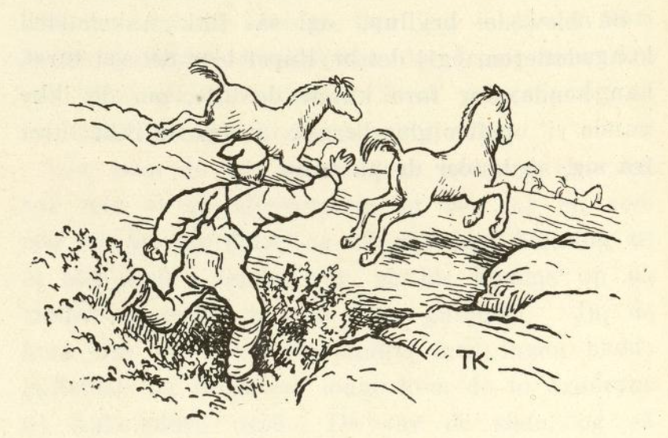
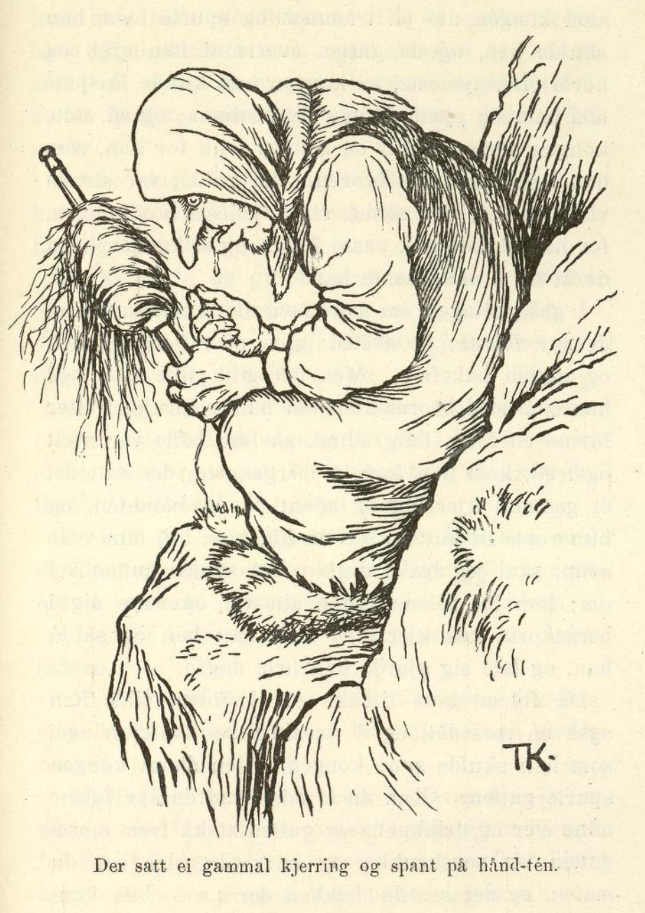

# De syv folene.

Det var engang et par fattige folk; de bodde i en ussel stue langt borti skogen, og det var ikke mer enn fra hånden og i munnen, og med nød og neppe det; men de hadde tre sønner, og den yngste av dem var da Askeladden, for han gjorde ikke annet enn å ligge og grave i oska.

En dag sa den eldste gutten at han ville ut og tjene; det fikk han straks lov til, og han vandret da ut i verden. Han gikk og han gikk hele dagen, og da det led mot kvelden, kom han til en kongsgård; der sto kongen ute på trappa og spurte hvor han skulle.

«Å, jeg går bare og spør etter tjeneste, jeg, far,» sa gutten.

«Vil du tjene hos meg og gjete de syv folene mine?» spurte kongen. «Hvis du kan gjete dem en hel dag og si meg om kvelden hva de eter og drikker, så skal du få prinsessen og halve riket; men kan du ikke, så skjærer jeg tre røde remmer av ryggen din.»

Ja, det syntes gutten var et lett arbeid; det skulle han nok klare, mente han.

Om morgenen, da det lysnet av dag, slapp stallmesteren de syv folene; de sprang av sted og gutten etter; og så kan det vel hende det gikk både over berg og daler, gjennom busker og kratt.

Da gutten hadde sprunget slik en god stund, begynte han å bli trett, og da han hadde holdt på enda et stykke, hadde han fått nok av hele gjetingen, og med det samme kom han til ei bergskorte; der satt ei gammel kjerring og spant på en håndtein.

Da hun fikk se gutten, som sprang etter folene så svetten silte av ham, ropte kjerringa: «Kom hit, kom hit, min vene sønn, så skal jeg lyske deg!» Det ville gutten gjerne; han satte seg i bergskorta hos kjerringa og la hodet sitt i fanget hennes, og så lysket hun ham hele dagen, mens han lå og latet seg.

Da det led mot kvelden, ville gutten gå; «jeg får like godt rusle rett hjem igjen,» sa han, «for til kongsgården nytter det ikke at jeg kommer.»

«Vent litt til det mørkner,» sa kjerringa, «så kommer folene til kongen forbi her igjen; så kan du springe hjem igjen med dem; det er ingen som vet at du har ligget her hele dagen i stedet for å gjete folene.»

Da de så kom, ga hun gutten ei vannkrukke og en mosedott; det skulle han vise kongen og si at det var det de syv folene åt og drakk.

«Har du nå gjett tro og vel hele dagen da?» sa kongen, da gutten kom fram for ham om kvelden.

«Ja, jeg har nok det,» sa gutten.

«Så kan du vel si meg hva det er de syv folene mine eter og drikker?» spurte kongen.

Ja, gutten viste fram vannkrukka og mosedotten han hadde fått av kjerringa; «der ser du maten, og der ser du drikken deres,» sa gutten.

Men så skjønte kongen nok hvordan han hadde gjett, og han ble så sint at han befalte at de skulle jage ham bort på øyeblikket, men først skulle de skjære tre røde remmer av ryggen på ham og strø salt i.

Da gutten kom hjem igjen, kan du nok vite hvordan han hadde det; én gang hadde han gått ut for å få tjeneste, sa han, men det gjorde han aldri mer.

Dagen etter sa den andre sønnen at han ville ut i verden og prøve lykken. Foreldrene sa nei og ba ham se på ryggen til broren sin, men gutten ga seg ikke, han sto på sitt, og langt om lenge fikk han da lov og la i vei. Da han hadde gått hele dagen, kom han også til kongsgården; der sto kongen ute på trammen og spurte hvor han skulle, og da gutten svarte at han gikk og spurte etter tjeneste, sa kongen at han kunne få tjene hos ham og gjete de syv folene hans; og så satte kongen samme straff og samme lønn for ham som han hadde satt for broren. Ja, gutten var straks villig til det; han tok tjeneste hos kongen, for han skulle nok passe folene og si kongen hva de åt og drakk, mente han.

I grålysningen om morgenen slapp stallmesteren de syv folene; de av sted igjen over berg og dal, og gutten etter. Men det gikk likedan med ham som med broren; da han hadde sprunget etter folene en lang, lang stund, så han var både svett og trett, kom han forbi ei bergskorte; der satt det ei gammel kjerring og spant på en håndtein, og hun ropte til gutten: «Kom hit, kom hit, min vene sønn, så skal jeg lyske deg!» Det likte gutten godt; han lot folene renne sin vei og satte seg i bergskorta hos kjerringa. Så satt han og så lå han, og late seg gjorde han hele dagen.

Da folene kom tilbake om kvelden, fikk han også en mosedott og ei vannkrukke av kjerringa, som han skulle vise kongen. Men da kongen spurte gutten: «Kan du si meg hva de syv folene mine eter og drikker?» og gutten stakk fram mosedotten og vannkrukka og sa: «Ja, der ser du maten, og der ser du drikken deres,» — ble kongen sint igjen og befalte at de skulle skjære tre røde remmer av ryggen på ham og strø salt i, og jage ham hjem på flekken. Da gutten kom hjem igjen, fortalte han også hvordan det hadde gått ham, og sa at én gang hadde han gått ut for å få tjeneste, men det gjorde han visst aldri mer.

Tredje dagen ville Askeladden i vei; han hadde nok lyst til å prøve å gjete de syv folene, han også, sa han.

De andre lo og gjorde narr av ham; «når det har gått slik med oss, så skal vel du klare det, — du ser ut til det, du, som aldri har gjort annet enn å ligge i oska og grave!» sa de.

«Ja, jeg vil nok i vei likevel, jeg,» sa Askeladden, «jeg har nå en gang fått det i hodet,» — og alt det de andre lo og alt det foreldrene ba, så hjalp det ikke; Askeladden la i vei, han.

Da han så hadde gått hele dagen, kom han også til kongsgården i mørkningen. Der sto kongen ute på trammen og spurte hvor han skulle.

«Jeg går nok og spør etter tjeneste,» sa Askeladden.

«Hvor er du fra da?» spurte kongen, for han ville ha litt bedre greie på det nå, før han tok noen i tjeneste.

Askeladden fortalte da hvor han var fra, og sa at han var bror til de to som hadde gjett de syv folene til kongen, og så spurte han om ikke han kunne få prøve å gjete dem neste dag.

«Å tvi!» sa kongen — han ble rent sint bare han kom til å tenke på dem — «er du bror til de to, så duger du vel ikke stort, du heller; slike har jeg hatt nok av!»

«Ja, men siden jeg nå er kommet hit, kunne jeg vel få lov å prøve meg, jeg også,» sa Askeladden.

«Å ja, vil du endelig ha ryggen din flådd, så gjerne for meg,» sa kongen.

«Jeg vil nok heller ha kongsdatteren, jeg,» sa Askeladden.

Om morgenen i grålysningen slapp stallmesteren de syv folene igjen, og de av sted over berg og dal, gjennom busker og kratt, og Askeladden etter.

Da han hadde sprunget slik en god stund, kom han også til bergskorta; der satt den gamle kjerringa igjen og spant på håndteinen sin og ropte til Askeladden: «Kom hit, kom hit, min vene sønn, så skal jeg lyske deg!» sa hun.

«Kyss meg bak, kyss meg bak!» sa Askeladden, hoppet og sprang og holdt i folerumpa.

Da han vel hadde kommet forbi bergskorta, sa den yngste folen: «Sett deg opp på ryggen min, du, for vi har lang vei igjen,» og det gjorde han.

Så reiste de et langt, langt stykke til. «Ser du noe nå?» sa folen.

«Nei,» sa Askeladden.

De reiste da et godt stykke igjen.

«Ser du noe nå?» spurte folen.

«Å nei,» sa gutten.

Da de hadde reist et langt, langt stykke, spurte folen igjen: «Ser du noe nå da?»

«Ja, nå synes jeg det hvitner i noe,» sa Askeladden; «det ser ut som en stor, diger bjørkestubbe.»

«Ja, der skal vi inn,» sa folen.

Da de så kom til stubben, tok den eldste folen og brøt den til side; så var det en dør der stubben hadde stått; innenfor var en liten stue, og i stua var det ikke stort annet enn en liten peis og et par krakker; men bak døra hang et stort, rustent sverd og en liten krukke.

«Kan du svinge sverdet?» spurte folen.

Askeladden prøvde, men han kunne ikke; så måtte han ta seg en slurk av krukka, først én gang, så en gang til, og enda en gang, og så kunne han håndtere det som ingenting.

«Ja, nå må du ta sverdet med deg,» sa folen; «med det skal du hogge hodet av oss alle syv på bryllupsdagen din, så blir vi til prinser igjen, som vi var før. For vi er brødre til prinsessen som du skal få, når du kan si kongen hva vi eter og drikker; men det er et fælt troll som har kastet denne hammen på oss. Når du så har hogget hodet av oss, må du passe godt på å legge hvert hode ved halen på den kroppen det satt på; så har trolldommen ikke mer makt over oss.»

Det lovet Askeladden, og så reiste de videre.

Da de hadde reist en lang, lang vei, spurte folen: «Ser du noe?»

«Nei,» sa Askeladden.

Så reiste de en god stund til. «Enn nå?» spurte folen. «Ser du noe nå?»

«Å nei,» sa Askeladden.

Så reiste de mange, mange mil igjen, både over berg og daler.

«Nå da?» sa folen, «ser du ikke noe ennå?»

«Jo,» sa Askeladden, «nå ser jeg liksom en stripe som blåner langt, langt borte.»

«Ja, det er en elv, det,» sa folen; «den skal vi over.»

Over elva gikk det en lang, gild bro, og da de hadde kommet over på den andre siden, reiste de igjen et langt, langt stykke; så spurte folen igjen om Askeladden ikke så noe.

Jo, den gangen så han at det svartnet i noe langt borte, som et kirketårn.

«Ja, der skal vi inn igjen,» sa folen.

Da folene kom inn på kirkegården, ble de til mennesker igjen og så ut som kongssønner, med så gilde klær at det lyste av dem; og så gikk de inn i kirken, og der fikk de brød og vin av presten, som sto ved alteret. Askeladden gikk også inn; men da presten hadde lagt hendene på prinsene og lyst velsignelsen, gikk de ut av kirken igjen, og det gjorde Askeladden også; men han tok med seg en vinflaske og et alterbrød. Og med det samme de syv kongssønnene kom ut på kirkegården, ble de til foler igjen; så satte Askeladden seg på ryggen av den yngste, og så gikk det tilbake igjen samme veien de var kommet, men enda mye, mye fortere. Først reiste de over broen, så forbi stubben, og så forbi kjerringa som satt i bergskorta og spant; og det gikk så fort at Askeladden ikke kunne høre det kjerringa skrek etter ham, men så mye hørte han at han skjønte hun var fælt sint.

Det var nesten mørkt da de kom tilbake til kongsgården om kvelden, og kongen selv sto på gårdsplassen og ventet på dem.

«Har du nå gjett tro og vel hele dagen?» sa kongen til Askeladden.

«Jeg har gjort mitt beste, jeg,» svarte Askeladden.

«Så kan du vel si meg hva de syv folene mine eter og drikker?» spurte kongen.

Askeladden tok fram alterbrødet og vinflasken og viste kongen. «Der ser du maten, og der ser du drikken deres,» sa han.

«Ja, du har gjett tro og vel,» sa kongen, «og du skal ha prinsessen og halve riket.»

Så ble det laget til bryllup, og det skulle være så gildt og gjevt at det både skulle høres og spørres, sa kongen. Men da de satt ved brudebordet, reiste brudgommen seg og gikk ned i stallen, for han hadde glemt noe der, og det måtte han hente, sa han. Da han kom ned dit, gjorde han som folene hadde sagt, og hogg hodet av dem alle syv, først av den eldste og så av alle de andre, etter hvor gamle de var, og så passet han på å legge hvert hode ved halen på den folen det hadde sittet på; og etter hvert som han gjorde det, ble de til prinser igjen. Da han kom inn til bryllupsbordet med de syv prinsene, ble kongen så glad at han både kysset og klappet Askeladden; og bruden hans ble enda gladere i ham enn hun hadde vært før.

«Halve riket har du fått nå,» sa kongen, «og den andre halvdelen skal du få etter min død; for sønnene mine kan skaffe seg land og rike selv, nå de er blitt prinser igjen.» Så kan det vel hende det ble glede og moro i det bryllupet.

Jeg var også med; men det var ingen som hadde tid til å tenke på meg; jeg fikk ikke annet enn ei kakeskive med smør på, den la jeg på ovnen, og kaka brant, og smøret rant, og ikke fikk jeg igjen det grann.
