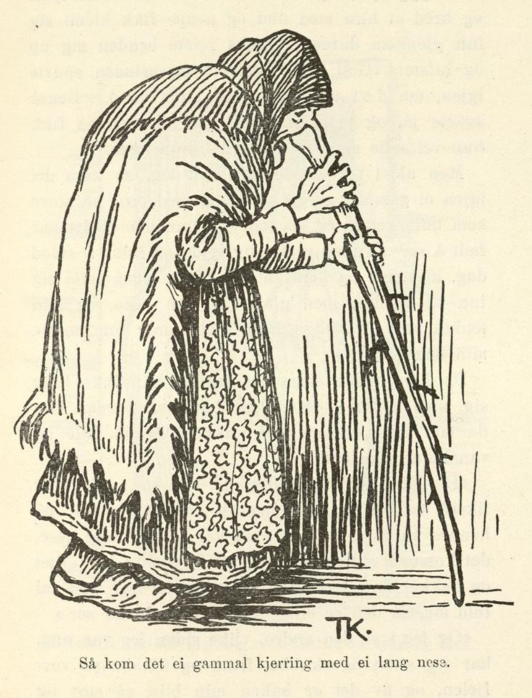
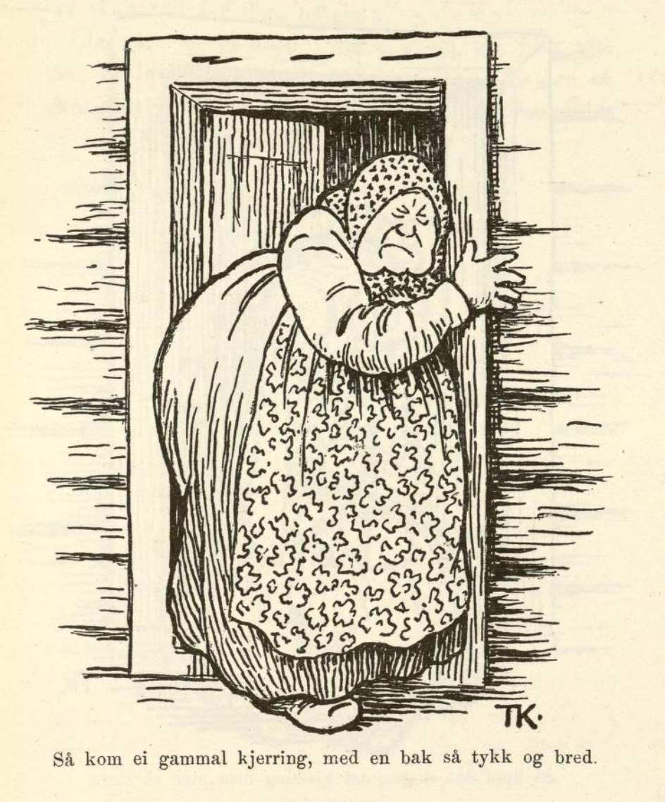
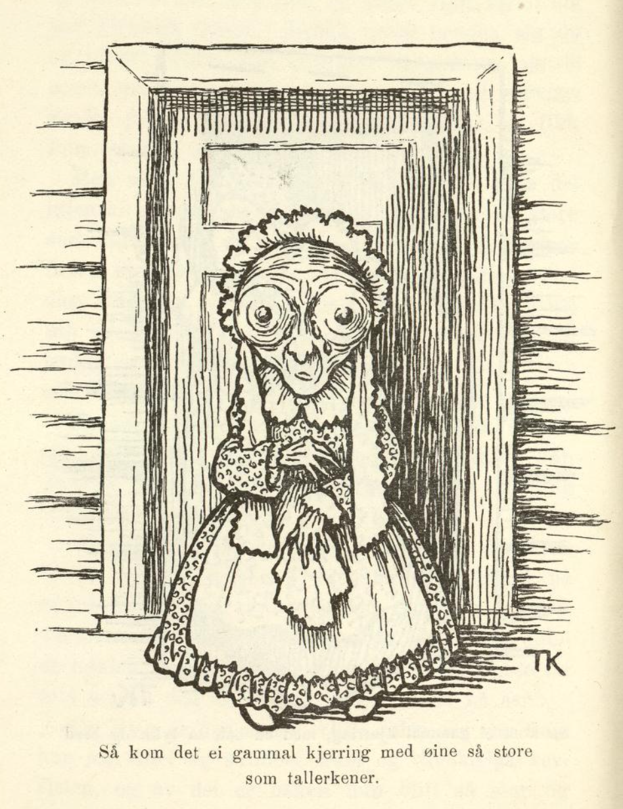

# De tre mostrene.

Det var en gang en fattig mann, som bodde i ei stue langt borti skogen og levde av skytteri. Han hadde en eneste datter, og hun var både vakker og ven. Da moren var død tidlig, og jenta alt var halvvoksen, sa hun at hun ville ut og tjene, så hun kunne lære å tjene sitt brød, hun også. «Ja, datter mi,» sa faren, «riktignok har du ikke lært annet hos meg enn å ribbe fugl og steke, men du får vel prøve å tjene ditt brød likevel.»

Så gikk jenta ut for å be om arbeid, og da hun hadde gått en stund, kom hun til kongsgården. Der fikk hun bli, og dronningen likte henne så godt at de andre ternene ble rent misunnelige på henne. De fant på å si til dronningen at jenta hadde sagt seg god for å spinne et pund lin i løpet av fire og tjue timer; for dronningen var så glad i alle slags håndarbeid.

«Ja, har du sagt det, skal du gjøre det,» sa dronningen; «men litt lengre tid kan du vel få.» Jenta, stakkar, torde ikke si at hun aldri hadde spunnet, men ba bare om et kammer for seg selv; det fikk hun, og dit opp ble både rokk og lin båret. Der satt hun og gråt og var ulykkelig og visste ikke sin arme råd; hun stelte med rokken og snudde og vendte på den, og visste ikke hvordan hun skulle bære seg at — hun hadde aldri før sett en hjulrokk engang.

Men som hun satt slik, kom det inn til henne en gammel kone.

«Hva feiler deg, barnet mitt?» sa hun.

«Å,» svarte jenta, «det kan vel ikke nytte jeg sier deg det; du kan så ikke hjelpe meg likevel!»

«Det kan ingen vite,» sa konen. «Kanskje jeg vet råd for det likevel, jeg.»

Ja, jeg kan jo gjerne si henne det, tenkte jenta, og så fortalte hun at de andre tjenestejentene hadde satt ut et rykte om at hun hadde sagt seg god for å spinne et pund lin på fire og tjue timer; «og jeg, stakkars meg,» sa hun, «jeg har aldri i mine dager sett en hjulrokk engang, og så skulle jeg spinne så mye på et døgn!»

«Ja, det er det samme det, barn,» sa konen; «vil du kalle meg moster på din hedersdag, skal jeg spinne for deg; så kan du gå bort og legge deg til å sove.»

Ja, det ville jenta gjerne, og gikk bort og la seg.

Om morgenen da hun våknet, lå alt linet spunnet på bordet, og det så pent og fint at aldri noen hadde sett så jevnt og vakkert garn. Dronningen ble så glad over det vakre garnet hun hadde fått, og ble enda gladere i jenta enn før. Men for dette ble de andre enda mer misunnelige på henne, og så fant de på å si til dronningen at nå hadde hun sagt seg god for å veve det garnet hun hadde spunnet, på fire og tjue timer. Dronningen sa igjen at hadde hun sagt det, så skulle hun gjøre det; men om det ikke ble akkurat på fire og tjue timer, så kunne hun vel få litt lengre tid. Jenta torde ikke si nei da heller, men ba om et kammer for seg selv, så fikk hun vel prøve.

Der satt hun igjen og gråt og bar seg ille, og visste ikke hva hun skulle ta seg til; så kom det inn en gammel kone igjen og spurte: «Hva feiler deg, barnet mitt?»

Jenta ville først ikke ut med det, men til slutt fortalte hun hvorfor hun var så lei seg.

«Ja,» svarte konen, «det er det samme, vil du kalle meg moster på din hedersdag, skal jeg veve for deg; så kan du gå bort og legge deg til å sove.»

Det lot jenta seg ikke si to ganger, og så gikk hun og la seg.

Da hun våknet, lå bunken på bordet, vevet så nett og så tett som noe kunne veves. Hun tok bunken med seg ned til dronningen, og hun ble svært glad over den vakre veven hun hadde fått, og ble enda gladere i jenta enn før. Men så ble de andre enda mer misunnelige på henne, og tenkte ikke på annet enn hva de skulle finne på.

Til sist fortalte de dronningen at nå hadde hun sagt seg god for å sy hele vevbunken om til skjorter på fire og tjue timer. Ja, det gikk likedan som før: Jenta torde ikke si at hun ikke kunne sy; hun kom opp på et kammer for seg selv igjen, og satt der og gråt og var ute av seg. Men så kom det igjen en gammel kone til henne, som lovet å sy for henne, hvis hun bare ville kalle henne moster på sin hedersdag; det lovet jenta mer enn gjerne, og så gjorde hun som konen sa, og gikk bort og la seg til å sove. Om morgenen da hun våknet, fant hun bunken sydd om til skjorter liggende på bordet. Så vakker søm hadde aldri noen sett, og skjortene var merket med navn og helt ferdige.

Da dronningen fikk se det arbeidet, ble hun så glad for sømmen at hun slo hendene sammen; «for så vakker søm har jeg verken hatt eller sett,» sa hun, og siden var hun like glad i jenta som i sitt eget barn.

«Hvis du vil ha prinsen, så kan du få ham,» sa hun til jenta, «for du trenger aldri sette bort noe arbeid; du kan sy og spinne og veve alt sammen selv.» Da jenta var så vakker og prinsen likte henne godt, ble det bryllup straks. Men akkurat som prinsen hadde satt seg til brudebordet med henne, kom det inn ei gammal stygg kjerring, med ei lang nese — den var visst tre alen lang.

Så sto bruden opp og neide og sa: «God dag, moster!»

«Er det moster til min brud?» sa prinsen.

Ja, hun var da det.

«Ja, så får hun vel sette seg inn til bordet da,» sa prinsen; men både han og de andre syntes hun var fæl å sitte til bords med.

Men rett som det var, så kom det igjen ei gammal stygg kjerring inn; hun hadde en bak så tykk og bred at hun med nød og neppe fikk klemt seg inn gjennom døren. Straks reiste bruden seg opp og hilste: «God dag, moster!» og prinsen spurte igjen, om det var moster til hans brud. Begge svarte ja, og prinsen sa at når det var slik, så fikk hun vel sette seg inn til bordet, hun også.

Men aldri før hadde hun satt seg, så kom det igjen ei gammal stygg kjerring, med øyne så store som tallerkener, og så røde og rinnende at det var fælt å se. Bruden reiste seg igjen og hilste: «God dag, moster!» og prinsen ba henne også sette seg inn til bordet; men glad var han ikke, og han tenkte med seg selv: «Gud hjelpe meg for noen mostre bruden min har!»

Da han hadde sittet litt, kunne han ikke la være, men spurte: «Men hvordan i all verden kan da min brud, som er så vakker, ha så fæle og vanskapte mostrer?»

«Det skal jeg nok si deg,» sa den ene. «Jeg var likeså vakker jeg som bruden din, da jeg var på hennes alder; men det at jeg har fått så lang nese, det kommer av at jeg støtt og stadig har sittet og hakket og nikket med spinning, så har nesa mi strukket seg, så den er blitt så lang som du nå ser.»

«Og jeg,» sa den andre, «like siden jeg var ung, har jeg sittet og skubbet fram og tilbake på vevfjelen, og av det er baken min blitt så stor og hoven som du ser.»

Så sa den tredje: «Like fra jeg var ganske liten, har jeg sittet og stirret og sydd natt og dag; av det er øynene mine blitt så fæle og røde, og nå er det ikke råd for dem lenger.»

«Ja så,» sa prinsen, «det var godt jeg fikk vite det; for kan folk bli så fæle og stygge av det, så skal bruden min aldri verken spinne eller veve eller sy i sine dager mer!»
