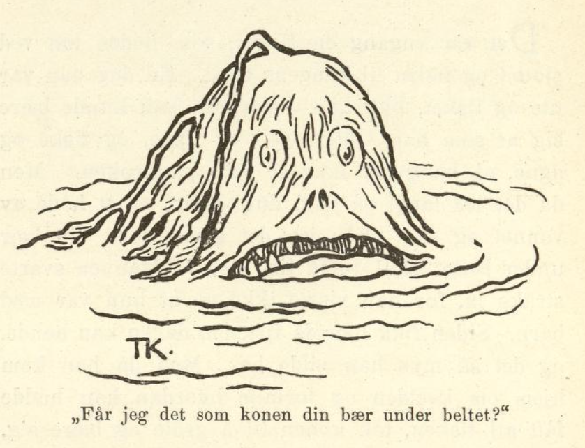
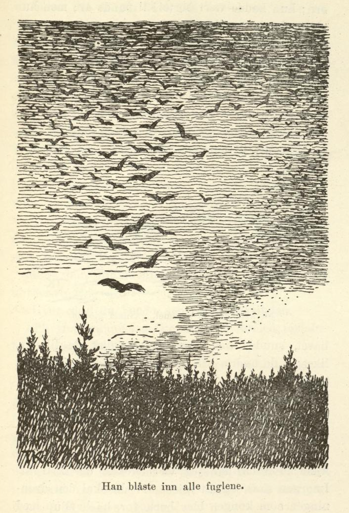
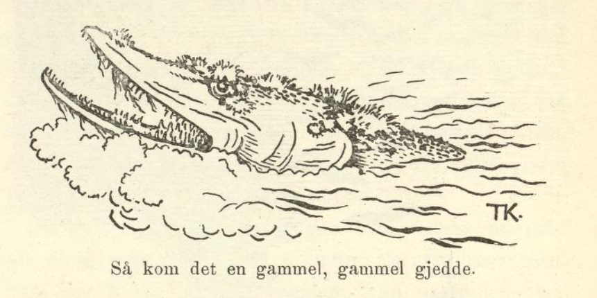

# De tre prinsesser i Hvittenland

Det var engang en fisker, som bodde tett ved slottet og fisket til kongens bord. En dag han var ute og fisket, fikk han ingenting; han kunne bære seg at som han ville, agne og fiske, og fiske og agne, så hang det ikke et bein på kroken. Men da det led langt på dag, dukket det opp et hode av vannet og sa: «Får jeg det som konen din bærer under beltet, skal du få fisk nok.» Mannen svarte straks ja, for han visste ikke av at hun var med barn. Siden fikk han da fisk om dagen kan hende, og det så mye han ville ha. Men da han kom hjem om kvelden og fortalte hvordan han hadde fått all fisken, tok konen til å gråte og bære seg, og ba Gud hjelpe seg for det løftet mannen hadde gjort; for hun bar et barn under beltet, sa hun.

Det spurtes snart oppe på slottet, at konen var så sorggiven, og da kongen fikk høre det, lovte han å ta barnet til seg og se til å frelse det. Det led med det skred, og da tiden var omme, fikk konen et guttebarn; det tok da kongen til seg og oppdro det som sin egen sønn, like til gutten var voksen. Da ba gutten en dag om lov til å følge faren ut og fiske; han hadde så inderlig lyst til det, sa han. Kongen ville nødig tillate det, men til slutt fikk gutten lov; han ble med faren, og det gikk godt og vel nok hele dagen, like til de kom til lands om kvelden. Da hadde sønnen glemt etter seg lommetørklæet sitt, det ville han springe ut i båten etter. Men med det samme han kom uti, tok båten til å gå med ham, så det fosset, og alt gutten holdt imot med årene, så hjalp det ikke; det gikk og det gikk hele natten, og endelig kom han langt, langt bort til en hvit strand. Der gikk han i land, og da han hadde gått et stykke, møtte han en gammel mann med hvitt, sidt skjegg.

«Hva heter det her?» sa gutten.

«Hvittenland,» svarte mannen. Og så ba han gutten si ham hvor han var fra og hva han ville, og det fortalte gutten ham.

«Ja,» sa mannen, «når du nå går frem langs med stranden her, så kommer du til tre kongsdøtrer, som står i jorden, så de bare har hodet oppe. Så roper den første — det er den eldste — og ber deg så vakkert komme og hjelpe henne, og det gjør den andre også; men ingen av dem skal du gå bort til; skynd deg bare fra dem, som du aldri hørte eller så dem. Men den tredje skal du gå bort til og gjøre det hun ber deg om; det blir din lykke det.»

Da gutten kom til den første av prinsessene, ropte hun til ham og ba ham så inderlig vakkert at han skulle komme til henne; men han gikk som han aldri så henne; like ens gikk han forbi den andre; men den tredje gikk han bort til.

«Vil du gjøre det jeg sier deg, skal du få hvem av oss tre du vil,» sa prinsessen.

Ja, det ville han gjerne; og så fortalte hun, at tre troll hadde satt dem alle tre ned i jorden der; men før hadde de bodd på det slottet han kunne se borte i skogen. «Nå skal du gå inn i slottet og la trollene piske deg en natt for hver av oss,» sa hun; «orker du tåle det, så frelser du oss.»

Ja, svarte gutten, det skulle han nok prøve.

«Når du går inn,» sa prinsessen igjen, «står det to løver i porten, men bare du går midt imellom dem, så gjør de deg ikke noe. Gå så bent frem, inn på et mørkt lite rom; der skal du legge deg. Så kommer trollet og slår deg; men så skal du ta flasken som henger på veggen, og smøre deg der han har slått deg, så er du like god igjen. Grip så sverdet som henger ved siden av flasken, og hogg ihjel trollet.»

Ja, han gjorde som prinsessen sa, han gikk midt imellom løvene, som han ikke så dem, og like inn i det vesle kammerset, og der la han seg.

Første natten kom det et troll med tre hoder og tre ris og pisket gutten syndig; men han holdt ut til trollet var ferdig, så tok han flasken og smurte seg, og så grep han sverdet og hogg ihjel trollet.

Da han så kom ut om morgenen, sto prinsessene over jorden til beltet. Den andre natten gikk det like ens; men det trollet som da kom, hadde seks hoder og seks ris, og det pisket ham enda verre enn det forrige; men da han kom ut om morgenen, sto prinsessene over jorden til smalleggen. Tredje natten kom det et troll som hadde ni hoder og ni ris, og slo og pisket gutten så lenge at han dånet til sist; så tok trollet ham og kastet ham mot veggen, men ved det falt krukken ned, så det skvatt utover ham, og så ble han like god igjen. Da var han ikke sein, han grep sverdet og hogg ihjel trollet, og da han den morgenen kom ut av slottet, sto prinsessene helt ovenpå jorden. Så tok han den yngste av dem til dronning og levde godt og vel med henne i lang tid.

Men endelig fikk han lyst til å reise hjem litt og se til foreldrene sine. Det var dronningen ikke mye for; men da han lengtet så hardt og endelig måtte og skulle av sted, sa hun til ham: «Ett skal du love meg, at du gjør det som far din ber deg, men ikke det som din mor ber deg,» og det lovte han. Så ga hun ham en ring, som var slik at den som hadde den på, kunne ønske to ting, hva han ville. Han ønsket seg da hjem, og foreldrene kunne ikke bli ferdig med å undre seg nok over så staselig og gild han var.

Da han hadde vært hjemme noen dager, ville moren at han skulle gå opp til slottet, så kongen kunne få se for en mann han nå var blitt. Faren sa: «Nei, det bør han ikke gjøre, for så kan vi ikke ha noen glede av ham den stunden.» Men det hjalp ikke, moren tagg og ba ham så lenge til han gikk.

Da han kom opp dit, var han gildere både i klær og all ting enn fosterfar sin. Dette likte nå ikke han mer enn måtelig, og så sa han: «Ja, men nå kan du se hvordan min dronning er; jeg kan ikke få se din jeg. Jeg tror ikke du har så vakker dronning.»

«Gid hun bare sto her, skulle du få se det!» sa den unge kongen, og straks så sto hun der. Men hun var så sorgfull og sa til ham: «Hvorfor gjorde du ikke som jeg ba deg om, og hørte etter hva din far sa deg? Nå må jeg straks hjem igjen jeg, og du har brukt begge ønskene dine.» Dermed knyttet hun en ring i håret hans, som navnet hennes sto på, og ønsket seg så hjem igjen.

Da ble den unge kongen rent sorggiven, og gikk dag ut og dag inn og tenkte bare på hvordan han skulle komme tilbake til dronningen sin. Jeg får se, om jeg ikke noensteds kan få spurt hvor Hvittenland er, tenkte han, og dro så ut i verden.

Da han hadde gått en stund, kom han til et berg; der møtte han én som var herre over alle dyrene i skogen — for de kom, når han blåste i et horn han hadde — og så spurte kongen etter Hvittenland.

«Ja, jeg vet det ikke,» svarte mannen; «men jeg skal spørre dyrene mine.» Så blåste han dem inn, og spurte om noen av dem visste hvor Hvittenland lå; men det var ingen som visste det.

Så ga mannen ham et par ski. «Når du står på disse,» sa han, «så kommer du til bror min, som bor hundre mil herifra; han er herre over alle fuglene i luften; spør han! Når du er kommet frem, så snur du bare skiene, slik at odden vender hit, så går de hjem av seg sjøl.»

Da kongen kom dit, snudde han skiene, slik som herren over dyrene hadde sagt, og så gikk de tilbake.

Han spurte igjen etter Hvittenland, og mannen blåste inn alle fuglene, og spurte om noen av dem visste hvor Hvittenland lå. Nei, ingen visste det. Lenge etter de andre kom også en gammel ørn; hun hadde vært borte i ti runde år; men hun visste det heller ikke.

«Ja ja,» sa mannen, «så skal du få lånt et par ski av meg; når du står på dem, så kommer du til bror min, som bor hundre mil herifra; han er herre over alle fiskene i havet; du får spørre han. Men glem ikke å snu skiene!»

Kongen takket og steg på skiene; og da han var kommet til han som var herre over fiskene i havet, snudde han dem, og så gikk de tilbake, akkurat som de andre. Så spurte han etter Hvittenland igjen.

Mannen blåste da inn fiskene; men ingen visste noe. Endelig kom en gammel, gammel gjedde, som han hadde et svare bry med å få blåst inn. Da han spurte henne, sa hun: «Jo, der er jeg vel kjent; for nå har jeg vært kokke der i ti år. I morgen skal jeg dit igjen; for da skal den dronningen som kongen ble borte for, ha bryllup med en annen.»

«Siden det er så, skal jeg si deg et råd,» sa mannen. «Her borte på en myr står tre brødre, som har stått der i hundre år, og slåss om en hatt, en kappe, og et par støvler; når en har de tre tingene, kan han gjøre seg usynlig og ønske seg så langt han vil. Du kan si til dem, at du vil prøve tingene og siden avsi dom mellom dem.»

Ja, kongen takket for seg, gikk og gjorde så.

«Hva er det dere står her og slåss evig og evindelig om?» sa han til brødrene; «la meg prøve tingene, så skal jeg dømme mellom dere.» Det ville de gjerne; men da han hadde fått hatten og kappen og støvlene, sa han: «Når vi møtes neste gang, skal dere få høre dommen,» og dermed ønsket han seg av sted.

Mens han for i luften, kom han i følge med nordenvinden.

«Hvor skal du hen?» spurte nordenvinden.

«Til Hvittenland,» sa kongen, og dermed fortalte han det som hadde hendt ham.

«Ja,» sa nordenvinden, «du farer vel litt fortere du; jeg skal nå inn i hver krok og gufse og blåse jeg. Men når du kommer frem, så still deg på trappen, ved siden av døren, så skal jeg komme susende, som om jeg ville blåse ned hele slottet. Når da prinsen som skal ha dronningen din, kommer ut og skal se hva som er på ferde, så tar du ham i nakken og kaster ham ut; siden skal nok jeg prøve å få ham av gårde.»

Ja, som nordenvinden hadde sagt, så gjorde kongen; han stilte seg på trappen, og da nordenvinden kom susende og brusende og tok tak i veggen på slottet, så det ristet, gikk prinsen ut og skulle se hva som var på ferde; men med det samme han kom, tok kongen ham i nakken og kastet ham ut, og så tok nordenvinden ham og reiste av med ham. Da han var blitt kvitt ham, gikk kongen inn i slottet. Først kjente ikke dronningen ham, for han var blitt så mager og bleik, ved det han hadde vandret så lenge og vært så sorgfull; men da han viste henne ringen, ble hun hjertens glad, og så ble det rette bryllupet holdt, så det spurtes både vidt og bredt.
