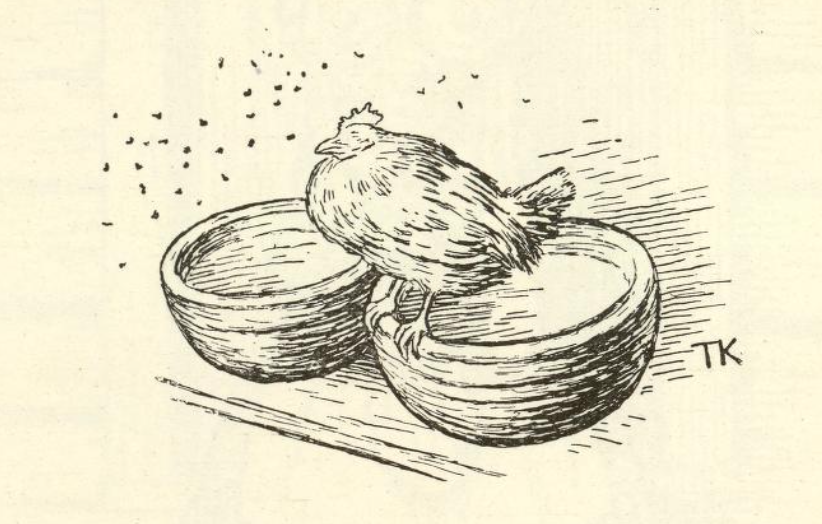
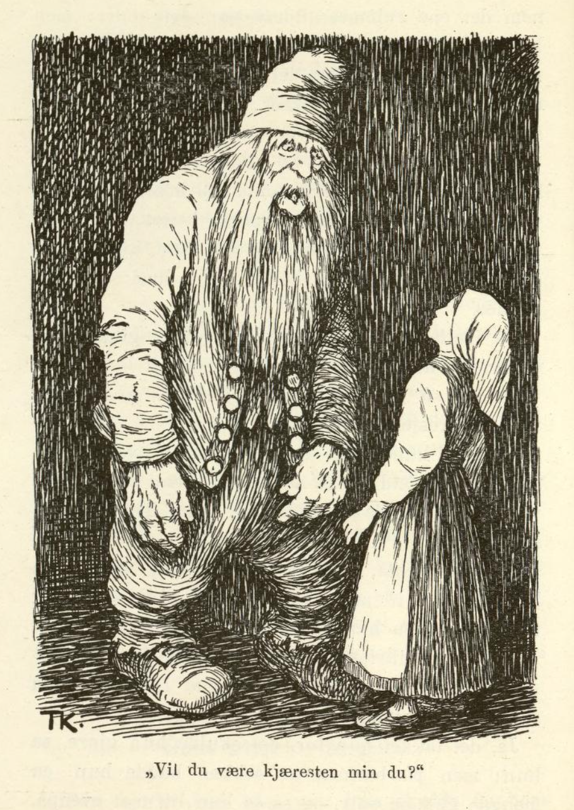
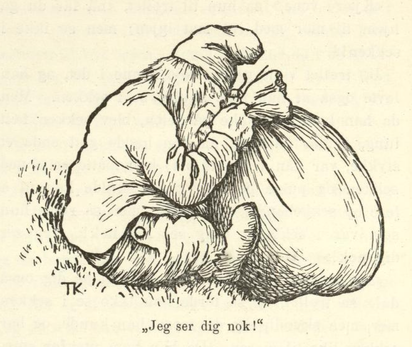

# Høna tripper i berget.

Det var engang en gammel enke som bodde i en avkrok av bygda, langt oppunder en ås, med de tre døtrene sine. Hun var så fattig at hun ikke eide annet enn ei høne, og den hadde hun så kjær som øyestenen sin; den kaklet hun for, og den stelte hun med, både tidlig og sent.

Men en dag, rett som det var, så ble høna borte. Konen gikk da ut, rundt om stua, og lette og lokket; men høna var og ble borte. «Du får ut og prøve å se etter høna vår du,» sa konen til den eldste datteren; «ha den igjen må vi, om vi så skal ta den ut av berget.»

Ja, datteren skulle da ut og se etter den; hun gikk både hit og dit og lette og lokket, og ingen høne fant hun. Men aller best det var, så hørte hun det sa borte i en bergvegg:

«Høna tripper i berget!
Høna tripper i berget!»

Hun skulle da bort og se hva det var, men ved bergveggen falt hun gjennom en lem, dypt, dypt ned i en hvelving under jorden. Der nede gikk hun frem gjennom mange rom, det ene gildere enn det andre, men i det innerste kom en stor stygg bergmann til henne.

«Vil du være kjæresten min?» spurte han.

Nei, sa hun, det ville hun slett ikke, hun ville opp igjen og se etter høna si, som var blitt borte.

Så ble bergmannen så sint at han tok henne og vrei hodet av henne, og kastet kropp og hode ned i kjelleren.

Moren satt hjemme og ventet og ventet, men ingen datter kom igjen. Hun ventet enda en god stund, men da hun verken hørte eller så noe til henne, sa hun til den mellomste datteren, at hun fikk gå ut og se etter søster si; «og høna kan du lokke på med det samme,» sa hun.

Den andre søsteren skulle da ut, og henne gikk det nettopp likedan; hun gikk og lette og lokket, og med ett så hørte hun også det sa borti bergveggen:

«Høna tripper i berget!
Høna tripper i berget!»

Dette syntes hun var underlig; hun skulle da bort og se hva det var, og så falt hun også gjennom lemmen, dypt, dypt ned i hvelvingen. Der gikk hun gjennom alle rommene, men i det innerste kom bergmannen til henne, og spurte om hun ville være kjæresten hans. Nei, det ville hun slett ikke, hun ville straks opp igjen og lete etter høna som var blitt borte, hun. Men så ble bergmannen sint; han tok henne og vrei hodet av henne og kastet hode og kropp ned i kjelleren.

Da konen hadde sittet og ventet på den andre datteren også i sju lange og sju breie, og ingen datter var å høre eller se, så sa hun til den yngste:

«Nå får du i veien og se etter søstrene dine. Ille var det at høna ble borte, men enda verre ble det, skulle vi ikke finne igjen søstrene dine; men høna kan du alltid lokke på med det samme.»

Ja, den yngste skulle da ut; hun gikk hit og dit og lette og lokket, men ikke så hun høna, og ikke så hun søstrene sine. Langt om lenge kom hun også bort imot bergveggen, og så hørte hun det sa:

«Høna tripper i berget!
Høna tripper i berget!»

Dette syntes hun var rart; hun skulle da bort og se, og så falt hun også gjennom lemmen, dypt, dypt ned i hvelvingen. Der nede gikk hun gjennom det ene rommet gildere enn det andre; men hun var ikke så redd hun; hun ga seg god tid og så både på det ene og det andre, og så fikk hun øye på kjellerlemmen også; hun så nedi der, og straks kjente hun søstrene sine, som lå der.

Med det samme hun vel hadde fått lukket igjen kjellerlemmen, kom bergmannen til henne. «Vil du være kjæresten min du?» spurte bergmannen.

«Ja, gjerne det,» sa jenta, for hun kunne nok skjønne hvordan det hadde gått med søstrene hennes.

Da trollet hørte det, fikk hun gilde, gilde klær, de fineste hun kunne ønske seg, og alt hun ellers ville ha, så glad ble han for det at noen ville være kjæresten hans.

Men da hun hadde vært der en tid, var det en dag hun var enda mer stur og still enn hun pleide å være. Så spurte bergmannen, hva det var hun sturet for.

«Å,» sa jenta, «det er fordi jeg ikke kan komme hjem til mor; hun er visst både sulten og tørst, og ingen har hun hos seg heller.»

«Ja, gå til henne kan du ikke få lov til,» svarte trollet, «men stapp noe mat i en sekk, så skal jeg bære den til henne.»

Ja, det takket hun for, det skulle hun gjøre, sa hun; men på bunnen av sekken hadde hun en mengde gull og sølv, og så la hun litt mat ovenpå, og sa så til trollet, at nå var sekken klar, men han måtte slett ikke se ned i den, og det lovet han også at han ikke skulle gjøre.

Da så bergmannen gikk, kikket hun ut etter ham i et lite hull som var på lemmen; da han hadde kommet et stykke på veien, sa han: «Den er så tung denne sekken, jeg vil nok se hva som er i den, jeg,» og ville løse opp sekkebåndet; men så ropte jenta: «Jeg ser deg nok! Jeg ser deg nok!»

«Det er da pokker til øyne i hodet på deg også da,» sa trollet, og så turte han ikke prøve på det mer.

Da han var kommet dit enken bodde, kastet han sekken inn gjennom stuedøren. «Der har du mat fra datter di; det leter ikke på henne,» sa han.

Da jenta hadde vært i berget enda en god stund, falt det en dag en gjeitebukk ned gjennom lemmen.

«Hvem er det som har sendt bud etter deg, ditt langraggete best?» sa trollet, han var fælt vill, og så tok han bukken og vrei hodet av den og kastet den ned i kjelleren.

«Å nei, hvorfor gjorde du det da?» sa jenta; «den kunne jeg hatt og moret meg med her nede.»

«Du trenger ikke sette opp noen surmule for det, vet jeg,» sa trollet, «jeg kan snart få liv i gjeitebukken igjen jeg.» Dermed tok han en krukke som hang på veggen, satte hodet på gjeitebukken og smurte den av krukken, så var den like god igjen.

Hå hå! tenkte jenta, den krukka er nok noe verdt den.

Da hun hadde vært hos trollet en god stund til, passet hun på en dag trollet var borte, tok den eldste av søstrene og satte hodet på henne og smurte henne av krukken, slik som hun hadde sett trollet gjorde med gjeitebukken; og straks kom søsteren til live igjen. Jenta la henne da i en sekk, og hadde litt mat ovenpå, og så snart trollet kom hjem igjen, sa hun til ham: «Kjære vene, nå får du hjem til mor med litt mat igjen, hun er visst både tørst og sulten, stakkar, og alene er hun også. Men se ikke i sekken!»

Ja, sekken skulle han nok gå med, sa han, og se i den skulle han heller ikke; men da han kom et stykke på veien, syntes han sekken ble så tung, og da han hadde gått enda en stund, sa han at han nok ville se hva som var i sekken; «hva slags øyne det er skapt på henne, så kan hun da ikke se meg nå,» sa han ved seg sjøl. Men med det samme han ville løse opp, sa hun som satt i sekken: «Jeg ser deg nok! Jeg ser deg nok!»

«Det var da pokker til øyne i hodet på deg også da!» sa trollet — han trodde det var hun i berget som snakket. Han turte da ikke prøve å se nedi mer, men bar sekken til moren det forteste han kunne, og da han kom til stuedøren, kastet han den inn. «Der har du mat fra datter di; det leter ikke på henne,» sa han.

Da jenta hadde vært i berget enda en god stund, gjorde hun det samme med den andre søsteren; hun satte hodet på henne, smurte henne av krukken, og hadde henne i sekken; men den gangen fylte hun så mye gull og sølv oppå, som det var rom til, og aller øverst la hun litt mat.

«Kjære vene,» sa hun til trollet, «nå får du gå hjem til mor med litt mat igjen; men se ikke i sekken!»

Ja, trollet ville gjerne føye henne i det, og han lovet også at han ikke skulle se i sekken. Men da han kom et stykke på veien, ble sekken fælt tung, syntes han; og da han hadde gått enda et stykke, var han rent utkjørt; han måtte sette ned sekken og puste på litt, og så skulle han til å løse opp sekkebåndet og se nedi; men så ropte hun som var i sekken: «Jeg ser deg nok! Jeg ser deg nok!»

«Det var da pokker til øyne i hodet på deg også da!» sa trollet, og så turte han ikke se i sekken mer, men skyndte seg alt han kunne, og bar sekken like til moren. Da han kom utenfor stuedøren, kastet han den inn; «der har du mat fra datter di; det leter ikke på henne,» sa han.

Da så jenta hadde vært der enda en god tid, skulle trollet ut en gang; så lot jenta som hun var ussel og syk, og sutret og bar seg.

«Det kan ikke nytte du kommer hjem før klokken tolv,» sa hun, «for før kan jeg ikke få maten ferdig; jeg er så ussel og så klein.»

Da trollet vel hadde gått, stoppet hun ut klærne sine med halm og satte denne halmjenta borti kroken ved peisen, med en tvare i hånden, så det så ut som det var hun sjøl som sto der. Så skyndte hun seg hjem og fikk med seg en skytter til å være i stua hjemme hos moren.

Da klokken var tolv eller vel det, kom trollet hjem.

«Kom med maten!» sa han til halmjenta.

Nei, hun svarte ikke.

«Kom med maten! sier jeg,» sa trollet igjen; «jeg er sulten!»

Nei, hun svarte ikke.

«Kom med maten!» skrek trollet tredje gangen, «hør det jeg sier, ellers skal jeg vekke deg jeg!»

Nei, jenta sto like stille.

Så ble han så vill at han sparket til henne, så halmstubbene fór både i vegger og tak. Men da han så det, merket han uråd og ga seg til å lete både høyt og lavt, og til sist kom han ned i kjelleren også; der var begge søstrene til jenta borte, og så skjønte han straks hvordan det hadde gått til. Ja, det skulle hun få unngjelde! sa han, og la i veien dit moren bodde. Men da han kom til stua, skjøt skytteren; så turte ikke trollet gå inn, han trodde det var tordenen. Han satte hjem igjen det forteste han orket, men med det samme han kom til lemmen, rant sola, og så sprakk han.

Det er visst gull og sølv nok enda. Den som bare visste hvor lemmen var!
