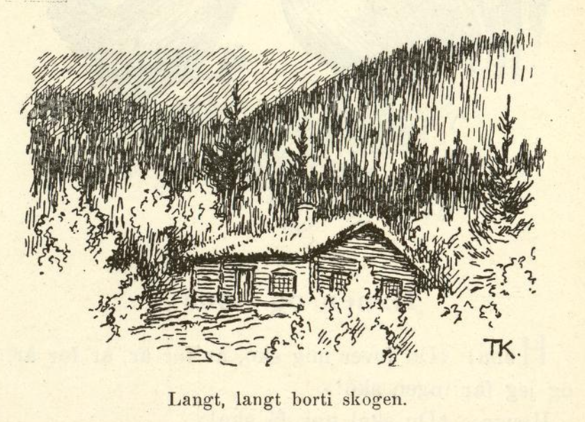
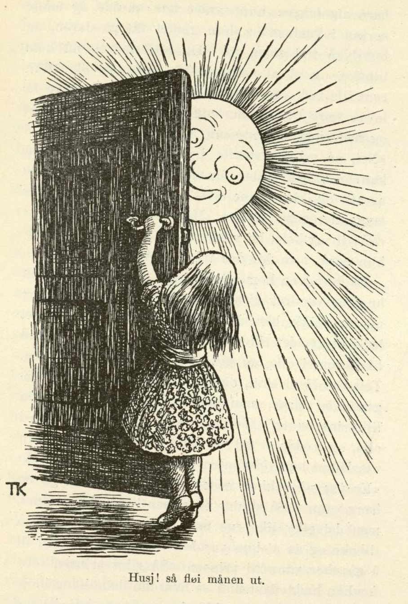

# Jomfru Maria som gudmor.

Langt, langt borti en stor skog bodde engang et par fattigfolk. Konen kom i barselseng og fødte et barn, en vakker datter. Men de var så fattige, at de visste ikke hvordan de skulle få barnet til dåpen. Mannen måtte da en dag ut for å se å få faddere som selv kunne ofre; han gikk hele dagen både til den ene og til den andre; men alle sa de, at de nok ville være fadder, men ingen syntes han hadde råd til å ofre selv.

Da han gikk hjem om kvelden, møtte han en vakker frue, som var så prektig kledd, og så så inderlig snill og god ut; hun bød seg til å skaffe barnet til dåpen; men siden ville hun ha det. Mannen svarte at han først måtte spørre konen sin, hva hun ville; men da han kom hjem og fortalte det, sa konen tvert nei. Andre dagen gikk mannen ut igjen; men ingen ville være fadder, når de skulle ofre selv, og alt han ba, så hjalp det ikke.

Da han gikk hjem igjen mot kvelden, møtte han på nytt den vakre fruen, som så så blid ut, og hun gjorde det samme tilbudet igjen. Han fortalte konen det som hadde hendt ham, og hun sa da, at hvis han ikke neste dag kunne få faddere til barnet, så fikk de vel la fruen få det, siden hun så så god og snill ut. Den tredje dagen mannen gikk ut, fikk han heller ingen faddere, og da han møtte fruen igjen om kvelden, lovet han å la henne få barnet, hvis hun ville skaffe det dåp og kristendom.

Om morgenen kom hun så dit mannen bodde, sammen med to mannfolk, tok barnet og reiste til kirken med det, og der ble det døpt. Så tok hun det hjem med seg, og der levde den vesle jenta hos henne i flere år, og fostermoren var alltid snill og god mot henne.

Da jenta var blitt så stor at hun lærte å skjønne, laget fostermoren seg til å reise bort. «Du kan få lov å gå hvor du vil,» sa hun til jenta, «bare ikke i de tre kammersene jeg nå viser deg.» Og så reiste hun. Men jentungen kunne likevel ikke la være å gløtte litt på den ene kammersdøren, og husj! så fløy det ut en stjerne. Da fostermoren kom tilbake, ble hun sint og truet fosterdatteren med å jage henne bort; men barnet gråt og ba for seg, og så fikk hun til slutt lov å bli.

Om en tid skulle fostermoren reise bort igjen, og så forbød hun jenta å gå inn i de to kammersene hun ikke hadde vært i. Hun lovet å ta seg i vare; men da hun hadde gått alene en stund og tenkt og grundet på hva som vel kunne være inne i det andre kammerset, kunne hun ikke holde seg fra å gløtte litt på døren og kikke inn, og husj! så fløy månen ut. Da fostermoren kom igjen, og så at månen hadde sluppet ut, ble hun sørgmodig, og sa at nå kunne hun slett ikke ha henne hos seg lenger, nå måtte hun bort. Men jenta gråt så hjertelig og ba så vakkert for seg, og så fikk hun da lov til å bli denne gangen også.

Om noen tid skulle fostermoren reise igjen — jenta var alt halvvoksen da — og da la hun henne alvorlig på hjerte, at hun slett ikke måtte prøve på å gå inn i eller se inn i det tredje kammerset. Men da fostermoren hadde vært borte en stund, og jenta hadde gått alene og kjedet seg lenge, så tenkte hun: «Nei så morsomt det skulle være å se litt inn i det tredje kammerset!» Hun tenkte først at hun likevel ikke ville gjøre det, for fostermorens skyld; men da hun andre gangen kom på det, kunne hun ikke styre seg lenger, hun syntes hun skulle og måtte se inn i kammerset; hun gløttet litt på døren, og husj! så fløy solen ut.

Da fostermoren nå kom tilbake, og så at solen hadde fløyet ut, ble hun helt ute av seg, og sa at nå kunne hun slett ikke få lov å være hos henne lenger. Fosterdatteren gråt og ba enda vakrere enn før, men det hjalp ikke. «Nei, nå må jeg straffe deg,» sa moren; «men du kan ha valget: enten du vil bli den aller vakreste av alle og ikke kunne snakke, eller du vil bli den aller styggeste og kunne snakke. Men bort fra meg må du.»

«Så vil jeg helst bli vakker,» sa jenta. Og det ble hun også, men fra den tid var hun målløs.

Da hun var kommet bort fra fostermoren, gikk hun og vandret gjennom en stor, stor skog; men alt hun gikk, ble det aldri ende på den. Da det led mot kvelden, kløv hun opp i et høyt tre som sto like over ei olle, og satte seg til å sove om natten. Tett ved lå et slott, og fra det kom tidlig om morgenen en terne, som skulle hente vann fra olla til prinsens te. Ternen så det vakre ansiktet i olla, og trodde at det var henne selv; så kastet hun vassbøtta, løp hjem igjen og slo på nakken og sa: «Er jeg så vakker, så er jeg for god til å gå og bære vann.» Så skulle en annen i vei etter vannet, men det gikk likedan med henne; hun kom også tilbake og sa at hun var for vakker og for god til å gå etter vann til prinsen. Så gikk prinsen selv, for han hadde lyst til å se hvordan dette hang i hop.

Da han kom til olla, fikk han også se bildet, og straks så han opp; da ble han var den vakre jomfruen som satt oppe i treet. Han lokket henne ned og tok henne hjem med seg, og ville endelig ha henne til dronning, fordi hun var så vakker. Men mor hans, som levde enda, ville ikke; «hun kan jo ikke snakke,» sa hun, «og det kan gjerne være et troll-menneske.» Men prinsen ga seg ikke, før han fikk henne.

Da de hadde levd sammen en tid, ble hun med barn, og da hun skulle føde, lot prinsen sette sterk vakt omkring henne, men i fødselstimen sovnet alle sammen, og da hun hadde født, kom fostermor hennes, skar barnet i veslefingeren og smurte dronningen om munnen og på fingrene med blodet, og sa til henne: «Nå skal du bli så sørgmodig, som jeg var, da du hadde sluppet ut stjernen»; og så ble hun borte med barnet. Da de våknet, de som var satt til vakt, trodde de at dronningen hadde spist sitt eget barn, og den gamle dronningen ville ha henne brent, men prinsen var så glad i henne, og til slutt fikk han bedt henne fri for straffen; men det var med nød og neppe.

Andre gangen den unge dronningen skulle i barselseng, ble det satt dobbelt så sterk vakt som forrige gang. Men det gikk nettopp likedan, bare at fostermoren sa: «Nå skal du bli så sørgmodig, som jeg var, da du hadde sluppet ut månen.» Dronningen gråt og ba — for når fostermoren var der, kunne hun snakke —, men det hjalp ikke. Nå ville den gamle dronningen endelig ha henne brent; men prinsen fikk da bedt henne fri den gangen også.

Da dronningen skulle i den tredje barselsengen, ble det satt tredobbelt vakt omkring henne. Men det gikk likedan: Fostermoren kom mens vakten sov, tok barnet og skar det i veslefingeren og smurte dronningen om munnen med blodet; og så sa hun, at nå skulle dronningen bli så sørgmodig, som hun selv hadde vært, da solen var sluppet ut. Nå kunne ikke prinsen på noen måte få frelst henne; hun måtte og skulle brennes. Men nettopp i det samme de leide henne opp på bålet, fikk de se fostermoren, som kom med alle tre barna; de to leide hun ved hånden, og det tredje bar hun på armen. Hun gikk bort til den unge dronningen og sa: «Her er barna dine, nå skal du få dem igjen. Jeg er jomfru Maria, og så sorgfull som du nå har vært, var jeg, da du hadde sluppet ut solen, månen og stjernen. Nå har du lidd straff for det du gjorde, og fra nå av skal du igjen kunne snakke.»

Så glad dronningen og prinsen ble, kan alle lett tenke seg, men ingen kan si det; siden var de lykkelige støtt, og prinsens mor var også glad i den unge dronningen fra den tid av.
