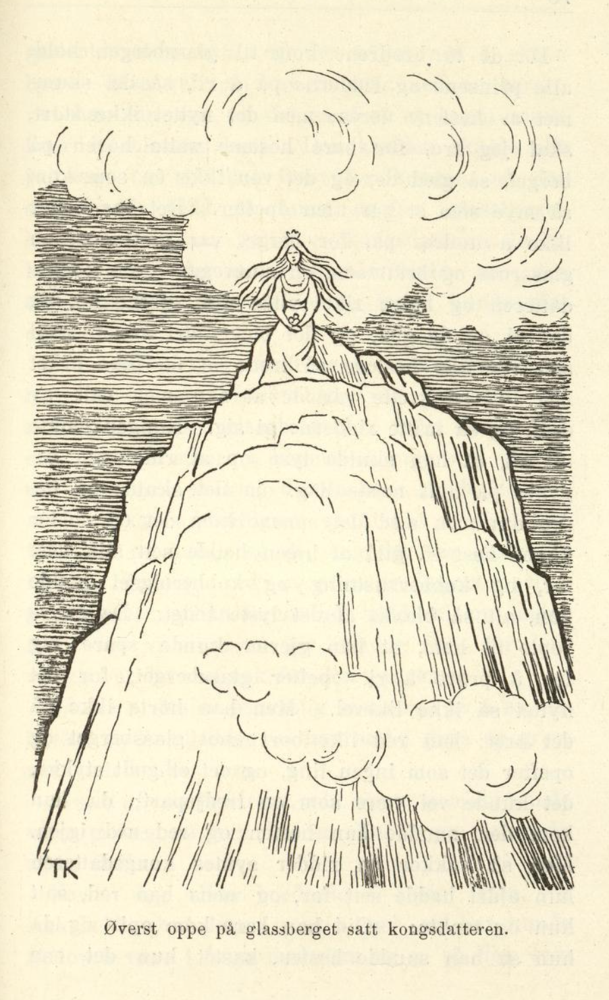
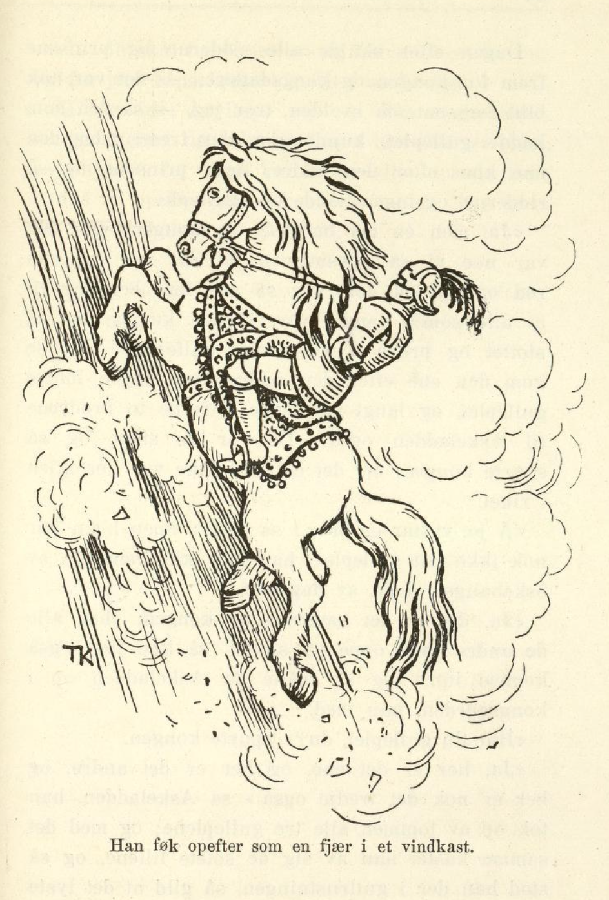

# Jomfruen på glassberget.

Det var engang en mann, han hadde en slåtteng som lå langt oppe i lia ensteds, og på den enga sto et høylade, han hadde å berge foret i. Men det hadde nok ikke vært stort i ladet de siste årene, skal jeg tro; for hver jonsoknatt, når gresset sto gildest og frodigst, ble slåttenga rent svartbeitet, som en hel drift skulle gått der og gnaget om natten. Det hendte én gang, og det hendte to ganger; men så ble mannen lei av det og sa til sønnene sine — han hadde tre, og den tredje var Askeladden, kan du vite, — at nå fikk en av dem ligge borti uteng-ladet om jonsoknatten, for det var for galt at gresset skulle bli ett opp rubb og stubb igjen, slik som de to siste årene; og den som ville i veien, måtte passe vel på, sa mannen.

Ja, så ville da den eldste bort og gjete enga; han skulle nok passe gresset, mente han, så verken folk eller fe eller fanden sjøl skulle få noe av det. Da det lei mot kvelden, gikk han bort i ladet og la seg til å sove; men litt ut på natten kom det slik en dur og slikt et jordskjelv, at vegger og tak ristet; og gutten opp og på bena det forteste han hadde lært, han turte ikke se seg om engang, og høyet ble ett opp den natten som de andre årene.

Neste jonsokkvelden sa mannen igjen, at det var for ille, de år etter år mistet alt gresset på utenga, nå fikk en av sønnene bort og passe på, og passe det vel også. Så ville den nest eldste prøve seg den kvelden. Han gikk da bort i høyladet og la seg til å sove, som broren hadde gjort; men utpå natten kom det en dur og et jordskjelv, enda verre enn siste jonsoknatt; og da gutten hørte det, ble han redd, og tok på sprang så fort som han skulle hatt betaling for det.

Året etter skulle da Askeladden i veien; men da han laget seg til å gå, lo de andre to og gjorde narr av ham. «Ja du skal bli den rette til å passe høyet, du som ikke har lært annet enn sitte i oska og steike deg!» sa de. Men Askeladden brydde seg ikke om det de snakket; da det lei mot kvelden, ruslet han bortover til utenga han. Der gikk han inn i høyladet og la seg; men da det lei om en stund, tok det til å dure og brake, så det var fælt. «Å blir det ikke verre, får jeg vel herde på,» tenkte Askeladden. Om litt kom det et brak igjen, og et jordskjelv, så høystråene føk omkring gutten. «Å blir det ikke verre, får jeg vel herde på,» tenkte Askeladden. Men aller best det var, kom den tredje duren, og et jordskjelv, så gutten tenkte at vegger og tak ramlet sammen; men da det var over, ble det med ett kurende stilt omkring ham. «Skal tro det kommer igjen,» tenkte Askeladden. Men nei, det kom ikke igjen, det var stilt, og det ble stilt, og da han hadde ligget en liten stund, hørte han liksom en hest sto og tygget tett utenfor ladedøren. Han lurte seg bort i dørgløtten og skulle se hva det var; så sto det en hest og gnog, og så stor og feit og gild hest hadde Askeladden aldri sett før, og sal og bissel lå det på den og full rustning til en ridder, og alt sammen var av kobber, og så blankt at det skinte i det. «Hå, hå! er det du som eter opp høyet vårt,» tenkte gutten, «det skal jeg nok forby deg.» Han skyndte seg og tok opp ildstålet sitt og kastet over hesten, så hadde den ikke makt til å røre seg av flekken; den ble så tam, at gutten kunne gjøre med den hva han ville. Han satte seg opp på den og red bort til et sted ingen visste om; der hadde han den.

Da han kom hjem igjen, lo brødrene og spurte hvordan det hadde gått ham. «Du ble vel ikke lenge liggende i høyladet, om du ellers har vært så langt som borti utenga,» sa de.

«Jeg lå i høyladet til sola rant, jeg, men jeg verken hørte eller så noe,» sa gutten; «tro hva det var dere ble så redde for!»

«Ja, vi får vel se etter hvordan du har passet enga,» svarte brødrene; men da de kom dit bort, sto gresset der like langt og tykt som om kvelden.

Neste jonsoknatten gikk det likedan: Ingen av de to brødrene turte gå bort i utenga og passe slåtten, men Askeladden turte; og så hendte akkurat det samme som siste jonsoknatt: først kom det en dur og et jordskjelv, så om litt et til, og så enda et; men alle tre jordskjelvene var mye, mye sterkere denne gangen. Så ble det med én gang kurende stilt igjen, og gutten hørte noe tygge utenfor ladedøren; han stjal seg da bort i dørgløtten så sakte han kunne, — jo! der sto en hest igjen like ved veggen og tamset og gnog; og den var enda mye større og feitere enn den andre; og sal lå det på ryggen dens, og bissel var det på den, og full rustning til en ridder — alt sammen av blankt sølv og så gromt som noen ville se. «Hå, hå! er det du som eter opp høyet vårt i natt,» tenkte gutten, «det skal jeg vel forby deg!» Han tok opp ildstålet sitt og kastet over manen på hesten, så sto den der så spak som et lam. Ja, gutten red den hesten også bort til stedet, der han hadde den andre, og gikk så hjem igjen.

«I dag ser det vel vakkert ut borti slåttenga?» sa brødrene.

«Å, jamen!» sa Askeladden.

De skulle da bort igjen, og så sto gresset både tykt og langt som før; men de ble nå ikke blidere på Askeladden for det.

Da den tredje jonsoknatten kom, turte heller ingen av de to eldste brødrene ligge i utengladet og passe gresset, for de var blitt så hjerteskremt den natten de lå der, at de aldri glemte det mer; men Askeladden turte. Og så hendte nettopp det samme som de to siste jonsoknettene; det kom tre jordskjelv, det ene fælere enn det andre, ved det siste danset gutten fra den ene ladeveggen til den andre; men så ble det med én gang kurende stilt. Da han så hadde ligget en liten stund, hørte han noe tygge utenfor ladedøren; han stiltret seg bort i dørgløtten igjen — så sto det en hest tett utenfor, mye, mye større og feitere enn de to andre han hadde fanget, og med både bissel og sal og full rustning av rent, rødt gull. «Hå, hå! er det du som eter opp høyet vårt denne gangen,» tenkte gutten; «det skal jeg vel forby deg;» han rev opp ildstålet sitt og kastet over den, så sto den som den var naglet til bakken, og gutten kunne gjøre med den hva han ville. Han red bort til stedet, der han hadde de andre to, og så gikk han hjem igjen. Der gjorde de to brødrene narr av ham, som de andre gangene; den natten hadde han visst passet gresset i utenga godt, sa de, for han så da ut som han gikk og sov enda. Men Askeladden brydde seg ikke om det, han ba dem bare gå bort og se; det gjorde de, så sto gresset like gildt og tykt denne gangen også.

Kongen der i landet hvor far til Askeladden bodde, hadde en datter som han ikke ville gi til noen, unntatt den som kunne ri oppover glassberget — for det var et høyt, høyt glassberg, blankt som en is, tett ved kongsgården. Øverst oppe på det skulle kongsdatteren sitte med tre gullepler i fanget, og den som kunne ri opp og ta de tre gulleplene, skulle få henne og halve riket, det lot kongen lyse opp på alle kirkebakker i hele landet og i mange andre kongeriker også. Kongsdatteren var så vakker, at alle som så henne, måtte bli borte i henne, enten de ville eller ei — og så kan du nok vite at alle prinser og riddere hadde lyst til å vinne henne og halve kongeriket med, og derfor kom de ridende fra alle verdens kanter, så gilde at det lyste av dem, og på slike hester, at de gikk bare på dans; og det var ingen som ikke tenkte at han skulle vinne kongsdatteren.

Da dagen kom som kongen hadde satt, var det så tykt av riddere og prinser ved glassberget at det yrte, og dit ville nå hver som krype og gå kunne, og se hvem som vant kongsdatteren, og de to brødrene til Askeladden ville da også i veien. Men han ville de slett ikke ha med; for var de i følge med slik en bytting, så fæl og svart som han var, etter det han hadde ligget i oska og gravet, ville folk bare gjøre narr av dem, sa de.

«Ja, jeg går like godt alene, for meg sjøl, jeg,» sa Askeladden.

Da de to brødrene kom til glassberget, holdt alle prinsene og ridderne på å ri, så det skummet av hestene deres; men det nyttet ikke stort, skal jeg tro, for bare hestene satte hoven på berget, så gled de, og det var ikke én som kom så mye som et par alen oppover. Det var heller ikke å undres på, for berget var glatt som en glassrute og bratt som en stuevegg. Men kongsdatteren og halve riket ville alle gjerne ha, og de rei og de glei, og det ble aldri annet. Til sist var alle hestene så trette at de ikke orket mer, og så svette var de at skummet valt av dem, og så måtte ridderne gi seg. Kongen tenkte alt på å lyse opp at ridningen skulle begynne på nytt neste dag, om det skulle gå bedre da; men med det samme kom det en ridder på en hest så gild at ingen hadde sett slik hest før, og kobberrustning og kobberbigsel hadde han, alt så blankt at det lyste i det. De andre ropte til ham, at han gjerne kunne spare seg for å prøve å ri oppover glassberget, for det nyttet så ikke likevel. Men han hørte ikke på det øret; han red rett bort mot glassberget og oppover det som ingenting, og det et godt stykke, det kunne vel være som en tredjepart; da han kom der, snudde han hesten og red ned igjen. Men så vakker en ridder syntes kongsdatteren hun aldri hadde sett før, og mens han red, satt hun og tenkte: «Gid han bare kom opp!» og da hun så han snudde hesten, kastet hun det ene gulleplet etter ham, og det trillet ned i skoen hans. Men så snart han var kommet ned av berget, red han sin vei, og det så fort at ingen visste hvor det ble av ham. Den kvelden skulle alle prinsene og ridderne frem for kongen, så den som hadde ridd så langt oppover glassberget, kunne vise frem gulleplet kongsdatteren hadde kastet. Men det var ingen som hadde noe; den ene kom etter den andre, og ingen kunne vise eplet.

Om kvelden kom brødrene til Askeladden også hjem igjen, og fortalte både vidt og bredt om ridningen oppover glassberget, at først så var det slett ingen som orket komme så mye som et steg oppover; «men så kom det én som hadde kobberrustning og kobberbigsel, så blankt at det lyste lang vei av ham,» sa de, «og det var gutt som kunne ri; han red over en tredjepart oppover glassberget, og han kunne nok ridd helt opp, hadde han bare villet; men der snudde han, for han syntes vel det var nok for den gangen.»

«Å han skulle jeg riktig hatt moro av å se, jeg også,» sa Askeladden — han satt i grua og grov, som han brukte, han.

«Ja, du!» sa brødrene, «du ser ut som du kunne være mellom så høye herrer, ditt stygge beist, du sitter der!»

Neste dag ville brødrene i veien igjen, og Askeladden ba denne gangen også, om han kunne få lov til å være i følge med dem og se på dem som red; men nei, det fikk han slett ikke, det var han for stygg og for fæl til, sa de.

«Ja, ja, jeg går like gjerne alene, for meg sjøl, jeg også,» sa Askeladden.

Da brødrene kom til glassberget, tok alle prinsene og ridderne på å ri igjen, og da kan det vel hende at de hadde skodd hestene sine. Men det hjalp ikke; de rei og de glei, akkurat som forrige dagen, og ingen kom så mye som et par alen oppover, og da de hadde maset ut hestene sine, så de ikke orket mer, måtte de holde opp igjen allesammen. Så tenkte kongen, at han vel fikk lyse opp at ridningen skulle gå for seg for siste gang dagen etter, om det kanskje skulle gå bedre da. Men så tenkte han om igjen: han fikk vel vente litt enda, mente han, om han i kobberrustningen skulle komme igjen den dagen også. Ham så de ikke noe til, men rett som det var, så kom det én på en hest som var mye, mye gildere enn den ridderen i kobberrustningen hadde hatt, og denne hadde sølvrustning og sølvsal og sølvbigsel, alt så blankt at det skinte og lyste i det lang vei. De andre ropte til ham igjen, og sa at han gjerne kunne la være å prøve ridningen oppover glassberget, for det nyttet så aldri likevel. Men ridderen hørte ikke etter det; han red like bort til glassberget og oppover det, enda lenger enn han i kobberrustningen; men da han hadde kommet så langt som to tredjeparter opp, snudde han hesten og red ned igjen. Han likte kongsdatteren enda bedre, og hun satt og ønsket at han bare måtte komme opp; men da hun så han snudde, kastet hun det andre eplet etter ham, og det trillet ned i skoen hans; og med det samme han kom ned av glassberget, red han av gårde så fort at ingen kunne se hvor det ble av ham.

Om kvelden, da alle skulle frem for kongen og kongsdatteren, så den som hadde gulleplet, kunne vise det frem, kom den ene etter den andre, men ingen hadde noe gulleple. Akkurat som forrige dagen kom de to brødrene hjem den kvelden også, og fortalte hvordan det hadde gått, at alle hadde ridd, og ingen kunne komme opp. «Men langt om lenge kom det en i en sølvrustning, og sølvbigsel og sølvsal hadde han også,» sa de, «og faen kunne ri; han satte vel som to tredjeparter oppover, så snudde han igjen. Det var gutt det! Og til ham kastet kongsdatteren det andre gulleplet,» sa brødrene.

«Å, han skulle jeg også hatt moro av å se,» sa Askeladden.

«Å ja, han var nå vel så blank som oska du sitter og graver i, ditt stygge svarte beist du er!» sa brødrene.

Tredje dagen gikk alt likedan som de andre dagene: Askeladden ville være med og se på ridningen, og de to ville ikke ha ham i følge med seg; og da de kom til glassberget, var det ingen som kom så langt som to alen oppover. Alle ventet nå på ham i sølvrustningen; men han var verken å høre eller se. Men langt om lenge kom det en på en hest så gild at ingen hadde sett maken; han hadde gullrustning og gullsal og gullbigsel, så blankt, så blankt, at det lyste og skinte lang vei av det. De andre ridderne og prinsene kom seg ikke engang til å rope til ham og si at det ikke nyttet prøve seg, så forundret ble de, da de så hvor gild han var. Han red rett bort mot glassberget og føk oppover det som en fjær i et vindkast, så kongsdatteren ikke engang fikk tid til å ønske at han måtte komme helt opp, før han var der. Med det samme han hadde nådd opp, tok han det tredje gulleplet av fanget på kongsdatteren, og så snudde han hesten og red ned igjen, men så var han også borte for øynene på dem, før de visste ordet av det.

Da de to brødrene kom hjem igjen om kvelden, fortalte de både vel og lenge om hvordan det hadde gått med ridningen den dagen, og til sist fortalte de også om ridderen i gullrustningen. «Det var vel gutt det! Så gild ridder fins ikke i verden,» sa brødrene.

«Å han skulle jeg hatt moro av å se, jeg også!» sa Askeladden.

«Ja, det glor nå ikke fullt så mye i kullhaugen du ligger og roter i, ditt stygge svarte beist!» sa brødrene.

Dagen etter skulle alle ridderne og prinsene frem for kongen og kongsdatteren — det var nok blitt for sent om kvelden, tror jeg, — så den som hadde gulleplet, kunne vise det frem; men den ene kom etter den andre, først prinsene og så ridderne, og ingen hadde noe gulleple.

«Ja, men én må ha det,» sa kongen, «for det var noe vi så allesammen, at det var en som red opp og tok det»; og så ga han befaling til at alle som i landet var, skulle komme opp på slottet og prøve å vise frem gulleplet. Ja, de kom den ene etter den andre, men ingen hadde gulleplet, og langt om lenge kom de to brødrene til Askeladden også. De var de siste, og så spurte kongen, om det da slett ikke var fler igjen i riket.

«Å jo, vi har en bror,» sa de to; «men han har nok ikke tatt gulleplet; han har ikke vært ute av oskehaugen noen av dagene.»

«Ja, det er det samme,» sa kongen, «har alle de andre vært oppe på slottet, så kan han også komme inn,» og så måtte da Askeladden opp i kongsgården, han med.

«Har du gulleplet, du?» spurte kongen.

«Ja, her er det ene, og her er det andre, og her er nok det tredje også,» sa Askeladden, han tok opp av lommen alle tre gulleplene; og med det samme kastet han av seg de sotete fillene, og så sto han der i gullrustningen, så gild at det lyste av ham.

«Ja, du skal ha datter mi og halve riket; du har vel fortjent både henne og det,» sa kongen.

Så ble det bryllup, og så fikk Askeladden kongsdatteren, og i det bryllupet ble det vel turet, kan hende; for ture kunne de alle, om de ikke kunne ri oppover glassberget, og har de ikke turet fra seg, så holder de på enda.
