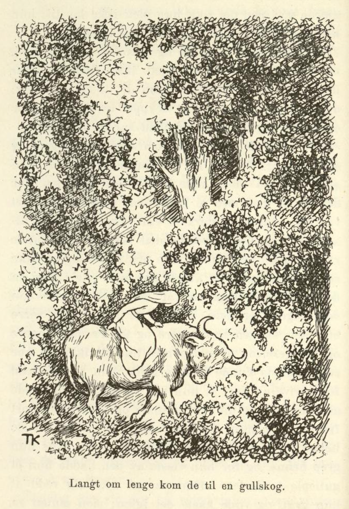
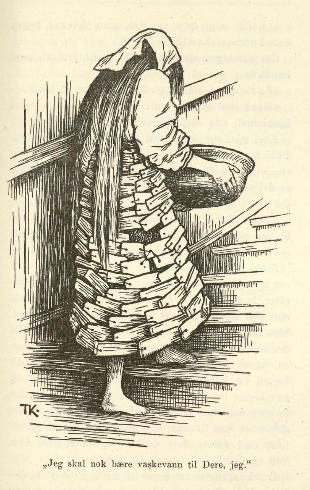
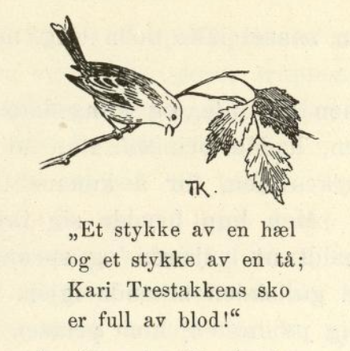

# Kari Trestakk.

Det var en gang en konge som var blitt enkemann. Etter dronningen sin hadde han en datter, som var så snill og så vakker at ingen kunne være snillere og vakrere. Han gikk lenge og sørget over dronningen, som han hadde vært så glad i, men til sist ble han lei av å leve alene, og giftet seg igjen med en enkedronning, som også hadde en datter; men hennes datter var like stygg og slem som den andre var snill og vakker. Stemoren og datteren hennes var misunnelige på kongsdatteren, fordi hun var så deilig; men så lenge kongen var hjemme, turte de ikke gjøre henne noe, for han var så glad i henne.

Om en stund fikk kongen krig med en annen konge og dro ut i leding; da trodde dronningen at hun kunne gjøre hva hun ville, og så både sultet og slo hun kongsdatteren, og var etter henne i hver krok. Til sist syntes hun alt var for godt for henne, og så satte hun henne til å gjete. Hun gikk da med buskapen og gjetet i skogen og på fjellet. Mat fikk hun lite eller ingenting av; blek og mager ble hun, og nesten alltid gråt hun og var lei seg.

I buskapen var det en stor blå stut, som alltid holdt seg så fin og blank, og den kom ofte bort til kongsdatteren og lot henne kjæle med seg. En gang hun satt og gråt og var helt ute av seg igjen, kom stuten bort til henne og spurte hvorfor hun var så lei seg. Hun svarte ingenting, men fortsatte å gråte. «Ja,» sa stuten, «jeg vet det nok, enda du ikke vil si det; du gråter fordi dronningen er slem mot deg, og fordi hun vil sulte deg i hjel. Men mat trenger du ikke å sørge for; i det venstre øret mitt ligger det en duk, og når du tar og brer den ut, kan du få så mange retter du vil.» Det gjorde hun, hun tok duken og bredte den ut på gresset, og så disket den opp med de fineste retter noen kunne ønske seg; det var både vin og mjød og søtkake. Hun kom snart til krefter igjen, og ble så rød og rund og hvit at dronningen og den tørrskranglete datteren hennes ble både blå og bleke av sinne over det. Dronningen kunne slett ikke skjønne hvordan stedatteren kunne se så godt ut på så dårlig kost; så sa hun til en terne at hun skulle gå etter henne i skogen, og passe på og se hvordan det hang sammen, for hun trodde at noen av tjenestefolkene ga henne mat. Jenta gikk da etter i skogen og passet på, og så fikk hun se at kongsdatteren tok duken ut av øret på den blå stuten og bredte den ut, og så disket duken opp med de gildeste retter, som kongsdatteren gjorde seg til gode med. Det gikk jenta hjem og fortalte dronningen.

Nå kom kongen hjem, og hadde vunnet over den andre kongen, som han hadde vært i krig med; det ble stor glede på hele slottet, og ingen var gladere enn kongens datter. Men dronningen la seg syk og ga doktoren mange penger for at han skulle si at hun ikke kunne bli frisk igjen uten at hun fikk kjøtt av den blå stuten å spise. Både kongsdatteren og folkene spurte doktoren om ikke noe annet kunne hjelpe, og ba for stuten, for alle var glad i den, og de sa at det fantes ikke make til stut i hele riket; men nei, den måtte slaktes og den skulle slaktes, det var ingen annen råd. Da kongsdatteren hørte det, ble hun ille til mote og gikk ned i fjøset til stuten. Den sto der også og hang med hodet, og så så sorgfull ut at hun begynte å gråte.

«Hva gråter du for?» sa stuten.

Så sa hun at kongen hadde kommet hjem igjen, og at dronningen hadde lagt seg syk, og at hun hadde fått doktoren til å si at hun ikke kunne bli frisk hvis hun ikke fikk kjøtt av den blå stuten, og nå skulle han slaktes.

«Får de først livet av meg, så dreper de snart deg også,» sa stuten; «vil du som jeg, så reiser vi vår vei i natt.»

Ja, kongsdatteren syntes nok det var vondt å reise fra far sin; men det var enda verre å være i hus med dronningen, og så lovte hun stuten at hun skulle komme.

Om kvelden, da alle de andre hadde lagt seg, listet kongsdatteren seg ned i fjøset til stuten; så tok han henne på ryggen og fór av gårde det forteste han kunne. Da folkene sto opp i otta neste dag og skulle slakte stuten, var den vekk, og da kongen sto opp og spurte etter datteren, var hun også borte. Han sendte ut bud på alle kanter for å lete etter dem, og lyste etter dem fra kirkebakken, men det var ingen som hadde sett noe til dem.

I mellomtiden fór stuten gjennom mange land med kongsdatteren på ryggen, og så kom de til en stor kobberskog; trær og grener og blad og blomster og alt sammen var av kobber.

Men før de reiste inn i skogen, sa stuten til kongsdatteren: «Når vi nå kommer inn i skogen, må du passe deg vel, så du ikke rører så mye som et blad, ellers er det ute både med meg og med deg, for her bor et troll med tre hoder, som eier den.»

Nei kors, hun skulle passe seg vel og ikke røre noe.

Hun var så forsiktig og bøyde seg til side for grenene og skjøv dem bort med hendene; men det var så tett skog at det nesten ikke var råd å komme fram, og hvordan hun enn bar seg at, kom hun likevel til å rive av et blad, som hun fikk i hånden.

«Au, au, hva gjorde du nå?» sa stuten; «nå gjelder det å slåss på liv og død.»

Straks etter var de ved enden av skogen, og da kom det et troll farende med tre hoder.

«Hvem er det som rører skogen min?» sa trollet.

«Den er like mye min som din,» sa stuten.

«Det skal vi nappes om,» skrek trollet.

«Kan så det,» sa stuten.

Så røk de i hop og sloss, og stuten stanget og sparket av alle livsens krefter, men trollet slo like godt, og det varte hele dagen før stuten fikk gjort ende på det, og da var han så full av sår og så medtatt at han nesten ikke orket å gå. Så måtte de hvile en dag; og så sa stuten til kongsdatteren at hun skulle ta det smørehornet som hang i beltet til trollet, og smøre ham med det. Da kom han seg, og dagen etter ruslet de av sted igjen.

De reiste nå i mange, mange dager, og så kom de langt om lenge til en sølvskog; trær og grener og blad og blomster og alt sammen var av sølv.

Før stuten gikk inn i den, sa han til kongsdatteren: «Når vi nå kommer inn i denne skogen, må du for Guds skyld passe deg vel; du må slett ikke røre noe som helst, og ikke rive av så mye som et blad, for ellers er det ute både med deg og med meg; det er et troll med seks hoder som eier den, og det tror jeg knapt jeg kan klare.»

«Nei,» sa kongsdatteren, «jeg skal nok passe meg, og ikke røre det du ikke vil jeg skal røre.»

Men da de kom inn i skogen, var den så tett og så trang at de nesten ikke kunne komme fram. Hun fór så varsomt hun kunne, og bøyde seg til siden for grenene og skjøv dem bort foran seg med hendene; men hvert øyeblikk slo kvistene henne i øynene, og hvordan hun enn bar seg at, så kom hun til å rive av et blad.

«Au, au, hva gjorde du nå?» sa stuten; «nå gjelder det å slåss på liv og død, for dette trollet har seks hoder og er dobbelt så sterkt som det andre; men bare pass på bladet og gjem det godt.»

Rett som det var, så kom trollet. «Hvem er det som rører skogen min?» sa det.

«Den er like mye min som din,» sa stuten.

«Det skal vi nappes om,» skrek trollet.

«Kan så det,» sa stuten — og røk på trollet, og stanget ut øynene på det og kjørte hornene tvers igjennom det, så tarmene rant ut, men det slo like godt, og det varte i tre hele dager før stuten fikk livet av det. Men da var han også så medtatt og utslitt at han med nød og neppe kunne røre seg, og så full av sår at blodet rant. Så sa han til kongsdatteren at hun skulle ta smørehornet som hang i beltet til trollet, og smøre ham med det. Det gjorde hun, og så kom han seg; men de måtte bli liggende og hvile en uke før han orket å gå lenger.

Endelig ga de seg på veien igjen; men stuten var skrøpelig ennå, og det gikk ikke fort i begynnelsen. Kongsdatteren ville spare stuten, og sa at hun var så ung og lett på foten at hun gjerne kunne gå; men det fikk hun slett ikke lov til; hun måtte sette seg opp på ryggen hans igjen.

Så reiste de i lang tid og gjennom mange land, og kongsdatteren visste slett ikke hvor det bar, men langt om lenge kom de til en gullskog; den var så gild at gullet dryppet av den, og trær og grener og blomster og blad var av bare gull.

Her gikk det likedan som i kobberskogen og sølvskogen. Stuten sa til kongsdatteren at hun ikke på noen måte måtte røre skogen, for det var et troll med ni hoder som eide den; det var mye større og sterkere enn begge de andre til sammen, og stuten trodde slett ikke at han kunne klare det. Nei, hun skulle nok passe seg og ikke røre skogen, det kunne han trygt stole på. Men da de kom inn i den, så var den enda tettere enn sølvskogen, og jo lenger de kom, desto verre ble det; skogen ble tettere og tettere og trangere og trangere, og til sist syntes hun ikke de på noe vis kunne komme fram; hun var så redd for å rive av noe at hun satt og vred og bøyde seg både hit og dit for kvistene og skjøv dem bort foran seg med hendene; men hele tiden slo de henne i øynene, så hun ikke kunne se hva hun grep etter, og før hun visste ordet av det, hadde hun et gulleple i hånden. Hun ble så inderlig redd at hun gråt, og ville kaste det fra seg; men stuten sa at hun ikke skulle det, men gjemme det godt, og trøstet henne så godt han kunne; men han trodde det ville bli et hardt basketak, og han tvilte på at det ville gå godt.

Rett som det var, så kom trollet med ni hoder; det var så fælt at kongsdatteren nesten ikke turte se på det.

«Hvem er det som rører skogen min?» skrek det.

«Den er like mye min som din,» sa stuten.

«Det skal vi nappes om,» skrek trollet.

«Kan så det,» sa stuten.

Og så røk de i hop og sloss, og det var så fælt å se på at kongsdatteren var nær ved å besvime. Stuten stanget ut øynene på trollet, og kjørte hornene tvers igjennom det så innvollene veltet ut; men trollet slo like godt, for når stuten fikk stanget i hjel ett hode, blåste de andre liv i det igjen, og det varte en hel uke før han klarte å få livet av det. Men da var stuten så medtatt og skrøpelig at han ikke kunne røre seg. Sår hadde han over det hele; han kunne ikke engang si så mye som at kongsdatteren skulle ta smørehornet til trollet og smøre ham med det. Men hun gjorde det likevel, og da kom han seg også; men de måtte bli liggende og hvile i tre uker før han var god for å gå videre.

Da reiste de så smått av sted, for stuten sa at de skulle litt lenger fram, og så kom de over mange store åser med tett skog. Dette varte en stund, så kom de opp på fjellet.

«Ser du noe?» spurte stuten.

«Nei, jeg ser ikke annet enn himmelen og det ville fjellet,» sa kongsdatteren.

Da de kom litt høyere opp, ble fjellet flatere, så de kunne se lenger omkring seg.

«Ser du noe nå?» sa stuten.

«Ja, jeg ser et lite slott langt, langt borte,» sa kongsdatteren.

«Det er nok ikke så lite likevel,» sa stuten.

Langt om lenge kom de til en stor haug, hvor det var en bratt bergvegg.

«Ser du noe nå?» sa stuten.

«Ja, nå ser jeg slottet tett ved, nå er det mye, mye større,» sa kongsdatteren.

«Dit skal du,» sa stuten; «rett nedenfor slottet er det et grisehus, og der skal du være. Når du kommer dit, finner du en trestakk; den skal du ta på deg, og gå fram til slottet, og si at du heter Kari Trestakk, og be om tjeneste. Men nå skal du ta den vesle kniven din og skjære hodet av meg med; så skal du flå meg og rulle sammen huden, og legge den under bergveggen der, og inne i huden skal du legge kobberbladet og sølvbladet og gulleplet. Borte ved berget står det en kjepp; når du vil meg noe, så banker du bare på bergveggen der med den.»

I begynnelsen ville hun ikke; men stuten sa at det var den eneste takken han ville ha for det han hadde gjort for henne, og så kunne hun ikke annet. Hun syntes det var så inderlig vondt, men hun slet og skar med kniven på det store dyret til hun fikk av hodet og huden, så la hun den sammen borte under bergveggen, og la kobberbladet og sølvbladet og gulleplet inn i den.

Da hun hadde gjort det, så gikk hun bort til grisehuset; men hele veien hun gikk, gråt hun og var helt ute av seg. Der tok hun trestakken på seg, og så gikk hun fram til kongsgården; da hun kom inn på kjøkkenet, ba hun om tjeneste, og sa at hun het Kari Trestakk. Ja, sa kokka, det kunne hun nok få, hun kunne få lov til å være der og vaske opp, for den som hadde gjort det før, hadde nettopp gått sin vei; «men når du blir lei av å være her, så stikker du vel av, du også,» sa hun.

Nei, det skulle hun slett ikke.

Hun var både flink og rask til å vaske opp. Om søndagen skulle det komme fremmede til kongsgården. Så ba Kari om å få lov til å gå med vaskevann til prinsen; men de andre lo av henne og sa: «Hva vil du der? Tror du prinsen vil vite noe av deg, som ser slik ut?»

Hun ga seg ikke, hun, men fortsatte å be, og endelig fikk hun da lov.

Da hun gikk oppover trappene, skranglet det i trestakken, så prinsen kom ut og spurte: «Hva er du for en?»

«Jeg skulle nok bære vaskevann til deg, jeg,» sa Kari.

«Tror du jeg vil ha det vaskevannet du bærer?» sa prinsen, og slo vannet over henne.

Med det måtte hun gå; men så ba hun om lov til å gå til kirken; det fikk hun også, for kirken lå tett ved. Men først gikk hun bort til berget og banket på med kjeppen som sto der, slik som stuten hadde sagt. Straks kom det ut en mann og spurte hva hun ville. Kongsdatteren sa at nå hadde hun fått lov til å gå i kirken og høre på presten, men hun hadde ingen klær å ha på seg. Så kom han med en kjole til henne, den var så blank som kobberskogen, og hest og sal fikk hun også. Da hun kom til kirken, var hun så vakker og gild at alle undret seg på hvem hun var, og nesten ingen hørte etter hva presten sa, for de så for mye på henne; prinsen selv likte henne så godt at han ikke kunne ta øynene fra henne et øyeblikk.

I det samme hun gikk ut av kirken, sprang prinsen etter og dro kirkedøren igjen etter henne, og så fikk han den ene hansken hennes i hånden. Da hun gikk bort og satte seg på hesten, kom prinsen etter igjen, og spurte hvor hun var fra.

«Jeg er fra Vaskeland,» sa Kari; og da prinsen tok fram hansken og ville gi henne den igjen, sa hun:

«Lyst foran og mørkt bak, så prinsen ikke ser hvor jeg rir i dag!»

Prinsen hadde aldri sett make til hanske, og han fór både vidt og bredt og spurte etter det landet som den stolte damen som red fra hansken sin, hadde sagt hun var fra, men det var ingen som kunne si ham hvor det lå.

Om søndagen skulle en gå opp til prinsen med håndkle.

«Å, får jeg lov til å gå opp med det?» sa Kari.

«Hva skal det være godt for?» sa de andre som var på kjøkkenet; «du så jo hvordan det gikk sist.»

Kari ga seg ikke, men fortsatte å be til hun fikk lov, og så løp hun oppover trappene, så det skranglet i trestakken. Prinsen fór ut, og da han fikk se at det var Kari, rev han til seg håndkleet og kastet det rett i ansiktet på henne.

«Pakk deg nå, ditt stygge troll!» sa han; «tror du jeg vil ha et håndkle som du har tatt i med de svarte fingrene dine?»

Siden reiste prinsen til kirken, og Kari ba også om å få gå dit. De spurte hva hun skulle i kirken, hun som ikke hadde noe annet å ha på seg enn den trestakken, og som var så svart og fæl. Men Kari sa at hun syntes presten var en så gild mann til å preke; hun hadde så godt av det han sa, og så fikk hun da lov til sist. Hun gikk til berget og banket på, og så kom mannen ut og ga henne en kjole som var mye gildere enn den første; den var utsydd med sølv overalt, og det skinte av den akkurat som av sølvskogen, og en staselig hest med sølvbrodert dekken og sølvbissel fikk hun også.

Da kongsdatteren kom til kirken, sto kirkefolket utenfor på bakken ennå; alle sammen undret de seg på hvem hun var, og prinsen var straks på farten og kom og ville holde hesten for henne mens hun steg av. Men hun sprang av og sa at det trengte han ikke, for hesten var så godt temmet at den sto stille når hun sa det, og kom når hun ropte på den. Så gikk de alle sammen i kirken; men det var nesten ingen som hørte etter hva presten sa, for de så for mye på henne, og prinsen ble enda mer forelsket i henne enn forrige gang. Da prekenen var slutt, og hun gikk ut av kirken og skulle sette seg på hesten, kom prinsen igjen og spurte hvor hun var fra.

«Jeg er fra Håndkleland,» sa kongsdatteren, og i det samme slapp hun ridepisken sin ned; da prinsen bøyde seg og skulle ta den opp, sa hun:

«Lyst foran og mørkt bak, så prinsen ikke ser hvor jeg rir i dag!»

Borte var hun igjen, og prinsen kunne ikke vite hvor hun var blitt av; han fór både vidt og bredt og spurte etter det landet som hun hadde sagt hun var fra; men det var ingen som kunne si ham hvor det lå, og prinsen måtte da slå seg til ro igjen.

Om søndagen skulle en gå opp til prinsen med en kam; Kari ba om å få lov til å gå med den, men de andre minnet henne om hvordan det hadde gått sist, og skjelte henne ut fordi hun ville vise seg for prinsen, så svart og fæl som hun var i trestakken sin; men hun holdt ikke opp å be før de lot henne gå opp til prinsen med kammen.

Da hun kom skranglende oppover trappene igjen, fór prinsen ut, tok kammen og kastet den etter henne, og sa at hun bare skulle pakke seg.

Siden reiste prinsen til kirken, og Kari ba også om lov; de spurte igjen hva hun skulle der, hun som var så fæl og svart, og som ikke hadde klær så hun kunne vise seg blant folk; prinsen eller noen andre kunne lett få se henne, sa de, og så ville både hun og de bli ulykkelige; men Kari sa at de hadde nok annet å se etter, og hun holdt ikke opp å be før hun fikk lov til å gå.

Nå gikk det likedan som begge de andre gangene; hun gikk bort til berget og banket på med kjeppen, og så kom mannen ut og ga henne en kjole som var enda mye gildere enn de andre; den var nesten av bare gull og edelstener, og en prektig hest med gullsydd dekken og gullbissel fikk hun også.

Da kongsdatteren kom til kirken, sto presten og folket på bakken ennå og ventet på henne. Prinsen kom løpende og ville holde hesten, men hun sprang av og sa: «Nei takk, det trengs ikke, hesten min er så godt temmet at den står stille når jeg sier det.» Så skyndte de seg inn i kirken alle sammen, og presten opp på prekestolen; men ingen hørte etter hva han sa, for de så for mye på henne, og undret seg på hvor hun var fra, og prinsen var enda mer forelsket enn begge de andre gangene; han merket ingen ting, men så bare på henne.

Da prekenen var over, og kongsdatteren skulle gå ut av kirken, hadde prinsen helt ut en tønne tjære i våpenhuset, for å få hjelpe henne over. Men hun brydde seg ikke om det, satte foten midt i tjæren og sprang over; så ble den ene gullskoen sittende igjen, og da hun hadde satt seg på hesten, kom prinsen farende ut av kirken og spurte hvor hun var fra.

«Fra Kammeland,» sa Kari. Men da prinsen ville rekke henne gullskoen, sa hun:

«Lyst foran og mørkt bak, så prinsen ikke ser hvor jeg rir i dag!»

Prinsen kunne ikke vite hvor det var blitt av henne denne gangen heller, og så fór han i lang tid omkring i verden og spurte etter Kammeland; men da ingen kunne si ham hvor det var, lot han kunngjøre at den som kunne passe gullskoen, ville han gifte seg med. Det kom da sammen både vakre og stygge fra alle kanter; men det var ingen som hadde så liten fot at hun kunne få på seg gullskoen. Langt om lenge kom den slemme stemoren til Kari Trestakk med datteren sin også, og henne passet skoen; men stygg var hun, og så lei så hun ut, at prinsen nødig gjorde det han hadde lovt. Likevel ble det laget i stand til bryllup, og hun ble pyntet til brud, men da de red til kirken, satt det en liten fugl i et tre og sang:

«Et stykke av en hæl og et stykke av en tå; Kari Trestakkens sko er full av blod!»

Og da de så etter, hadde fuglen sagt sant, for blodet silte ut av skoen. Så måtte alle tjenestejentene og alle de kvinnfolkene som var på slottet, fram og prøve skoen, men det var ingen den ville passe.

«Men hvor er Kari Trestakk da?» spurte prinsen, da alle de andre hadde prøvd, for han skjønte fuglesang, og husket godt det fuglen hadde sagt.

«Å, hun da!» sa de andre; «det kan aldri nytte at hun kommer fram, for hun har føtter som en gamp.»

«Kan være,» sa prinsen, «men siden alle de andre har prøvd, så kan Kari også.»

«Kari!» ropte han ut gjennom døren, og Kari kom oppover trappene, og det skranglet i trestakken som om det var et helt regiment dragoner som kom farende.

«Nå skal du prøve gullskoen og bli prinsesse, du også,» sa de andre jentene, og lo og gjorde narr av henne.

Kari tok opp skoen og satte foten i den så lett som bare det, kastet trestakken av seg, og så sto hun der med gullkjolen på, så det skinte av henne, og på den andre foten hadde hun maken til gullskoen. Prinsen kjente henne straks igjen, og ble så glad at han gikk rett bort og tok henne om livet og kysset henne; og da han fikk høre at hun var kongsdatter, ble han enda gladere, og så ble det bryllup.

Snipp, snapp, snute, så er eventyret ute.
