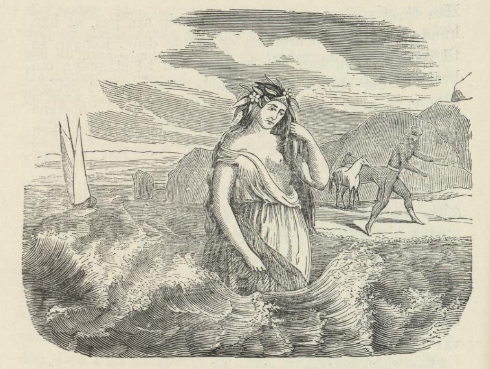
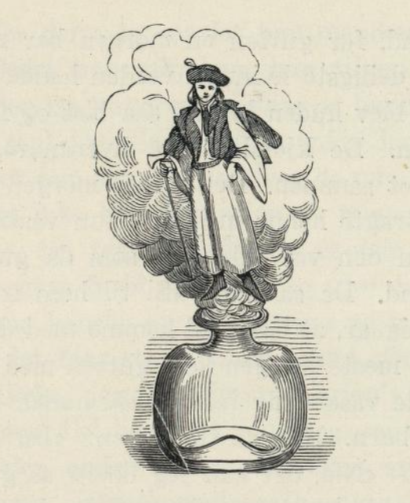

# Den skjønne havfrue

Det var en gang en fattig mann. Han levde i en ussel landsby. Han hadde vært gift i mange år; men han hadde ingen barn. Han og konen hans ville så gjerne ha et barn, og nå ba de inderlig til Gud om at han ville gi dem et barn som kunne bli en støtte for dem i alderdommen. Gud hørte bønnen deres, og konen fikk to barn, en gutt og en pike, og begge hadde de hår som lyste som gull. Nå gjaldt det å få et par skikkelige faddere til barna, og det var ikke så lett for dem som var så fattige. Mannen ba flere; men ingen ville. Ja, noen skjelte ham og konen hans ut. Den gamle mannen ble svært lei seg, og han visste ikke hva han skulle gjøre. Mens han gikk på gata, møtte han en rik kjøpmann. Da han så at mannen var så trist, spurte han: «Hvorfor er du så lei deg, gamle far?» «Skulle jeg ikke være lei meg,» sa han, «kona mi har fått to barn, og nå kan jeg ikke finne faddere til dem.» Da sa kjøpmannen: «Hør nå her, gamlefar, jeg og konen min vil svært gjerne være faddere for barna dine; for vi har ingen barn selv; men hvor bor du?» Den gamle svarte: «Jeg bor i et gammelt, falleferdig hus. Det er lett å finne; for utenfor døra står et morbærtre, den ene veggen er falt ned, på den andre siden er det satt opp støtter, og så har jeg en hund som heter Cerberus som alltid ligger under morbærtreet.» Så løp gamlingen hjem og fortalte at han hadde fått faddere, og den neste dagen kom kjøpmannen og konen hans. Da kjøpmannen fikk se barna, ble han rent forundret over at det kunne finnes noe så vakkert i verden. De ble da døpt. Gutten ble kalt Rudolf og piken Josefa. Til de var ti år, bodde de hos faren; men så tok kjøpmannen dem til seg, og da han ikke ville ha noe bry med all rikdommen sin, ga han hver av dem en butikk. Det de tjente på forretningen, kunne de bruke som de selv ville; men de måtte ikke røre kapitalen. Pleiebarna var svært glade for dette. De begynte straks å handle, og snart hadde de tjent seks hundre daler. En gang de hadde lite å gjøre, skulle de finne på noe å fordrive tiden med, og Rudolf sa til Josefa: «Gå bort og hent et kortspill, så morer vi oss med å spille kort.»

Josefa ville gjerne gjøre alt det broren ville, og så løp hun bort og hentet kortene. Rudolf sa: «Vi begynner å spille om de pengene vi har tjent; men vi skal alltid gi tilbake det vi har vunnet.» Ja, det ville Josefa gjerne. Nå begynte de å spille, og snart hadde Rudolf tapt alle pengene sine. Da sa han: «Ja, nå kan jeg ikke spille mer; for jeg har tapt alle pengene mine; men nå må du gi meg dem igjen.» Søsteren ga ham dem igjen slik som de var blitt enige om. Så begynte de å spille på nytt. Men nå tapte Josefa alle pengene sine. Hun sa til broren: «Ja, nå får du gi meg pengene igjen, så jeg kan spille videre.» «Å, jo,» sa Rudolf. «Da måtte jeg være gal! Tror du jeg sitter her og kaster bort tiden til ingen nytte? Nei, du kan være sikker på at jeg ikke gir deg noe igjen.» Josefa ble så lei seg og minnet broren om hva de var blitt enige om da de begynte å spille; men Rudolf brydde seg ikke om det og sa at han hadde vunnet pengene. Da tok Josefa tre daler av kapitalen og begynte å spille igjen. Nå var Rudolf uheldig, og Josefa heldig; for hun vant først tilbake alle pengene sine og deretter alle Rudolfs. Nå ba Rudolf om å få pengene sine igjen; men da svarte Josefa: «Du ville ikke gi meg pengene mine igjen, da får ikke du dine igjen heller.» Da ble Rudolf sint og sa at hvis hun ikke gjorde det, skulle han forbanne henne, så verken himmel eller jord tok imot henne. Hun lot seg ikke skremme, og da forbante Rudolf henne virkelig, og med ett åpnet jorden seg og slukte Josefa, og hun sank ned til fiskenes konge. Han tok imot henne; for han syntes synd på henne. Med det samme kom pleiefaren inn i butikken for å se til dem, og han spurte straks: «Hvor er Josefa?» «Hun har gått på torget,» sa Rudolf. I begynnelsen trodde også kjøpmannen det; men da det begynte å bli mørkt, og hun fortsatt ikke var kommet tilbake, syntes han det var rart, og så spurte han Rudolf igjen hvor det var blitt av henne. Nå visste Rudolf ingen annen råd enn å fortelle sannheten, og så fortalte han hele historien. Han sa: «Da hun ikke ville gi meg pengene igjen, forbante jeg henne og sa at verken himmel eller jord skulle ta imot henne. Da åpnet jorden seg, og nå vet jeg ikke hvor det er blitt av henne.» Da sa kjøpmannen: «Ditt ondskapsfulle menneske! Hvordan kunne du forbanne søsteren din? Men har du gjort det, så forbanner jeg nå deg, og gid verken himmel eller jord vil ha deg; men gid du må vandre omkring til du finner søsteren din igjen.» Da åpnet jorden seg, og Rudolf sank ned, og han sank og sank helt til han kom til Arabia.

Han gikk og gikk uten å stanse; han traff ingen og så ingenting annet enn endeløse ørkener, og han visste ikke hvor veien gikk. Endelig så han et slott langt borte, og han skyndte seg enda mer; men da han kom dit, var porten lukket. Han tittet gjennom sprinklene og så en gammel mann som gikk fram og tilbake i gården. Den gamle mannen så ham også; han undret seg over hvor vakker han var, og han spurte hvordan han var kommet dit, og hva han ville. Han svarte: «Jeg vil gjerne ha arbeid.» «Ja,» sa mannen, «jeg vet ikke om det er noe arbeid for deg her på gården. Den må kongen gi deg; han bor på slottet her. Nå skal jeg gå og si det til ham.» Gamlingen gikk til kongen og sa: «Stormektige konge! Utenfor slottet står en gutt med gullhår; han spør om han ikke kan få arbeid hos Deres majestet.» Kongen sa: «La gutten med gullhåret komme til meg.» Da han kom inn, spurte kongen ham om han var vant til å stelle hester. «Ja, det forstår seg,» sa gutten. Så ble han satt til å være stallknekt. Men da det var gått et par år, var gutten blitt så stor at hesten nesten ikke kunne bære ham. Nå døde en gammel kusk som var satt til å kjøre ved og vann til kjøkkenet med to hester; men hestene var så magre og usle at de ikke orket å gå ut av stallen. Kongen sa til gutten: «Nå skal du fôre hestene slik at du kan skaffe kokkene alt de vil ha. Er du flink og bra, skal jeg gi deg mer ansvar.»

Han fôret hestene godt, og de kom seg såpass at han kunne føre dem til brønnen og vanne dem. Kongen sa til gutten: «Du kan leie hestene ned til stranden om kvelden; der blir de kanskje enda fetere av det deilige grønne gresset som er der.» Gutten førte så hestene til stranden om kvelden og lot dem beite der til klokka ti. Da kom han til å se utover Rødehavet, og plutselig delte bølgene seg, og opp av vannet steg den deiligste kvinne i verden. Hun ropte til ham: «Hør du, gjem deg ikke; kom hit og spis og drikk og snakk litt med meg.» Gutten gikk bort til henne og satte seg og snakket med henne. Da han skulle gå, tok hun fram et tørkle og tørket hestene med det, og da ble de til de deiligste røde hester du kan tenke deg, ja, det var en ren fryd å se dem. Så snudde hun seg, og borte var hun.

Så førte gutten hestene hjem. Men da de andre kuskene fikk se hestene, gikk de til kongen og sa: «Jo, det er en fin gutt vi har fått her på slottet. I natt har han stjålet et par prektige røde hester; når han som eier dem oppdager det, blir det stor skam for hele hoffet.» «Det kan ikke være mulig,» sa kongen. «Jo,» sa de, «det er nå slik likevel.»

Gutten bandt hestene, og kongen ropte ham bort til seg og sa: «Hvordan tør du komme hit med de hestene du har stjålet? Når han som eier dem kommer, blir det stor skam for meg også.» «Stormektige konge!» svarte gutten. «Det trenger De ikke være redd for. Jeg har ikke stjålet hestene; men jeg er vant til å skjære høyet smått og måle vannet jeg gir dem, og jeg stikker ikke havrepengene i lomma, som de andre kuskene gjør. Vil De ikke tro meg, så kom og se på hestene, de er merket med kongens merke.» Kongen gikk, og han fant sitt eget merke på hestene. Da ga han gutten tjue dukater. Gutten ble svært glad over å få så mange penger. Den neste kvelden tok han igjen hestene med seg og lot dem beite på stranden til klokka var elleve. Da så han utover Rødehavet. Plutselig delte det seg, og den deiligste kvinne i verden steg opp av vannet. Gutten ville først gjemme seg; men han fant ikke noe sted der han kunne gjøre det. «Hør her du!» ropte hun, «gjem deg ikke, kom heller hit til meg og snakk litt med meg.» Gutten gjorde det. Da gutten skulle gå, tørket hun hestene med tørkleet, og straks sto det to prektige sølvgrå hester der. De var så vakre at det skinte lang vei av dem. Så suste og bruste Rødehavet, den deiligste kvinne i verden var borte, og gutten sto der alene. Da han kom hjem med hestene, og de andre kuskene fikk se dem, fór de til kongen og sa: «Det er en tyv her på gården!» «Hvordan det?» spurte kongen. «Jo, nå har gutten stjålet et par sølvgrå hester, og de er så prektige at når eieren får greie på det, kan det kanskje koste Deres majestet livet.» «Nei, det er umulig,» sa kongen. «Ja, det er nå slik likevel, da,» sa de. Gutten satte hestene inn i stallen, og kongen ropte på ham. «Hør her,» sa han, «hvor har du fått de hestene fra? Hvordan kan du være så frekk at du kommer hit med stjålne saker? Hvis eieren kommer, kan det jo koste meg livet.» Men gutten svarte: «Vær ikke redd. Jeg har ikke stjålet hestene. Men jeg har den skikken at jeg småhakker høyet til dem og måler vannet, og så stikker jeg ikke havrepengene i lomma som andre kusker gjør. Vil Deres majestet ikke tro meg, så kan De se på hestene, de er brent med kongens merke.» Kongen gikk bort og så på dem, og de hadde ganske riktig merket hans på beinet. Så fikk gutten igjen en hel neve dukater, og nå var han inderlig glad over at han hadde så mange penger. Så ble han hjemme i tre dager; men den tredje kvelden gikk det som før. Han førte hestene ut på stranden og lot dem beite der. Da klokka slo tolv, så han utover Rødehavet, og plutselig delte det seg, og den deiligste kvinne i verden steg opp av vannet og ropte: «Hør her du! Kom hit til meg og snakk litt med meg!» Gutten gikk bort til henne og snakket med henne. «Hør nå på meg,» sa hun. «Hvis du vil at jeg skal bli din og du min, så må du aldri gå og skryte av at du har en vakker kjæreste, for hvis du sier et eneste ord om meg til noe menneske, så kan jeg aldri bli din.» Da han skulle gå, tørket hun igjen hestene med tørkleet, og straks sto det et par deilige gullfargede hester der. De skinte slik at det nesten gjorde vondt i øynene å se på dem. Så snudde den skjønne havfruen seg, Rødehavet suste og bruste, og borte var hun.

Gutten tok gullhestene med seg hjem. Da de andre kuskene så dem, gikk de igjen til kongen og sa: «Jo, det er riktig en tyveknekt vi har fått her på gården!» «Hvordan det?» spurte kongen. «Jo,» svarte de, «nå har han stjålet to gullhester og de er så deilige at når eieren oppdager det, kommer De kanskje til å miste både land og rike.» «Å, det er umulig,» sa kongen. «Ja, det er nå slik, da,» sa de. Gutten dro hestene inn i stallen. Kongen lot gutten gjøre som han ville, og han tenkte for seg selv: «Den gutten må kunne mer enn et troll.»

Nå hadde kongen en gammel statskusk som hadde tjent hos ham i mange år. Kongen ba både ham og gutten komme inn. «Hør nå her,» sa han til den gamle kusken, «du har tjent lenge hos meg, nå må du ikke bli sint, verken på meg eller gutten; men fra i dag av skal han være statskusk, og du skal kjøre ved og vann til kjøkkenet.» Så ble gutten statskusk; men den gamle kusken ble rasende sint på ham og sa: «Den skarven! Kommer her på gården og tar plassen fra meg!» Men gutten hadde gode dager, for han trengte aldri å kjøre, unntatt når kongen var ute og kjørte på stas. Til middags og kvelds spiste han med de andre kuskene. Den gamle kusken var alltid sint på ham, og en gang de satt og spiste, sa han: «Dere skal se at den gutten tenker på å bli konge selv og gifte seg med prinsessen.» Men gutten sa: «Jeg gir prinsessen en god dag, henne bryr jeg meg ikke noe om. Hun er ingenting mot kjæresten min.» Den gamle kusken gikk straks til kongen og sa: «Jeg har noe å melde. De andre kuskene snakket seg imellom om ikke statskusken tenkte på å bli konge og få prinsessen; men da sa han: 'Jeg gir prinsessen en god dag, jeg bryr meg ikke om henne. Hun er ingenting mot kjæresten min.'» Da ble kongen skikkelig sint og kalte gutten for seg: «Hva sa du i går kveld til de andre kuskene?» spurte han. «Jeg,» sa gutten, «jeg har ikke sagt noe til dem.» Men kongen sa: «Nekt det nå ikke, si det like ut, det er det beste.» Gutten kunne da ikke gjøre annet enn å tilstå. Kongen dømte nå at gutten skulle henges neste morgen klokka åtte, de skulle sette opp galgen om natten. Gutten ba om å få snakke med kongen én gang til, og det fikk han lov til. Kongen spurte hva han ville. «Da det nå er sikkert at jeg må dø,» sa gutten, «så vil jeg be om at galgen må bli reist opp nede ved stranden, hvor jeg så ofte har vært med hestene.» Det ble gjort som gutten hadde bedt om, og da klokka slo åtte, tok to menn ham mellom seg og førte ham ut dit. På veien sa han til dem: «Hvis dere vil henge meg opp slik at jeg ikke kan falle ned og heller ikke kveles mens jeg henger, så skal dere få en hel skjeppe dukater av meg.» Det ville mennene gjerne ha, og så hang de ham opp slik at han verken falt ned eller ble kvalt.

Da de var gått sin vei, sprang han ned av galgen, satte seg under den og gråt så sårt. Han var så lei seg at han gjerne skulle ha gjemt seg under jorden. Mens han satt og gråt, så han utover Rødehavet. Plutselig delte det seg, og den skjønneste kvinne i verden steg opp og ropte: «Kom hit til meg, det er bedre enn å sitte og være lei seg. Sa jeg deg ikke at det ville gå slik? Nå hadde du nær mistet livet. Du må ikke skryte av meg. Det gjør oss begge skade; men du kan jo ikke la det være. Før kunne jeg gå fritt hvor jeg ville; men nå må jeg være bare i min egen by, og hele byen må bære sorg så lenge jeg ikke kan snakke med deg. Men det blir lenge til; for selv om vi treffer hverandre, så kjenner vi hverandre ikke, om vi så spiser av samme fat og drikker av samme beger.» Så snudde hun seg fra ham, Rødehavet suste og bruste, og borte var hun. Men gutten reiste seg og gikk sin vei.

Mens han gikk, kom han til en maurtue; den var så stor at han ikke visste hvordan han skulle komme gjennom den. Han ble derfor stående midt i den og tenkte: «Hva skal jeg gjøre med disse dyrene, ikke vil jeg slå dem i hjel, og jeg vil så nødig tråkke på noen av dem.» Da kom maurdronningen fram og sa: «Jeg skjønner du har et godt hjerte, siden du ikke vil slå oss i hjel og ikke tråkke på oss, vær ikke lei deg, den ene tjenesten er den andre verdt. Kommer du i nød noen gang, så bare si: 'Maurdronning, gi meg din styrke, jeg gir deg min igjen' — så blir du straks til en maur. Og når du vil bli menneske igjen, skal du si: 'Maurdronning, gi meg min styrke igjen, jeg gir deg også din.'» Gutten ble svært glad over at han hadde lært en slik kunst, og så gikk han videre; for nå kunne han komme fram hvor han ville. Da han igjen hadde gått et stykke, traff han så mange ørner at han ikke skjønte hvordan han skulle komme fram. Han ble stående og tenkte: «Hva skal jeg gjøre nå? Jeg kan ikke slå dem i hjel, og jeg vil nødig gjøre noen av dem noe vondt.» Da sa ørnekongen: «Jeg skjønner du har et godt hjerte, du skal ikke være lei deg; den ene tjenesten er den andre verdt. Hvis du kommer i nød noen gang, skal du bare si: 'Ørnekonge, gi meg din styrke, jeg gir deg min igjen' — da blir du straks til en ørn og kan fly hvor du vil. Men når du sier: 'Ørnekonge, her har du din styrke, gi meg min igjen' — så blir du straks til menneske igjen.» Gutten ble svært glad over å ha lært to slike kunster. Nå var han ikke redd for hvordan han skulle komme gjennom verden.

Så gikk han videre og kom til et vertshus. Der bodde det en mann som var to hundre år gammel. Gutten hilste og sa: «Goddag, gamlefar!» «Det var godt du sa det,» sa gammelen, «for ellers måtte du ha mistet livet, om du så hadde hatt tusen liv. Hva vil du her?» Gutten svarte: «Jeg leter etter fiskenes konge. Jeg ville gjerne vite noe om ham.» «Nå er jeg to hundre år,» sa mannen; «men jeg har aldri hørt snakke om fiskekongen før. Det nytter ikke at du går og spør etter ham. Du kan heller bli her hos meg; for jeg har ingen tjenestegutt.» «Om jeg så skulle dø,» sa gutten, «her blir jeg ikke.» «Jeg mener det bare godt med deg,» sa gammelen, «og jeg vil ikke være skyld i at det skal gå deg galt. Et lite stykke herfra ligger hundre gjetere med hundre hunder så store som kalver, og du kan ikke komme noen annen vei; derfor må du dø, om du så hadde tusen liv.» «Ja,» sa gutten, «det er det samme enten jeg dør her eller der,» og så lot han mannen stå og gikk sin vei. Rett som han gikk, kom han til et stort bål, og rundt om den lå hundre gjetere og hundre hunder. «Ja, hva skal jeg gjøre nå?» tenkte han, «går jeg gjennom her som jeg er, så river de meg i tusen stykker så det ikke blir en fille igjen av meg, gjør jeg meg til en maur, så tråkker kanskje en av dem på meg, og så er det også forbi med meg, og gjør jeg meg til en ørn, så får kanskje en av gjeterne se meg og skyter meg. Men det får stå i Guds hånd. Ørnekonge! Gi meg din styrke, jeg gir deg min igjen!» Straks ble han til en ørn, fløy høyt opp i været og helt stille ned igjen på den andre siden, så ingen av hundene la merke til ham. «Ørnekonge!» sa han så, «gi meg min styrke igjen, her har du din!» Og straks ble han til et menneske igjen. Gamlegjeteren, som var tre hundre år gammel, så ikke gutten før han kom bort til ham og hilste: «God kveld, gamlefar!» «Velkommen,» sa han, «du har sannelig lykken med deg siden hundene ikke har lagt merke til deg. Hvordan er du kommet hit, og hva er det du vil?» «Jeg går og spør etter fiskekongen,» sa gutten, «jeg ville gjerne vite noe om ham.» «Nå er jeg tre hundre år gammel,» sa mannen, «og aldri har jeg hørt snakke om fiskekongen. Det nytter ikke at du går og spør etter ham, bli heller her og ta tjeneste, du trenger ikke gjøre stort, du må bare alltid være her på gården.» «Ja, så kan jeg jo gjerne bli her,» sa gutten. Men de hundre gjeterne tjente hos den deiligste kvinne i verden, og de gjette hundre geiter som de melket hver morgen til de fikk en stamp full av melk, og i den badet den skjønne havfruen seg. Men det var ingen forskjell på melka og alminnelig vann før gutten en morgen bar melka inn. Men da den deiligste kvinne i verden hadde badet seg i den melka, ble huden hennes så bløt og fin som på et lite barn. De kjente ikke hverandre igjen, enda de hadde snakket sammen. Den neste morgen var det en annen som brakte henne melka. Hun vasket seg litt i melka; men den var ikke slik som da gutten hadde båret den inn. Da sa hun: «Si til ham som var her med melka i går, at han skal komme med den i morgen også.» Den neste morgen kom gutten med melka, og da hun hadde vasket seg i den, ble huden hennes som på et lite barn. Hun sa til gutten: «Du kan bli her hos meg, du.» «Nei, det kan jeg ikke,» sa gutten, «jeg må være hos de hundre gjeterne.» Da han kom hjem, spurte han gamlegjeteren om det ikke var et vertshus tett ved. «Ja, hva slags vertshus skulle det være?» spurte han. «Et sånt vertshus hvor folk danser og morer seg, vel,» sa gutten. «Jo, det er nok av slike,» sa gammelen, «og du kan gjerne gå og danse; men du må passe deg; for det er slemme folk der også som kan slå deg i hjel.» «Ja, men når jeg ikke gjør dem noe, da,» sa gutten. «Ja, så kan du gå,» sa gammelen.

Da det ble mørkt, gikk gutten. Men han gikk ikke til vertshuset; han gikk til slottet hvor den skjønne havfruen bodde. Da han kom dit, var porten lukket, så han ikke kunne komme inn. Han sto en stund og tenkte på hva han skulle gjøre; men så sa han: «Maurdronning! Gi meg din styrke, jeg gir deg min igjen.» Så ble han til en maur og krøp under porten, oppover trappene og opp til det rommet hvor den skjønne havfruen sov med piken sin. Han krøp inn gjennom nøkkelhullet, opp i senga og stakk den skjønne havfruen så hun skrek høyt og sa til piken: «Du har ikke sett ordentlig etter i senga.» De tente lys og lette og lette; men de fant bare en maur. Han gjorde slik en to, tre ganger; men da grep havfruen raskt til, fanget mauren med klypa og puttet den ned i en flaske som hun satte i vinduet. Nå var mauren fanget. «Hvis jeg nå blir maur,» tenkte gutten, «så må jeg dø her i flaska; men hvis jeg blir meg selv igjen, så vet jo alle at det var meg.» Da det ble dag, tenkte han at det var altfor ille å dø som maur, han fikk prøve, og så ropte han: «Maurdronning! Gi meg min styrke, her er din igjen.» Med det samme kom det en gutt opp av flaska, og han var så vakker at havfruen ble glad i ham. «Gå ikke bort,» ropte hun, «bli her hos meg!» Men gutten var glad han kunne slippe unna, derfor hørte han ikke på hva hun sa, men gikk hjem og sa til den gamle gjeteren: «Gamlefar, nå er jeg lei av tjenesten. Nå går jeg dit jeg kom fra.» «Ja vel,» sa gammelen, «når du ikke har lyst, så vil jeg ikke holde på deg, om du så var min egen sønn. Gå du, og Vorherre være med deg!»

Så gikk gutten sin vei, og han gikk til han kom til den stranden hvor havfruen pleide å komme opp av vannet. Han så at bølgene gikk nedover akkurat som trappetrinn, som om de var hogd i stein. «Det får stå i Guds hånd,» tenkte han, «jeg vil gå ned der.» Så gikk han ned av trappa og gikk helt til han kom til et land. Da suste og bruste Rødehavet og lukket seg over ham, og han ble der nede. Han hadde gått så lenge at han holdt på å dø av sult og tørst. Da kom han plutselig til en deilig frukthage, der det var alle slags frukttrær, og under hvert tre sto en gullseng. Han var så sulten at han tenkte: «Det får gå som det vil, jeg tar av frukten!» Så begynte han å spise av et pæretre, og da han var mett, begynte han å gå opp og ned mellom gullsengene.

Dette var fiskekongens gård; men til all lykke for gutten var han ikke hjemme, men ute og styrte landet sitt. Om litt kom fiskedronningen fra slottet og ned i hagen. Da gutten så henne, falt han på kne for henne og sa: «Dronning, jeg vil ikke nekte det, jeg har spist av gullpærene; for jeg var så sulten.» «Du skal ikke være redd,» sa hun, «ingen skal gjøre deg noe.» Så tok hun ham i hånda, ledet ham inn til seg og ga ham både mat og drikke. Gutten spiste seg skikkelig mett, og så la han seg til å sove. Da klokka var åtte om kvelden, kom fiskekongen hjem, og med det samme han kom inn av døra, sa han: «Jeg lukter fremmede.» «Å jo, hvem skulle det være?» svarte dronningen, «det er jo ingen her.» «Å, nekt ikke, la dem bare komme fram,» sa kongen. Det kunne ikke nytte å nekte lenger. Hun fortalte da at det var kommet en gutt fra fremmed land, og hun hadde gitt ham mat og drikke. Da sa kongen: «Ja, la så meg også få noe å spise.» De satte seg for å spise til kvelds. Mens de satt ved bordet, sa kongen til gutten: «Kom nå hit og spis med oss.» «Mange takk, konge,» sa han, «men jeg har fått nok.» «Å, bare kom og spis,» sa kongen igjen. Så sto gutten opp, spiste og drakk, og så gikk han bort og la seg igjen. Kongen og dronningen tok så fram en kortstokk og satte seg til å spille om penger, og kongen sa: «Kom og spill med oss!» «Ikke for alt i verden, konge,» sa gutten, «det er jo det som er skyld i at jeg må vandre slik omkring som jeg gjør.» Kongen sa ikke mer da; men senere spurte han ham to ganger til om han ikke ville spille, men fikk hver gang samme svar. Så spurte kongen hva han mente med det, at det var derfor han måtte vandre omkring. Så fortalte gutten hvordan alt var gått til, om kortspillet med søsteren, og at han hadde forbannet henne. Da ble fiskedronningen glad, reiste seg opp og gikk over i det andre slottet; for der bodde bror til fiskekongen, og han var gift med guttens søster. «Her er din bror,» ropte hun; men da begynte Josefa å skjelve slik at hun ikke orket å gå og møte ham engang. Da tok dronningen gutten ved hånda og førte ham bort til søsteren, og de kjente hverandre igjen med én gang og gråt av glede.

Om en stund sa gutten til søsteren: «Nå må du si til mannen din at han må reise hjem med oss; for hvis ikke han vil følge med, mister jeg deg jo igjen.» Så pakket de tolv vogner fulle av sølv og gull og reiste hjem til sitt eget land, og fiskekongens bror fulgte med dem. Nå var foreldrene deres blitt så gamle at de nesten ikke orket å gå mer, og slik var det med kjøpmannen og konen hans også. Da de kom til farens hus, sa gutten: «God kveld, far.» «Velkommen, prins,» sa den gamle mannen, «jeg kan da ikke være Deres far?» «Å, det kunne du nok være,» sa gutten; «men kan vi få hus her i natt?» «Det kunne dere nok,» sa han, «bare huset var godt nok.» «Vi kan godt ligge ute i svalen i natt,» sa gutten. Så gikk de inn alle tre og ble der til morgenen. «Nå, hvor mye skal du så ha for nattelogiet, far?» sa gutten. «Å, det var dårlig for en sånn kongssønn som du er,» sa den gamle, «jeg skal ikke ha noe for det.» «Ja, men jeg vil ikke ha det for ingenting,» sa gutten, og så lesset de av ute i gården seks vogner fulle av gull og sølv. Den andre kvelden gikk de til den gamle kjøpmannen. «God kveld, gamlefar,» sa gutten. «Velkommen, prins,» sa han. «Var det mulig å få være her i natt?» spurte gutten. Ja, det kunne de da gjerne, og han ga dem god kveldsmat og gode senger, og de lå der til om morgenen. Da spurte gutten hva kjøpmannen skulle ha fordi de hadde fått være der. Kjøpmannen sa at han ikke ville ha noe av en slik prins; men gutten ville ikke ha noe for ingenting og lesset av to vogner med gull og sølv utenfor huset til kjøpmannen. De hadde nå fire vogner igjen selv, og med dem reiste de ut av byen. Da de var kommet et stykke utenfor byen, møtte de en tigger; men den tiggeren var Vorherre selv, og han gikk etter dem hele tiden og tigget og ba, og de øste penger ut til ham med hendene så han ikke kunne få opp alle engang. Så spurte han dem om det ikke var noe de ønsket seg, noe de ville be Vorherre om. «Jeg ønsker ingenting for meg selv,» sa gutten; «men jeg har gamle foreldre og pleieforeldre, og jeg ville gjerne at de skulle bli like unge og leve like lenge som oss.» Med det samme var tiggeren borte. De snudde og gikk tilbake til foreldrene. Da de kom hjem, var de fire gamle folkene like unge som de andre tre. Gutten fortalte faren sin hvordan alt var gått til, og fiskekongens bror giftet seg ordentlig med Josefa, og så levde de i fryd og glede alle sammen.
