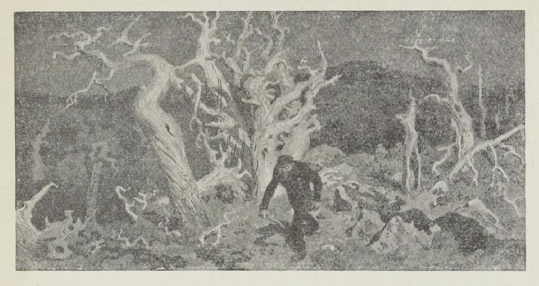
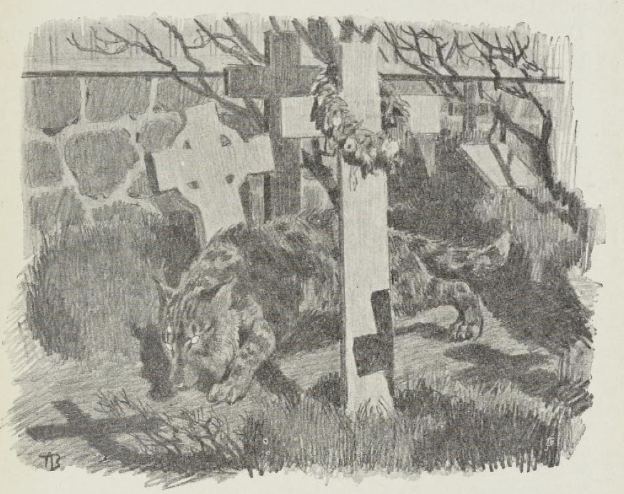

# Jens ulv

Tett ved kirken lå klokkergården. Mørke, solbrune hus med hvitmalte vinduer på den siden som vendte mot kongeveien, med eldgamle vindskjeve blyvinduer inn mot gårdsplassen. Bakom sto stabburet. Den gamle værhanen på klokketårnet bar seg og jamret, etter hvert som den vendte seg mot været; brønnen med sitt solblekte, skjeve lokk svartnet tett der ved; den gamle slitte, jernbeslagne bøtta svang tung av fuktighet hit og dit på den gnisende brønnstanga, og den ensformige lyden skar og skrek i stillheten. For stille var det støtt på klokkergården; kirken lå nær der ved, og kirkegården med de forfalne trekorsene og det stive gresset på gravene lå like inntil husene, bare med det svarte plankegjerdet imellom.

Derfor hørtes også all lyd sterkere her på klokkergården enn annensteds. Skvatret en skjære på taket, så skar det som redsel gjennom stillheten; kvein grisen som sto innestengt mellom uthusene, kunne en tro det ble begått mord. Og så stille var det, særlig i hviletiden, at gikk den svart- og hvitbotete katten over gården, syntes man en hørte skrittene dens.

Han som nå var klokker, het Jens. Han var svart av håret og mager av kropp, hadde en bred, stor munn med sterke, gule tenner og vassblå, slukne øyne under mørke, sammenløpende øyenbryn. Han gikk lutt og snikende, men svært fort og hadde det ved seg at han liksom alltid kom uforvarende over folk. Når han satt mellom mange mennesker, var blikket hans urolig og flakkende, og han snakket mye og forstandig om alt som var for hånden; men ble han sittende alene, kom det en stor sorg over ansiktet hans, og folk som hadde truffet til å se ham når han vandret for seg selv, fortalte at aldri hadde de sett tungsindigere mann.

Denne Jens klokker var av en ætt som nylig var vandret inn i bygden. Ingen visste noe videre om ham, og ingen hadde videre lyst til å spørre heller; for det kunne av og til komme et uttrykk i ansiktet hans som om han ville ete folk levende, og da fikk de vassblå øynene mest som en rødlig, farlig glans og sto rett på folk lenge.

Jens klokker var ikke gift; han hadde en søster til å stelle for seg og en tjenestegutt til å drive gårdens bruk. Mange hadde tjent hos klokkeren; men de stanset ikke lenge, for arbeidet var hardt, og det var en forunderlig gru over gården, så de kjente ille ved.

Så var det en gang at klokkeren nettopp hadde byttet tjenestegutt. Den han nå fikk, het Ola og var fra øvre bygden.

De arbeidet mye sammen, Jens klokker og denne Ola, mest med åkerbrytning og grøftarbeide, og drengen la da merke til at når husbonden drev med grøftegravingen, kunne han av og til ligge slik i og ta slike tak at han var rent vill. Og når han så av og til pustet på, eller reiste seg opp og så seg omkring, fikk drengen en kjennelse, mest som om det var et rivende dyr som drev på.

Gutten sa ikke noe til noen; men han ga fra den stund nøye akt på husbonden, for han syntes dette var underlig.

Under klokkergården lå det en seter langt inne på de øde fjellene. Til seteren støtte en skogteig, gammel, glisen skog med gråhvite tørrfuruer øverst i fjellbåndet og vantrivelig ungskog lenger nede. Her brukte klokkerdrengen å ta tørrved for vinteren. Han hogg den om høsten før første snøfall og kjørte den hjem på vinterføret. Her holdt elgen til på ferd over fra vestre til østre li; her spilte tiuren solspillet i toppen av en eller annen av de mektige tørrfuruene der oppe i fjellstillheten.

En høstdag som klokkerdrengen kom hjem fra seteren og tok snarveien over de øde moene for å sette ut noen store fuglsnarer, traff det seg slik at han ble heftendes med disse snarene til langt på kveld.

Da han endelig var ferdig, sto månen høyt på himmelen. Det var klarvær med frost i vente. Måneskinnet lå som en jevn, eventyrlig tone over fjellet; det hvitnet på de mektige tørrfuruene, gråhvitt og fælt som på knoklene til de døde; de mosegrå haugene bortover lå som graver på en stor kirkegård.

Klokkerdrengen slo et slag nordover for å finne en hjemsti som han visste lå fremme der ved en liten myr. Men rett som han arbeidet seg frem ved denne vesle myren, fikk han fra haugene ovenom høre liksom et underlig ul. Han tverrstanset og grep etter øksa som han bar i bakmeisen. Skulle det være ulv her, mon tro? Rett som han sto, fikk han se noe røre seg og komme fort frem over haugene. Det stanset og ulte — og så dro det på igjen. Det gikk i kross og i krok som om det fulgte et spor; men dyr var det nå ikke likevel, for det gikk høyt oppreist gjennom lendet.

Klokkerdrengen ble kald der han sto, men kom seg likevel bak en unggran, som vokste like ved hjemstien.

Den som ulte, kom fort dragende, og i måneskinnet så han det var en krukket mann med stav i hånd. Da han kom fram til myra, rettet mannen seg opp, snuste nesten som en hund og ulte. Gikk så fort i vei, like forbi busken der klokkergutten sto. Men denne ble stående som fjetret; for da han fikk se ham i ansiktet, der han dro forbi, så han at det var Jens klokker, husbonden hans.

Lenge ble han stående, for han torde ikke gå; men til slutt tok han kuten gjennom skogen, snarveien, så fort han orket.

Da han kom hjem om kvelden, var alt stille.

«Du kommer sent hjem,» sa klokkeren; han lå i senga og våknet da gutten gikk gjennom stua.

«Ja, jeg ble heftendes,» svarte gutten, han torde ikke se bort på klokkeren, men gikk bare ende opp på loftet og la seg.

Dagen etter da klokkerdrengen og Jens klokker bar opp løv på låven og drengen gikk sist, fikk han se at det satt tørr reinmose i buksa på klokkeren. Da skjønte han alt. Og fjorten dager etter flyttet han.

Men fra den dag begynte de i bygda å snakke om klokkeren sin, og før året var gått, hadde han liksom av seg selv fått øknavnet Jens ulv.

Ryktet om at klokkeren var varulv, kom snart presten for øre, men han trodde ikke stort på det. For i all sin gjerning i Guds hellige hus var Jens klokker så andaktsfull, og når han leste kirkebønnen fra kordøra, var det slik hengivelse i stemmen som om han takket og ba for seg selv alene.

Men så var det en kveld presten skulle opp til kirken for å hente Guds ords bok som han hadde glemt etter seg sist han prekte.

Da han kom opp til klokkergården, stakk han innom der for å få kirkenøklene.

Klokkeren var ikke hjemme, men han traff søsteren.

Hun visste ingenting om kirkenøklene, for de var ikke å finne der de brukte å henge.

Ja, presten tenkte at kanskje klokkeren var i kirken, og dro i vei uten nøklene.

Da han kom frem til kirkeporten, sto den på gløtt med nøklene i. Han gikk inn, men fant ikke folk, gikk ut igjen for å se om klokkeren kanskje var på kirkegården.

Å jo! Da han kom fram til der graven til gamle presten Mandal var, fikk han høre noen som grov og grov. Og dertil en underlig ynkelig lyd, halvt som ul og halvt som gråt.

Presten gikk så nær at han fikk spruten av gravjorda rett som det var i ansiktet. Men det som grov, verken hørte eller så.

Da skjønte presten at det var Jens klokker, som var på nattferd. Så satte han seg stille i kirkegårdsvalen og ventet.

Om en tur ble det stille der ute, og han hørte noen komme. Og inn gjennom kirkeporten smøg et underlig dyr, halvt ulv, halvt katt. Da smelte presten kirkeporten igjen, låste og tok nøklene ut. Gikk så sørover til klokkergården og leste hele tiden Fader vår gang på gang. Men da han skulle inn av porten ved klokkergården, snudde han seg og så seg tilbake mot kirken. Og der så han klokkeren sitte som varulv i kirketårnsluka og mjaua og bar seg som en katt.

Presten gikk like inn til søsteren.

«Hvor er bror din?» spurte han.

«Her er jeg,» sa klokkeren, han satt ved bordet og åt kveldsmat og stirret på presten.

Presten ble blek.

«Det var bare kirkenøklene jeg ville levere,» sa han og rakte dem frem.

«Takk,» sa klokkeren og rakte hånda ut. Men hånda var grå av gravmuld.

«Det er godt jeg vet de er i gode hender,» sier presten, han ser skarpt på klokkeren.

«Å, hendene er nå som Gud har skapt dem,» svarer klokkeren, og det lyser rødt av de vassblå øynene.

En tid etter ble Jens klokker syk, og da måneden vel var gått, skjønte alle at rett nå var det slutt.

Så var det siste dagen. Presten var kommet og satt ved senga; Jens ulv lå blek og stille. Rett som han lå, skalv han, og øynene sto store på presten.

«Fryser du?» spurte presten — han dro felden oppover brystet. Da ga Jens ulv et ul så uhygge stygt og stirret og stirret mot sengefoten.

Og da presten så etter, lå foten bar med klør som av ulv på tærne.

Da slo presten hendene sammen.

«Gud forbarme seg, for noen føtter du har!» sa han.

«Ja, han må da vel det!» sa Jens ulv — han stirret rødøyd på presten.

Samme natten døde han; men siden var det fritt for varulv i dalen.
