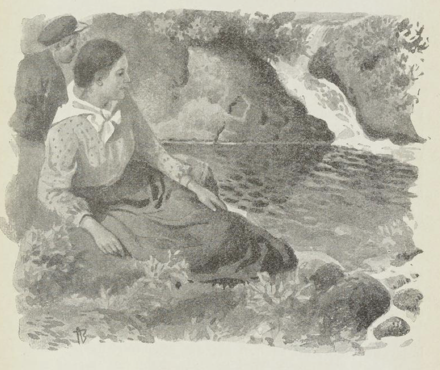

# Marit

Jeg husker det så tydelig som om det var i dag - selv om jeg den gang ikke var mer enn fem år gammel.

Borte ved prestegårdssvalen sto jeg fortapt og stirret med luen bak på nakken og tommelfingeren i munnen.

Slikt hadde jeg aldri sett før!

Midt på gården sto en stor, rar vogn, «kalosjevogn» hadde Ola Styggpåjord kalt den, og i stallen hadde det kommet to brune, fremmede hester.

Men inne i selve stuen var det fullt av folk, fine barn med pene byklær, en stor mann med langt skjegg og grov røst, som hørtes selv om døren var lukket, og en liten tynn frue som så bedrøvet ut.

De drakk ripsvin og spiste både goro og fattigmannsbakkels derinne i stuen, men vi barn fikk ikke lov til å komme inn, for vi var ikke pent nok kledd; og de fremmede skulle reise videre, så snart hestene hadde hvilt.

Rett som jeg står og stirrer, kjenner jeg et tak om hodet mitt og et par varme, gode hender over øynene mine.

Det var fremmede hender og et fremmed, mildt åndedrett.

«Å, det er bare deg som følger med dem,» sa jeg.

Hun slapp ikke.

«Du med det rare forklæet vel!»

Da løftet hun meg opp i fanget og så på meg med de dype, blå øynene.

«Marit», sa hun lavt og varmt.

Og så lo hun, slik en lun, trygg latter, og to dype smilehull kom frem.

«Hva heter du da?» spurte hun.

Jeg svarte ikke, jeg måtte bare stirre på henne.

«Min venn heter du,» sa hun og bøyde hodet så pannen hennes rørte min.

Med det samme kom mor ut.

«Har du alt begynt?» spurte hun og smilte.

«Ja, jeg er nok ikke lenge om det,» svarte Marit, hun holdt meg fast i fanget.

«Du har da fått fatt på den viltreste også,» sier mor og går inn igjen.

Marit svarte ikke, lo bare på sin gode måte og svingte rundt med meg.

Jeg tok tak om halsen hennes for å holde meg fast, og slik bar hun meg bortover.

Dette var mitt første møte med Marit, og fra samme stund var det et forbund mellom oss to så inderlig og en kjærlighet så sterk at den varer ennå, skjønt hun for lengst er død fra meg.

Hun var fra fjelltraktene inne på Røros-kanten og kom til oss fra presten S... som hun fulgte på veien nedover da han skulle reise til et større og bedre prestekall sørpå.

Og da de to brune hestene sto forspent igjen og alle satt i vognen, sto hun der blek, Marit, med min hånd i sin og stirret på barna som reiste, og fruen nikket så blidt for siste gang, og barna satt tause og visste ikke hva de skulle si, men presten tok tømmene og kunne ikke få et ord frem.

«Far vel, far vel,» mumlet han og kjørte til.

Hestene tok et rykk, det ble nikket og viftet på ny, og vognen svingte raskt ut av gården.

«Marit,» sa mor og tok henne om skuldrene, der hun sto ensom. «Vi får stelle det så godt vi kan,» la hun hviskende til.

«Ja, je ska' freste,» svarte Marit og så trofast på henne.

Så fulgte vi mor inn.

Inne i lillestuen, den samme stuen der jeg ble født, hadde Marit og vi barn tilholdet vårt. Der satt hun ved vinduet og kardet og spant og fortalte om verden vidt omkring. Om Røros-grubene med de dype, farlige gangene, om nordmanns-karene som kom kjørende med kull fra Tynset og Tolga, Kvikne og Ålen i de strenge vinternettene under nordlys og knitrende kulde, tjue, tretti lass om gangen; om finn og om rein, tusen dyr over alle vidder, så langt øyet kunne se.

Og når det var fortalt, kom bøker frem, gamle og grå med bilder inni, bleknende farger og underlig lukt av gammelt, innestengt, mørknet papir.

Og så måtte vi da fortelle.

Men når vi kom i krangel og røk sammen, lo hun så lunt og bare så på oss.

«Skjøt på tålmodighet, nå blir det for stutt,» sa hun.

Kokte blodet vårt over, sterke og viltre som vi var, og hørte vi ikke på de dempede ordene hennes, reiste hun seg helt stille, la arbeidet fra seg, tok tørkleet på, gikk og kom ikke igjen.

Og når hun først hadde gått, ble det så underlig lummert i stuen. Vi satt og så på hverandre, rådville; det ble stillere og stillere og til slutt så tungt å puste.

Hun fortalte det ikke, verken til mor eller far, det visste vi; men kanskje hun satt for seg selv alene et sted og gråt; for det hadde hendt; eller kanskje hun holdt på å legge sammen klærne sine for å reise!

Og rett som det var, smøg én seg sakte ut for å lete, så én til, og før vi visste ordet av det, sto vi alle rundt omkring henne borte i en krok, ute på gangen eller ute på gården, og hun snakket til oss og strøk oss over håret, men nevnte aldri noe om det som nettopp hadde hendt.

Så falt det et spøkefullt, tilgivende ord, og vill av glede var hele flokken over henne og dro henne med.

Når så far møtte toget, nikket han lyst:

«Nå gutter! Riv henne ikke ihjel,» sa han.

«A, en får tråtte,» svarte hun da gjerne og lo, så de dype, betagende smilehullene viste seg.

Da Marit hadde vært i tre år på prestegården, ble jeg en vinter svært syk. Doktoren ble hentet, og han forklarte at jeg hadde den trondhjemske halssyken, som gikk over alle bygder på den tiden.

Jeg hørte gjennom feberen at mor spurte om det var farlig.

«Kan bli,» svarte doktoren.

«Men smittsomt er det under alle omstendigheter,» la han til.

Og så ble det bestemt at jeg skulle legges på nysalen alene, langt borte fra de andre.

Jeg reiste meg opp i sengen i redsel.

Nysalen! Der hvor den druknede mannen hadde stått lik! Der hvor det jamret og stønnet om kveldene! Der hvor bare bispen turde ligge, han, som var så godt kjent med Gud!

Og jeg gråt og ba for meg!

Da kom Marit bort til sengen.

«Du kan da skjønne at vi ikke er redde, du og jeg!» sa hun.

Du og jeg! Det sank som fred over meg! Det hadde jeg ikke tenkt på.

Jeg lå en liten stund stille.

«Men da skal du aldri gå fra meg!» sa jeg.

«Nei var det likt seg.»

«Og være hos meg hele, hele tiden? —Du skal love meg det, hører du!»

Marit sto og så på meg med de dype, trofaste øynene sine.

«Det kan je låve deg trygt,» sa hun.

Mor og doktoren vekslet et raskt blikk.

«Det kan vare hele tre uker det, Marit,» sier doktoren.

«Je har hørt så,» svarer hun.

«Det kan bli farlig for deg også.»

«Ja det er vel så det.» Hun la puten bedre under hodet mitt og satte seg ved sengegjerdet.

Mor og doktoren så igjen på hverandre. «Marit er Marit,» hvisket mor.

Doktoren snudde seg raskt og gikk.

Men da Marit og jeg ble alene, stønnet jeg gjennom feberheten:

«Og så skal du være hos meg hele, hele tiden!»

Hun strøk meg over håret. «Je har låve deg det,» sa hun.

Og hun ble hos meg hele tiden. I de tre ukene sykdommen varte, satte hun ikke foten utenfor sykerommet på nysalen.

Jeg husker ikke annet fra denne tiden med feberdrømmene og smertene enn Marits bleke, velsignede ansikt, som alltid var der dag og natt, ga smerten lindring, strøk uroen bort, brakte søvn i de lange nattetimene og eventyrglans over de lange dagene, da bedringen endelig kom.

Ofte siden, når sorg har rammet eller livet har gått meg imot, har jeg pleid å drømme frem bildene av far og mor for å kjenne meg sammen med gode mennesker; men bak dem, i sterkt lys, stiger uvilkårlig Marits ansikt frem med det gode smilet og de dype, trofaste øynene. Det er minnet fra de dagene.

Tre uker etter at jeg var blitt syk, gikk det bortover veien ved prestegården to bleke mennesker, ørske og betatt av den sterke, solfylte vinterluften.

Det var Marit og jeg som var ute første gang etter sykdommen.

Borte ved hagesvingen møtte vi far.

«Nå endelig!» sa han, stanset og så på oss.

«Ja, vi vart klene lenge vi; men nå står det til liv,» svarte Marit og lo sin lyse dempede latter.

Verken jeg eller Marit bar merker lenge etter vinterens tunge uker. Da sommervarmen kom, var jeg den viltreste i leken som før, og Marit gikk der som sunnheten selv, fast og frisk, med det fine, unge ansiktet, det store, mørke håret flettet i tykke fletter under tørkleet og en holdning som en dronning.

Og så gikk dagene som eventyr. Snart plukket vi harelabb, både hvit og lyserød på de varme, bare hauger borte ved smien, snart drev vi langs skigarden i stekende solskinn og bandt kranser av blomstermylderet i det høye, urteduftende gresset, mens humler surret og mygg sang, snart satt vi nede ved elven i skumringen og så fisken slå, mens Marit nynnet underlige, fremmede sanger fra fjerne bygder som vi ikke kjente.

«Hvor gammel er du, Marit?» pleide vi ofte å spørre når vi klengte på henne og hun i spøkende ord mente vi måtte være «andektige» mot mor vår.

«Skjøt på!» svarte hun da gjerne og lo så inderlig godt; men hvor gammel hun var, fortalte hun aldri, og ikke ville noen ha trodd henne heller om hun hadde fortalt det.

Vi barn gjorde nå imidlertid den utregning at hun kunne leve forferdelig lenge, og da var det jo ingen fare.

Men så hendte det en dag noe som ble en av de tyngste sorgene i barneårene mine.

Marit gikk og forlovet seg.

Ordentlig med ring og alt!

Og en fremmed mann fra den bygd der hun hadde hjemme, satt stadig ute i drengestuen, snakket med henne når hun bar inn ved, og tok farvel med henne borte ved skigarden.

Det skar meg i hjertet med en ukjent smerte; jeg gikk for meg selv og sørget, og jeg kjente meg syk over hele kroppen.

En dag traff hun meg slik, tok meg tett inntil seg og spurte hva som feilte.

Jeg gjorde først motstand, såret og syk; men så fikk den gamle kjærligheten overtaket, og så brast det ut:

«Du vil gifte deg fra meg,» storhulket jeg.

For det hadde jeg lovet meg selv da jeg første gang for alvor tenkte på å gifte meg - jeg var den gang syv år gammel - at med Marit skulle det bli og med ingen annen.

Marit var blitt svært alvorlig. Hun sto og strøk meg ned over hodet gang på gang, og stirret ut i luften. Hun ville si noe, men fikk det ikke frem.

Så snudde hun seg langsomt bort og gikk.

Noen dager etter reiste den fremmede mannen, og nå gikk jeg som i en feber og drømte at Marit ikke ville gifte seg allikevel.

Men så en dag fortalte mor oss at det var bestemt hun skulle nordover til høsten og gifte seg og aldri mer komme tilbake.

Fra den stunden var alt som dødt. Det var ingen glede lenger i lekehuset under trappen, der alle de forgylte skårene av fine kopper og krus lå. Det var ingen moro mer å rive farge av rød murstein og male på kvernen, som vi bygde nord ved bekken, og i høyet på høytrevet hoppet jeg aldri mer. Jeg gikk bare bakom låven eller nede på jordene alene, alene og tenkte på Marit som ville reise.

Den tunge dagen kom.

Utenfor svalen sto Storblakken forspent for kjerren. Den kjente rødmalte klesskisten med de hvite, snirklede navnebokstavene var bundet bakpå, og Marit kom blek og forgrått ut fra gangen med det svarte helligdagstørkleet sitt om hodet.

Hun hadde tatt avskjed med far og mor og begge de små brødrene mine; nå så hun seg om etter meg, for jeg hadde ikke vært inne.

«Kjære hvor er gutten blitt av!» undret mor, hun gikk ut i kjøkkenet for å se, men kom straks tilbake.

Ingen hadde sett meg der.

Så ropte hun. Det kom ingen.

Far gikk ut i drengestuen og kom igjen. Derfra bort til vedskjulet, ropte ut over jordet og kom igjen.

«Vi får hilse fra deg,» sa mor.

«Nei det går aldri for seg,» hadde Marit svart svært alvorlig.

Så hadde hun begynt å lete selv. Først på alle de stedene hun visste jeg likte. Senere overalt der det kunne være fare.

Endelig, som etter en fin sjels innskytelse - oppe på nysalen.

Og der fant hun meg.

Dit, til sykeværelset fra i vinter, hadde jeg listet meg tross redselen for de øde rommene, og der på gulvet lå jeg, bortsovnet fra all verdens altfor tidlige sorg.

Jeg våknet ved å kjenne Marit kysse meg gang på gang, mens tårer dryppet. Hun hadde løftet meg opp, og nå slo jeg armene fast om halsen på henne.

Slik bar hun meg ned.

«Kjære var han der!» utbrøt mor grepet, hun forsto med ett dybden i dette barnlige forholdet og så halvt spørrende bort på far. Så gikk hun bort for å ta meg.

Da bøyde Marit hodet ned mot mors skulder.

«Je er ikke god for å reise,» hvisket hun og brast i gråt.

De andre sto undrende omkring.

«Marit, kjære Marit,» mumlet mor og strøk henne nedover kinnet, rådvill, beveget.

Og da jeg snudde hodet, fikk jeg se far stå på noen avstand, stirre på oss og gni seg i hendene, så de hvitnet, noe han alltid pleide å gjøre når noe grep ham sterkt.

Så hostet han, den trykkende hosten når noe vanskelig skal sies.

«Mor,» sa han halvhøyt.

Hun gjorde seg sakte løs og gikk bort til ham. Marit satte meg ned og ble stående og se ned på min hånd, som hun strøk og strøk.

Far og mor snakket en stund sakte sammen, han forklarte og hun spurte. Så snudde mor seg endelig. «Ja, det måtte kunne gå an,» sa hun halvhøyt og kom langsomt bort til oss.

Marit så opp, mykt, skamfullt, som om hun skulle be om forlatelse.

«Enn om dere kunne bo på nysalen?» sa mor høyt.

Marits ansikt lyste opp, sterkt. «Kunne det gå for seg?» spurte hun.

«Ja, det fikk gå an, Marit,» sa mor.

«Å nei, herregud da!» sa Marit, gikk bort og tok mor i hånden.

Men da brøt også jubelen løs hos oss barn!

Fra mor bort til Marit, fra henne til far, så på fire bortover bakken: «Ha, ha, ha!» så oppover stigen og ned igjen til far smilende ropte:

«Nå, nå, nå, gutter!»

Men alle folkene på gården sto fornøyde og så på. Ja, selv Tull Erik stanset huggingen borte ved skjulet.

«Det er best je snur, je da,» sier Ola Styggpåjord lunt, han tar tømmene og smatter på Blakken.

«Ja skulle du sett slikt da,» sier Marit og ler den gamle, gode latteren sin.

Så ser hun på mor og følger lasset for å få klesskisten sin av igjen.

Mange år har gått siden den dag.

Marit og hennes mann hadde flyttet fra nysalen til en liten stue som lå på prestegårdens grunn ved allmannsveien en halv fjerding borte. Og jeg hadde byttet barneleken og barnedrømmene med livet i den larmende byen, der jeg var sendt inn for å gå på skole.

Men om kveldene når jeg satt alene og leste, kunne jeg ofte synes jeg så Marit stå gråtende ved prestegårdsgrinden og si:

«Du glømmer full bort meg!»

Og når jeg fikk noe godt sendt til værelset om kvelden, sto alltid honningkakebiten med den underlige smak av Marits røne skuffer for meg som det beste i verden. For den kom selvsagt frem hver gang jeg gjennom de lange årene besøkte henne i den lille stuen ved veien, og det skjedde ofte.

Det var en sval julinatt på morgensiden, at jeg kom hjem til den første ferien.

Fra Storsjøen og opp til prestegården de to siste mil gikk jeg sammen med et par lass-kjørere, kjente bygdefolk.

Duggen lå grå over engene, skogen sto lun og søvntung langs de øde veiene. Bygden lå og sov i demringen, og fuglene hadde enda ikke begynt.

Krasningen av hjulene hørtes langt og lydt, og våre stemmer klang så underlig våkent i nattstilheten.

Hvor alt var blitt smått og vemodig på det ene året! Skigardene var forfalne og lave; jeg syntes jeg kunne skreve over dem. Og husene med de fattige gresstak! Jeg syntes jeg kunne nå mønet med hånden.

Nå kom vi forbi Bårdteigen, hvor jeg plukket bringebær mellom steinrøysene langs Rødbekken i gamle dager. Lite som en dukkestue lå jordet der, og det som før hadde vært så uoverkommelig stort!

Jo, jeg kjente den sterke lukten av hegg borte ved ledet, og den ville ripsbusken sto der visst ennå tett ved elvekanten!

Der lå Marits lille stue i bakkehellingen til venstre. Jeg kjente det trangt for pusten, da jeg gikk forbi. For gjennom brev fra mor hadde jeg hørt at Marit hadde vært dårlig hele våren utover.

Da vi hadde gått en stund, spurte jeg dem jeg fulgte, hvordan det sto til med Marit.

«A, det er nok på det siste,» svarte den ene. Det fór som et kaldt støt gjennom meg.

«På det siste!» gjentok jeg brutt.

«Ja, det ska nok ikke være langt igjen.»

Jeg fikk ikke frem et ord mer. Bare gikk og gikk, så de andre måtte slå på hestene for å holde følge. Ved den lille bakken i hagesvingen sa jeg takk for følget, fikk ranselen min av lasset, gikk frem til grinden og løftet den slitte kroken.

Så åpnet jeg stille porten, som sto på klem, gikk varsomt oppover trappene, snublet i de altfor små trinnene, famlet langs det kjente rekkverket og kom inn til mor.

Fire timer senere sto jeg ved Marits stue med hånden på klinken, ør av nattens gang.

De snakket der inne. En sped, syk stemme med hyppig stans som av tretthet og innimellom de korte, dempede svar av en mannsrøst og lyden av trinn som gikk til og fra.

Jeg løftet varsomt klinken og kom inn.

Der lå hun med et fremmed uttrykk i de store øynene og det mørke håret løst utover.

Øyenbrynene var trukket sammen av smerte, og munnen satt smal og stram i det magre ansiktet.

Mannen sto borte ved dreiebenken med noe arbeid.

Jeg vekslet blikk med ham, nikket stilt, da han la fra seg for å hilse, og gikk så langsomt bort til sengen.

Hun stirret først på meg, fremmed, uten forståelse —; da klarnet det opp, drivende hvitt, i ansiktet hennes, og jeg kjente øynene hennes igjen.

«Å nei herregud da!» mumlet hun og fuktet de tørre leppene med tungen.

Da måtte jeg i kne.

Hånden hennes kom famlende bort på min skulder.

«Gud velsigne deg da,» sa hun. Ordene døde hen.

Jeg fikk tak i hånden uten å se opp og ble liggende slik.

Og fred sank som skygger over stuen.

Om en stund tok hun hånden til seg igjen. Så sa hun lavt og anstrengt:

«Du skulle ikke komme nå! Jeg er blitt så altfor dårlig.»

Jeg så opp.

«Skal du dø nå da Marit?»

«Ja, je skal nok det.»

Jeg tok hånden for ansiktet og bet tennene sammen for ikke å gråte.

Hun skjønte det, fikk lunt tak i den ene etter den andre av fingrene mine og dro hånden vekk.

«Du får ikke gråte,» sa hun.

Jeg så opp på henne. «Det er så vondt dette, Marit,» hvisket jeg.

Hun lå en stund og stirret. De store, svømmende øynene så langt bort. «Å nei,» sa hun sakte.

Det ble stille igjen.

Mannen borte ved dreiebenken trakk et dypt, skjelvende pust. Så satte jeg meg opp på stolen ved siden av sengen.

Som jeg satt der, begynte Marit å se seg om med bekymrede øyne.

«Slik som her ser ut da,» sa hun.

Jeg strøk henne over håret. «Nei, nei da,» sa jeg. Hun forsøkte å smile.

«Og litt traktering skulle du vel ha også,» hvisket hun. «Du får se etter du,» sa hun til mannen.

Jeg måtte snu meg bort og gå bort til vinduet. At hun tenkte på dette, tok meg nesten mer enn alt.

Jeg hørte de to snakke, hørte ham gå og lete frem, og så om en stund kom han bort til bordet med et lite brett. Det var vin av mors i et glass med trestett og en liten tørket gammel honningkakebit.

«Det blir ikke rar traktering,» sa han og satte brettet ned.

Men med ett grep minnet ham; han ga en kort, underlig, hikstende hulk, som straks stanset, snudde seg og gikk bort til dreiebenken igjen.

Jeg kunne ikke smake noe, men den vesle honningkakebiten stakk jeg til meg. «Den tar jeg,» mumlet jeg med gråten i halsen.

Og jeg skammer meg ikke over det; jeg har dens smuldrende smuler enda.

Fjorten dager etter døde Marit, en natt, så jeg ikke fikk være der.

Hun ble begravet i familiegraven vår tett ved siden av lille Johannes. Gamle Blakken dro likkjerren, den samme kjerren som sto forspent den dagen Marit skulle reise fra oss, men ikke orket.

Straks hun var kommet i jorden, reiste jeg til en gammel venn som aldri hadde sviktet i noen sorg, det svale, store høyfjellet.
