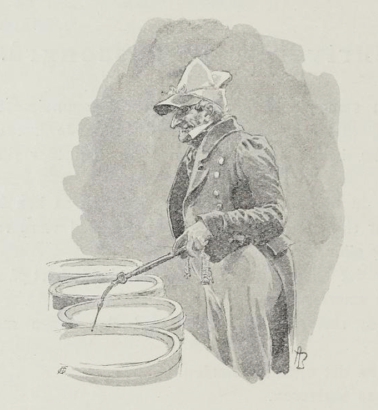
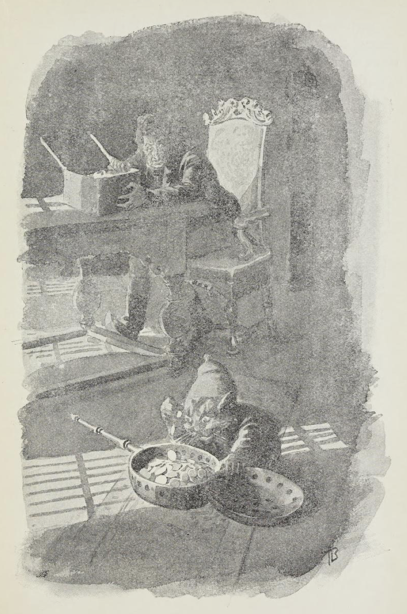
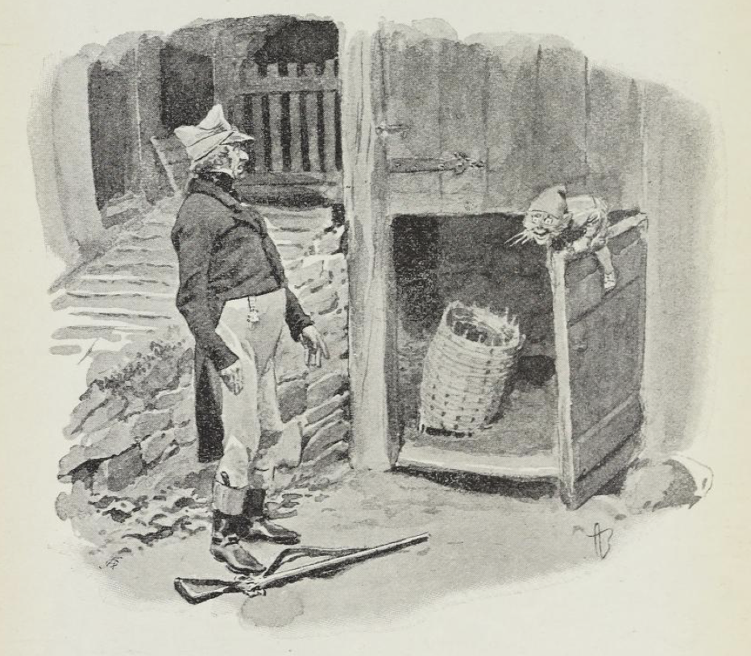

# Skriveren og Tassengrå

Skriveren som kjøpte Julsrudgården da gammelpresten døde var en mann av dem Gammel-Erik hadde bitt merke i.

For han hadde vært prokurator før han ble skriver må vite.

Og sa du til ham at øks hadde skaft, så sa han blankt nei; for det var skaftet som hadde øks, og rett skal være rett enten det er rett eller ikke.

Så var det en morgen at skriveren skulle bort på stabburet for å telle smørformene sine.

«En,» sa skriveren og pekte med den fine merskumspipa sin.

«To,» sa det oppunder slinden.

«To,» sa skriveren.

«Fire,» sa det oppunder.

«Fem,» sa skriveren - han kom ut av tellingen.

«Slem,» sa det oppunder slinden.

«Syv,» sa skriveren - han visste verken ut eller inn.

«Kjyv,» sa det oppunder.

Da ble skriveren sint.

«Ti,» sa han, han gjorde seg morsk, må vite.

«Ti selv,» svarte det oppunder slinden.

Så begynte skriveren å telle om igjen, men like galt ble det.

Alt han strevde og alt han skrek, så fikk han ikke tall på smørformene sine.

Da han gikk igjen og skulle til å stenge stabburet, var burnøkkelen borte.

«Nøkkelhullet har jeg,» sa skriveren, «men nøkkelen har fanden tatt.»

«Nøkkelen har jeg, men nøkkelhullet har fanden tatt,» sa det oppe i matklokketårnet, og da skriveren skulle se til, så hang nøkkelen og slang i et tau nedover burveggen.

Han til å hoppe og hugge etter nøkkelen med neven; men jo mer han hoppet, jo høyere kom nøkkelen, og til slutt ble skriveren sittende på stabburtrappen og pese, så det hørtes lang vei, og gråte gjorde han, bare så det silte av ham.

Rett som han satt der og bar seg, fikk han høre at stabburdøren smalt igjen så det klang, og da han skulle se etter, satt nøkkelen i nøkkelhullet; men tauet hang og slang nedover burveggen.

Skriveren i vei og tok nøkkelen ut av burdøren, og med det samme han gikk nedover stabburtrappen, glante han opp mot tauet, som hang der og slang enda.

«Du kan gjerne henge for meg,» sa han.

«Du kan gjerne henge for meg,» sa det oppe i klokketårnet.

En annen gang drev han inne i kammerset sitt og telte penger av et digert pengeskrin han hadde stående der.

Rett som han satt der og var glad, kjente han seg så underlig nummen over hele kroppen.

«Uff, her må det være katt inne,» sa han og snudde seg for å se.

Men da satt det en diger nisse midt på gulvet og telte det blanke sølvet av et kullfat.

«Det er jeg som eier sølvet!» skrek skriveren og reiste seg brått.

«Det er sølvet som eier deg,» sa nissen, og borte var han.

Men da skriveren kom bort til kullfatet, var det fullt av bare jord og småstein.

Etter den dagen lurte skriveren med børsa på nissen om kveldene.

En kveld fikk han se ham - han satt innunder stallgulvet og åt på et sildehode. Skriveren smalt av, så røyken føk, og da han skulle se etter, lå det en grå, stubbrumpet katt så dau som en sild. Og så gammel var den, at den hadde værhår over hele kroppen.

Skriveren var både stolt og kry da han gikk opp igjen fremme ved husene den dagen; for det er ikke hver dag en får livet av en nisse, må vite.

Men da han kom frem til stalldøren så satt nissen der like fullt, den, og lo og freste av skriveren.

«Nei, nå vet jeg ikke forskjell på rett og vrangt lenger,» sa skriveren, han slapp børsa og ble stående og glane.

«Det har du aldri gjort,» sa nissen.
