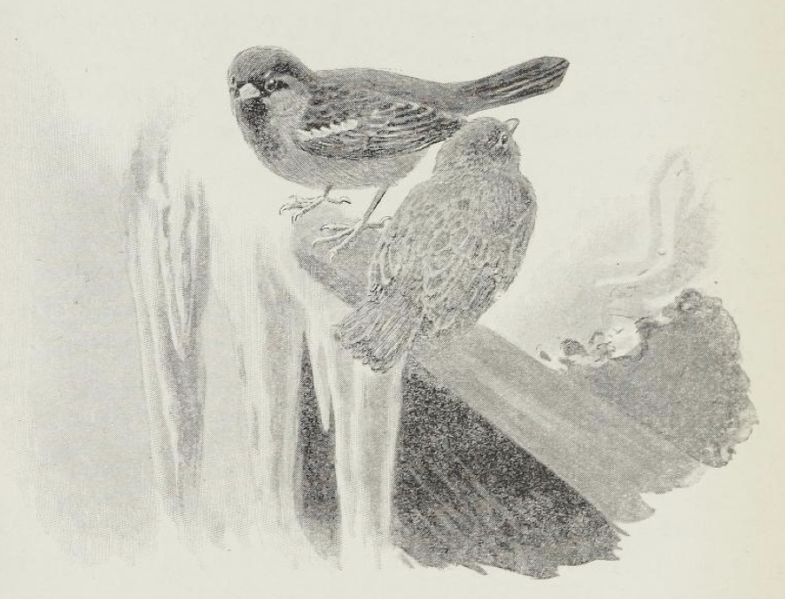

# Spirrevipp og Spurrevupp

«Pipp!» - det var knitrende kaldt på gården.

«Pipp!» hun satt alene på takrennen, den søte spurverske, og grøsset og så lubben ut i de unge fjærene sine.

At han ikke kom, Spurrevupp den deilige!

«Pipp!» hun skakket på hodet; de svartblanke øynene skinte. Og hun ble slankere i fjæren der hun satt; for nå hørte hun den kjente duren av de snurrende vingeslagene hans, der han kom flyvende fra låvegluggen, høyt over brønnstanga og like dit.

«Drrrrrrrr!» der slo han seg ned på takrennen.

Hun ble så sjenert; nebbet kom så høyt, nakken sank så inn, hun satt urørlig med stjerten ende opp av bare matthet og glede. Og hjertet hennes banket så hun kunne kjenne det like inn under vingene.

Han satt først stille og snudde hodet i alle retninger og lot som om han ikke så henne. Så skjerpet han nebbet på den skarpe snøen der istappen begynte. Hoppet så bred og lubben nærmere.

«Gomorrn!» sa han.

«Pipp!» sa hun, hun var så betatt. For han var så vidunderlig svart og varm i brystet.

«Fryser du, Spirrevipp?» spurte han, han bruste i fjæren.

«Pytt! nei, Spurrevupp,» svarte hun, hun bruste seg ut hun også. Og så hoppet de tett i følge bortover takrennen til de fant et gammelt frø som de delte.

«Til våren har vi bryllup, Spirre,» sa han.

«Ja, Spurre,» svarte hun. Hun la det søte hodet sitt på skakke og så på ham.

«Hvorr, hvorr skal vi bo?» spurte han.

«Pytt san! her!» sa hun, «eller der!» sa hun, hun så over og under takrennen.

«Hist, hist på en kvist,» sa han og var så spøkefull. Og han nappet henne i halefjæren og holdt fast.

«Pipp, slipp, slipp,» lo hun. Og så fløy de begge, hun foran over taket, han like etter - ned i den store rogna bak husveggen.

Der satt de lenge, hver på sin kvist, for her gjaldt det å være forsiktig, så ingen fikk se dem fra kjøkkenvinduet.

«Drrrrrrrrrr!»

En trinn spurvemadam kom tungt surrende fra stalltrevet og satte seg like ved de to unge. Hun var grå i fjæren med hvite stenk av alder, men svartsmusket i brystet og under buken; for hun hadde sine erfarne veier like inn blant menneskene, både blant gryter og kopper, både langs murpiper og på svaltakene.

De to skottet sjenert til hverandre.

«Skam dere! Skam dere! Kjærlighet! Kjærlighet! Er det likt seg slikt! Vinterstid! Vinterstid!» Hun tok opp igjen og opp igjen mest som i skolen, den gamle grå spurvemadammen.

«Fy!» sa hun til slutt og ble sittende helt stille. Hun tenkte på sin salige mann, som katten hadde tatt nettopp som han sto brudgom på nysalstrappen en solduftende vårmorgen.

«Drrrrrrr! Pipp! Drrrrrr! Kvitt!»

Det var to spurver fra nabogården som kom flyvende og slo seg ned, en ung og en gammel.

«Kvitt!» sa den gamle og hugg seg fast i grenen. «Kvitt, kvitt!» sa den. Det var lang vei, og den hadde tungt for brystet, gammel og fet som den var.

«Hva' ska' dere! Hva' ska' dere?» spurte den grå spurvemadammen.

«Bare hilse, bare hilse - kvitt!» svarte hun fra nabogården, hun fikk ånden igjen.

«Ikke verre?» sa den gamle madammen, hun ristet de grå fjærene sine og gned seg under buken med nebbet, men var i grunnen forarget; for hun visste om et nek som ville komme opp i dag på låvebrostangen.

Hun flyttet seg litt på grenen, hun fløy høyere opp, men lot som ingenting, enda hun herfra kunne se at det alt gulnet på stangen ved låven; så satt hun bom stille i mange minutter.

«Vakkert vær,» sa nabomadammen.

«Ja det er, ja det er,» svarte hun der oppe.

«I går også, også i går,» svarte hun der nede.

«Ja i går også, også i går,» svarte hun der oppe.

«Far vel, liten tid,» sa hun, og så fløy hun.

Men så gammel en spurv hun var, kunne hun ikke la være å fly beineste veien, som et tungt snurrende nøste bortover, og etter fløy de andre, alle sammen; for der hun fløy, var det gjerne mat å finne.

Og før hun visste ordet av, hadde hun dem alle etter seg i neket.

Og alle de andre spurvene på gården, som hørte den store duren av flukt mot låven, kom dragende en etter en, så snart sto hele neket på låvebrostangen i et eneste larmende mylder av grå, brune, levende nøster og klatter, som slo med vinger og hugg med nebb og lo og skjente og sloss og holdt leven.

«Mitt, mitt!» sa madammen, hun satt i korn til halsen, hugg og svelget.

«Vårt, vårt!» sa ungdommen omkring.

«Her, her!» sa Spurrevupp, han satt i en krok tett innved stangen med sin kjæreste og hadde det deilig.

«Fikk, fikk!» svarte hun, hun knepret med nebbet og lukket nesten de unge, forelskede øynene.

«Nei, her skal dere se!» sa en.

«Å du verden!» sa en annen.

«Vekk der!» sa en tredje.

«La meg være, la meg være!» sa den fjerde.

«Det er vårt!»

«Nei, mitt!»

«Nei, vårsesses!»

«Ikke deresesses!»

«Å du herlige verden!»

«Slipp, slipp! Gi meg det, gi meg det!»

«Pytt, det kan ikke nytte!»

«Verre og verre! Larv, larv.»

«Mitt!»

«Ditt!»

«Nei, mitt!»

«Her, der, så er vi kvitt! Bi litt!»

«Her er mer, her er mer!»

«Det er flere! Det er flere!»

«Nei, vet dere hva', vet de hva', vet du hva'!»

«Kvitt!» sa madammen - hun satt så trinn som en pølse midt i neket.

Med det samme smalt fjøsdøra igjen, og Oline budeie kom ut.

Durrrrrrrrr!

Pitt, kvitt, titt! Som en stor surrende sky fløy spurveflokken opp og dro til alle verdens kanter.

Og da katten som kom fra fjøset, kom opp på låvebrua, var det ikke en eneste en å se. Den så opp til neket lenge, gikk så med langsomme skritt ned igjen, smøg inn i låven og satte seg der ved et musehull for å lure.

«Spirre!»

«Ja, Spurre!»

«Gullet mitt!»

«Pitt - ja ditt!»

Det var så vidt det hørtes, som en fin vinterlig tone der oppe fra neket øverst i den lune kroken inntil stangen.

Det var Spirrevipp og Spurrevupp som hadde glemt å fly.

For de drømte om vår og kjærlighet.
