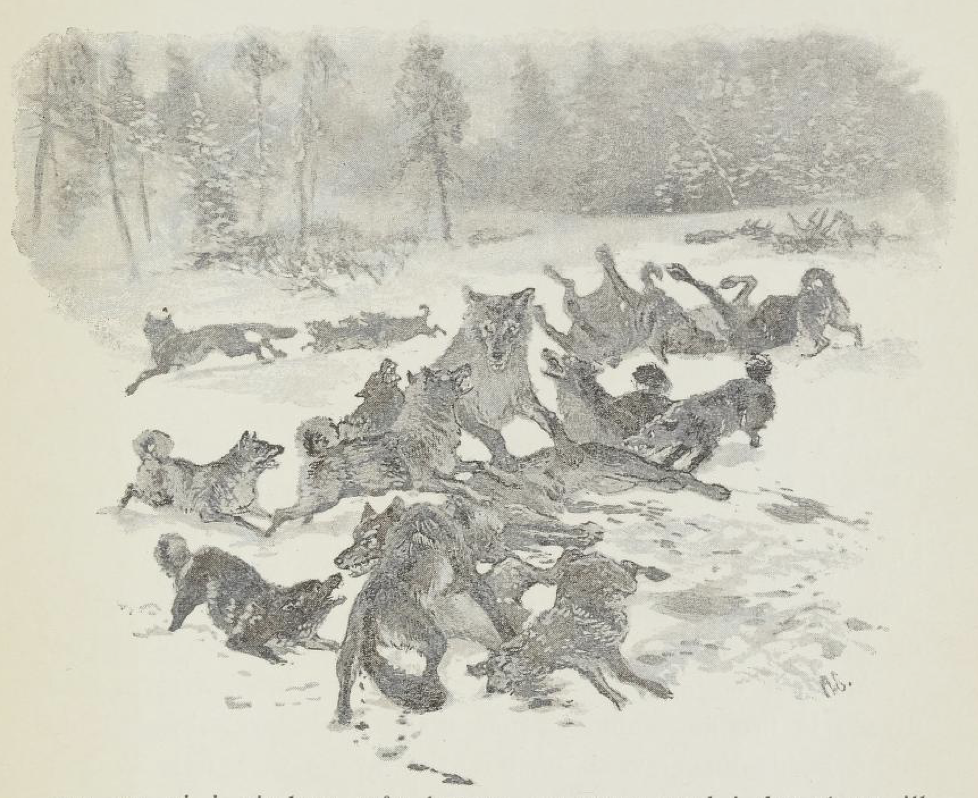
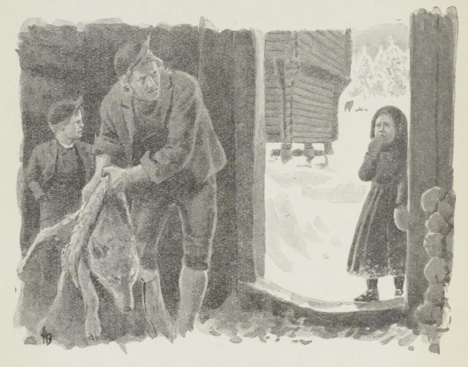

# Ulveslaget

I øvre Rendalens prestegård sto det i presten Storras tid et høyt gjerde av oppreist gardstav rundt hundehuset ved drengestuen. Dette gjerdet kom opp etter at ulven en forrykende uværsnatt innunder jul hadde revet ihjel bandhunden like utenfor drengestudøren og stukket til skogs med den.

Enda i min fars tid sto det gamle hundehuset der; men etter gjerdet var det bare merker igjen, og far tenkte aldri på å få det opp igjen, for det hadde vært nokså fredelig for ulv i bygda i flere år.

I prestegården hadde vi to hunder, Ajaks og Hektor.

Ajaks var en vanlig harehund, svart- og hvitsalet og heller liten enn stor. Den var det villeste dyret jeg har kjent, alltid opplagt og alltid leken. En stein som ble kastet, eller en fille som ble slengt, var nok til å få den i villeste jubel. I kåte sprett og overgivne glefs fór den gården rundt, og vi smågutter etter.

Med hodet mellom labbene og øynene lysende av skøyeraktighet lå den og ventet til vi kom, og når vi så skulle få tak i den, bar det av sted i behendige skvett hit og dit, inn under stabburet, ut under låven, bortover jordene, til vi hesblesende kastet oss ende ned og ikke orket mer. Da kom den styrtende, tok tak i buksebein eller trøyeermer og veltet seg overgivent mellom oss. Og ikke et glefs og ikke et knurr, hvor hardhendte vi enn var.

Ajaks var en slagsbror på sin hals. Det kom ikke en hund, stor eller liten, gående etter veien uten at Ajaks røk på den. Ofte fikk den bank, men oftere vant den; for den var så lynsnar i vendingen, så skarpbitt i kjeften, så uoppslitelig pågående og så ubendig modig at den som oftest ble mester til slutt. Og når det virkelig knep, kom gjerne Hektor til og knurret, og dermed var saken avgjort.

Hektor var en stor bernhardiner av det langhårede slaget, gulhvit med brune flekker. Av oss barn tålte den alt, ble ridd på og kjørt med og fulgte oss som en skygge. Når fremmedfolk kom til gårds, meldte den gjerne fra med et par grove glefs, men tok ellers saken med stor ro og lot Ajaks stå for musikken. Mindre hunder bet den aldri, og større hunder fantes det ikke i mange mils omkrets. For Ajaks hadde den et trofast og tålmodig vennskap, og om nettene lå gjerne Ajaks i det gamle hundehuset og Hektor utenfor.

Så var det en iskald, stjerneklar vinterkveld i februar 1858. Oppe i Bergslibakken nord for prestegården holdt vi smågutter på med kjelkene våre som vanlig, med topplua nedover ørene og de spekte grepvottene på hendene. Snøen gnistret under hælene når vi gikk oppover bakken, og skrek under stålmeiene på kjelken når vi satte nedover. Månelyset kastet skarpe eventyrskygger på den blålige snøen, og Hektor og Ajaks, som stadig fulgte med, så fremmede ut i det mystiske skjæret. Nede fra vedskålen i prestegården skar lyset fra furuspikstabben rødt og varmt igjennom; huggene som falt, ga den trygghet som folks nærhet alltid gir, men ellers var knirkingen av et enkelt lass som kom kjørende, eller smellet av en dør som ble slått igjen langt borte, det eneste som hørtes i den snøtunge vinterstillheten.

Med ett tar broren min meg i armen og stanser.

«Hør,» sier han.

Og fra skogsnaret oppe i grova hørtes et langt, sultent ul, syngende ut i stillheten. Det svarer fra en haug lenger borte, og om en liten stund fjernt og finere fra den andre siden av dalen.

Hektor står med høyt løftet hode og lytter, Ajaks reiser bust og knurrer.

Vi kjente denne lyden fra før, vi smågutter, for vi hadde ofte hørt den om vinterkveldene; men det gikk grøssende over oss likevel, det klang så underlig vilt og farlig i skogensomheten.

«Jeg tror vi går hjem, jeg,» sa broren min og snudde kjelken.

Da ropte det nede fra gården - vi satte oss på kjelken, og i vei bar det.

Nede på gården sto far.

«Hører dere ulvene, gutter?» spurte han.

Vi stanset og lyttet igjen, men nå var det blikkstille.

«Ja, det er det samme. Inn med dere,» han klappet Hektor på hodet og så på at vi satte fra oss kjelkene, fikk av oss snøen og kom inn.

«De er der igjen nå,» sa han til mor idet han satte seg og tok avisen.

«Huff, dette begynner jo å bli rent uhyggelig,» svarte mor, hun så opp og la boka fra seg. «Hørte dere noe, barn?» la hun til og reiste seg.

Jo, vi hadde nok hørt.

Og så ble det en fortelling uten ende om Bok-Simen, som hadde møtt en ulv nord i Ellevollsveiene, og beistet var så pågående at det ble sittende og vise tenner til ham midt i selve allmannsveien - og om Nils skomaker, som hadde kappkjørt med to stykker hele Lomnessjøen oppover, og om sønnen til klokkeren, som syntes han så tydelig hadde sett en i grisehuset en søndag morgen, men da han sprang inn etter faren sin, og de kom ut med børsa, var den borte.

«Ja, barn, der ser dere, det er best å være forsiktig,» sa mor.

Så gikk hun til kjøkkengluggen og ba piken komme inn med kveldsmaten.

Den store moderatørlampen med det milde, gule lyset ble flyttet, maten kom på bordet, og vi satte oss. Så leste lille Johannes bordbønnen, og det ble stille i stua.

Rett som vi sitter, kommer Ola Jonsen, drengen, inn fra vedskålen, kald av været og med sagmugg og snø over de frosne sokkene. Han blir stående i den åpne døra.

«Det var kanskje likest å ta inn hundan i natt, før her er nok ikke fritt før gråben,» sier han.

«Har du sett noen?» spør far og reiser seg.

«Nei, men jeg hørte en to-tre av dem opp i grova ista,» svarer Ole Jonsen og tar av seg lua.

«Du får ta Ajaks inn i drengestuen, så kan Hektor ligge i barnekammeret - det er kanskje sikrest,» sa mor.

«Ja-a!» jublet vi tre smågutter i kor, for det å ha Hektor til sovekamerat var da så usigelig trygt og morsomt.

Og mellom oss barn ble det, da vi gikk fra bordet, mye ivrig snakk om hva Hektor ville gjøre om ulven kom og ville ta oss. For Hektor var den sterkeste hunden i hele verden, og han bet nok ihjel både en og to og tre - ja ti, tjue, hundre ulver, mange, mange flere enn det var i hele bygda.

Men gjennom alt motet vårt sang ulveulene og nattens mystiske stemning med sin uvilkårlige redsel; vi sprang, den ene reddere enn den andre, oppover trappene da vi skulle legge oss, og da Marit, barnepiken, kom med Hektor, skrek vi til i redsel - vi trodde det var ulven selv som var kommet i huset. Og tanker på ulv og redsel for skog og skjelving i øde, iskald natt fulgte oss lenge etter at vi var kommet i seng, lurte på oss bak de frosne rutene, tasset i de mørke gangene og døde først bort etter hvert som tiden gled, med sprakende varme fra ovnen og Hektors tunge, trygge pust borte ved døra, hvor den lå på vakt. Da tok endelig den barnetrygge søvnen oss med sine halvt utviskede drømmer.

Jeg vet ikke hvor lenge jeg kan ha ligget slik, da jeg med ett farer opp i unevnelig angst. Ute, langt borte, hørtes det et underlig vilt mylder av ul og raul, og mot vinduet ser jeg et dyrs store, mørke hode tegne seg med åpent gap.

Jeg setter i et skrik og slår hendene for øynene. Barnepiken, som lå i rommet ved siden av, kommer oppskremt inn og spør med søvndrukken pust hva som er på ferde.

«Ser du ikke der da?» roper jeg og peker.

Men med det samme gir Hektor - for det var han - et knurrende glefs og reiser seg høyt med begge labbene i vinduskarmen.

Marit kommer bort til vinduet og skraper rimet av for å se ut, men blir stående og stirre som fjetret ut i den iskalde vinternatten. Og ved siden av står jeg barbeint og skjelvende. For borte på jordet, nord for gården, ser vi et syn jeg sent skal glemme.

Ut over snøen veltet og vred det seg mørke klumper av dyr som sloss, store og små, under skrik og vræl som steg og falt som en fjern foss gjennom natten.

«Ulv!» hvisket Marit og snudde seg blek, tok meg i armen og dro meg unna. Men Hektor lå med begge de brede labbene høyt oppe på døra, presset på og ville ut.

Da åpnet mor. Hektor satte på sprang ut gjennom gangen og nedover trappene, men ble stanset av gangdøra, som var stengt.

«Kle på barna,» sa mor. «For dette her er gyselig,» la hun til, gikk bort til vinduet og stirret ut, men snudde seg fort bort for ikke å se mer.

Innen få minutter var alle i huset påkledd og oppe og ble stående og stirre og lytte nordover jordet til alt var slutt.

For i denne timen sto det navngjetne slaget mellom seks-syv ulver og alle bygdas argeste finnehunder, nordfra og sørfra, etter hvert som de kom dragende etter lyden og larmen. Langtrukne hyl og skarpe skrik skar gjennom luften, hissige glefs og kvalte raul når det ble tatt strupetak! De sterke, magre ryggene på ulvene som sto, og de lynsnare, hissige kastene til finnehundene som ble slengt og veltet seg, spratt opp og røk på igjen - det hele ga en spenning så jeg dirret i hvert lem.

Med ett hører vi et rop og ser en mann komme springende fra drengestuen og opp mot svalen. Det var Ola Styggpåjord, drengen.

Far slår opp vinduet.

«Gå ikke ut!» roper han.

«Hain Ajaks er med!» skriker Ola og blir stående barhodet og halvkledd i iskulda.

«Slipp 'n Hektor!» roper han igjen, legger i vei til vedskålen, får tak i en øks og vil nordover.

«Du går ikke av flekken! Er du blitt splitter gal?» roper far av all sin makt.

Ola stanser og står rådvill.

Da stiger det gjennom larmen et høyt, hjelpeløst skrik fra en stemme vi ville kjent igjen blant hundre. Først sterkt, jamrende, så mer og mer kvalt og svakt og til slutt bare som et gurglende gaul - den redsomme larmen.

«Dem river ihjel 'n!» ropte Marit, hun tok tak i vinduskarmen med begge hender og gråt høyt.

«Ta ska' aller skje,» hører vi Olas røst gjennom larmen og ser ham legge i vei.

Men i samme øyeblikk lyder det et grovt, veldig gjø nede i gangen, og en stor larm hørtes.

Hektor hadde kjent igjen stemmen til Ajaks. Den kastet seg mot gangdøra med all sin makt, rev og slet med tenner og labber og ville ut.

«Så i Guds navn, slipp hunden,» ropte far - og Marit løp ned.

Med høyt løftet hode setter det store dyret i tunge sprang nordover, forbi Ola Styggpåjord, som springer andpusten med øksa i hånden, og rett inn i ulveflokken. Den gjør et slag hit og et slag dit med det veldige hodet før den finner det den søker. Men så tar den tak, og Ola Styggpåjord stanser og stirrer, og vi i vinduet står betatt og revet med i det skuespillet av ubendig kraft og villskap som nå tok til.

En høy, mager ulv ble løftet og slengt, så vi så hele kroppen dens mot himmelen. Taket glapp, men med et voldsomt sprang lå Hektor over den, tok strupetak straks og slengte den hit og slengte den dit, så snøen sprutet høyt.

Et helt langt minutt holdt den taket fast, mens ulven kastet og vred seg i dødskrampene. Så slapp den med ett, løftet hodet stolt og så seg om etter Ajaks.

Og da den hørte ham jamre i den nærmeste klyngen - fire hunder om en ulv - søkte den dit, prøvde gang på gang å finne en flekk hvor den kunne få tak, fikk endelig tak i ulvens bare rygg akkurat som den slo Ajaks under seg, og nå hogg den til.

Ola Styggpåjord, som sto like ved, men ikke torde gjøre noe, fortalte oss alt sammen siden.

De andre hundene slapp som skremt og fór unna til alle kanter da Hektor tok tak. Ulven, et stort, kraftig dyr, gjorde et voldsomt kast for å rive seg løs, men Hektor reiste seg i hele sin høyde og brøt ulven ned, så Ola Styggpåjord hørte det knaste og knakk i ryggbeina på den. Et langt, døende hyl hørtes.

Hektor hogg nye tak, knekk på knekk fremover ulvens rygg og nakke, og begynte å riste og slenge den som rasende. Så løftet den med ett hodet — ulven var død.

Men borte ved drengestudøra sto allerede Ola Styggpåjord med Ajaks i fanget og ropte. Hektor så seg om et par ganger og kom så i store sprang, snuste på Ajaks, som skalv og blødde, lyttet etter larmen og hylene og satte så i vei igjen. Ola Styggpåjord bar Ajaks inn i drengestuen, fikk klær på seg, og nå dro de, han og to unggutter, hver med sin øks nordover.

Men da de kom dit nord, var slaget avgjort. Av ulvene lå fire døde eller døende mellom ihjelrevne hunder; de andre hadde lusket vekk, og en hørte av og til hylene deres oppe i skogkanten hvor de satt. Hektor gikk omkring fra klynge til klynge, snuste på de døde og logret for de skambitte, som lå eller satt og slikket seg i snøen. Der kom Bruhunden hinkende og skjelvende bort til Ola Styggpåjord. Øret var revet av, og den hadde et stort sår over lenden, men pigghalsbåndet hadde reddet livet dens. Der lå Enkegardshunden med opprevet strupe, levende ennå. Ola Styggpåjord ga den et barmhjertig slag med øksehammeren. Av Svehunden var det bare hodet og noe av halsen igjen. Men Hårsethunden sto med flammende øyne og bloddryppende munn og stirret oppover mot skogene og lyttet.

Ola Styggpåjord fikk tak i Hektor og ville ha den inn, men den var som vill. Den knurret og flekket tenner, så han måtte slippe. Og i over en halv time gikk den fram og tilbake på jordet, la seg ned og reiste seg igjen. Endelig, da de andre hundene en etter en hadde lusket hjemover, kom den, ga et glefs ved døra og ville inn. Så gikk den bort til Ajaks, snuste og logret og slikket sårene hans, la seg så endelig ned med et langt pust og tok fatt på sine egne.

Men Ajaks krøp skjelvende inn mellom beina dens, gikk et par ganger rundt i ring og la seg der. Den hadde et dypt sår i ryggen og en lang, gapende flenge i halsen.

Morgenen etter var det stort likskue på prestegårdsjordet. Snøen var rødflekket vidt omkring med tråkk og risp etter tusen klør. Her og der var det en svart flekk av en ihjelbitt hund som lå der stiv og strak med frosne øyne og gapende strupe.

Til og fra stedet gikk det slagspor, store og små, på kryss og tvers, og rundt omkring hang gråsvarte hårtuster og blafret i morgenvinden.

Snart kom det folk fra alle gårdene i bygda for å se og høre. Noen sto i vedskålen, hvor Ola Jonsen fortalte mens han flådde ulvene, andre lette mellom hundeskrottene borte på jordet til de fant den de søkte. Men Ajaks lå i drengestuen, skjelvende av blodtap og sårfeber, og foran ham lå Hektor ubevegelig på vakt, mens de mørke, alvorlige øynene gikk langsomt fra den ene til den andre av dem som kom.

Rett som vi sto der i vedskålen, blåfrosne av kulde, vi smågutter, og så på, kom en liten jente gråtende bort til oss.

«Å er'n Flink etter?» spurte hun.

«Å seier du?» sa Ola Jonsen litt kvast.

«Å er'n Flink etter,» gjentok hun, bet i vottene og så seg rådløs omkring, mens tårene rant.

«Du får sjå nordpå,» svarte Ola Styggpåjord, han dro i ulveskinnet så det knaket i den magre skrotten.

Jenta så hjelpeløst på ham, snudde seg og stirret nordover; så gikk hun langsomt.

Jeg vet ikke hvordan det var, men jeg ble så underlig til mote ved den lille jentas sorg. Jeg kjente henne, og jeg kjente Flink, en liten brunsvart, spedvoksen hund fra en av husmannsplassene. Nesten uten å vite det selv fulgte jeg etter på avstand, men ble stående oppe ved ildhuset og så henne gå bortover jordet og lete fra den ene svarte klumpen til den andre, alltid med vottene oppe i ansiktet og hodet bøyd.

Med ett stanser hun ved noe som ligger svart lengst nord på jordet, stirrer og slår seg ned på kne, kaster hodet som i fortvilelse høyt bakover, slenger det så voldsomt fram, ned, fremover i snøen.

Hun hadde funnet Flink.

Jeg var ikke i stand til å flytte meg av flekken.

Jeg syntes jeg måtte gå bort til den vesle jenta som var så alene, men jeg ble stående.

Hun reiste seg om en stund, men satte seg ned igjen og ble sittende slik. Da kom Ola Jonsen ut av vedskålen og bort til bekken for å vaske fingrene sine. Han snudde seg dit jeg stirret, og fikk se jenta.

«Hm,» mumlet han, tørket av fingrene i snøen og ruslet bortover.

Da tok jeg meg sammen og fulgte etter.

Da han kom bort til henne, ble Ola Jonsen stående lenge stille og se på.

Så sa han mykt og lavt:

«Du får gå opp att nå, vechla mi!»

Jenta snudde seg halvt unna og så bort, så fremmed, så fremmed.

«Du frys deg førdervet,» sier han enda mildere, går tett bort til henne og vil løfte henne opp.

«La meg være,» svarer hun redd og synker sammen igjen.

«Er det vechle hunden din dette kanskje?» Han bøyer seg over henne og godsnakker.

«Ja-ah,» kom det som et skjelvende pust.

Ola står en stund og tygger hardt på skråen. Så bøyer han seg igjen ned over jenta.

«Je ska' hjelpe deg je kanskje,» sier han. Hun ser opp på ham, undrende; hun skjønner ham ikke.

Så tar han varsomt under det stivfrosne, døde dyret for å løfte og bære. Men straks han får se hva som er igjen av det, slipper han fort.

«Ta er ittnå for deg det lenger,» sier han lavt og tar henne varsomt i armen.

Jenta ser skremt på ham, men følger med. Så snur hun seg med ett, begynner å gråte og sier:

«Ska'n ligge att, 'n Flink da?»

«Far din tær'n nok,» svarer Ola og drar henne med seg.

Hun snur seg enda et par ganger og stirrer med store, lengtende øyne nordover; så følger hun viljeløst med.

Men inne i drengestuen er moren hennes allerede kommet, og der går praten om nattens redsler mellom store og små hele dagen utover. Og Hektor, nattens helt, blir kjælt for og skrytt av der han ligger og vender de store, forstandige øynene fra den ene til den andre, nå som før urørlig på vakt foran Ajaks.

To dager etter holdt vi gutter en underlig høytid i prestegården. Ola Styggpåjord hadde båret skrotten av Flink fram til gården, og der hadde den nå ligget urørt bak skålen i to dager, uten at noen kom og hentet den. Og så hadde vi barn bestemt oss for å holde gravøl over den. Med økser og hakker hadde vi hogd opp en grav i is og snø nord ved bekken; et gammelt grisetrau var kiste, og nå dro følget av sted: Hektor foran jernmeiekjelken med dombjeller på, kista på kjelken og vi tre gutter sørgende bak.

Og det ble sunget ved graven, og det ble holdt tale, og den kalde gravmolda ble kastet i en haug med ildskuffer og spader. De små luene kom av og ble holdt fram for øynene slik de voksne gjør, og vi kjente oss så underlig sørgmodige da vi gikk derfra.

Om ettermiddagen gikk far ned for å se. Og han fant det skjeve trekorset i snøen, og han leste den klossete barneskriften:

> Her hviler Hunden Flink  
> død i  
> det svære Ulveslag  
> stått på  
> Rendalens Prestegård  
> den 18de dennes  
> 1858.  
> Fred med ditt Støv  
> velsignet være ditt  
> Minne.

Og da han kom opp igjen, strøk han meg over hodet så mildt, så mildt, der jeg sto og ventet for å lese i ansiktet hans.

Nå er mange år gått. Far og mor er døde for lengst, Ajaks og Hektor lenge før dem. Men går du forbi Rendalens prestegård nordover, har du hagen til høyre. Der, tett ved grinda, ser du en haug, lav og forsømt. Det er Hektors og Ajaks' grav, og lenger oppe, like ved grindstolpen, under den visnende rogna, ligger Vesleblakken.
