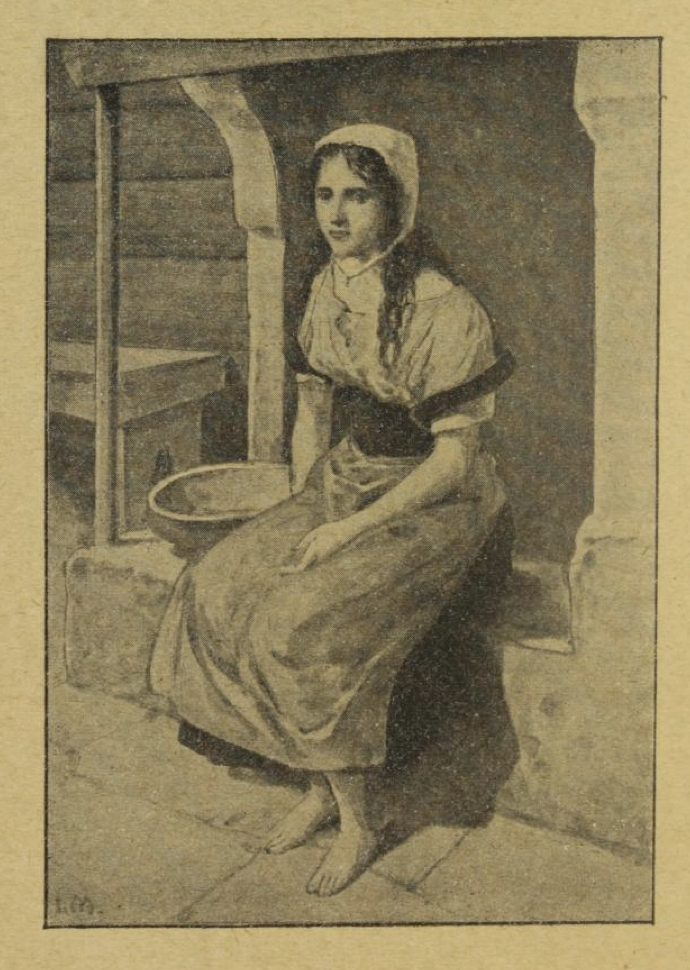
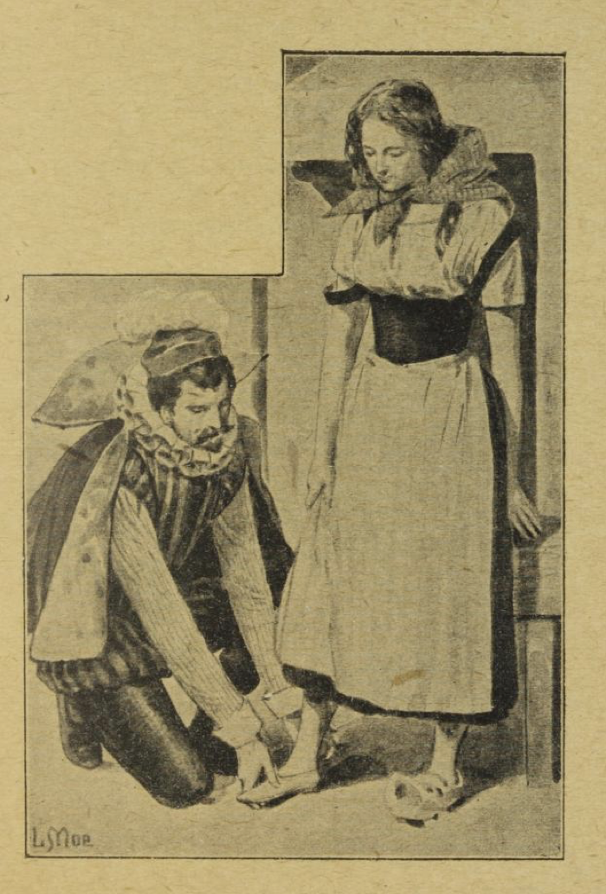

# Askepott

Det var engang en rik mann; kona hans ble syk, og da hun kjente at det led mot slutten, kalte hun sin eneste datter til sengen sin og sa til henne: «Gud gi at du alltid må være snill og god, så skal du nok se at Vårherre alltid hjelper deg, og fra himmelen skal jeg se ned til deg og holde øye med deg.» Da hun hadde sagt det, sovnet hun inn og døde. Piken gikk hver dag ut til sin mors grav for å gråte der i stillhet, og hun fortsatte alltid å være snill og god. Så kom vinteren, og snøen la sitt hvite teppe over graven; men da sola om våren hadde smeltet det bort igjen, tok mannen seg en annen kone.

Kona hadde to døtre med seg; de hadde hvite og vakre ansikter, men stygge og onde hjerter. Så kom det en hard tid for den stakkars steddatteren. «Skal den dumme gåsa sitte inne i stua hos oss?» sa de. «La henne selv streve for brødet sitt! Ut med kjøkkentøsa!» De tok så de fine klærne hennes fra henne og ga henne et stygt, gammelt skjørt i stedet, og et par tresko. Så begynte de å gjøre narr av henne og førte henne ut i kjøkkenet. Der måtte hun siden slite hardt fra morgen til kveld; tidlig i otta, før det ble dag, måtte hun stå opp, bære vann og fyre opp, koke og vaske. Dessuten gjorde søstrene henne alt det vondt de kunne finne på, gjorde narr av henne og slapp ertene og bønnene i aska for henne, bare for at hun skulle ha bryet med å plukke dem opp igjen. Om kvelden, når hun var trett etter alt strevet, hadde hun ingen seng å ligge i, men måtte ligge i aska ved grua. Derfor så hun alltid sotete og skitten ut, og så kalte de henne Askepott.

Nå hendte det en dag at faren skulle på marked, og han spurte da begge steddøtrene hva han skulle ta med hjem til dem. «Fine klær,» svarte den ene. «Perler og edelsteiner,» sa den andre. «Men du da, Askepott,» sa han, «hva vil du ha?» Da svarte Askepott: «Jeg ber om den første kvisten som støter mot hatten din på hjemveien.» På markedet kjøpte han da fine klær, perler og edelsteiner til steddøtrene; men på hjemveien, da han red gjennom småskogen, var det en hasselkvist som slo hatten av ham; den brakk han av og tok med seg. Da han kom hjem, fikk steddøtrene det de hadde ønsket seg, og til Askepott ga han hasselkvisten. Askepott takket for den, gikk ut til sin mors grav og plantet kvisten der; hun gråt sårt i det samme, og tårene hennes falt på graven og vannet det unge treet. Det vokste opp og ble stort og vakkert; Askepott gikk dit ut tre ganger hver dag, gråt og ba, og hver gang kom en liten hvit fugl flyvende og satte seg i treet, og når det var noe hun ønsket seg, så kastet fuglen det ned til henne.

Så kunngjorde kongen der i landet at han ville holde en stor fest, som skulle vare i tre dager, og alle de vakreste unge jentene i landet skulle være med, for at prinsen kunne finne den han likte best, og ta henne til brud. Da de to stesøstrene til Askepott hørte at de også skulle være med, ble de helt kry og ropte til henne: «Nå skal du gre håret vårt og børste skoene våre og feste spennene på oss; for nå skal vi til bryllup på kongsgården.» Askepott gjorde som de sa, men gråt sine bitre tårer; for hun ville også gjerne være med på dansen, og så ba hun stemora om hun ikke kunne få lov. «Du, Askepott, som er så sotete og skitten!» sa stemora. «Hva skal du i bryllup, du som verken har klær eller sko? Vil du danse barbeint?» Men Askepott holdt på å be så lenge at stemora til slutt svarte: «Nå heller jeg dette fatet med gryn ut i aska; kan du plukke opp alle sammen på to timer, så skal du få bli med.» Da gikk Askepott gjennom bakdøra ut i hagen og ropte: «Kom, alle tamme duer, alle turtelduer, alle små fugler under himmelen, kom og hjelp meg å plukke!

> De gode i koppen,  
> de andre i kroppen!»

Straks kom to hvite duer inn gjennom kjøkkenvinduet, så kom turtelduene, og til slutt kom alle fuglene under himmelen flyvende og flagrende inn i kjøkkenet og slo seg ned i aska. Og duene nikket med hodene og pikket med nebbene, det gikk så fort, så fort — tikk tikk! tikk tikk! —, og de andre småfuglene også — tikk tikk! tikk tikk! —, og snart lå alle de gode grynene i fatet. Det var knapt gått en time før de var ferdige, og da fløy de sin vei igjen. Så bar Askepott fatet inn til stemora, og nå var hun så glad, fordi hun skulle få være med i bryllupet. Men stemora sa: «Å nei, Askepott, de kommer bare til å le av deg; du har jo ingen klær, og du kan ikke danse heller.» Da satte den stakkars piken seg til å gråte, og stemora sa: «Nå ja, kan du plukke opp to fat med gryn på én time, når jeg strør dem ut i aska, så skal du få være med.» For hun tenkte med seg selv: Det er jo helt umulig. Så ristet hun to fat med gryn ut over aska; men piken gikk gjennom bakdøra ut i hagen og ropte igjen: «Kom, alle tamme duer, alle turtelduer og alle små fugler under himmelen, kom og hjelp meg å plukke!

> De gode i koppen,  
> de andre i kroppen!»

Og straks kom to hvite duer flyvende inn gjennom kjøkkenvinduet, og så kom turtelduene, og til slutt kom alle fuglene under himmelen flyvende og flagrende inn i kjøkkenet. Og duene duppet med hodene og plukket med nebbene, og det gikk så fort, så fort — tikk tikk! tikk tikk! —, og de andre fuglene også — tikk tikk! tikk tikk! —, og før en halv time var gått, var de allerede ferdige og fløy sin vei igjen. Nå bar Askepott fatene inn til stemora, og nå var hun så glad; for hun var sikker på at nå skulle hun få være med i bryllupet. Men stemora sa: «Det nytter ikke likevel. Du kommer ikke med; for du har ikke klær, og du kan ikke danse. Vi får bare skam av deg.» Dermed snudde hun ryggen til henne og vimset av sted med begge de stolte døtrene sine.

Da Askepott nå var blitt alene hjemme, gikk hun ut til morens grav under hasselbusken og ropte:

> «Tre som gror i dødens hage,  
> send meg nå god og gyllen gave!»

Og straks kastet fuglen ned til henne en kjole av gull og sølv og et par sko som var brodert med sølv og silke. Askepott tok på seg kjolen og skoene og gikk til kongsgården. Søstrene og stemora kjente henne ikke, og mente det måtte være en fremmed kongsdatter, så fin og vakker var hun i gullkjolen. Askepott satt jo hjemme, mente de, og rotet i aska. Kongssønnen gikk mot henne, tok henne i hånden og danset med henne. Siden ville han slett ikke danse med noen andre, og når noen kom og bød henne opp til dans, sa han at han selv ville danse med henne.

Hun danset til sent på kveld; da ville hun gå hjem, men kongssønnen sa: «Jeg vil følge deg,» for han ville se hvor den vakre piken bodde. Men hun smatt fra ham og sprang inn i duehuset. Prinsen ventet til faren kom, og til ham sa han at den fremmede jomfrua hadde smuttet inn i duehuset. «Tro om det kunne være Askepott?» tenkte faren, og fikk tak i øks og hakke for å bryte opp duehuset; men der inne var det ingen å se. Da de kom hjem, lå hun, som hun pleide, i de stygge klærne sine i aska, og en søvnig oljelampe brant på grua; for hun hadde smuttet ut bakveien fra duehuset og sprunget bort til hasselbusken; der hadde hun tatt av seg de fine klærne og lagt dem på graven, og fuglen hadde tatt dem bort, og så hadde hun tatt på seg det gamle grå skjørtet sitt igjen og lagt seg ved grua i aska.

Dagen etter, da festen begynte igjen, og foreldrene og stesøstrene hadde dratt av gårde, gikk Askepott ut til hasselbusken og ropte:

> «Tre som gror i dødens hage,  
> send meg nå god og gyllen gave!»

Da kastet fuglen en enda finere og vakrere kjole ned til henne, og da hun kom opp på kongsgården i disse klærne, måtte alle undre seg over hvor fin og vakker hun var. Kongssønnen hadde bare ventet på henne, tok henne straks i hånden og danset med henne, og siden ville han ikke danse med noen andre, og når noen kom og bød henne opp til dans, sa han at han selv ville danse med henne. Om kvelden, da hun skulle hjem, fulgte kongssønnen igjen etter henne for å se hva slags hus hun gikk inn i; men hun smatt fra ham og sprang bak huset og ut i hagen. Der sto et vakkert pæretre; lett som et ekorn klatret hun opp i treet, og kongssønnen visste ikke hvor det var blitt av henne. Men han ventet til faren kom, og så sa han til ham: «Den fremmede jomfrua har smuttet fra meg, og jeg tror hun må ha klatret opp i pæretreet.» Da tenkte faren: «Tro om det kunne være Askepott?» Så fikk han tak i en øks og hogg ned treet; men de fant ingen. Og da de kom ut i kjøkkenet, lå Askepott i aska, som hun pleide; for hun hadde hoppet ned av treet på den andre siden, hadde båret de vakre klærne tilbake til fuglen i hasselbusken og tatt på seg det gamle grå skjørtet sitt igjen.

Den tredje dagen, da foreldrene og søstrene hadde dratt av sted, gikk Askepott igjen til morens grav og ropte:

> «Tre som gror i dødens hage,  
> gi meg nå god og gyllen gave!»

Igjen kastet fuglen ned en kjole, og den var så herlig at ingen hadde sett maken, og da hun viste seg i den på kongsgården, ble alle helt målløse av undring over hvor vakker hun var. Kongssønnen ville slett ikke danse med noen andre, og når noen kom og bød henne opp til dans, sa han at han selv ville danse med henne.

Ut på kvelden, da Askepott skulle gå hjem, ville prinsen igjen følge henne; men hun smatt så fort fra ham at han ikke kunne følge etter. Men nå hadde han tenkt ut en list og latt trappa smøre med bek, og den ene skoen hennes ble sittende fast da hun sprang ned. Kongssønnen tok den opp; den var liten og fin og av rent gull. Morgenen etter tok han den med hjem til Askepotts far og sa til ham: «Ingen annen skal bli min kone enn den som denne gullskoen passer.» Da ble begge søstrene glade; for de hadde vakre føtter. Den eldste gikk inn på kammerset sitt for å prøve skoen, og mora sto ved siden av; men skoen var liten og trang, så hun fikk ikke inn stortåa. Da ga mora henne en kniv og sa: «Hugg av den tåa! Blir du dronning, så slipper du å gå til fots.» Datteren hogg av tåa og klemte foten inn i skoen; vondt gjorde det, men hun bet tennene sammen og gikk ut til kongssønnen. Så tok han henne opp til seg på hesten og red bort med henne. Men på veien kom de forbi graven; der satt to duer i hasselbusken, og de kurret og ropte:

> «Gro gro gurr i kroa,  
> blod, blod, blod i skoa!  
> Foten i klemme,  
> den rette brud sitter hjemme.»

Da så han ned på foten hennes og så at det dryppet blod fra skoen. Så snudde han hesten, red tilbake med den falske bruden og sa at den andre skulle prøve skoen. Nå gikk hun inn på kammerset, og hun fikk tærne inn i skoen; men hælen var for stor. «Hugg et stykke av hælen!» sa mora og rakte henne kniven. «Når du blir dronning, slipper du å gå til fots.» Piken hogg et stykke av hælen og klemte foten ned i skoen. Vondt gjorde det, men hun bet tennene sammen og gikk ut til prinsen. Han tok henne opp på hesten sin og red bort med henne. Da de kom forbi hasselbusken, satt begge duene der igjen, og de kurret og ropte:

> «Gro gro gurr i kroa,  
> blod, blod, blod i skoa!  
> Foten i klemme,  
> den rette brud sitter hjemme.»

Da så han ned på foten hennes og så at det dryppet blod fra skoen. Så snudde han hesten og førte den falske bruden hjem. «Dette er heller ikke den rette,» sa han til faren. «Har du ikke en datter til?»

«Nei,» sa mannen, «ingen andre enn den stakkars Askepott, som jeg har med min første kone; men henne kan det umulig være.» Kongssønnen ville likevel se henne. Men stemora sa: «Å nei, hun er da så sotete og stygg, hun kan ikke vise seg fram.» Prinsen sto likevel på sitt; han måtte og skulle se henne, og Askepott ble ropt inn. Så vasket hun ansiktet og hendene rene, gikk inn og neiet for kongssønnen, og han rakte henne gullskoen. Hun satte seg ned på en krakk, tok av seg den tunge treskoen og stakk foten ned i gullskoen. Da kongssønnen så etter, satt den som om den var støpt til henne, og da han nå så henne inn i ansiktet, kjente han henne igjen og så at det var henne han hadde danset med. «Dette er den rette bruden!» sa han. Stemora og døtrene hennes ble likbleke av sinne og misunnelse; men prinsen tok Askepott opp på hesten og red bort med henne. Da de nå kom forbi hasselbusken, kurret begge duene og sa:

> «Gro gro gurr i kroa,  
> ikke blod nå i skoa!  
> Skoen passer greit og grant,  
> den rette brud til slutt han fant.»

Og da de hadde ropt dette, kom de begge flyvende og satte seg hos Askepott, en på den høyre skulderen hennes og en på den venstre, og der ble de sittende.

Da kongssønnen skulle holde bryllup, kom de falske søstrene og gjorde seg så blide mot Askepott for å få del i lykken hennes. Og da brudefølget dro til kirken, ville den eldste endelig gå på høyre side av henne og den yngste på venstre. Da pikket duene ut et øye på hver av dem. På hjemveien fra kirken gikk den eldste på venstre og den yngste på høyre side. Og så pikket duene ut det andre øyet på hver av søstrene. Slik ble de straffet for ondskapen og falskheten sin, og var blinde alle sine levedager siden.
