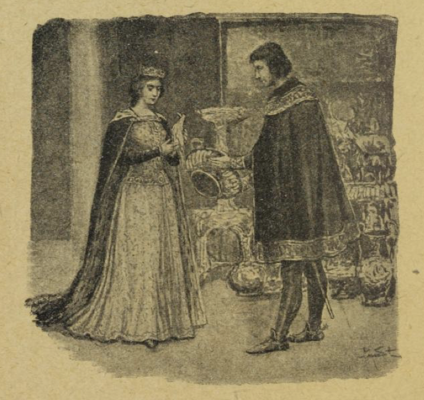
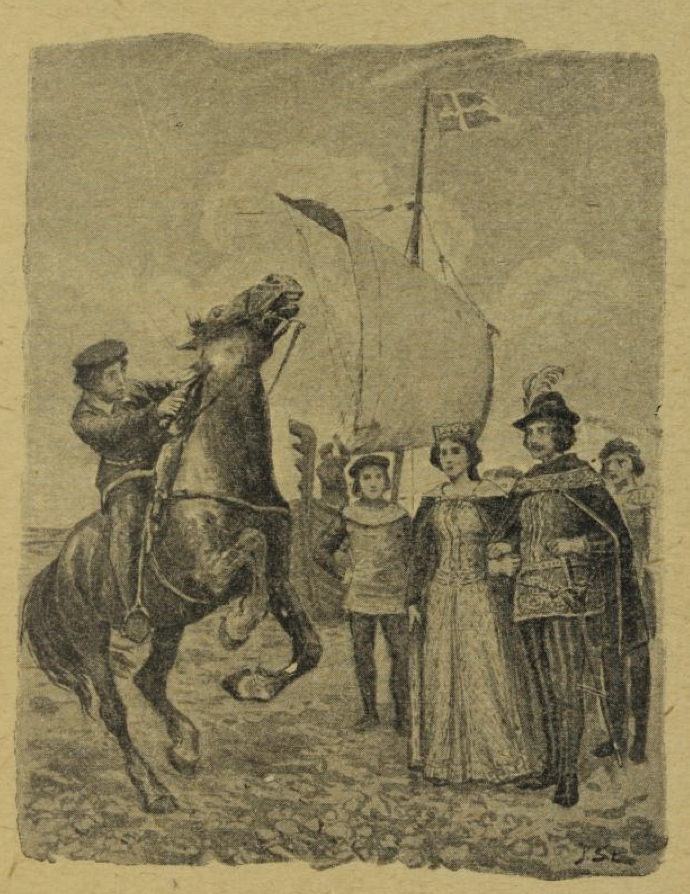

# Den tro Johannes

Det var en gang en gammel konge; han ble syk og skjønte at han lå på dødsleiet. Så sa han: «La den tro Johannes komme til meg.»

Den tro Johannes var hans kjæreste tjener, og ble kalt det fordi han alle sine dager hadde vært så tro mot kongen. Da han var kommet inn og sto ved sengen, sa kongen til ham:

«Kjære Johannes, nå lider det mot slutten med meg, og jeg har en sorg som tynger meg sånn, og det er sønnen min. Han er ung og har ikke alltid så lett for å greie seg, og derfor må du love meg at du vil lære ham alt han trenger å vite, og at du vil være som en far for ham i ett og alt; ellers kan jeg ikke dø rolig.»

Da svarte den tro Johannes: «Jeg skal aldri forlate ham, men tjene ham med troskap, om det så skal koste mitt liv.»

Da den gamle kongen hørte det, sa han: «Så kan jeg lukke øynene i fred. Og når jeg er død, skal du vise ham hele slottet, alle kamrene og salene og kjellerrommene, og alle skattene som er gjemt der. Men ett kammer må du ikke vise ham, og det er det som ligger ved enden av den lange gangen; det er der jeg har gjemt bildet av kongsdatteren fra det gylne tak. Får han se det, blir han grepet av en slik kjærlighet til henne at han besvimer og kommer i stor fare for hennes skyld, og dette må du berge ham fra.»

Den tro Johannes ga kongen løftet sitt nok en gang, og tok ham i hånden på det, og så ble kongen rolig, la hodet ned på puten og døde.

Da den gamle kongen var båret til graven, fortalte Johannes den unge kongen hva han hadde lovet faren hans på dødsleiet. «Og det kan du stole på,» sa han, «at jeg skal være like tro mot deg som jeg har vært mot ham, om det så skal koste mitt liv.»

Da sorgtiden var over, sa den tro Johannes til kongen: «Nå er det på tide at du tar arven din i øyesyn. Kom nå, så skal jeg vise deg hele slottet.»

Så førte han ham omkring alle steder, både høyt og lavt, og lot ham se all rikdommen på slottet og alle de fine rommene; bare ett kammer lukket han ikke opp: det som det farlige bildet var gjemt i. Men bildet var satt opp slik at straks døren gikk opp, måtte en se rett på det, og så mesterlig var det laget at en kunne tro det hadde liv og sjel, og at ingenting i verden kunne måle seg med det i skjønnhet og ynde. Men den unge kongen la merke til at Johannes lot være å åpne én av dørene.

«Hvorfor lukker du aldri opp denne?» spurte han.

«Fordi det er noe der inne som du ville bli redd av,» svarte den tro Johannes.

«Har jeg sett hele slottet,» sa kongen, «så vil jeg vite hva som er der inne også,» og dermed ville han åpne døren med makt.

Da holdt den tro Johannes ham tilbake og sa: «Jeg har lovet din far, før han døde, at du ikke skal få se det som er gjemt i dette kammeret; det kunne føre både deg og meg i stor ulykke.»

«Større ulykke blir det,» svarte kongen, «om jeg ikke får komme inn der; da blir det ikke fred og ro å finne for meg, verken dag eller natt, før jeg har sett denne hemmeligheten med mine egne øyne. Nå rører jeg meg ikke av flekken før du har lukket opp.»

Da skjønte den tro Johannes at det ikke var annet å gjøre, og med tungt hjerte og tunge sukk lette han fram nøkkelen i det store knippet. Da han hadde lukket opp døren, gikk han selv inn først; for han tenkte å stille seg slik at kongen ikke fikk se bildet. Men hva nyttet det? Kongen reiste seg på tå og kikket over akselen hans. Og da han fikk se bildet av kongsdatteren fra det gylne tak, syntes han hun var det herligste øynene hans hadde sett, og kjærligheten til henne grep ham så sterkt og kom så brått på at han mistet bevisstheten og falt over ende på gulvet.

Den tro Johannes løftet ham opp og bar ham inn på sengen hans, og tenkte med angst: «Nå er ulykken hendt! Hvordan skal dette gå?» Han ga ham en styrkende drikk, så han kom til seg selv igjen, og det første kongen sa var: «Hvem er hun, den herlige som er malt der inne på bildet?»

«Det er kongsdatteren fra det gylne tak,» svarte den tro Johannes.

Da tok kongen til orde igjen og sa: «Så stor kjærlighet har jeg til henne at om alle bladene på trærne var tunger, kunne de ikke si det. Hun må og skal bli bruden min; det vil jeg sette livet inn på, og så sant som du er min tro Johannes, må du hjelpe meg til å vinne henne.»

Johannes grundet lenge på hva de nå skulle gjøre; det var vanskelig nok, mente han, bare å komme fram for kongsdatteren. Til slutt trodde han at han hadde funnet en løsning.

«Alt som kongsdatteren har omkring seg,» sa han til kongen, «er av gull: skåler og begre, bord og stoler, og mange andre slags ting. Du har fem tønner gull i skattkammeret; av en av dem skal du la alle gullsmedene i riket ditt lage fine og kostbare ting: kopper og kar, fugler og underlige dyr. Det kommer hun til å like. Så drar vi av sted med det og prøver lykken hos kongsdatteren.»

Kongen kalte så alle gullsmedene sammen, og de arbeidet dag og natt, og omsider fikk de ferdig all den vakre gullstasen. Alt sammen lot Johannes føre om bord på et skip, og så kledde han seg ut som kjøpmann, og det samme måtte kongen også gjøre, for at ingen skulle kjenne dem. De satte så seil og fór ut på storhavet, og de seilte både langt og lenge, til de kom til den byen hvor kongsdatteren fra det gylne tak bodde.

Den tro Johannes ba kongen bli igjen på skipet og vente på ham. «Kanskje jeg får kongsdatteren med meg,» sa han, «og derfor må du holde alt i fin stand, sette fram all gullstasen og pynte vakkert på skipet.»

Jo, det skulle nok kongen gjøre, og så valgte Johannes ut noen av gullsakene, som han gjemte i forkleet sitt, gikk i land og rett opp til slottet. Da han kom inn i kongsgården, sto det ved brønnen en vakker jente, som hadde to gullspann i hånden; hun skulle nettopp til å bære inn vann. I det samme hun snudde seg, fikk hun se den fremmede mannen, og spurte hvem han var.

«Jeg er en mann som handler med gullstas,» sa han, og så viste han henne det han hadde i forkleet.

«Å nei, hvor vakkert det er!» ropte hun, og måtte sette spannene fra seg for å se på det alt sammen. «Dette må prinsessen endelig få se,» sa hun, «for hun er så glad i alt slikt, og kommer sikkert til å kjøpe alt sammen.»

Dermed ba hun ham følge med inn i slottet; for hun var kammerjomfruen til prinsessen. Da kongsdatteren fikk se gullsakene, likte hun dem så godt at hun sa: «Dette er det vakreste gullsmedarbeidet jeg har sett, og jeg vil kjøpe alt sammen av deg.»

Men den tro Johannes svarte: «Jeg er bare tjener hos den rike kjøpmannen som eier dette. Dette her er bare småting mot alt det som min herre har nede på skipet; for det er det fineste og kostbareste som kan lages av gull.»

Da ville hun ha det hele opp til seg på slottet; men han sa: «Nei, det ville ta mange dager, så mye som det er, og jeg tror ikke det er plass i alle salene her på slottet, om alt skulle stilles opp.»

Da ble kongsdatteren så nysgjerrig, og fikk slik lyst til å se all denne herligheten, at hun sa: «La meg komme ut på skipet, så jeg kan få se din herres skatter med mine egne øyne.»

Så førte den tro Johannes henne ned til skipet, og da kongen fikk se henne, syntes han hun var enda vakrere enn på bildet, og det var som hjertet skulle sprenges i brystet på ham. Så steg hun om bord, og kongen selv førte henne inn; men den tro Johannes ble igjen ute hos styrmannen og ga ordre om at skipet skulle legge fra land.

«Opp med seilene!» sa han. «La nå skipet fly som fugl i luften!»

I mellomtiden viste kongen prinsessen alle gullsakene, stykke for stykke: skåler og kar og begre, gullfuglene og alle de underlige dyrene. Dette tok flere timer, og så glad var hun, mens hun så på alt sammen, at hun ikke merket at skipet seilte av sted for fulle seil. Da hun hadde sett det siste stykket, takket hun kjøpmannen, og ville hjem igjen; men da hun kom opp på dekket, så hun at skipet var langt fra land og stevnet ut på det åpne havet.

«Å,» ropte hun, full av redsel, «jeg er narret og bortført; men heller vil jeg dø enn gi meg i en ussel kjøpmanns vold.»

Da grep kongen hennes hånd og sa: «Jeg er ikke kjøpmann; jeg er en konge og ikke mindre høybåren enn du selv, og når jeg har bortført deg med list, så er det bare på grunn av den store kjærligheten jeg har til deg. Første gang jeg så bildet ditt, tok det meg så sterkt at jeg mistet sans og samling.»

Da kongsdatteren fra det gylne tak hørte dette, trøstet hun seg, og hjertet hennes ble allerede dratt mot ham, så hun gjerne gikk med på å bli dronningen hans.

Men så hendte det, mens de seilte der ute på det åpne havet og den tro Johannes satt framme i baugen og spilte på fele, at han så tre ravner komme flyvende, og de fulgte med skipet. Da holdt han opp med spillet og lyttet til det de snakket om; for han forsto fuglenes språk.

Den ene ropte: «Se, der fører han kongsdatteren fra det gylne tak hjem med seg.»

«Å ja,» svarte den andre, «men han eier henne ikke ennå.»

Den tredje sa: «Hun sitter jo hos ham på skipet.»

«Det hjelper nok ikke stort,» tok den første til orde igjen; «for straks de legger til land, kommer en rød hest springende mot ham, og den vil han sette seg opp på; men gjør han det, så farer den av sted med ham gjennom luften, så han aldri mer får se jomfruen.»

«Er det ingen råd for det?» spurte den andre.

«Jo,» lød svaret, «hvis en annen får sprunget opp på hesten og griper pistolen som sitter i salhylsteret, og skyter hesten, så er den unge kongen frelst. Men hvem kan vite det! Og den som vet det og sier det til ham, han blir til stein fra fotsålene og opp til knærne.»

Da sa den andre: «Jeg vet enda mer: Om så hesten blir drept, får nok ikke kongen prinsessen til brud likevel. For når de kommer sammen inn i slottet, så ligger det en ferdigsydd brudgomsskjorte på et fat, og den ser så gild ut som om den var vevd av gull og sølv; men det er ikke annet enn svovel og bek, og når han tar den på seg, så brenner den ham opp helt inn til marg og bein.»

«Finnes det ingen råd for det?» spurte den tredje.

«Å jo,» svarte den andre, «hvis en får grepet skjorten, med hansker på hendene, og kaster den på varmen, så den brenner opp, da er den unge kongen frelst. Men hva nytter det! Den som vet det og sier det til ham, blir til stein fra knærne opp til hjertet.»

Da sa den tredje: «Jeg vet enda mer: Om så brudgomsskjorten blir brent opp, får nok ikke kongen bruden sin for det. Når han skal danse med henne i bryllupet, blir hun plutselig blek og faller ned som død; og hvis ikke noen da løfter henne opp og suger tre bloddråper av det høyre brystet hennes og spytter dem ut igjen, så dør hun. Men om noen vet det og sier det, så blir han til stein fra topp til tå.»

Da ravnene hadde snakket slik med hverandre, fløy de sin vei igjen; men den tro Johannes hadde hørt det alt sammen og skjønt hvert ord. Fra den stund var han fåmælt og tung til sinns; for tidde han om det han hadde hørt, så måtte kongen bli ulykkelig, og sa han det til ham, så kostet det ham selv livet. Men til slutt bestemte han seg.

«Jeg vil frelse min herre,» tenkte han, «om jeg så selv må sette livet til.»

Da de kom i land, gikk det som ravnene hadde spådd; en vakker rød hest kom springende.

«Den kommer i rette tid,» sa kongen; «den skal bære meg opp til slottet!»

Han skulle akkurat til å sette seg opp på den; men den tro Johannes var snar i vendingen; han sprang opp på hesteryggen, dro pistolen fram av salhylsteret og skjøt hesten. Da ropte kongens andre tjenere, som var misunnelige på den tro Johannes, at det var skammelig gjort å drepe det vakre dyret som skulle ha båret kongen hjem til slottet.

Men kongen sa: «Ti stille og la ham være i fred! Han er min tro Johannes. Hvem vet hva det kan være godt for?»

Så gikk de opp til slottet og inn i salen, og der sto et fat med den ferdigsydde brudgomsskjorten på, og den så ut som om den var av rent gull og sølv. Den unge kongen gikk bort og skulle til å ta den; men den tro Johannes skjøv ham til side, grep skjorten, med hansker på hendene, bar den raskt bort og kastet den på varmen, så den brente opp.

De andre tjenerne begynte å mukke igjen. «Tenk, han brenner opp kongens brudgomsskjorte!» sa de.

Men den unge kongen sa: «Hvem vet hva det kan være godt for? La min tro Johannes være i fred!»

Så ble det holdt bryllup og de skulle til å danse, bruden også; men den tro Johannes tok ikke øynene fra henne. Plutselig bleknet hun og falt ned som død. Straks sprang Johannes bort til henne, løftet henne opp og bar henne inn i et kammer; der la han henne ned, falt på kne ved siden av henne, sugde tre bloddråper av det høyre brystet hennes og spyttet dem så ut igjen. Straks kom hun til live igjen; men den unge kongen hadde sett alt dette, og skjønte ikke hvorfor Johannes hadde båret seg slik at; han ble sint og ropte: «Kast ham i fengsel!»

Morgenen etter ble den tro Johannes dømt til døden og ført til galgen. Men da han sto der oppe og skulle henrettes, sa han: «Etter gammel skikk og bruk får den som skal dø, lov til å si noe, om han har noe på hjerte. Får jeg lov til det?»

«Ja,» sa kongen, det skulle han få lov til.

Da sa Johannes: «Jeg er dømt med urette, og har alltid vært deg tro.» Og så fortalte han om samtalen han hadde hørt mellom ravnene ute på havet; det var bare for å frelse sin herre, at han hadde båret seg at som han hadde gjort.

Da kongen fikk vite dette, ropte han: «Å, min tro Johannes! Nåde! Nåde! — Før ham ned straks!»

Men knapt hadde Johannes sagt det han hadde å si, før han falt død om; nå var han blitt til stein fra topp til tå.

Kongen og dronningen sørget sårt over dette, og kongen sa: «Å, så ille jeg har lønnet en så stor troskap!» Han lot steinbildet bære inn i soverommet sitt og stille opp ved siden av sengen sin, og hver gang han så på det, gråt han bitre tårer og sa: «Å, kunne jeg bare gjøre deg levende igjen, min tro Johannes!»

Da en tid var gått, fødte dronningen tvillinger, to små sønner, som vokste opp til stor glede for foreldrene sine. En dag som dronningen var i kirken, og begge barna satt og lekte hos faren sin, så kongen igjen bort på steinbildet og sukket, med tårer i øynene: «Å kunne jeg så sant gjøre deg levende igjen, min tro Johannes!»

Da begynte steinbildet å snakke og svarte ham: «Ja, du kan gjøre meg levende igjen, hvis du vil ofre det kjæreste du eier.»

Da ropte kongen: «Alt det jeg eier i verden vil jeg gi for deg!»

Igjen tok statuen til orde: «Hvis du med egen hånd vil hugge hodet av begge barna dine og stryke blodet på meg, så kommer jeg til live igjen.»

Kongen ble forferdet da han hørte at han selv skulle drepe sine kjære små barn; men så tenkte han på all den troskapen Johannes hadde vist ham, og at han hadde ofret livet sitt for hans skyld, og da dro kongen sverdet sitt, hogg med egen hånd hodet av begge barna og strøk blodet på statuen. Da kom det liv i den igjen, og den tro Johannes sto der igjen, lys levende og like frisk og rask som før.

Han sa til kongen: «Din troskap skal ikke bli ulønnet.» Dermed tok han de små hodene og satte dem på plass, og strøk blod over sårene; straks ble barna levende igjen og sprang omkring og tok fatt på leken sin igjen, som om ingenting hadde hendt.

Da ble kongen hjertens glad, og da han så dronningen komme i det samme, så lot han den tro Johannes og begge barna gjemme seg i et stort skap. Da hun kom inn, spurte han henne: «Har du bedt i kirken?»

«Ja,» svarte hun, «men hele tiden måtte jeg tenke på den tro Johannes, som det skulle gå så ille for vår skyld.»

Da sa kongen: «Min kjære kone, vi kan gjøre det godt igjen og gi ham livet tilbake; men det kommer til å koste oss begge barna våre; dem må vi ofre.»

Dronningen ble blek av redsel; men likevel svarte hun: «Vi skylder ham dette for hans store troskap.»

Da gledet kongen seg, fordi hun tenkte på samme måte som han selv, gikk bort og lukket opp skapet, hentet fram barna og den tro Johannes, og sa: «Gud være lovet, han er frelst, og småguttene våre har vi også fått igjen.»

Og så fortalte han henne hvordan det hele hadde gått til. Siden levde de sammen lykkelig og vel alle sine dager.
