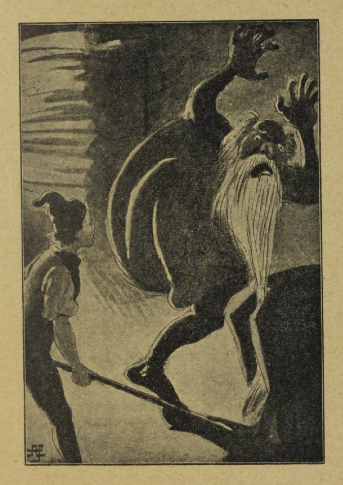
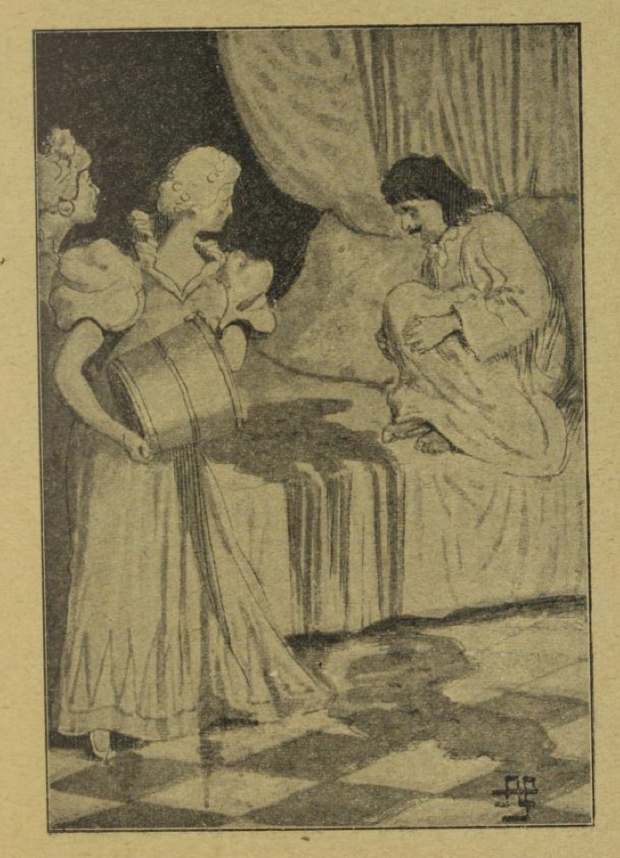

# Gutten som dro omkring for å lære å grøsse

Det var en gang en far som hadde to sønner. Den eldste var klok og forstandig og kunne greie seg godt i alt han tok fatt på; men den yngste var enfoldig og kunne verken lære eller forstå noe, og når folk så ham, sa de: «Den fyren kommer aldri til å bli til noe for faren sin.» Når det var noe farlig å gjøre, måtte alltid den eldste sønnen ta det; men hvis faren sendte ham etter noe sent om kvelden, og veien gikk over kirkegården eller gjennom andre uhyggelige steder, svarte han alltid: «Å nei, far, dit går jeg ikke; det grøsser i meg!» For han var redd. Eller når de satt om kvelden ved peisen og fortalte historier som fikk folk til å gyse, sa tilhørerne ofte: «Uff, det grøsser i meg!» Den yngste satt i kroken sin og hørte på dette, men kunne ikke forstå hva det skulle bety. «De sier alltid: 'Det grøsser i meg! Det grøsser i meg!' Jeg grøsser slett ikke. Det er vel også en kunst som jeg ikke forstår.»

En dag sa faren til ham: «Hør her, du som sitter i kroken der, du vokser til og blir stor og sterk, så det er på tide du lærer noe, du også. Se bare på broren din, hvor flittig han er. Du får se til å komme deg ut og tjene ditt brød.»

«Det er riktig sant det, far,» sa gutten. «Kunne jeg ikke dra ut og lære å grøsse? Det har jeg slik lyst til.»

Da lo den eldste. «Nei, hvor dum han er, denne broren min,» tenkte han; «av ham kan det da umulig bli noe.»

Faren sukket og svarte: «Den kunsten kan du vel tidsnok få lært; men du tjener ikke ditt brød med den.»

En stund etter kom klokkeren på besøk. Faren klaget da sin nød for ham, og fortalte om denne gutten som de ikke kunne få lært noen ting. «Tenk deg,» sa den gamle til klokkeren, «da jeg spurte ham hva han ville tjene brødet sitt med, så svarte han at han ville dra ut for å lære å grøsse.»

«Ikke annet?» svarte klokkeren. «Send ham bare til meg, så skal nok jeg lære ham å grøsse, det kan han lite på.» Dette tilbudet tok faren imot, for han tenkte at klokkeren kanskje kunne få skikk på gutten. Klokkeren tok ham da med hjem til seg og satte ham til å ringe i tårnet. Da noen dager var gått, vekket han gutten midt på natta, og sa at han skulle gå opp i tårnet og ringe. «Du skal nok få lært å grøsse,» tenkte han, og listet seg i forveien oppover trappa. Da gutten var kommet helt opp og skulle til å ringe, fikk han se en hvit skikkelse som sto i trappa, rett overfor lydhullet.

«Hvem er du?» ropte gutten; men den hvitkledde verken svarte eller rørte seg. «Svar straks, hører du!» ropte han igjen, «eller se til å komme deg unna, og det fort! Hva har du å gjøre her midt på natta?»

Men klokkeren ble stående urørlig, for at gutten skulle tro han så en død mann. Igjen ropte gutten: «Hva vil du her? Svar, hvis du er et skikkelig menneske, ellers hiver jeg deg nedover trappa.» Men klokkeren tenkte det ikke var så farlig ment, ga ikke en lyd fra seg, og ble stående stiv som en støtte. Gutten ropte for tredje gang, og da det nyttet like lite som før, gikk han rett bort til skremselet og ga det et støt, så det rullet ned trappa og ble liggende i kroken. Så ringte han med klokka, gikk hjem og la seg til å sove, uten å si et ord til noen.

Klokkerkona ventet lenge på mannen; men han kom ikke. Da ble hun redd, vekket gutten og spurte: «Vet ikke du hvor mannen min er blitt av? Han gikk opp i tårnet før deg.»

«Nei,» svarte gutten, «men det sto en fyr i trappa, rett overfor lydhullet, og da han ikke ga noe svar og heller ikke ville gå sin vei, så drev jeg til ham, så han røk nedover trappa. Dere får gå og se etter. Det skulle virkelig gjøre meg vondt om det var klokkeren.» Kona for av gårde og fant mannen sin, som lå i kroken og jamret og klaget; for han hadde brukket beinet.

Hun bar ham hjem og løp storgråtende av sted for å klage på gutten hjemme hos faren. «Nei, for en ulykke den narren deres har ført over oss!» ropte hun. «Han har kastet mannen min nedover trappa, så han har brukket beinet. Dere må få den fyren bort fra oss, og det både fort og snart!» Faren ble rent forferdet, løp av sted, og begynte å skjenne på gutten. «Hva er det nå for skarvestreker du har gjort!» ropte han. «Jeg tror den onde selv har fart i deg!»

«Hør nå, far,» sa gutten; «dette er ikke min skyld. Han sto der midt på natta og så ut til å ha ondt i sinne. Jeg visste ikke hvem det var, og så ropte jeg til ham tre ganger at enten skulle han svare eller gå sin vei.»

«Å jøye meg!» ropte faren, «av deg har jeg bare ulykker i vente! Gå meg av syne! Jeg vil aldri se deg mer.»

«Det skal jeg nok,» svarte gutten. «Så snart det blir lyst, skal jeg legge i vei og prøve om jeg ikke kan lære å grøsse; så kan jeg da én kunst, og så får jeg se til å tjene mitt brød selv.»

«Lær hva du vil for meg,» svarte faren; «det er meg det samme. Se, her har du femti daler; dra så ut i den vide verden; men si ikke til noen hvor du er fra, eller hvem som er far din; for jeg har jo bare skam av deg.»

«Som du vil, far!» svarte gutten. «Er det ikke annet du krever av meg, skal jeg nok gjøre som du sier.»

Da det lysnet av dag, stakk gutten de femti dalerne i lomma, gikk bortover landeveien, og sa hele tida til seg selv: «Bare jeg kunne lære å grøsse! Bare jeg kunne lære å grøsse!» Så kom en mann gående; han hørte det gutten gikk og mumlet, slo følge med ham, og da de hadde gått et stykke, kom de til galgebakken. «Ser du det rare treet der borte?» sa mannen og pekte på galgen. «De syv karene der oppe har nylig holdt bryllup med reipslagerens datter, og nå øver de seg i flykunsten. Sett deg ned under dem, og vent til det blir midnatt, så tenker jeg nok du skal få lære å grøsse.»

«Er det ikke annet som skal til, så er det jo en lett sak,» svarte gutten, «og kan jeg bare lære å grøsse, så skal du få de femti dalerne jeg har. Kom igjen i morgen tidlig, så får vi snakkes.» Dermed gikk han opp på bakken, satte seg under galgen, og ventet tålmodig til det ble mørkt. Da det led ut på natta, begynte han å fryse og gjorde opp en ild for å varme seg. Mot midnatt ble det slik sur vind at han hadde nok med å holde varmen; vinden tok i dødmennene som hang i galgen, og dunket og dasket dem mot hverandre, og så kom han til å tenke på at de nok frøs, så kaldt som det var. Snill og god var han, og syntes synd på dem, og derfor satte han stigen opp til galgen, krøp til værs, løste den ene etter den andre og hentet dem ned alle syv. Så raket han opp i varmen og satte dem i en ring rundt bålet, for at de skulle ha det godt og hyggelig; men de satt der uten å røre på seg, og om en stund tok ilden fatt i klærne deres. Han ropte da til dem at de fikk passe på klærne sine. Men dødmennene svarte ikke et muk og lot fillene brenne. Da ble gutten sint og sa: «Vil dere ikke gjøre som jeg sier, så vil jeg ikke ha dere her nede,» og dermed hengte han dem opp igjen. Han ble nå sittende alene ved bålet, og sovnet. Da det ble lyst, kom mannen og ville ha de femti dalerne; «for nå har du vel lært å grøsse?» sa han. «Nei, det har jeg slett ikke,» svarte gutten, «hvem skulle vel ha lært meg det? De der oppe har ikke åpnet munnen. De har ikke bedre vett enn at de lar klærne brenne av kroppen på seg.» Da skjønte mannen at de femti dalerne fikk han ikke denne gangen; en slik raring hadde han aldri truffet før, tenkte han, og dermed gikk han sin vei.

Så gikk gutten videre, og sa igjen til seg selv: «Bare jeg kunne lære å grøsse! Bare jeg kunne lære å grøsse!» Dette hørte en vognmann som kom gående bak ham, og så spurte han gutten: «Hva er du for en kar?»

«Det vet jeg ikke,» svarte gutten. Så spurte mannen igjen: «Hvor er du fra?» Men det visste gutten heller ikke. «Hvem er faren din da?» spurte vognmannen. Jo, det visste da gutten; men han hadde ikke lov til å si det, sa han. «Hva er det du går og snakker med deg selv om da?» spurte vognmannen. «Å, jeg ville så gjerne lære å grøsse,» svarte gutten; «men det er nok ingen som kan lære meg det.»

«Det kan det vel bli råd med,» svarte vognmannen; «bare bli med meg.» Gutten fulgte med ham, og om kvelden kom de til et vertshus; der skulle de være natta over. Med det samme de kom inn, tok gutten til igjen: «Nei, kunne jeg bare lære å grøsse!» Verten hørte det, begynte å le og sa: «Er det ikke annet du ønsker, så tenker jeg du kan få lysten din stilt.»

«Å, bare ti still!» sa kona; «det er nok av dem som har mistet livet her før; det var synd om de vakre øynene aldri mer skulle få se dagens lys.» Men gutten mente at om det gikk aldri så galt, ville han prøve å lære det likevel; det var jo derfor han hadde dratt ut i verden. Og mannen i huset fikk ikke fred før han fortalte at i nærheten var et fortryllet slott; der kunne gutten nok lære å grøsse, hvis han turte holde vakt der tre netter på rad. Kongen hadde lovet datteren sin til den som turte gjøre dette vågestykket; for da var trolldommen løst, og denne prinsessa var den vakreste jomfru som sola noen gang hadde skint på. I slottet var store rikdommer gjemt; over dem holdt onde ånder vakt; men ble makten deres brutt og skatten fri, kunne den nok gjøre en fattigmann rik for resten av livet. Mange hadde gått inn for å prøve, men ingen var kommet levende ut igjen.

Morgenen etter gikk gutten opp til kongen og sa: «Hvis jeg får lov, vil jeg gjerne våke i det fortryllede slottet.» Kongen så på ham, likte ham godt, og sa: «Du kan få lov til å ta tre livløse ting med deg inn på slottet.» Gutten svarte: «Så vil jeg be om ild, og en dreiebenk, og en tollekniv.» Kongen sørget for at dette var på plass. Da det mørknet, gikk gutten opp på slottet, tente opp i et av kamrene, og satte seg på dreiebenken. Kniven hadde han ved siden av seg. «Bare jeg nå kunne komme til å grøsse!» tenkte han; «men det lærer jeg nok ikke her heller.» Ved midnattstid ville han rake i ilden for å få den til å brenne bedre; da skrek det plutselig borte i en krok: «Mjau, mjau! Vi fryser så!»

«Er det noe å skrike for da, tosker!» ropte han. «Kom hit og varm dere her!» Og akkurat som han hadde sagt det, kom to store svarte katter farende med et veldig sprang, satte seg på hver side av ham og glodde vilt på ham med de glødende øynene sine. Da de hadde varmet seg en stund, sa den ene av dem: «Kom, gutt, så skal vi spille kort!»

«Gjerne det,» svarte gutten. «Men la meg nå først se labbene dine!» Katten strakte fram klørne. «Det var da noen stygge, lange negler,» sa gutten. «Det er nok best jeg klipper dem litt.» Dermed tok han begge kattene i nakken, slengte dem opp på dreiebenken, og skrudde fast labbene. «Jeg spiller ikke kort med noen som har slike fingre,» sa han, og så slo han dem i hjel begge to og hev dem ut i dammen.

Da dette var gjort, og han igjen skulle sette seg ved varmen, så myldret det fram fra hver en krok svarte katter og svarte bikkjer med glødende lenker; flere og flere kom farende, så han hadde nok med å berge seg for dem. De sparket ut ilden for ham, spredte den utover, og holdt på å slukke den helt. En stund så han rolig på dette; men da han syntes det ble for galt, grep han kniven. «Ut med dere, pakk!» ropte han, gikk løs på dem og hogg og stakk til alle kanter, det beste han orket. Noen av dem la på sprang og ble borte, resten slo han i hjel og hev ut i dammen.

Da han var ferdig med det arbeidet, raket han ilden sammen igjen, blåste på glørne og varmet seg. Mens han satt slik, ble øyelokkene hans så tunge, og han fikk lyst til å ta seg en lur. Og da han så seg om, fikk han øye på en stor seng borte i det ene hjørnet. Der la han seg ned; men akkurat som han skulle lukke øynene, begynte senga å kjøre av seg selv rundt i hele slottet. «Det var bra,» sa han, «jo mer, jo bedre!» Og senga for av sted, som om det var seks hester spent for, over dørstokker og trapper, til den plutselig gjorde et veldig hopp, vendte bunnen i været, og ble liggende over ham som et helt fjell. Han slengte puter og tepper av seg, krabbet ut og sa: «Nå kan hvem som vil kjøre for meg,» og dermed la han seg ned ved ildstedet sitt, og sov til det ble dag. Da kom kongen opp til ham, og da han så gutten ligge på gulvet uten å røre seg, trodde han at spøkelsene hadde drept ham. «Det var jammen synd på den vakre gutten,» sa han.

«Å, det er nå ikke så farlig,» sa gutten, for han hadde hørt det, og reiste seg opp. Kongen ble både glad og forundret, og spurte hvordan det hadde gått med ham. «Ikke så verst,» sa han; «den ene natta er over, og de to andre går vel også.» Da han kom til vertshuset, gjorde verten store øyne. «Jeg hadde ikke trodd jeg skulle se deg levende igjen,» sa han. «Men nå har du vel lært å grøsse.»

«Å nei, langt ifra!» svarte gutten. «Bare jeg visste om noen som kunne lære meg det!»

Om kvelden gikk han igjen opp på slottet, satte seg ved ilden, og begynte på den gamle visa si: «Bare jeg kunne lære å grøsse!» Da det led mot midnatt, hørte han at det begynte å rusle og tusle, stake og brake omkring ham, først så smått, siden sterkere og sterkere. Så ble alt plutselig stille igjen; men så hørte han et fælt skrik, og i det samme kom halvparten av et menneske dettende ned gjennom pipa og ble liggende rett foran føttene hans.

«Heisan!» ropte gutten. «Men her kommer jo bare halvparten. Får vi ikke snart mer?» Da bar det løs igjen med brak og bulder; det durte og hylte, og så kom den andre halvparten deisende ned. «Vent litt!» sa gutten; «la oss legge et par gode kubber på varmen, så blir det mer hyggelig her.» Da det var gjort, og han snudde seg, var begge halvdelene grodd sammen, og en stor stygg mann satt på plassen hans.

«Nei, det var nok ikke meningen,» sa gutten; «du tar jo plassen min.» Mannen ville skubbe ham unna, men gutten skubbet tilbake og satte seg på plassen. Nå kom den ene mannen etter den andre dumpende ned gjennom pipa. De hadde med seg ni dødningbein og et par dødninghoder, og med dem begynte de å spille kjegler. Gutten syntes dette så morsomt ut, og spurte: «Får jeg lov til å være med?»

«Ja, har du penger, så,» svarte de. Det var det råd med, mente gutten; «men disse kulene er ikke riktig runde,» sa han, og så tok han dødninghodene, satte dem på dreiebenken og dreide dem runde. «Se så!» sa han, «nå triller de bedre, og la oss nå få liv i leken!» Han spilte en stund med dem, og tapte en del av pengene sine; men da klokka slo tolv, ble alt sammen borte med ett, og gutten la seg til å sove ved peisen. Om morgenen kom kongen og ville høre hvordan det hadde gått. Å jo, gutten fortalte at han hadde hatt det nokså morsomt. «Jeg har spilt kjegler,» sa han, «og tapt noen skillinger.»

«Men har du ikke grøsset da?» spurte kongen. Nei, det hadde han ikke. «Bare jeg visste om noen som kunne lære meg det!»

Tredje kvelden satte han seg på benken igjen, helt motløs, sukket og sa: «Å nei, bare jeg kunne lære å grøsse!» Ut på natta kom seks store karer bærende på en likkiste. Gutten tenkte det måtte være søskenbarnet hans som var død for en uke siden, og så vinket han bort til likkista: «Kom hit, så skal du få sitte hos meg og varme deg.» Mennene satte kista ned, og han gikk bort og løftet av lokket. Det lå en mann i den; han la hånden på ansiktet hans; det var iskaldt. «Vent litt,» sa han; «jeg skal prøve å få varmen i deg.» Han gikk bort til ilden, varmet hånden og la den på ansiktet; men den døde var like kald som før. Så tok han ham opp av kista, satte seg ved ilden, la ham over fanget og gned armene hans, for at blodet skulle komme i gang igjen. Men det hjalp heller ikke. Da kom han til å tenke på at når to ligger i seng sammen, så varmer den ene den andre. Han bar da liket bort i senga, bredte godt over det, og la seg selv ved siden av. Om en stund kjente han at dødmannen begynte å røre på seg; for nå hadde han fått varmen i seg. «Har jeg ikke vært snill med deg nå,» sa gutten, «siden jeg har varmet deg så godt?» Da reiste den døde seg og ropte: «Nå kveler jeg deg!»

«Er dette takken?» sa gutten. «Da er det nok best du kommer ned i kista igjen.» Så bar han ham tilbake og satte lokket på. Straks etter kom de seks mennene og bar kista bort. «Nei, bare jeg kunne lære å grøsse!» sa gutten. «Men det lærer jeg nok aldri.»

Så kom det inn en mann som var større enn alle de andre og så helt fryktelig ut; han var gammel og hadde et langt hvitt skjegg. «Kom hit, din stakkar!» ropte han. «Nå skal du nok lære å grøsse; for nå skal du dø!»

«Ikke så fort!» sa gutten. «Skal jeg dø, sier du? Det tenker jeg vi skal bli to om.»

«Hå, hå!» skrek trollgubben; «en slik pjokk skal vi nok få bukt med.»

«Ta det bare med ro,» svarte gutten, «og vær nå ikke så kry! Jeg tenker nok jeg er like sterk som du og vel så det.»

«Det skal vi snart se,» ropte gamlingen. «Er du sterkere enn meg, så skal du slippe godt fra det. Bli med! La oss prøve!»

Så førte han ham gjennom mørke ganger til en smie; der tok han en øks og slo den ene ambolten ned i jorda med ett slag. «Ikke verre!» sa gutten, tok øksa og gikk til den andre ambolten. Gamlingen stilte seg ved siden for å se godt etter, og det hvite skjegget hans hang langt ned. Gutten kløyvde ambolten med ett hogg; men gubben hadde bøyd seg dypt ned, og skjegget hans ble sittende fast i sprekken. «Nå har jeg deg!» sa gutten, «og nå tenker jeg det er du som skal dø.» Dermed grep han en jernstang og dundret løs på trollgubben, alt det han orket. Gamlingen hylte og ba ham holde opp, så skulle han gi ham store rikdommer. Da slapp gutten ham løs, og nå førte gubben ham til en kjeller i slottet og viste ham tre kister fulle av gull. Den ene skulle de fattige ha, og kongen den andre; «men den tredje er din,» sa han til gutten. I det samme slo klokka tolv, uhyret ble borte, og gutten sto i mørket. «Jeg finner vel ut likevel,» sa han, famlet seg fram, og fant til slutt veien tilbake til kammeret. Der la han seg til å sove ved grua. Om morgenen kom kongen og sa: «Nå, vet du nå hva det er å grøsse?»

«Nei,» svarte gutten, og så fortalte han at det døde søskenbarnet hans hadde vært der, og siden en gammel gråskjegg, som hadde vist ham en mengde gull. «Men ingen av dem har lært meg å grøsse,» la han til. Da sa kongen: «Nå har du løst trolldommen som lå over slottet, og du skal få prinsessa.»

«Mange takk, det er godt og vel,» svarte gutten; «men det er da leit at jeg ikke kan lære å grøsse.»

Gullet ble hentet fram, og bryllupet ble holdt, og den unge kongen var veldig glad i dronningen sin; men så godt han syntes han hadde det, så sukket han likevel stadig på sin gamle måte: «Bare jeg kunne lære å grøsse!» Dette ble dronninga til slutt lei av, og kammerpiken sa da: «Jeg vet råd; han skal snart få lære å grøsse.» De gikk da sammen ned til bekken som rant gjennom hagen, og fanget et spann fullt av små stingsild og annen fiskeyngel. Om natta, mens den unge kongen sov, tok dronninga dyna av ham og tømte spannet med all småfisken ut over ham, så fiskene hoppet og sprellet omkring beina hans. Da bråvåknet han og ropte: «Uff, det grøsser i meg! Kjære kone, det grøsser i meg!»

Så hadde han da endelig lært å grøsse.

