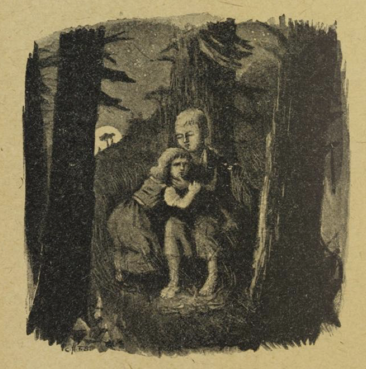

# Hans og Grete

Tett utenfor en stor skog bodde en fattig vedhugger med kona si og de to barna sine. Gutten kalte de Hans og jenta Grete. Lite hadde de både å bite og brenne, og da det kom dyrtid i landet, hadde mannen ikke lenger det daglige brød til seg og sine.

En kveld han lå i senga og ikke fikk sove for alle de tunge tankene og sorgene sine, sukket han og sa til kona: «Hva skal det bli av oss? Hvordan skal vi kunne sørge for de stakkars barna våre, når vi ikke har noe til oss selv?»

«Hør nå her, mann,» sa kona; «i morgen tidlig tar vi barna med oss ut i skogen, hvor den er tettest, gjør opp en varme til dem og gir hver av dem et stykke brød, og så går vi til arbeidet vårt og lar dem være alene. De finner aldri veien hjem igjen, og så er vi av med dem.»

«Nei kone,» sa mannen, «jeg har ikke hjerte til å la de stakkars barna mine bli alene i skogen; da blir de nok snart revet i hjel av ville dyr.»

«Å, din tosk!» sa hun. «Vil du heller at vi alle fire skal sulte i hjel, så kan du like godt begynne å høvle bord til likkistene våre med det samme,» sa hun, og hun ga seg ikke før han samtykket. «Men jeg synes så synd på de stakkars barna,» sa mannen.

De to barna hadde heller ikke fått sove for sult, og hadde hørt hva stemora hadde sagt til faren. Grete, stakkar, gråt bitre tårer, og sa til den lille broren sin: «Nå er det ute med oss.» Men han trøstet henne, og sa at hun ikke skulle gråte. «Jeg skal nok finne på råd.» Da foreldrene var sovnet, sto han opp og tok på seg trøya, lukket opp den nederste halvdøra og listet seg ut. Det var klart måneskinn, og alle de hvite flintsteinene utenfor huset glitret som rene sølvskillinger. Hans bøyde seg ned og sanket så mange som han kunne få plass til i lomma på trøya. Så gikk han inn igjen, og sa til søsteren: «Du skal ikke være redd, lille Grete. Bare sov du! Vorherre vil nok ikke forlate oss.» Og dermed la han seg ned i senga igjen.

Straks det lysnet, før sola ennå var oppe, kom kona og vekket barna. «Stå nå opp, dovninger!» sa hun, «vi skal ut i skogen og hente ved.» Så ga hun hver av dem et lite stykke brød, og sa: «Dette skal dere ha til middagsmat; men ikke sluk alt på én gang, for mer får dere ikke.» Grete tok brødet til seg og gjemte det; for Hans hadde lomma full av stein. Så ga de seg alle på vei ut til skogen. Da de hadde gått et stykke, snudde Hans seg og kikket tilbake mot huset, og det gjorde han flere ganger.

«Hva er det du går slik og kikker etter, Hans?» spurte faren. «Nå må du se til å få beina med deg.»

«Jeg ser bare etter den hvite katten min,» svarte Hans; «den sitter oppe på taket og vil si farvel til meg.»

«Tøv!» sa mora. «Det er jo ikke katten; det er morgensola som skinner på den hvite skorsteinen.»

Men Hans var ikke ute etter katten; han kastet en hvit flintstein på veien hver gang han snudde seg.

Da de var kommet langt inn i skogen, sa faren: «Nå, barn, sank ved og finn tørre kvister; jeg skal gjøre opp en varme til dere, så dere ikke skal fryse.» Hans og Grete sanket kvist sammen og laget en liten haug av dem. Bålet ble tent, og da flammene slo høyt opp, sa kona: «Nå skal dere legge dere ved ilden, barn, og hvile dere; vi går inn i skogen og hogger ved. Når vi er ferdige, kommer vi igjen og henter dere.»

Hans og Grete satt ved ilden, og da det ble middag, spiste de hvert sitt stykke brød. De hørte økseslag og trodde det var faren som hogg. Men det var ikke øksa; det var en grein som han hadde bundet fast til et visnet tre, og som vinden slo til og fra. Da de hadde sittet lenge, ble øynene deres tunge av søvn, og de sovnet dypt.

Da de våknet, var det mørk natt. Grete begynte å gråte og sa: «Hvordan skal vi nå finne ut av skogen?» Men Hans trøstet henne: «Vent bare, lille Grete, til månen kommer opp, så skal vi nok finne veien.» Og da fullmånen var kommet opp, tok Hans den lille søsteren sin i hånda og fulgte flintsteinene, som glitret som nyslåtte sølvskillinger og viste dem veien. De gikk hele natta, og da det lysnet, kom de til farens hus.

De banket på døra, og da kona lukket opp og så at det var Hans og Grete, sa hun: «Dere slemme unger! Hvorfor har dere ligget og sovet så lenge i skogen? Vi trodde dere slett ikke ville komme hjem igjen.» Men faren var glad; for han hadde i sitt hjerte angret på at han hadde latt dem bli igjen alene.

Noen dager senere var det igjen nød i huset, og barna hørte at mora sa til faren, da de var kommet i seng: «Nå er vi like langt igjen; vi har bare et halvt brød, og når det er slutt med det, så er visa ute. Barna må bort; vi må føre dem dypere inn i skogen, så de ikke kan finne veien hjem igjen; ellers er det ute med oss.» Dette falt mannen tungt for hjertet, og han mente det var bedre å dele den siste matsmulen med barna. Men kona ville ikke høre på slikt, og kom bare med kjeft og spydigheter. Hadde han gitt etter første gangen, fikk han gjøre det andre gangen også, sa hun.

Barna hadde ligget våkne og hørt samtalen. Da foreldrene var sovnet, sto Hans opp og ville ut og sanke flintstein; men kona hadde stengt døra, så han kom seg ikke ut. Likevel trøstet han søsteren sin og sa: «Du skal ikke være redd, lille Grete. Bare sov du! Vorherre vil nok ikke forlate oss.»

Tidlig neste morgen kom kona og dro barna opp av senga. De fikk hver sitt stykke brød; men det var enda mindre nå enn forrige gang. På veien til skogen smuldret Hans sitt brødstykke i lomma, stanset hvert øyeblikk og kastet smulene på bakken.

«Hva er det du står og kikker etter, Hans?» spurte faren. «Se nå til at du skynder deg!»

«Jeg bare ser etter den vesle dua mi,» svarte Hans; «den sitter på taket og vil si farvel til meg.»

«Tøv!» sa kona. «Det er jo morgensola som skinner på skorsteinen.» Men Hans kastet etter hvert alle smulene på veien.

Kona førte barna lenger og lenger inn i skogen; aldri i sine levedager hadde de vært så langt hjemmefra. Det ble igjen gjort opp et stort bål, og mora sa til barna: «Nå skal dere bli sittende her, og er dere trette, så kan dere sove; vi går inn i skogen og hogger ved, og når vi er ferdige, og det lider mot kvelden, så kommer vi og henter dere.»

Da det ble middag, delte lille Grete brødstykket sitt med broren, som hadde smuldret opp sitt og strødd det på veien. Så falt de i søvn, og det ble kveld; men ingen kom for å hente barna. Da de våknet, var det mørk natt, og Hans trøstet søsteren sin og sa: «Vent bare, Grete, til månen kommer opp, så kan vi se brødsmulene som jeg har strødd ut; de skal nok vise oss veien hjem.»

Da månen kom opp, gikk de av sted; men ingen brødsmuler var å finne nå; for de tusenvis av småfugler som flyr omkring i skog og mark, hadde pillet dem opp alle sammen. «Vi skal nok finne veien likevel,» sa Hans; men de fant den ikke. De gikk hele natta og neste dag med, fra morgen til kveld, uten å komme ut av skogen, og så var de så sultne; for de hadde ikke annet til mat enn noen bær som de fant her og der på bakken. Til slutt ble de så trette at beina ikke lenger ville bære dem, og så la de seg under et tre og falt i søvn.

Nå var det den tredje morgenen siden de hadde gått hjemmefra. De våknet og ga seg av sted igjen, men kom bare lenger inn i skogen, og fikk de ikke snart hjelp, måtte de dø av sult og tretthet. Ved middagstid så de en vakker, liten snøhvit fugl som satt på en grein og sang, og det lød så vakkert at de ble stående og lytte. Så lettet den og fløy foran dem, og de fulgte etter, og så kom de til et lite hus; der satte fuglen seg på taket. Da de kom nærmere, så de at huset var bygget av brød, taket var gjort av kake, og vindusrutene av det klareste sukker.

«Nå skal vi sette til,» sa Hans, «og ta oss et velsignet måltid. Jeg vil spise av taket, og du, Grete, kan spise av vinduet; det er søtt.» Hans strakte seg opp og brøt et stykke av taket for å prøve hvordan det smakte, og Grete stilte seg til vinduet og gnavet på rutene. Da hørte de en fin stemme rope inne fra stua:

> «Knirk, knark, knar!  
> Hvem gnager på mitt hus så hardt?»

Barna svarte:

> «Det er vinden, det himmelske barn,  
> som blåser så sterkt om ditt garn.»

Og de lot seg ikke forstyrre, men fortsatte å spise. Hans, som syntes taket smakte så godt, rev ned et stort stykke av det, og Grete dyttet ut en hel rund vindusrute, satte seg ned og koste seg med den.

Da gikk plutselig døra opp, og en eldgammel kone, som støttet seg på en krykke, kom krøpende ut. Hans og Grete ble så redde at de slapp det de hadde i hendene. Men den gamle nikket med hodet og sa: «Å, kjære barn, hvem har ført dere hit? Kom bare inn og bli hos meg, dere skal ikke lide noen skade.» Hun tok dem begge i hånda og førte dem inn i det lille huset sitt. Der ble det satt fram god mat for dem, melk og pannekaker med sukker, epler og nøtter. Etterpå ble det redt to vakre hvite små senger til dem, og Hans og Grete la seg i dem, og trodde rent at de var kommet til himmelen.

Men den gamle kona hadde bare gjort seg så blid for å lokke dem til seg; hun var en ond heks, som lå på lur etter småbarn, og hadde bygget brødhuset sitt bare for å få dem i sin makt. Når hun fikk tak i et barn, så drepte hun det, kokte det og åt det opp, og det var en ren festdag for henne. Hun hadde sett Hans og Grete, straks de nærmet seg huset, og da satte hun i en ondskapsfull latter og gned seg i hendene. «Dem har jeg,» mente hun; «de skal ikke slippe fra meg.»

Tidlig om morgenen, før barna var våknet, sto hun opp, og da hun så dem ligge der og sove så søtt, med røde, runde kinn, mumlet hun for seg selv: «Dette skal bli god stek.» Så grep hun lille Hans med de knoklete hendene sine og bar ham ned i en liten stall. Det nyttet ham ikke noe å skrike; hun stengte ham inne bak en tregrind, og der måtte han holde til som i et bur. Så gikk hun inn til Grete, rusket henne våken og ropte: «Opp med deg nå, din dovne unge! Du skal hente vann og koke god mat til broren din; han står på stallen og skal bli fet, og når han er blitt skikkelig fet og god, så skal jeg steke ham og ete ham opp.»

Grete, stakkar, begynte å gråte så ynkelig; men det hjalp ingenting; hun måtte gjøre som den onde heksa bød henne. Så ble det kokt skikkelig god mat til Hans; men Grete fikk ikke annet enn krabbeskall. Hver morgen kom kjerringa luskende ned til stallen og ropte: «Stikk ut fingeren din, Hans, så jeg kan kjenne om du snart er fet.» Men Hans stakk et avgnagd bein ut mellom sprinklene, og heksa var så nærsynt at hun ikke merket det; hun trodde det var fingeren til Hans, og undret seg på at det gikk så sent med å få ham fet.

Da fire uker var gått, og Hans enda var like mager, var det slutt på tålmodigheten hennes, og hun ville ikke vente lenger. «Hei da Grete!» ropte hun. «Skynd deg og hent vann! Enten Hans er fet eller mager, så skal han bli slaktet og kokt i morgen.» Den stakkars lille søstera sørget og sukket, så det var en ren ynk, og tårene rant nedover kinnene på henne, mens hun gikk og bar vann. «Kjære Gud, hjelp oss!» ropte hun. «Hadde bare villdyra spist oss ute i skogen, så hadde vi i alle fall fått dø sammen!»

«Du kan spare deg alt skrål og skrik!» sa heksa. «Det hjelper deg ikke det grann.»

Tidlig neste morgen måtte Grete henge opp den store vannkjelen og tenne på under den. «Først skal vi bake,» sa heksa; «jeg har allerede fyrt opp bakerovnen og eltet deigen.» Hun dyttet den stakkars Grete bort til ovnen, som flammene allerede slo ut av. «Kryp nå inn,» sa kjerringa, «og kjenn etter om det er hett nok der inne, så vi kan skyte inn brødet.» Men straks Grete var kommet inn, ville heksa smelle igjen ovnsdøra; Grete skulle også bli stekt, for henne ville hun også ete.

Men Grete skjønte hva hun tenkte på, og så sa hun til heksa: «Jeg vet ikke hvordan jeg skal bære meg at. Hvordan skal jeg komme helt inn?»

«Din dumme gås!» sa kjerringa. «Åpninga er jo så stor at jeg selv kan krype inn,» og dermed krabbet hun selv bort og stakk hodet inn i bakerovnen. Men i det samme ga Grete henne et støt, så hun røk helt inn i ovnen, smeldte jerndøra igjen og skjøt slåen for. Huff! da begynte kjerringa å hyle så forferdelig; men Grete sprang sin vei, og den ugudelige heksa ble brent til døde.

Grete løp rett til Hans, åpnet den lille stallen og ropte: «Hans! Nå er vi frelst, den gamle heksa er død.» Da sprang Hans ut som en fugl av buret. Hvor de var glade og sprang omkring hverandre og kysset hverandre! Og nå som de ikke hadde mer å være redde for, gikk de inn i heksas hus og så seg om i alle kriker og kroker. Der sto kister fulle av perler og edelsteiner.

«De er enda bedre enn flintsteinene,» sa Hans, og stappet alle lommene fulle, og Grete sa: «Jeg vil også ha noe med hjem,» og fylte forkleet sitt.

«Og nå må vi av sted,» sa Hans, «så vi kan komme ut av den fordømte trollskogen.»

Da de hadde gått et par timers tid, kom de til et stort vann. «Hvordan skal vi komme over?» sa Hans. «Her er verken klopp eller bro.»

«Og heller ingen båt,» svarte Grete. «Men se, der kommer en hvit and svømmende. Kanskje den vil hjelpe oss over, når vi ber den vakkert.» Og så ropte hun:

> «And, and, lille and,  
> her står Hans og Grete på land.  
> Verken klopp eller bro  
> kan vi her på stedet se.  
> Sett oss på din hvite rygg,  
> så vi kommer trygt og skyndig!»

Anda kom da til dem, og Hans satte seg på ryggen, og ba søstera sette seg hos ham. «Nei,» svarte Grete, «det blir for tungt for den vesle anda; den skal ta oss over én om gangen.» Det gjorde den gode fuglen, og da de var kommet vel over og hadde gått en liten stund, virket skogen mer og mer kjent, og tilslutt så de farens hus i det fjerne. Da begynte de å løpe, sprang inn i stua og falt faren om halsen. Mannen hadde ikke hatt en glad time siden han hadde latt barna bli igjen i skogen; men kona var død.

Grete ristet forkleet sitt, så perlene og edelsteinene trillet utover hele golvet, og Hans tok fram håndfull etter håndfull fra lommene. Da var det slutt med all nød og sorg, og de levde i glede alle sine dager.

Snipp snapp snute, nå er eventyret ute.
