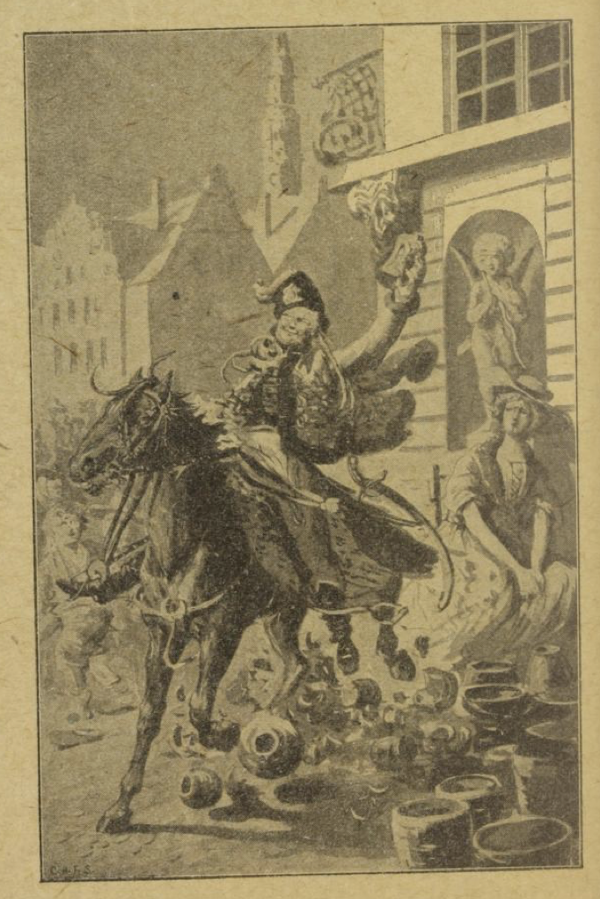

# Kong Trosteskjæg

En konge hadde en datter som var så vakker, men også så stolt og overmodig, at ingen friere var god nok for henne. Hun avviste den ene etter den andre, og gjorde dessuten narr av dem alle sammen.

En gang lot kongen holde en stor fest, og inviterte alle giftelystne menn fra hele landet og fra utlandet, prinsene, grevene og hertugene, alle sammen i rekke etter rang og verdighet. Da de var ført fram for kongsdatteren, så hun bare på dem og fant noe å klage på hos hver eneste en. Den første var for tykk: «Slik en øltønne!» sa hun. Den andre var for høy: «Lang og mager!» Den tredje var for kort: «En kort og tykk!» Den fjerde var for blek: «Nei, se dødsmannens ansikt!» Den femte var for rød: «Nei, se kalkunen!» Og slik hadde hun en spydighet til hver eneste en av dem. Men særlig gjorde hun seg morsom over en konge som sto aller øverst, og som hadde en litt fremstående hake. «Nei, se på ham!» ropte hun; «haken hans ligner et trostenebb!» Siden ble denne kongen kalt kong Trosteskjæg.

Men da faren hennes, den gamle kongen, så at datteren bare holdt alle frierne for narr, så ble han sint, og svor at hun skulle ta til brudgom den første fattigmannen som kom til døren for å tigge.

Et par dager etter kom en spillemann og begynte å spille under vinduet for å tjene seg et par skilling. Da kongen hørte det, sa han: «La ham komme opp!» Spillemannen kom da inn i de skitne og fillete klærne sine, sang for kongen og datteren hans, og da visen var ute, ba han om en liten gave. Da sa kongen: «Jeg likte sangen din så godt at jeg vil gi deg datteren min til kone.» Prinsessen ble rent forferdet; men kongen sto på sitt. «Jeg har svoret å gi deg til den første tiggeren, og det vil jeg holde.» Det hjalp ingenting hva hun sa imot; presten ble hentet, og prinsessen måtte gifte seg med tiggeren, og det på timen. Da det var gjort, sa kongen: «Nå er det selvsagt, skjønner du vel, at du som tiggerkone ikke kan bli lenger her på slottet; du må følge mannen din.»

Så tok fattigmannen henne i hånden, og hun måtte gå av sted med ham til fots. Da de kom til en stor skog, spurte hun:

«Hvem eier den skog så grønn og fin?»

Og tiggeren svarte:

«Kong Trosteskjæg, kjære vennen min!  
Hadde ham du valgt, så var den nå din.»

Da sukket kongsdatteren og sa:

«Sårt ønsker jeg nå, i min usle stand,  
kong Trosteskjæg var min ektemann.»

Så kom de over en eng; da spurte hun igjen:

«Hvem eier den eng av blomster full?»

Og tiggeren svarte:

«Kong Trosteskjæg, mitt kjære gull!  
Deg med, hadde ham du vist deg huld!»

Da sukket kongsdatteren igjen og sa:

«Sårt ønsker jeg nå, i min usle stand,  
Kong Trosteskjæg var min ektemann.»

Så kom de gjennom en stor by; da spurte hun igjen:

«Hvem eier den stad så stor og gild?»

Og tiggeren svarte:

«Kong Trosteskjæg, min hustru snill!  
Var han blitt din mann, deg hørte den til!»

Da sukket kongsdatteren igjen og sa:

«Sårt ønsker jeg nå, i min usle stand,  
Kong Trosteskjæg var min ektemann.»

«Jeg liker slett ikke,» sa spillemannen, «at du går her og ønsker du var gift med en annen. Er ikke jeg god nok til deg?» Så kom de til en liten lav hytte. Da sa kongsdatteren:

> «Nei se, nei se for et hønsebur!  
> Hvem bor i det usselig ringe skur?»

«Det er vårt hus det,» svarte spillemannen; «der skal du og jeg bo sammen.» Kongsdatteren måtte bøye hodet for å komme inn gjennom døren, så lav var den. «Hvor er tjenestefolkene?» spurte hun. «Vi har ikke noe sånt her,» svarte fattigmannen; «du får nok selv gjøre det du vil ha gjort. Tenn opp i ovnen og sett på litt vann, så jeg kan få noe å spise; for jeg er både sulten og trett.» Men kongsdatteren kunne verken fyre eller lage mat, og så måtte fattigmannen selv ta i et tak for å få det til å gå noenlunde. Da de var ferdige med det fattige måltidet sitt, gikk de til ro; men tidlig neste morgen vekket han henne, og sa at nå måtte hun opp og stelle i huset. Slik gikk det et par dager; da hadde de spist opp det lille de hadde. «Hør, kone,» sa mannen, «slik kan det ikke gå lenger, at vi bare tærer og ingenting tjener. Du får begynne å flette kurver.» Så gikk han til skogs og skar vidjer og bar dem hjem. Hun tok da til å flette; men kvistene var harde å arbeide med; hun stakk seg i de fine fingrene, så de ble såre og ømme. «Nei, dette nytter ikke,» sa mannen; «du får heller prøve å spinne; kanskje det går bedre.» Så satte hun seg til å spinne; men tråden skar henne i de myke fingrene, så hun fikk blodige sår. «Der ser du,» sa mannen, «du duger ikke til noe arbeid, og med deg er jeg virkelig ille ute. Jeg får prøve en liten handel med krukker og leirvarer; dem får du sitte med på torget og by fram til salgs.» — «Å,» tenkte hun, «når det kommer folk fra min fars rike og ser meg sitte her og selge krukker, så blir jeg bare til spot og latter.» Men det hjalp ikke; hun måtte ta det hun kunne få, skulle hun ikke dø av sult. Første gangen gikk det riktig bra; folk ville gjerne kjøpe hos denne vakre unge konen; de ga henne det hun ville ha for varene sine, og det var mange som ga henne penger og likevel lot krukkene stå. Så levde de av det hun hadde tjent så lenge det varte, og mannen kjøpte inn en hel del nytt leirtøy. Hun satte seg da med det ved et hjørne på torget og stilte varene opp rundt omkring seg. Da kom en full husar ridende rett inn mellom krukkene hennes, så de gikk i tusen stykker. Hun ble rent fortvilet og satte seg til å gråte, og var så redd at hun ikke visste hva hun skulle gjøre. «Å, hvordan skal det gå, når mannen min får vite dette?» ropte hun. Hun sprang hjem og fortalte ham ulykken. «Hvor kunne du nå være så tosset å sette deg like ved hjørnet med de skjøre sakene!» sa mannen. «Men la nå være å gråte! Jeg visste jo at det ikke nytter å sette deg til slikt arbeid. Derfor har jeg nå vært oppe i kongsgården og hørt om de ikke trengte en kjøkkenjente, og de har lovet å ta deg i tjeneste; der får du maten gratis.»

Slik ble kongsdatteren kjøkkenjente; hun skulle hjelpe kjøkkenmesteren og gjøre det enkleste arbeidet. Under skjørtet hadde hun hengt et par vesker, og i hver av dem bar hun en krukke; de matrestene hun fikk, gjemte hun der, for å ta dem med seg hjem. Det var det de hadde å leve av. Så var det en dag stort bryllup i kongsgården, for den eldste av kongssønnene skulle gifte seg. Fattigkonen stilte seg ved døren til salen og så inn på stasen. Lysene ble tent, den ene gjesten finere enn den andre gikk inn i salen, og der lyste alt i glans og herlighet. Da tenkte hun med sorg på skjebnen sin og angret bittert på stoltheten og overmotet sitt, som hadde fornedret henne så dypt og ført henne i så stor fattigdom. Av alle de kostbare rettene som ble båret ut og inn, stakk tjenerne en gang imellom noe til henne; det gjemte hun i krukkene sine, for siden å bære det hjem. Men plutselig kom kongssønnen inn; han var kledd i fløyel og silke og hadde et gullkjede om halsen. Da han fikk se den vakre unge kvinnen nede ved døren, tok han henne i hånden og ville danse med henne. Hun ble forferdet og trakk seg tilbake; for hun så det var kong Trosteskjæg, som hadde fridd til henne, og som hun hadde avvist med hån. Men det nyttet ikke at hun stred imot; han dro henne inn i salen; men da røk båndet som veskene hennes var bundet i, så krukkene falt ut og gikk i stykker, suppen rant ut over gulvet, og kjøttbollene kom trillende fram foran føttene hennes. Dette vakte stor latter og moro i salen; men hun, stakkar, var så skamfull at hun ønsket seg mange favner ned i jorden. Hun sprang mot døren og ville rømme; men på trappen kom en mann etter henne og førte henne tilbake, og da hun så på ham, var det ingen annen enn kong Trosteskjæg. Han snakket vennlig til henne og sa: «Du skal ikke være redd! Jeg er spillemannen, som du har bodd sammen med i det usle huset. Det var av kjærlighet til deg at jeg kledde meg ut, og husaren som knuste krukkene for deg, det var meg det også. Meningen med det var å bøye ditt stolte sinn og straffe deg for overmotet ditt.» Da gråt hun bitre tårer og sa: «Jeg har oppført meg stygt og gjort deg stor urett, og jeg er ikke verdig til å være din kone.» Men da sa han: «Nå skal du ikke gråte og sørge lenger. De vonde dagene er over, og nå vil vi holde bryllup.» Så kom kammerjomfruene og kledde henne i brudeklær, og faren hennes og alle hoffolkene hans kom og ønsket henne til lykke med giftemålet med kong Trosteskjæg, og da ble det fest med glede og gammen. Jeg skulle bare ønske at du og jeg hadde vært med!
