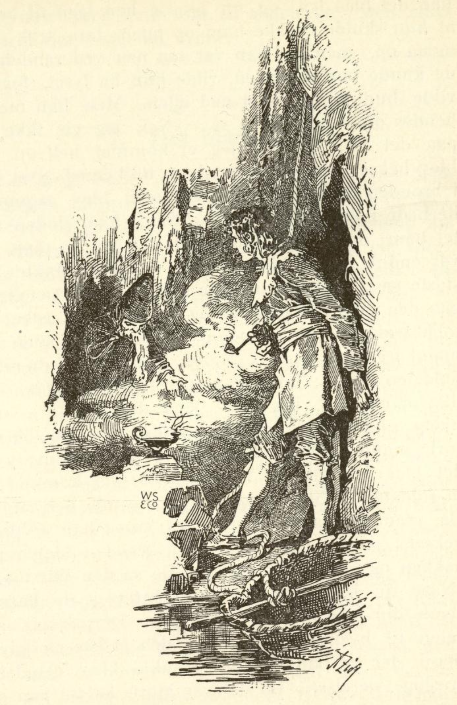

# Det blå lyset

En konge hadde en gang en soldat i tjeneste; han var svært gammel og skrøpelig; derfor sendte kongen ham bort og ga ham ingenting. Soldaten visste nå ikke hvordan han skulle klare seg, han gikk sørgmodig omkring hele dagen og kom om kvelden til en skog. Da han hadde gått en stund, så han et lys; det gikk han mot og kom til et lite hus, og i det bodde en gammel heks. Han ba henne om husly for natten og litt mat og drikke, men det sa hun nei til; til slutt sa hun: «Jeg får vel vise barmhjertighet mot deg, men da skal du i morgen grave om hele hagen min.» Soldaten lovet det og fikk husly for natten.

Neste dag spadde han heksens hage, og med det hadde han nok å gjøre helt til kvelden. Nå ville hun sende ham bort, men han sa: «Jeg er så trett, la meg få bli her natten over.» Først ville hun ikke, men til slutt tillot hun det, men så skulle han neste dag hugge et lass kjøkkenved. Neste dag hogg soldaten veden og hadde så fullt opp av arbeid helt til kvelden at han ikke orket å komme seg av sted; han ba da om husly også den tredje natten, og derfor skulle han dagen etter hente det blå lyset opp av brønnen.

Heksen førte ham da til en brønn, bandt ham fast i et langt tau og firte ham ned; og da han var der nede, fant han det blå lyset, og nå ga han henne tegn om at hun skulle trekke ham opp igjen; hun trakk ham også opp, men da han var så nær kanten at de kunne nå hverandre, ville hun ha lyset, for så ville hun slippe ham ned igjen. Men han merket den onde hensikten hennes og sa: «Nei, jeg gir ikke slipp på det blå lyset før jeg er kommet helt opp.» Da ble heksen sint og slapp ham ned i brønnen sammen med lyset og gikk sin vei.

Soldaten ble sørgmodig der nede i den svarte, fuktige brønnen hvor døden ventet på ham; da fikk han tilfeldigvis tak i en pipe, den var ennå halvfull av tobakk, og han tenkte: For siste gang skal du nå røyke den ut. Han tente på den med det blå lyset og begynte å røyke; da tobakksrøyken fylte brønnen, kom det en liten svart mann fram og spurte: «Herre, hva befaler du meg?» Soldaten svarte: «Hva kan jeg befale deg?» Den lille mannen sa: «Jeg må tjene deg i alt.» «Så hjelp meg først ut av brønnen.» Da tok den svarte mannen ham i hånden og førte ham opp, og det blå lyset tok de med seg.

Da de var kommet opp, sa soldaten: «Slå nå den gamle heksen i hjel for meg.» Da mannen hadde gjort det, viste han soldaten heksens gull og skatter; dem lesset soldaten på ryggen og tok med seg. Da sa den lille mannen: «Når du trenger meg, behøver du bare å tenne pipen din med det blå lyset.» Deretter gikk soldaten til byen og tok inn på det beste vertshuset; der fikk han sydd seg fine klær og innredet prektige rom.

Da det var gjort, kalte han på den lille mannen og sa: «Kongen har sendt meg fra seg og latt meg sulte fordi jeg ikke dugde lenger; hent nå kongsdatteren hit til meg i kveld, så skal hun varte meg opp som en tjenestepike og gjøre det jeg befaler henne.» Mannen sa: «Det er en farlig sak.» Så gikk han og tok kongsdatteren sovende ut av sengen og bar henne til soldaten, og ham måtte hun nå adlyde, og hun måtte gjøre det han ville; om morgenen før hanegal bar den lille mannen henne tilbake igjen.

Da hun hadde stått opp, fortalte hun det til faren sin og sa: «Jeg har hatt en forunderlig drøm i natt, det virket som om jeg ble bortført og var tjenestepike hos en soldat som jeg måtte varte opp.» Da sa kongen: «Fyll lomma di med erter og lag et hull i den (drømmen kunne jo være sann), så faller de ut, og vi kan finne sporet i gata.» Det gjorde hun også, men den lille mannen hadde hørt hva kongen hadde rådet henne til.

Da det nå ble kveld og soldaten sa at han igjen skulle hente kongsdatteren til ham, strødde han på forhånd erter over hele byen, så de få som falt ut av prinsessens lomme, ikke kunne lage noe spor, og neste morgen hadde folk nok å gjøre med å samle erter hele dagen. Kongsdatteren fortalte igjen faren sin hva som hadde hendt henne; da sa han: «Behold den ene skoen på og gjem den der du er.» Den lille mannen hørte også dette, og da soldaten igjen ville ha kongsdatteren til seg, sa han: «Nå kan jeg ikke hjelpe deg lenger, det går deg ille hvis hun kommer hit,» men soldaten ville ha viljen sin. «Ja, men så må du straks i morgen tidlig komme deg ut av byen når jeg har båret henne hjem igjen,» sa den lille mannen.

Kongsdatteren beholdt den ene skoen på og gjemte den hos soldaten i sengen; neste morgen, da hun var kommet tilbake til faren sin, lot han lete overalt i byen etter skoen, og den ble funnet hos soldaten. Han hadde riktignok kommet seg ut av byen, men han ble snart innhentet og satt i fengsel. Der satt han nå i bånd og lenker, men i den raske flukten hadde han latt det beste han eide, bli igjen, nemlig det blå lyset og pengene, og han hadde ikke mer på seg enn én krone.

Mens han nå satt sørgmodig ved vinduet i fengselet sitt, så han en kamerat gå forbi; han ropte på ham og sa: «Hvis du vil hente den lille bylten som jeg har liggende på vertshuset, så skal jeg gi deg en krone.» Kameraten gikk da og hentet det blå lyset og bylten til ham for kronen. Fangen tente straks pipen sin og lot den lille mannen komme. Han sa til soldaten: «Vær ikke redd, gå trøstig i retten og la alt skje, men ta det blå lyset med deg.»

Så ble han forhørt og dømt til å henges. Da han ble ført til galgen, ba han kongen om en siste nåde. «Hva skulle det være?» sa kongen. «La meg få lov til å røyke en pipe på veien.» «Du kan gjerne røyke tre om du vil,» sa kongen. Da trakk han fram pipen sin og tente den med det blå lyset, og den lille mannen kom straks fram. «Slå alt det pakket i hjel for meg, og hugg kongen i tre stykker.» Den lille mannen begynte å slå folk i hjel rundt omkring, da måtte kongen be ham om nåde, og for å beholde livet ga han soldaten riket og datteren sin til kone.
