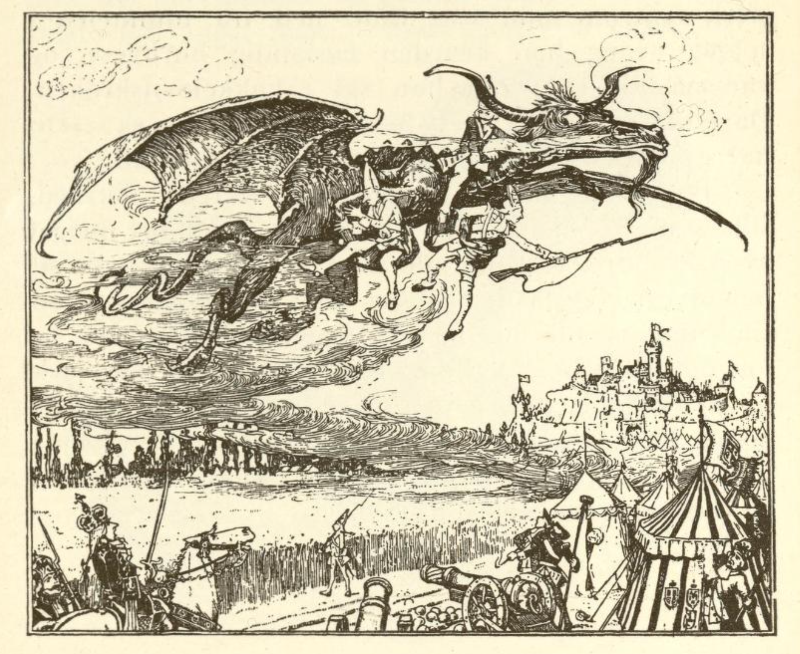
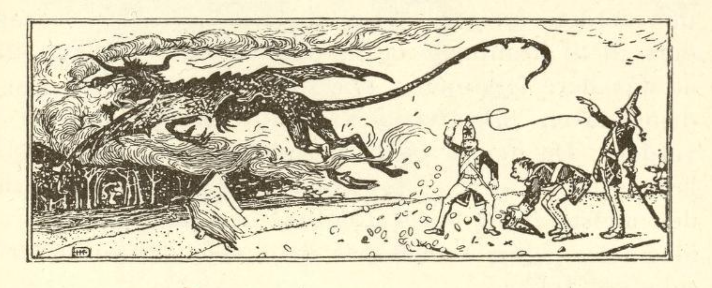

# Djevelen og hans oldemor

I en stor krig ga kongen soldatene sine så liten lønn at de ikke kunne leve av den; da slo tre av dem seg sammen og ville rømme. En av dem sa til de andre: «Men hvis de får fatt på oss, henger de oss opp i galgen, hvordan skal vi unngå det?» Den andre sa: «Der borte står en stor rugåker, den kryper vi inn i, så finner ingen oss; hæren kommer ikke inn der.» De krøp da inn og satt i åkeren i to dager og to netter, men de led så av sult at de holdt på å dø; for ut turte de ikke komme. Da sa de: «Hva hjelper det oss nå at vi er rømt, når vi må ligge her og dø ynkelig i kornet.»

Så kom det en ildsprutende drage flyvende gjennom lufta over rugåkeren; den så dem ligge der og spurte: «Hva gjør dere tre der i kornet?» De svarte: «Vi er tre soldater som har rømt, vi kunne ikke leve av lønnen vår i hæren lenger, og nå må vi dø her av sult, fordi hæren ligger rundt omkring, og vi kan ikke unnslippe.» «Vil dere tjene meg i syv år,» sa dragen, «så skal jeg føre dere tvers gjennom hæren uten at noen får tak i dere.» «Vi har ikke noe annet valg, men får finne oss i det,» svarte de.

Da tok dragen dem i klørne og under vingene sine og førte dem gjennom lufta over hæren og i sikkerhet. Så slapp han dem igjen ned på jorden; men dragen var ingen annen enn djevelen, og han ga dem en liten pisk som de kunne piske gull frem med så mye de ville. «Nå,» sa han, «kan dere bli store herrer og kjøre i vogn, men om syv år hører dere meg til,» og han holdt en bok frem for dem som de måtte skrive seg inn i alle tre. «Men først,» sa han, «vil jeg gi dere en gåte; kan dere gjette den, skal dere bli fri og ikke ha noe mer med meg å gjøre.»

Så fløy dragen bort, og de dro sin vei med pisken sin, fikk penger i overflod, fikk sydd seg prektige klær og dro omkring i verden. Hvor de enn var, levde de i fryd og herlighet, kjørte med hester og vogn, spiste og drakk og levde vel, og de syv årene gikk fort. Da det lakket mot slutten, ble de både redde og engstelige, og to av dem var svært lei seg, men den tredje tok det lett og sa: «Brødre, la oss ikke være redde, kanskje vi kan gjette gåten.»

Mens de satt slik sammen, kom en gammel kone som spurte hvorfor de var så lei seg. «Å, hva angår det deg, du kan jo ikke hjelpe oss likevel,» sa soldatene. «Hvem vet, la meg bare høre.» Da fortalte de henne at de i nesten syv år hadde tjent djevelen, som hadde gitt dem penger som gress, men de hadde forskrevet seg til ham og var hans eiendom, hvis de ikke kunne gjette en gåte når de syv årene var omme.

Den gamle sa: «Skal noe kunne hjelpe dere, da må en av dere gå inn i skogen til han kommer til en klippe som ser ut som et hus.» De to som var så triste, tenkte: Det hjelper oss ikke likevel, og de gikk ikke til skogen, men den tredje som alltid var lystig, dro av sted og fant alt slik som kona hadde sagt. Men i huset satt en kone som var så gammel som mose på stein; det var djevelens oldemor, og hun spurte ham hvor han kom fra og hva han ville; da fortalte han henne alt, og fordi han var et vakkert ungt menneske, syntes hun synd på ham og løftet opp en stor stein. «Sitt nå helt stille under den,» sa hun, «når dragen kommer, skal jeg spørre den ut.»

Klokka tolv om natten kom dragen flyvende og ville ha mat, og oldemoren dekket bordet for ham og satte mat og drikke frem så han ble fornøyd, og de spiste og drakk sammen. Så spurte hun ham hvordan dagen hadde gått, om han hadde fått mange sjeler og mer sånt som man kan snakke med djevelen om. «Ja, jeg har nok tre soldater, de er mine,» sa han. «Tre soldater,» sa hun, «hvem vet, de kan nok slippe unna deg.» Men djevelen sa hånlig: «Jeg er sikker på dem, jeg gir dem en gåte som de aldri kan gjette.» «Hva er det for en gåte?» spurte hun. «Det skal jeg si deg: I Nordsjøen ligger det en død havkatt, den skal de ha til stek, og ribbeinet av en hvalfisk skal være sølvskjeen deres, og en gammel hestefot skal de ha til vinglass.»

Så gikk djevelen og la seg, og den gamle oldemoren hans løftet opp steinen og slapp soldaten ut. «Har du nå lagt godt merke til alt?» sa hun. «Ja,» sa han, «nå skal jeg nok klare meg.» Så måtte han gå en annen vei, ut gjennom vinduet, for å komme til kameratene sine, så djevelen ikke merket ham. Da han kom til de to andre, fortalte han dem hva han hadde hørt, og nå kunne de gjette det ingen andre hadde kommet på; så ble de alle glade og lystige til mote og pisket igjen penger frem.

Da de syv årene var omme, kom djevelen med boka, viste dem underskriften og sa: «Nå vil jeg ta dere ned til helvete, der skal dere spise til middag, men kan dere gjette hva det er for en stek dere får å spise, så skal dere være fri og kan beholde pisken på kjøpet.» Da begynte den første: «I Nordsjøen ligger en død havkatt, den skal vel være steken vår.» Djevelen ergret seg og hostet og sa «hm, hm,» og spurte den andre: «Hva skal dere ha til skje?» Da svarte han: «Ribbeinet av en hvalfisk, det skal være sølvskjeen vår.» Djevelen gjorde stygge grimaser, knurret og hostet tre ganger «hm, hm, hm» og spurte den tredje: «Hva skal dere ha til vinglass?» «En gammel hestefot, den skal være vinglasset vårt.»

Da fløy djevelen sin vei og hadde ikke lenger noen makt over dem, men de tre beholdt pisken og pisket penger frem, så mange som de ville, og levde glade og lykkelige til sin salige død.
