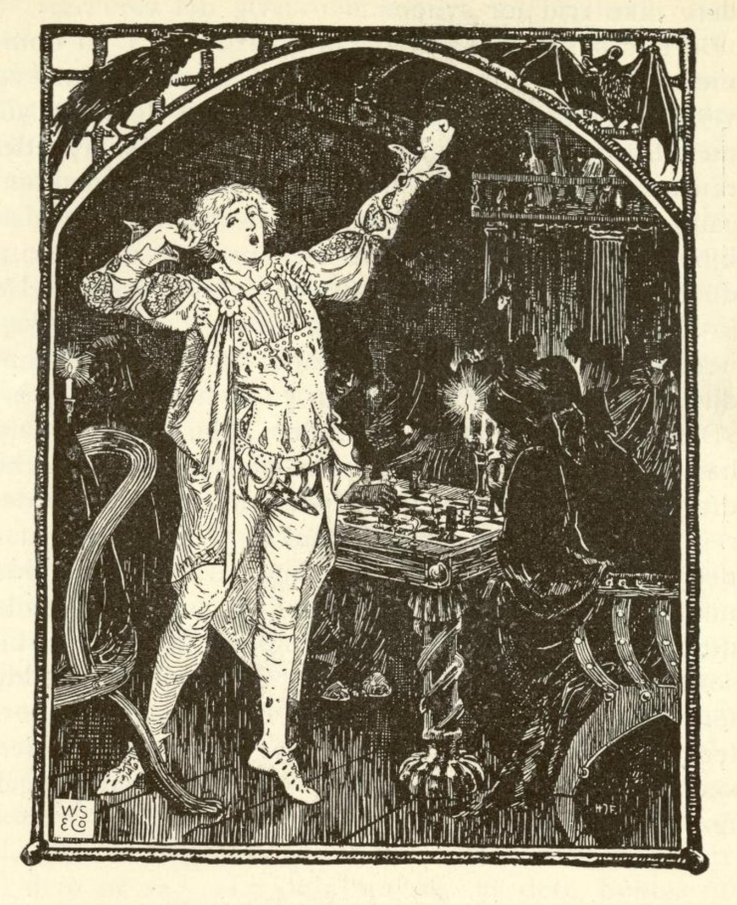
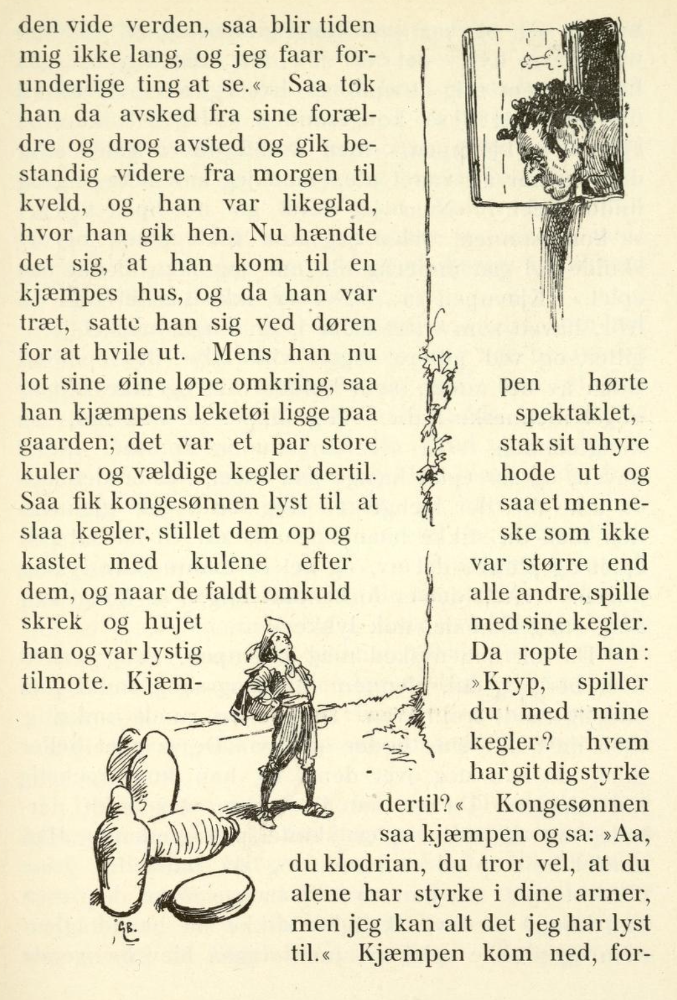

# Kongssønnen som ikke var redd for noe

Det var en gang en kongssønn som ikke likte å være hjemme i farens hus, og siden han ikke var redd for noe, tenkte han: «Jeg vil dra ut i den vide verden, så blir tiden ikke lang for meg, og jeg får se forunderlige ting.» Så tok han avskjed med foreldrene sine og dro av sted og gikk videre og videre fra morgen til kveld, og det var det samme for ham hvor han gikk.

Så hendte det seg at han kom til huset til en kjempe, og da han var trett, satte han seg ved døra for å hvile. Mens han lot blikket gå omkring, så han lekene til kjempen ligge på gården; det var et par store kuler og veldige kjegler til. Så fikk kongssønnen lyst til å spille kjegler, stilte dem opp og kastet kulene etter dem, og når de falt over ende, skrek og hujet han og var i godt humør.

Kjempen hørte spektakkelet og stakk det store hodet sitt ut og så et menneske som ikke var større enn andre folk, spille med kjeglene hans. Da ropte han: «Kryp, spiller du med kjeglene mine? Hvem har gitt deg krefter til det?» Kongssønnen så på kjempen og sa: «Å, din klossmajor, du tror vel at det bare er du som har krefter i armene, men jeg kan alt jeg har lyst til.» Kjempen kom ned, så forundret på kongssønnen og sa: «Menneskebarn, hvis det er slik med deg, så gå og hent meg et eple fra livets tre.»

«Hva vil du med det?» sa kongssønnen. «Det er ikke jeg som vil ha eplet,» sa kjempen, «men bruden min har lyst på det. Jeg har allerede vært ute, men jeg kan ikke engang finne treet.» «Når jeg først gir meg i vei,» sa kongssønnen, «skal jeg nok finne treet, og det skulle gå underlig til om jeg ikke fikk tak i eplet.» Kjempen sa: «Det er ikke så lett som du tror. Hagen som treet står i, har et jerngjerde rundt seg, og ved gjerdet ligger ville dyr, det ene ved siden av det andre, som holder vakt og ikke slipper noe menneske inn.» «Meg slipper de nok inn,» sa kongssønnen.

«Ja, selv om du kommer inn i hagen og ser eplet henge på treet, så er det ikke ditt ennå; det henger en ring foran det, og gjennom den må du stikke hånden hvis du vil få tak i eplet og plukke det, og det har ingen klart ennå.» «Å, det er spart til meg,» sa kongssønnen, «jeg skal nok klare det.»

Så tok han avskjed med kjempen og dro av sted over berg og dal, gjennom mark og skog, til han endelig fant trollhagen. Dyrene lå rundt omkring, men de hadde hodene nede og sov. De våknet ikke engang da han steg over dem, og han kom vel inn i hagen. Da så han livets tre stå midt der inne, og de røde eplene skinte på greinene. Han klatret høyt opp i stammen, og da han ville gripe etter et eple, så han en ring henge foran det, men han kunne uten vanskelighet stikke hånden gjennom og plukke eplet, og ringen ble hengende fast på armen hans. Plutselig kjente kongssønnen en slik kraft i den at han skjønte at han nå kunne overvinne alt; den kraften ga ringen ham.

Da han var kommet ned fra treet, ville han ikke klatre over gjerdet, men grep tak i den store porten og ristet i den, og den sprang knakende opp for ham. Da gikk han ut, og løven som hadde ligget foran porten, sprang etter ham, men ikke rasende og vill; for den fulgte ham ydmykt som sin herre, adlød ham og ville ikke gå fra ham.

Kongssønnen kom nå til kjempen med eplet, slik han hadde lovet. «Ser du,» sa han, «jeg har hentet det uten vanskelighet.» Kjempen var glad for at han så lett hadde fått det han hadde ønsket seg så lenge, og han skyndte seg til bruden sin og ga henne eplet. Hun var en vakker og klok jomfru; da hun ikke så ringen på armen hans, sa hun: «Jeg tror ikke at du har hentet eplet før jeg får se ringen på armen din.» «Å,» sa kjempen, «jeg skal gå hjem og hente den,» og han tenkte å ta den fra det svake menneskebarnet hvis han ikke ville gi den fra seg med det gode. Så gikk han tilbake og krevde ringen av kongssønnen, men han ville ikke gi ham den. «Der eplet er, må ringen også være,» sa kjempen, «og gir du meg den ikke, så må du slåss med meg om den.»

De sloss lenge med hverandre, men kjempen kunne ikke få bukt med kongssønnen, så sterk var han blitt av ringens kraft. Da fant kjempen på en list og sa til ham: «Vi er blitt varme av kampen, la oss først bade og kjøle oss ned før vi begynner igjen.» Kongssønnen, som ikke tenkte på noe svik, ble med ned til vannet, tok av seg klærne, tok også ringen av armen, la den ved siden av og gikk ut i elva.

Straks tok kjempen ringen og løp av sted med den; men løven, som hadde fulgt med herren sin og sett tyveriet, satte etter kjempen og rev ringen fra ham igjen. Da ble kjempen rasende og sprang tilbake til vannet, og da kongssønnen holdt på å ta på seg klærne igjen, grep han ham og stakk ut begge øynene hans. Nå var den stakkars kongssønnen blind og sto der og visste ikke hva han skulle gjøre; da gikk kjempen bort til ham igjen og hadde ondt i sinne. Taus tok han den blinde ved hånden som en som vil lede ham, og førte ham slik opp på toppen av en høy klippe. Der forlot han ham og tenkte: «Hvis han går et par skritt til, faller han ned og slår seg i hjel, og så kan jeg ta ringen fra ham.»

Men den trofaste løven hadde ikke forlatt herren sin; den holdt ham fast i klærne og trakk ham tilbake igjen. Da kjempen kom tilbake og ville plyndre den døde, så han at han var reddet. «Kan jeg ikke engang få livet av et så usselt menneskebarn?» sa han sint til seg selv, tok kongssønnen og førte ham en annen vei opp til stupet, men løven, som skjønte den onde hensikten hans, hjalp trofast herren sin ut av faren. Da de var kommet helt ut på kanten og kjempen slapp hånden til kongssønnen for å la ham bli igjen alene, sprang løven av alle krefter mot ham, så beistet styrtet ned og ble knust.

Så trakk løven herren sin bort til et tre som det rant en klar bekk forbi. Kongssønnen satte seg ned der, men løven la seg ved vannet og skvettet vann i ansiktet hans så godt den kunne. Et par dråper traff heldigvis øynene og fuktet dem, og kongssønnen merket at synet begynte å komme tilbake; for han så et glimt av dagslyset og kunne skjelne noen ting i nærheten, men han visste ikke hvordan det kunne ha seg.

Da så han en liten fugl som fløy tett forbi ansiktet hans og støtte mot en trestamme som om den var blind; men den dukket ned i vannet og badet seg i det, så fløy den opp igjen og svevde lett og sikkert mellom greinene på trærne, så man godt kunne skjønne at den hadde fått synet tilbake. Da kom kongssønnen på at dette var et vink fra Gud, og han bøyde seg ned til vannet og badet ansiktet i det, og da han reiste seg opp igjen, hadde han fått synet tilbake, og øynene var så klare og rene som de aldri hadde vært før.

Kongssønnen takket Gud for den store nåden og dro videre ut i verden med løven sin. Så hendte det seg at han kom til et slott som var forhekset; i porten sto det en jomfru som var vakkert skapt og hadde et vakkert ansikt, men hun var helt svart. Hun snakket til ham og sa: «Akk, kunne du frelse meg fra den trolldommen som holder meg her og har makt over meg?» Da sa kongssønnen: «Hva skal jeg gjøre for å befri deg?»

Jomfruen svarte: «Du må være tre netter i den store salen i det forheksede slottet, men det må ikke være frykt i hjertet ditt. Holder du ut alt det vonde de gjør mot deg, uten å si en lyd, så er jeg frelst; livet ditt tør de ikke ta.» Da sa kongssønnen: «Med Guds hjelp vil jeg prøve; for jeg er ikke redd for noe i hele verden.» Han gikk trøstig inn i slottet og satte seg i den store salen til natten kom.

Det var stille og rolig til midnatt, men da begynte bråket, og det kom små djevler fram gjennom døra og fra alle kroker og hjørner. De lot som de ikke så ham, satte seg midt i stua, fyrte opp og begynte å spille kort. Når en tapte, sa han: «Det er noe galt her, her er det en som ikke hører til oss, det er hans skyld at jeg taper.» «Vent du der bak ovnen, jeg skal nok komme til deg,» sa en annen. Skrikingen ble verre og verre, så det nesten ikke var mulig å høre på det uten å bli skrekkslagen, men kongssønnen var ikke redd. Til slutt sprang djevlene opp og kastet seg over ham, og de var så mange at han ikke kunne verge seg mot dem; de dro ham ned på gulvet, rusket i ham og kløp og klemte ham og slo og pinte ham, men han tålte det uten frykt og sa ikke en lyd.

Mot morgenen forsvant de, og da var han så utmattet at han nesten ikke kunne røre et lem; men da dagen brøt fram, kom den svarte jomfruen inn til ham. I hånden bar hun en liten flaske som var full av livets vann, og med det vasket hun ham, og straks kjente han alle smertene forsvinne, og han ble frisk og glad. Hun sa til ham: «En natt har du nå holdt ut, men det er to igjen»; så gikk hun bort igjen, og da hun gikk, så han at føttene hennes var blitt hvite.

Neste natt kom djevlene igjen og begynte å spille, men de kastet seg snart over kongssønnen og slo ham hardt, mye hardere enn natten før, så han fikk sår over hele kroppen. Men siden han tålte alt i ro, måtte de gi seg, og da morgenrøden brøt fram, kom jomfruen tilbake og leget ham med livets vann, og da hun gikk, så han med glede at hun allerede var blitt hvit helt ut til fingertuppene.

Nå hadde han bare én natt igjen. «Er du der ennå?» ropte de. «Bare vent, så skal du bli pint og plaget så du mister pusten.» De stakk ham og slo ham hit og dit og dro og rev i armene og bena hans som om de ville rive ham i stykker, men han ga ikke en lyd av smerte eller angst fra seg og trøstet seg med å tenke: «Det går vel over, og da er jomfruen frelst fra makten deres.» Han kunne ikke engang åpne øynene for å se jomfruen som kom inn og vasket ham med livets vann; men plutselig var han kvitt alle smertene og frisk og sterk som om han hadde våknet av søvnen, og da han åpnet øynene, så han jomfruen stå ved siden av seg. Hun var så snøhvit og vakker at hun skinte som den klare dag.

Nå sa hun til ham: «Stå opp, sving sverdet ditt tre ganger over trappa, så blir du forløst!» Og da han hadde gjort det, var hele slottet befridd fra trolldommen. Jomfruen var en rik kongsdatter; tjeneren kom nå og sa at bordet var dekket i den store salen og at maten sto på bordet. Så satte de seg til bords og spiste og drakk sammen, og om kvelden holdt de bryllup med stor fryd og glede.
