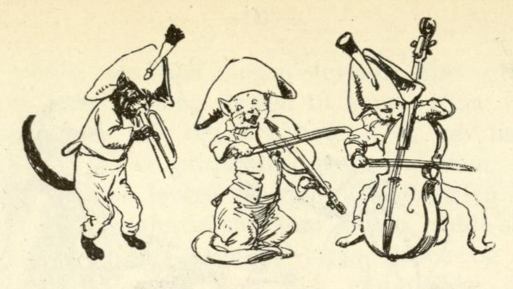
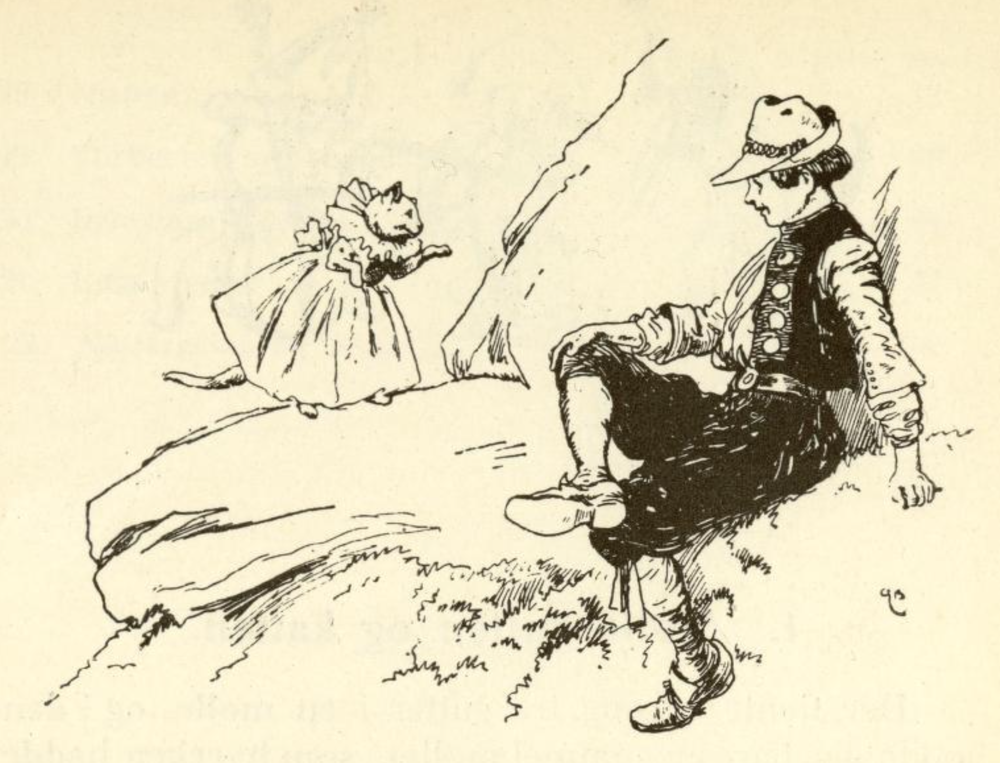

# Møllergutten og katten

Det tjente en gang tre gutter i en mølle, og i den bodde det bare en gammel møller som verken hadde kone eller barn. Da de hadde tjent i noen år hos ham, sa han til dem: «Nå kan dere dra ut i verden, og den som kommer hjem igjen med den beste hesten, ham vil jeg gi møllen.» Men den tredje av guttene var Askepot, ham holdt de andre for dum, og de unnet ham ikke møllen, men han brydde seg heller ikke om den.

De gikk da alle tre av sted med hverandre, og da de kom til en landsby, sa de to til den dumme Hans: «Du kan gjerne bli her, du får likevel aldri i livet noen hest.» Men Hans gikk allikevel med dem, og da det ble mørkt, kom de til en hule hvor de la seg til å sove. De to kloke ventet til Hans var sovnet; da sto de opp, gikk sin vei og lot Hans ligge, og nå trodde de at de hadde gjort det riktig godt!

Da solen sto opp og Hans våknet, lå han i en dyp hule; han så seg overalt omkring og ropte: «Å Gud, hvor er jeg!» Nå reiste han seg og kravlet ut av hula, så kom han til en skog og tenkte: «hvordan skal jeg nå få fatt på en hest!» Mens han gikk og tenkte på dette, møtte han en liten brokete katt. Katten spurte: «Hans, hvor vil du hen?» «Å, du kan uansett ikke hjelpe meg.» «Ja, jeg vet nok hva du vil ha,» sa katten, «du vil ha en prektig hest, følg med meg og tjen meg trofast i syv år, så vil jeg gi deg en som er så prektig at du aldri i dine levedager har sett maken til den.»

Da tok hun ham med seg til det forheksede slottet sitt, og han måtte tjene henne og hogge ved hver dag; til det fikk han en sølvøks og kiler og sag av sølv og en stor klubbe, men den var av kobber. Nå ja, han hogg ved og ble hos henne og hadde det godt både med mat og drikke, men aldri så han noen levende sjel unntatt den brokete katten.

En gang sa den til ham: «Gå nå og slå enga mi og berg høyet,» og ga ham så en sølvljå og et gullbryne, men ba ham for all del levere alt tilbake igjen. Hans gikk og gjorde slik som katten hadde sagt, og da han var ferdig og hadde båret ljåen og brynet hjem, spurte han om hun ikke snart ville gi ham lønnen hans. «Nei,» sa katten, «du må først gjøre én ting til; se, der har du tømmer av sølv og alt du trenger av sølv; av det må du først bygge meg et lite hus.»

Da bygget Hans huset ferdig og sa at nå hadde han bygget huset ferdig og ennå ikke fått noen hest; men de syv årene var nå over, så nær som et halvt. Katten spurte om han ville se hestene hennes. «Ja,» sa Hans. Da åpnet hun døra til huset, og der sto det tolv hester i stallen, og de var så stolte og blanke og skinnende at han kunne speile seg i dem, og hjertet hans hoppet i brystet av glede over det. Nå ga hun ham mat og drikke og sa: «Gå nå hjem, hesten din får du ikke med deg, men om tre dager kommer jeg med den.»

Han ga seg på veien til møllen. I all den tiden hadde hun ikke gitt ham nye klær, men han måtte beholde den gamle fillete kjolen sin som han hadde da han kom dit, og på syv år var den blitt både for kort og for trang. Da han kom hjem, så var også begge de andre møllerguttene kommet hjem, og de hadde hver tatt med seg en hest, men den enes var blind og den andres var halt. De spurte ham: «Hans, hvor har du hesten din?» «Om tre dager kommer den etter.» Da lo de begge og sa: «Ja, du Hans, hvor skal du få en hest fra, det blir nok et underlig dyr!»

Hans gikk inn i stua, men mølleren sa at han ikke fikk lov til å komme til bordet, for han var altfor fillete og ussel, det var skam om noen kom inn og fikk se det. Da ga de ham litt mat ute i gården, og da de skulle legge seg om kvelden, ville de to andre ikke gi ham sengeplass, og til sist måtte han krype inn i stallen og legge seg på litt halm.

Da han våknet om morgenen, var de tre dagene alt over, og der kom en vogn kjørende med seks hester for, så gilde at det skinte av dem, og en tjener førte den syvende hesten til den fattige møllergutten; men ut av vogna steg en deilig kongedatter, og hun gikk inn i møllen, og denne kongedatteren var den lille brokete katten som Askepot hadde tjent hos i syv år.

Hun spurte mølleren hvor den tredje møllergutten var; da sa mølleren: «Ham kan vi ikke la komme inn i møllen, for han er så ussel og fillete, og han ligger i stallen.» Da sa kongedatteren at de straks skulle hente ham. De hentet ham også, og han måtte holde klærne sine sammen for å skjule seg; da lot kongedatteren tjeneren ta prektige klær frem, og de måtte vaske ham og kle ham på, og da han var ferdig, kunne ingen konge være vakrere å se.

Nå ville jomfrua se hestene som de to andre møllerguttene hadde tatt med hjem; den ene var blind, den andre var halt. Så lot hun tjeneren hente den syvende hesten; da mølleren så denne, sa han at slik en hest hadde aldri vært på gården hans før. «Ja, den tilhører den tredje møllergutten,» sa kongedatteren. «Da skal han også ha møllen,» sa mølleren, men kongedatteren sa at hesten skulle være hans og han kunne beholde møllen også, og nå tok hun sin trofaste Hans, satte ham i vogna og kjørte av sted med ham.

Først kjørte hun med ham til det lille huset som han hadde bygget med sølvverktøyet; det var blitt til et stort slott og alt var av sølv og gull, og der giftet hun seg med ham, og han ble så rik at han hadde nok alle sine levedager.
