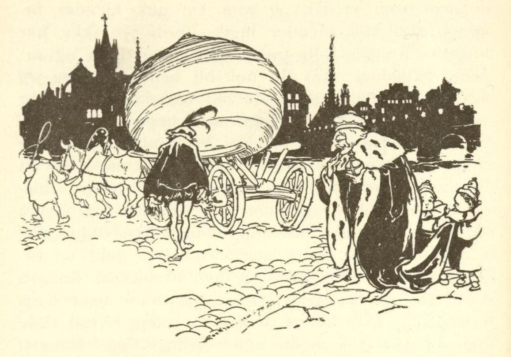

# Nepen

To brødre tjente som soldater, den ene var rik, den andre fattig. Men den fattige ville se å komme ut av sin nød, derfor tok han av seg soldaterkjolen og ble bonde. Han spadde og grov et stykke jord og sådde nepefrø. Frøene kom opp, og det vokste frem en nepe som var både stor og tykk, og den ble tykkere og tykkere. Den ville aldri holde opp å vokse, så man kunne kalle den en dronning for alle neper, for aldri hadde man sett make til denne og kommer heller ikke til å se det. Til sist ble den så stor at to hester knapt kunne trekke den, og bonden visste ikke hva han skulle gjøre med den, heller ikke visste han om den skulle bringe ham lykke eller ulykke.

Til sist tenkte han: «Hvis du selger den, så får du vel neppe stort for den, og hvis du selv vil spise neper, så smaker de små like så godt; best er det at du tar den med til kongen og gir ham den i gave.» Han lasset den da på vogna, spente to hester for, kjørte den til kongsgården og ga den til kongen. «Nei, men,» sa kongen, «det er en forunderlig ting, jeg har sett mye rart i mine dager, men make til denne har jeg enda aldri sett; hva slags frø har den vokst opp av? Eller er det bare deg det lykkes for, er du et lykkebarn?»

«Å nei,» sa bonden, «et lykkebarn er jeg ikke, jeg er en stakkars soldat som ikke lenger kunne forsørge meg, derfor hengte jeg soldaterkjolen på veggen og tok til å grave i jorden; jeg har enda en bror som er rik og som du nok kjenner, herr konge, men meg kjenner ingen, fordi jeg ikke har noe.» Kongen syntes synd på ham og sa: «Fattigdommen din skal du nok bli kvitt, og jeg skal gi deg så mye at du blir like så rik som broren din.» Da ga kongen ham en mengde gull, åkrer, enger og kveg, så brorens rikdom slett ikke kunne måle seg med hans.

Da den rike broren hørte alt det broren hans hadde fått for en eneste nepe, misunte han ham og grunnet på hvordan han også skulle gjøre lykke hos kongen, men han ville gjøre det enda mye bedre; derfor tok han gull og hester og kom med det til kongen, og han trodde at kongen ville gi ham en mye større gave; for når broren hans hadde fått så mye for en nepe, hva ville han da ikke få for slike fine ting? Kongen mottok gaven og sa at han ikke visste om noe å gi ham som var sjeldnere og bedre enn den store nepa. Den rike måtte da legge brorens nepe på en vogn og kjøre den hjem.

Da han var kommet hjem, visste han ikke hvem han skulle la sinnet og ergrelsen sin gå ut over, men til sist fikk han onde tanker og bestemte seg for å drepe broren sin. Han leide mordere som skulle legge seg i bakhold, og så gikk han til broren og sa: «Kjære bror, jeg vet en skjult skatt, den vil vi grave opp og dele med hverandre.» Den andre syntes godt om dette og gikk med uten å tenke på noe ondt; men da de kom ut, styrtet morderne over ham, bandt ham og ville henge ham opp i et tre.

Mens de holdt på med dette, hørte de sang og hestetramp i det fjerne; da ble de forskrekket og puttet ham hals over hode i en sekk, heiste ham opp på en gren og lot ham henge; men han strevet så lenge at han fikk et hull på sekken, så han kunne stikke hodet ut. Røverne tok beina fatt, men den som kom ridende på veien, var ingen annen enn en reisende student, en ung fyr som sang visen sin lystig mens han travet igjennom skogen.

Da bonden oppe i treet merket at en kom forbi, ropte han: «Velkommen, du kommer i en lykkelig time!» Studenten så seg omkring overalt, men visste ikke hvor stemmen kom fra; til sist sa han: «Hvem roper på meg?» Da svarte det fra tretoppen: «Løft øynene opp, jeg sitter her oppe i visdommens sekk, i kort tid har jeg lært store ting, og alle skoler og universiteter er ingenting mot dette; om en liten stund er jeg utlært, og da kommer jeg ned og er klokere enn alle mennesker i hele verden. Jeg kjenner alle stjerner og himmeltegn, jeg forstår meg på vindenes gang og å helbrede sykdommer og kreftene i urter, fugler og stein. Om du bare satt her, skulle du få føle hvor herlig det er.»

Da studenten hørte alt dette, ble han forbauset og sa: «Velsignet være den time da jeg traff deg; kan ikke også jeg komme litt inn i sekken?» Han som satt der, lot som han ikke gjerne ville ut og sa: «En liten stund skal jeg nok slippe deg inn for gode ord og betaling, men du må vente litt, for det er enda noe tilbake som jeg først må lære.» Da studenten hadde ventet litt, ble tiden for lang for ham, og han ba om at han likevel måtte få slippe inn, for tørsten hans etter visdom var så stor.

Da lot han der oppe som om han endelig ga etter og sa: «Hvis jeg skal komme ut av visdommens hus, må du fire sekken ned, og så skal du komme inn.» Studenten firte den fort ned, åpnet sekken og befriet ham, så ropte han selv: «La meg nå fort komme inn,» og ville straks inn i sekken med beina først. «Stopp,» ropte den andre, «slik går det ikke,» tok ham ved beina og satte ham på hodet i sekken og bandt den til, og så heiste han visdomsstudenten opp i treet og lot ham svinge i lufta. «Hvordan står det til, min kjære venn?» sa han, «nå føler du allerede at visdommen kommer og du gjør gode erfaringer, sitt derfor rolig og stille til du blir klokere.» Så satte han seg opp på studentens hest og red sin vei.
