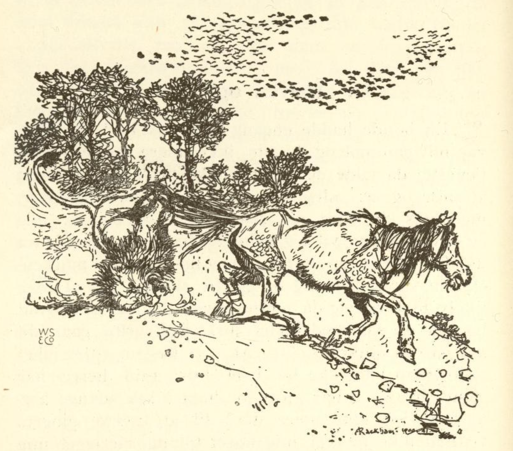

# Reven og hesten

En bonde hadde en gang en trofast hest, men den var blitt gammel og kunne ikke gjøre nytte for seg lenger; da ville husbonden ikke gi den mer å spise og sa: «Jeg kan ikke bruke deg lenger, men hvis du viser deg så sterk at du kommer hit med en løve til meg, så skal jeg beholde deg. Men pakk deg nå ut av stallen!» Og med det jaget han den ut på jordet.

Hesten var lei seg og gikk til skogen for å finne litt ly for været. Der møtte reven den og sa: «Hva henger du så med hodet for, og hvorfor går du så alene omkring?» «Akk,» sa hesten, «gjerrighet og troskap kan ikke bo i samme hus. Husbonden min har glemt hva jeg har gjort for ham i så mange år, og fordi jeg ikke duger til å trekke plogen lenger, vil han ikke gi meg mer fôr og har jaget meg bort. Han har riktignok sagt at hvis jeg var så sterk at jeg kunne komme til ham med en løve, ville han beholde meg, men han vet godt at jeg ikke kan det.»

Reven sa: «Det skal jeg nok hjelpe deg med, legg deg bare ned som om du var død, strekk deg ut og ikke rør deg.» Hesten gjorde som reven sa, og reven gikk til løven, som hadde hulen sin like ved, og sa: «Der borte ligger det en død hest, kom og følg med meg, så kan du få deg et godt måltid.» Løven gikk med, men da den sto ved hesten, sa reven: «Her har du det ikke bekvemt nok. Vet du hva, jeg skal binde hesten fast til deg etter halen, så kan du dra den til hulen din og ete den i ro og mak.»

Løven syntes godt om det rådet og stilte seg slik at reven kunne binde hesten fast til den. Den sto stille og rolig, men med halen til hesten bandt reven beina sammen på løven, og bandt og knyttet alt så fast og sterkt at det ikke var mulig å slite seg løs. Da reven var ferdig med det, slo den til hesten og sa: «Trekk, Blakken, trekk!» Da spratt hesten opp og dro løven av sted med seg. Løven begynte å brøle så fuglene i hele skogen fløy opp av skrekk, men hesten lot den brøle og dro og slepte den over jordet helt fram til døra til husbonden sin.

Da husbonden så det, kom han på andre tanker og sa til hesten: «Du skal bli hos meg og ha det godt,» og han ga den nok å ete så lenge den levde.
