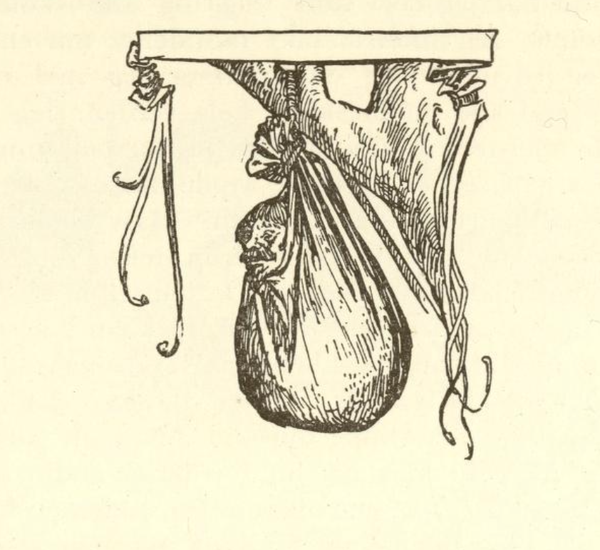

# Vårherres og fandens dyr

Vårherre hadde skapt alle dyrene og valgt ulvene til hundene sine, men geitene hadde han glemt; da satte djevelen seg også fore å skape, og han skapte geitene med lange haler. Når de nå gikk og beitet, ble de som regel sittende fast i tornebuskene med halene sine, og djevelen måtte da gå etter og med stor møye løse dem; dette ble han til slutt ergerlig over og bet halen av alle geitene; det kan man ennå den dag i dag se på stumpen.

Nå lot han dem nok beite alene, men det hendte at Vårherre så hvordan de snart gnog på et fruktbart tre, snart ødela andre spede planter. Han syntes så synd på plantene at han i sin nåde og barmhjertighet hisset ulvene sine på dem, så de snart rev geitene i stykker. Da djevelen merket dette, trådte han fram for Herren og sa: «Din skapning har revet i stykker min.» Herren svarte: «Hvorfor skapte du den til å gjøre skade?» Djevelen svarte: «Det måtte jeg; for akkurat som mitt sinn bare står til å skade, kunne det som jeg skapte, ikke ha noen annen natur, og du må nå gi meg erstatning for det din skapning har gjort.»

«Jeg skal gi deg den,» sa Herren, «når eikeløvet har falt av; kom da, så skal du få erstatningen din.» Da eikeløvet hadde falt av, kom djevelen og krevde den. Men Vårherre sa: «Ved kirken i Konstantinopel står det en høy eik som ennå har alle bladene sine.» Rasende fór djevelen av sted for å lete etter eika, men han vandret seks måneder omkring i ødemarken før han fant den, og da han kom tilbake, sto alle de andre eikene fulle av grønne blader; da måtte han gi opp erstatningen, og i sitt sinne stakk han øynene ut på alle geitene og satte sine egne inn i stedet; derfor har alle geiter djevleøyne og en kort hale, og djevelen tar gjerne skikkelse av en geit.
