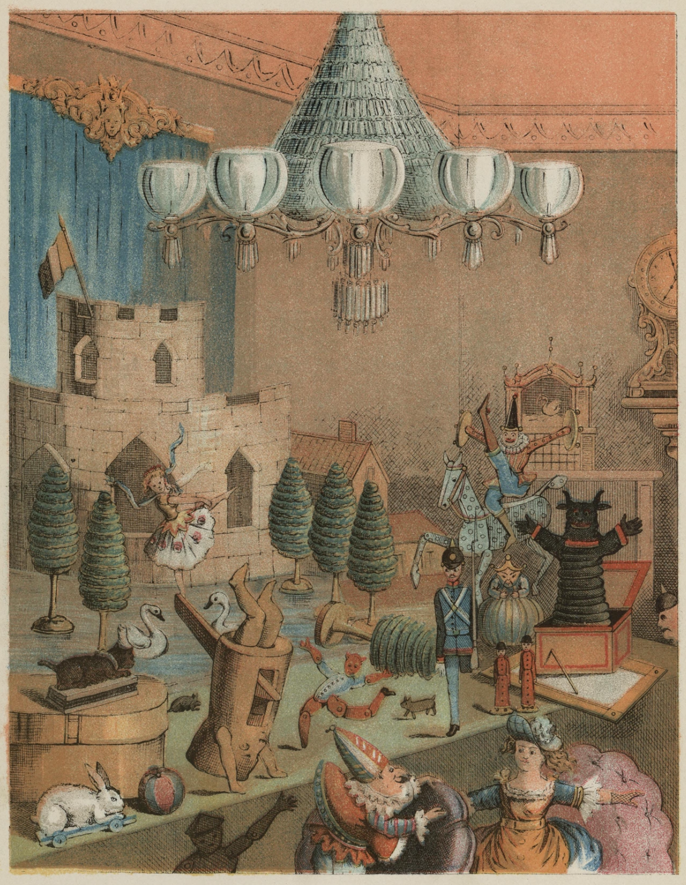
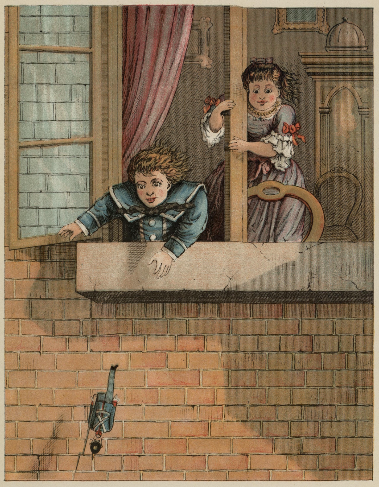
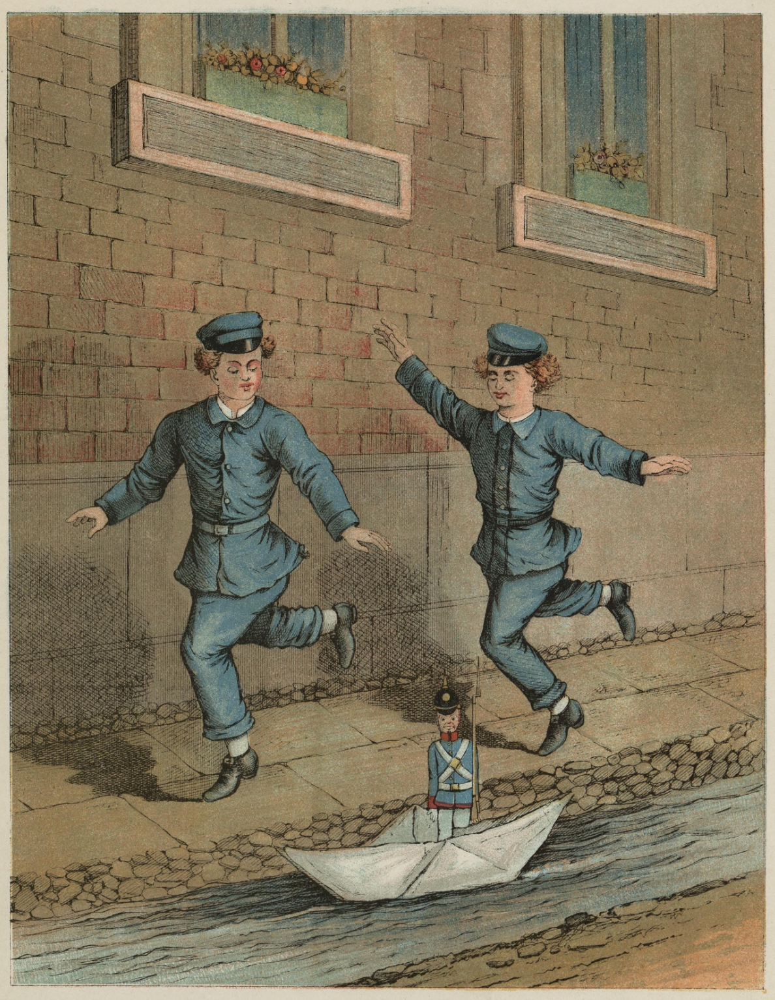
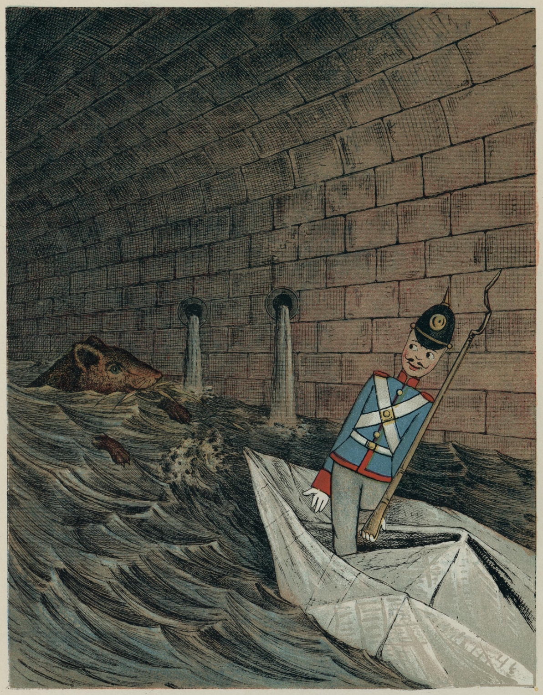
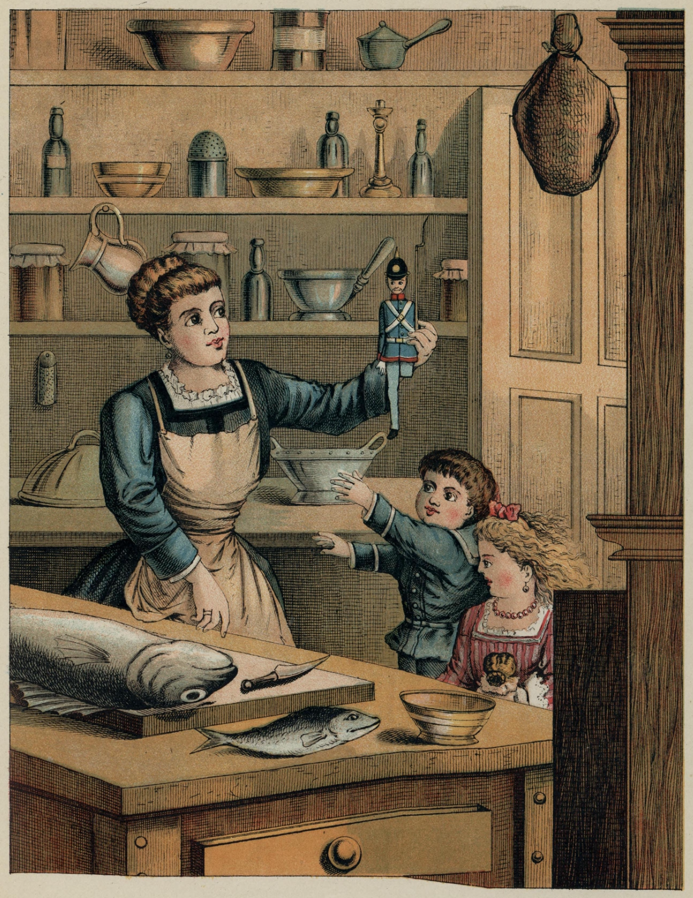
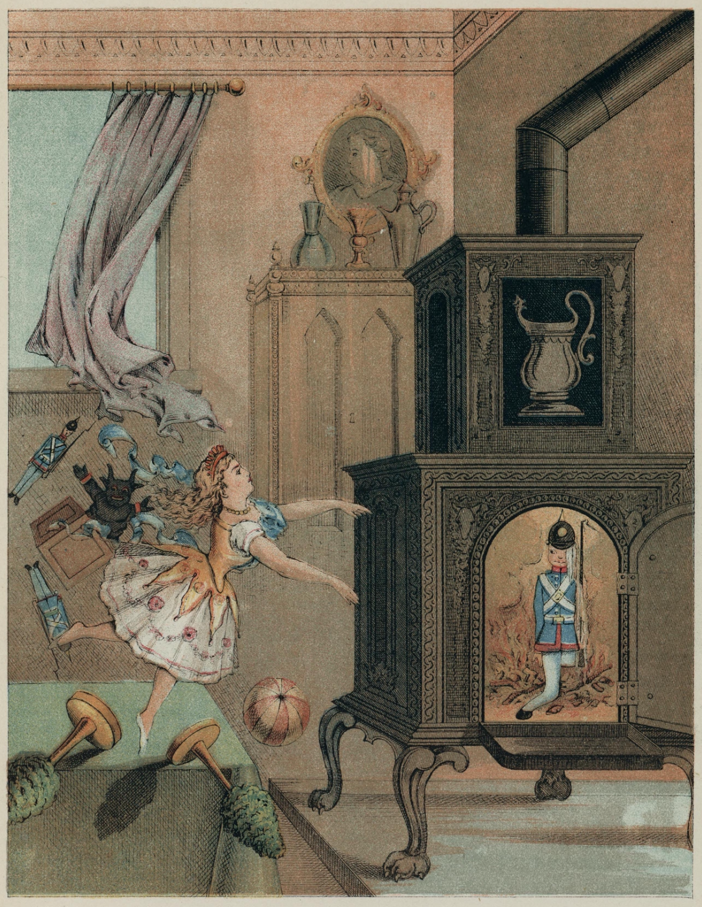

# Den standhaftige tinnsoldat

Det var engang fem og tjue tinnsoldater. De var alle brødre, for de var født av en gammel tinnskje. De så rett fram, geværet holdt de i armen, og uniformen var rød og blå og riktig flott.

Det aller første de hørte i denne verden, da lokket ble tatt av esken de lå i, var det ordet: «Tinnsoldater!» Det ropte en liten gutt og klappet i hendene. Han hadde fått dem fordi det var hans fødselsdag, og stilte dem nå opp på bordet.

Den ene soldaten lignet den andre på prikken, bare én var litt annerledes. Han hadde ett ben, for han var blitt støpt sist, og så var det ikke tinn nok. Likevel sto han like støtt på sitt ene som de andre på sine to, og det er akkurat ham det skal handle om.

På bordet hvor de ble stilt opp, sto mye annet leketøy, men det som falt mest i øynene, var et deilig slott av papir. Gjennom de små vinduene kunne man se rett inn i salene. Utenfor sto små trær rundt om et lite speil som skulle se ut som en sjø. Svaner av voks svømte på det og speilte seg. Det var alt sammen nydelig, men det nydeligste var likevel en liten jomfru som sto midt i den åpne slottsdøra. Hun var også klippet ut av papir, men hun hadde en kjole på av det klareste linon og et lite smalt blått bånd over skulderen som et sjal. Midt på det satt en skinnende paljett, like stor som hele ansiktet hennes.

Den lille jomfruen strakte begge armene ut, for hun var en danserinne, og så løftet hun det ene benet sitt så høyt i været at tinnsoldaten slett ikke kunne finne det og trodde at hun bare hadde ett ben, akkurat som han.

«Det var en kone for meg!» tenkte han. «Men hun er veldig fornem, hun bor i et slott, jeg har bare en eske, og den er vi fem og tjue om. Det er ikke noe sted for henne! Men jeg må se å bli kjent med henne!» Og så la han seg så lang han var bak en snustobakksdåse som sto på bordet. Der kunne han se rett på den lille fine damen som fortsatte å stå på ett ben uten å komme ut av balansen.

Da det ble ut på kvelden, kom alle de andre tinnsoldatene i esken sin, og folkene i huset gikk til sengs. Nå begynte leketøyet å leke, både å leke besøk, føre krig og holde ball. Tinnsoldatene raslet i esken, for de ville være med, men de kunne ikke få lokket av. Nøtteknekkeren slo kollbøtter, og griffelen gjorde kommers[^1] på tavla. Det var et spektakel, så kanarifuglen våknet og begynte å snakke med, og det på vers.

De to eneste som ikke rørte seg av stedet, var tinnsoldaten og den lille danserinnen. Hun holdt seg så rank på tåspissen og med begge armene utåt. Han var like standhaftig på sitt ene ben, og øynene hans slapp henne ikke et øyeblikk.

Nå slo klokka tolv, og klask! Da sprang lokket av snustobakksdåsen, men det var ingen tobakk i den, nei, men et lite, svart troll – det var et slikt kunststykke.

«Tinnsoldat!» sa trollet. «Vil du holde øynene dine for deg selv!»

Men tinnsoldaten lot som han ikke hørte det.

«Ja, vent til i morgen!» sa trollet.

Da det ble morgen og barna kom opp, ble tinnsoldaten stilt i vinduet, og enten det nå var trollet eller trekken, med ett fløy vinduet opp, og soldaten falt på hodet ned fra tredje etasje.

Det var en skrekkelig fart, han vendte benet rett i været og ble stående på hjelmen med bajonetten nede mellom brosteinene.

Tjenestepika og den lille gutten kom straks ned for å lete, men selv om de nesten tråkket på ham, kunne de likevel ikke se ham. Hadde tinnsoldaten ropt: «Her er jeg!» så hadde de nok funnet ham, men han fant det ikke passende å skrike høyt da han var i uniform.

Nå begynte det å regne, den ene dråpen falt tettere enn den andre, det ble et ordentlig skyll. Da den var forbi, kom det to gategutter.

«Sjø du!» sa den ene, «der ligger en tinnsoldat! Han skal ut og seile!»

Og så gjorde de en båt av en avis, satte tinnsoldaten midt i den, og nå seilte han nedover rennesteinen. Begge guttene løp ved siden og klappet i hendene. Bevar oss vel! Hvilke bølger det gikk i den rennesteinen, og hvilken strøm det var! Ja, det hadde da også skyllregnet. Papirbåten vippet opp og ned, og innimellom så dreide den seg rundt, så det dirret i tinnsoldaten. Men han forble standhaftig, forandret ikke en mine, så rett ut og holdt geværet i armen.

Med ett drev båten inn under et langt rennesteinsbrett. Der ble det like mørkt som om han var i sin eske.

«Hvor mon jeg nå havner,» tenkte han. «Ja, ja, det er trollets skyld! Å, om bare den lille jomfruen satt her i båten, så kunne det gjerne være dobbelt så mørkt!»

I det samme kom det en stor vandrotte som bodde under rennesteinsbrettet.

«Har du pass?» spurte rotta. «Hit med passet!»

Men tinnsoldaten tiet stille og holdt enda fastere på geværet. Båten fór av sted og rotta bak etter. Hui! Som den skar tenner og ropte til pinner og strå:

«Stopp ham! Stopp ham! Han har ikke betalt toll! Han har ikke vist pass!»

Men strømmen ble sterkere og sterkere. Tinnsoldaten kunne allerede øyne den lyse dagen foran hvor brettet slapp, men han hørte også en brusende lyd som nok kunne gjøre en tapper mann forskrekket. Tenk deg, rennesteinen styrtet, hvor brettet endte, rett ut i en stor kanal. Det ville for ham være like farlig som for oss å seile ned en stor foss.

Nå var han allerede så nær at han ikke kunne stanse. Båten fór ut, den stakkars tinnsoldaten holdt seg så stiv han kunne. Ingen skulle kunne si om ham at han blinket med øynene.

Båten snurret tre, fire ganger rundt og var fylt med vann rett til randen, den måtte synke. Tinnsoldaten sto i vann til halsen, og dypere og dypere sank båten. Mer og mer løste papiret seg opp. Nå gikk vannet over soldatens hode – da tenkte han på den lille nydelige danserinnen som han aldri mer skulle få se, og det klang for tinnsoldatens øre:

«Fare, fare, krigsmann!
Døden skal du lide!»

Nå gikk papiret i stykker, og tinnsoldaten styrtet gjennom – men ble i det samme slukt av en stor fisk.

Nei, så mørkt det var der inne! Det var enda verre enn under rennesteinsbrettet, og så var det så trangt. Men tinnsoldaten var standhaftig og lå så lang han var med geværet i armen.

Fisken fór omkring, den gjorde de aller forferdeligste bevegelser. Endelig ble den helt stille, det fór som en lynstråle gjennom den. Lyset skinte helt klart, og en ropte høyt: «Tinnsoldat!»

Fisken var blitt fanget, brakt på torvet, solgt og kommet opp i kjøkkenet, hvor pika skar den opp med en stor kniv. Hun tok soldaten med to fingre midt om livet og bar ham inn i stua, hvor de alle sammen ville se en så merkverdig mann som hadde reist rundt i magen på en fisk. Men tinnsoldaten var slett ikke stolt.

De stilte ham opp på bordet, og der – nei, så underlig det kan gå til i verden! Tinnsoldaten var i den selvsamme stua han hadde vært i før, han så de selvsamme barna, og leketøyet sto på bordet: det deilige slottet med den nydelige lille danserinnen. Hun holdt seg enda på det ene benet og hadde det andre høyt i været, hun var også standhaftig! Det rørte tinnsoldaten, han var nær ved å gråte tinn, men det passa seg ikke. Han så på henne, og hun så på ham, men de sa ikke noe.

I det samme tok en av småguttene og kasta soldaten rett inn i kakkelovnen, og han ga slett ingen grunn for det. Det var sikkert trollet i dåsen som hadde skylden.

Tinnsoldaten sto helt opplyst og følte en hete som var forferdelig, men om det var av den virkelige ilden, eller av kjærlighet, det visste han ikke. Fargene var helt gått av ham, om det var skjedd på reisen eller det var av sorg, kunne ingen si. Han så på den lille jomfruen, hun så på ham, og han følte han smeltet, men enda sto han standhaftig med geværet i armen.

Da gikk det en dør opp, vinden tok i danserinnen, og hun fløy som en sylfide rett inn i kakkelovnen til tinnsoldaten, blusset opp i lue og var borte. Så smeltet tinnsoldaten til en klatt, og da pika dagen etter tok asken ut, fant hun ham som et lite tinnhjerte. Av danserinnen derimot var det bare palletten igjen, og den var brent kullsort.

[^1]: Gjorde kommers: holdt leven og moret seg.
