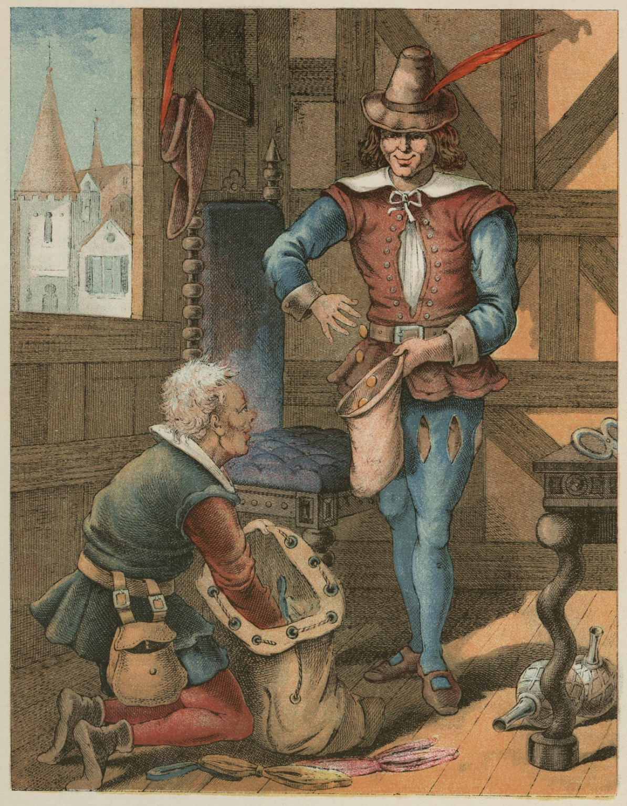
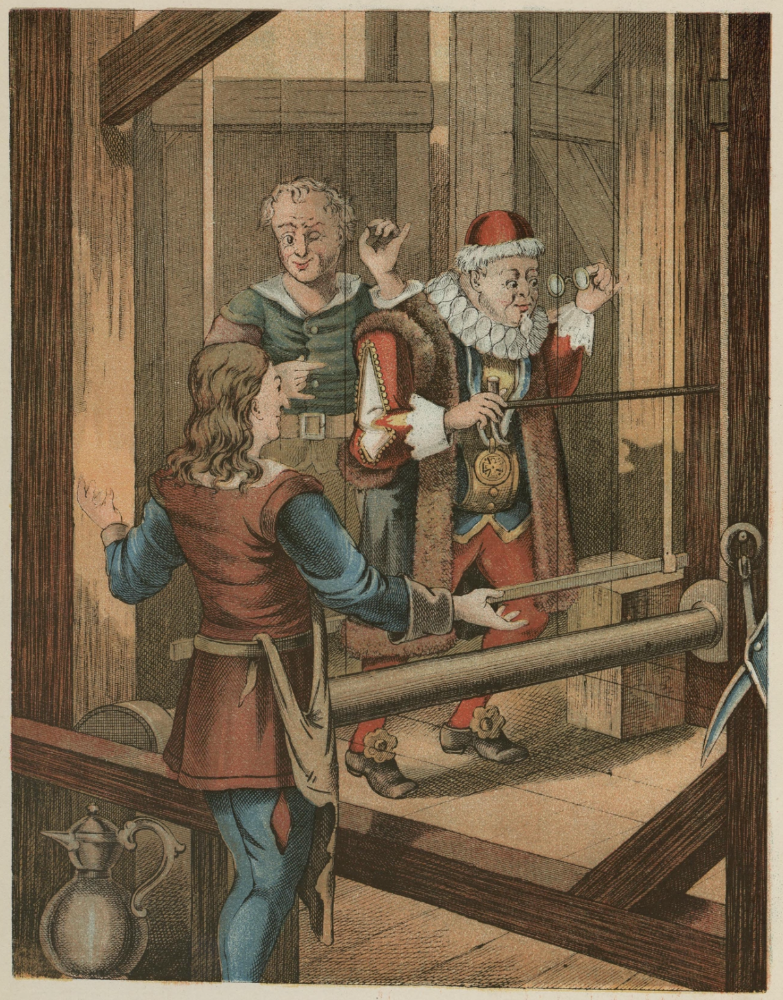
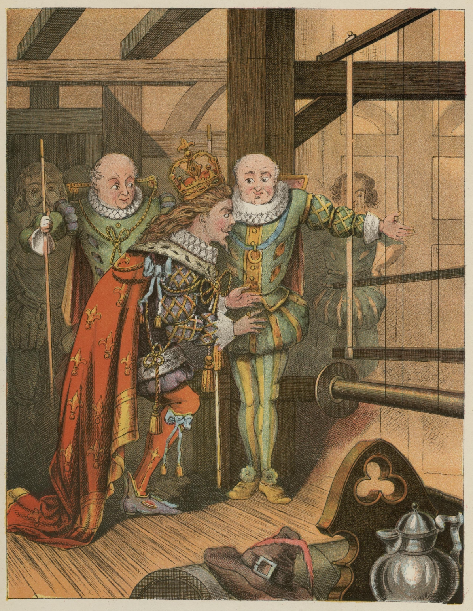
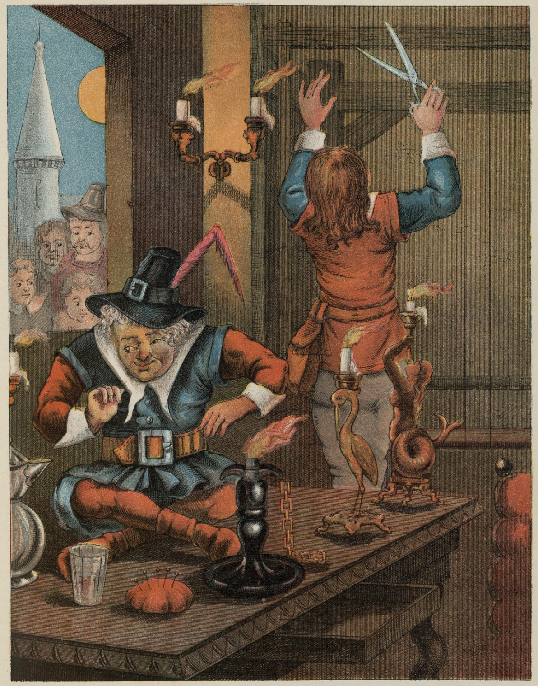
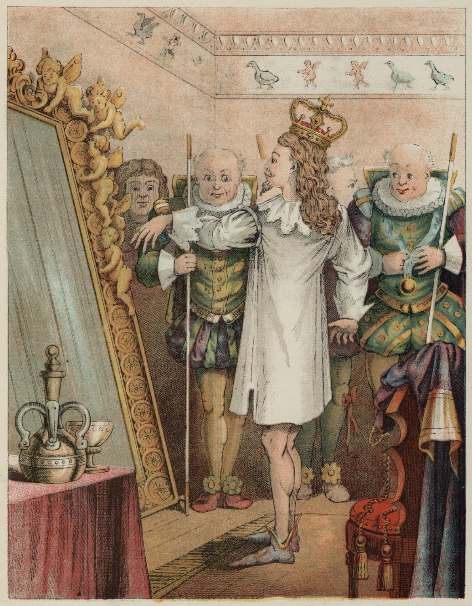
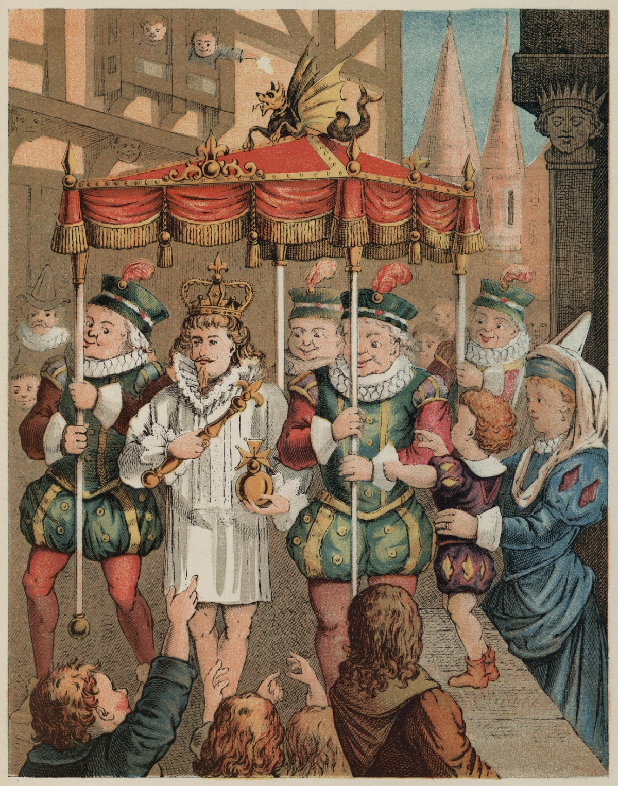

# Keiserens nye klær

For mange år siden levde en keiser som var så uhyre glad i vakre, nye klær at han brukte alle pengene sine på å bli riktig pyntet. Han brydde seg ikke om soldatene sine, brydde seg ikke om teater eller om å kjøre i skogen, uten bare for å vise fram de nye klærne sine. Han hadde en kjole for hver time på dagen, og akkurat som man sier om en konge: «han er i rådet», så sa man alltid her: «Keiseren er i klesskapet!»

I den store byen hvor han bodde, gikk det svært muntert for seg. Hver dag kom det mange fremmede. En dag kom det to bedragere. De ga seg ut for å være vevere og sa at de kunne veve det deiligste tøyet man kunne tenke seg. Ikke bare var fargene og mønsteret uvanlig vakre, men de klærne som ble sydd av tøyet, hadde den underlige egenskapen at de ble usynlige for alle mennesker som ikke dugde i embetet sitt, eller som var utilgivelig dumme.

«Det ville jo være deilige klær,» tenkte keiseren. «Ved å ha dem på kunne jeg finne ut hvilke menn i riket mitt som ikke duger til det embetet de har. Jeg kan skille de kloke fra de dumme! Ja, det tøyet må straks veves til meg!» Og han ga de to bedragerne mange penger på hånda for at de skulle begynne på arbeidet sitt.

De satte da opp to vevstoler, lot som om de arbeidet, men de hadde ikke det minste på veven. Straks krevde de den fineste silken og det prektigste gullet. Det puttet de i sin egen lomme og arbeidet med de tomme vevene, og det til langt ut på natta.

«Nå skulle jeg gjerne vite hvor langt de er med tøyet!» tenkte keiseren, men han ble litt rar om hjertet ved tanken på at den som var dum, eller dårlig passet til embetet sitt, ikke kunne se det. Han trodde nok at han ikke behøvde å være redd for seg selv, men han ville likevel sende noen først for å se hvordan det sto til. Alle mennesker i hele byen visste hvilken underlig kraft tøyet hadde, og alle var ivrige etter å se hvor udugelig eller dum naboen var.

«Jeg vil sende den gamle, ærlige ministeren min bort til veverne!» tenkte keiseren. «Han kan best se hvordan tøyet tar seg ut, for han har forstand, og ingen passer embetet sitt bedre enn han!»

Nå gikk den gamle, skikkelige ministeren inn i salen hvor de to bedragerne satt og arbeidet med de tomme vevene.

«Gud bevare oss!» tenkte den gamle ministeren og sperret øynene opp. «Jeg kan jo ikke se noe!» Men det sa han ikke.

Begge bedragerne ba ham være så snill å komme nærmere og spurte om det ikke var et vakkert mønster og deilige farger. Så pekte de på den tomme veven, og den stakkars gamle ministeren fortsatte å sperre øynene opp, men han kunne ikke se noe, for det var ingenting der.

«Herre Gud!» tenkte han. «Skulle jeg være dum? Det har jeg aldri trodd, og det må ingen mennesker vite! Skulle jeg ikke duge til embetet mitt? Nei, det går ikke an at jeg forteller jeg ikke kan se tøyet!»

«Nå, du sier ikke noe om det!» sa den ene som vevde.

«Å, det er nydelig! Helt aller nydeligst!» sa den gamle ministeren og så gjennom brillene sine. «Dette mønsteret og disse fargene! Ja, jeg skal si keiseren at det behager meg svært!»

«Nå, det gleder oss!» sa begge veverne, og nå nevnte de fargene ved navn og det sjeldne mønsteret. Den gamle ministeren hørte godt etter for at han kunne si det samme når han kom hjem til keiseren, og det gjorde han.

Nå forlangte bedragerne flere penger, mer silke og gull. Det skulle de bruke til vevingen. De stakk alt i sine egne lommer. På veven kom ikke en tråd, men de fortsatte, som før, å veve på den tomme veven.

Keiseren sendte snart igjen en annen skikkelig embetsmann bort for å se hvordan det gikk med vevingen, og om tøyet snart var ferdig. Det gikk ham akkurat som ministeren. Han så og så, men da det ikke var noe utenom de tomme vevene, kunne han ikke se noe.

«Ja, er det ikke et vakkert stykke tøy!» sa begge bedragerne og viste og forklarte det deilige mønsteret som det slett ikke var.

«Dum er jeg ikke!» tenkte mannen. «Det er altså det gode embetet mitt jeg ikke duger til? Det var underlig nok! Men det må man ikke la seg merke med!» Og så roste han tøyet han ikke så, og forsikret dem om hvor glad han var for de vakre fargene og det deilige mønsteret. «Ja, det er helt aller nydeligst!» sa han til keiseren.

Alle mennesker i byen snakket om det prektige tøyet.

Nå ville keiseren selv se det mens det ennå var på veven. Med en hel skare av utvalgte menn, blant dem de to gamle, skikkelige embetsmennene som hadde vært der før, gikk han bort til de to listige bedragerne, som nå vevde av alle krefter, men uten tråd og trevl.

«Ja, er det ikke magnifique!» sa begge de skikkelige embetsmennene. «Vil Deres Majestet se hvilket mønster, hvilke farger!» Og så pekte de på den tomme veven, for de trodde at de andre sikkert kunne se tøyet.

«Hva for noe!» tenkte keiseren. «Jeg ser ingenting! Det er jo forferdelig! Er jeg dum? Duer jeg ikke til å være keiser? Det er det skrekkeligste som kunne hende meg!»

«Å, det er veldig vakkert!» sa keiseren. «Det har mitt aller høyeste bifall!» Og han nikket fornøyd og betraktet den tomme veven. Han ville ikke si at han ikke kunne se noe. Hele følget han hadde med seg, så og så, men fikk ikke mer ut av det enn alle de andre, men de sa akkurat som keiseren: «Å, det er veldig vakkert!» Og de rådet ham til å ta på seg klær av dette nye, prektige tøyet første gang ved den store prosesjonen som skulle holdes snart. «Det er magnifique! Nydelig, excellent!» gikk det fra munn til munn, og de var alle sammen så inderlig fornøyde med det. Keiseren ga hver av bedragerne et ridderkors å henge i knapphullet og tittelen vevjunker.

Hele natta før den formiddagen prosesjonen skulle være, satt bedragerne oppe og hadde over seksten lys tent. Folk kunne se at de hadde det travelt med å få keiserens nye klær ferdige. De lot som om de tok tøyet av veven, de klippet i lufta med store sakser, de sydde med synål uten tråd og sa til sist: «Se, nå er klærne ferdige!»

Keiseren, med de fornemste kavalerene sine, kom selv dit, og begge bedragerne løftet den ene armen i været, akkurat som om de holdt noe, og sa: «Se, her er buksene! Her er kjolen! Her er kappa!» og så videre. «Det er så lett som spindelvev! Man skulle tro man ikke hadde noe på kroppen, men det er nettopp det fine med det!»

«Ja!» sa alle kavalerne, men de kunne ikke se noe, for det var ikke noe der.

«Vil Deres keiserlige majestet allernådigst behage å ta av seg klærne?» sa bedragerne. «Så skal vi kle på Dem de nye, her borte foran det store speilet!»

Keiseren tok av seg alle klærne sine, og bedragerne bar seg at som om de ga ham hvert plagg av de nye som skulle være sydd, og de tok ham om livet, og det var som om de bandt noe fast – det var slepet – og keiseren vendte og dreide seg foran speilet.

«Gud, hvor det kler ham godt! Hvor det sitter deilig!» sa de alle sammen. «Hvilket mønster! Hvilke farger! Det er en kostbar drakt!»

«Utenfor står de med tronhimmelen som skal bæres over Deres Majestet i prosesjonen!» sa overseremonimesteren.

«Ja, jeg er jo klar!» sa keiseren. «Sitter det ikke godt?» Og så snudde han seg en gang til foran speilet, for det skulle jo se ut som om han virkelig beundret stasen sin.

Kammerherrene som skulle bære slepet, famlet med hendene bortover gulvet, som om de tok slepet opp. De gikk og holdt i lufta. De turte ikke la seg merke med at de ikke kunne se noe.

Og så gikk keiseren i prosesjonen under den deilige tronhimmelen, og alle mennesker på gata og i vinduene sa: «Gud, hvor keiserens nye klær er mageløse! Hvilket deilig slepp han har på kjolen! Hvor det sitter velsignet!» Ingen ville la seg merke med at de ikke så noe, for da hadde de jo ikke duget i embetet sitt, eller vært svært dumme. Ingen av keiserens klær hadde gjort slik lykke.

«Men han har jo ikke noe på!» sa et lite barn.

«Herre Gud, hør den uskyldiges røst!» sa faren, og den ene hviska til den andre hva barnet sa.

«Han har ikke noe på! Det er et lite barn som sier han har ikke noe på!»

«Han har jo ikke noe på!» ropte til sist hele folket. Og det krøp i keiseren, for han syntes de hadde rett, men han tenkte som så: «Nå må jeg holde prosesjonen ut.» Og så holdt han seg enda stoltere, og kammerherrene gikk og bar på slepet som det slett ikke var.
