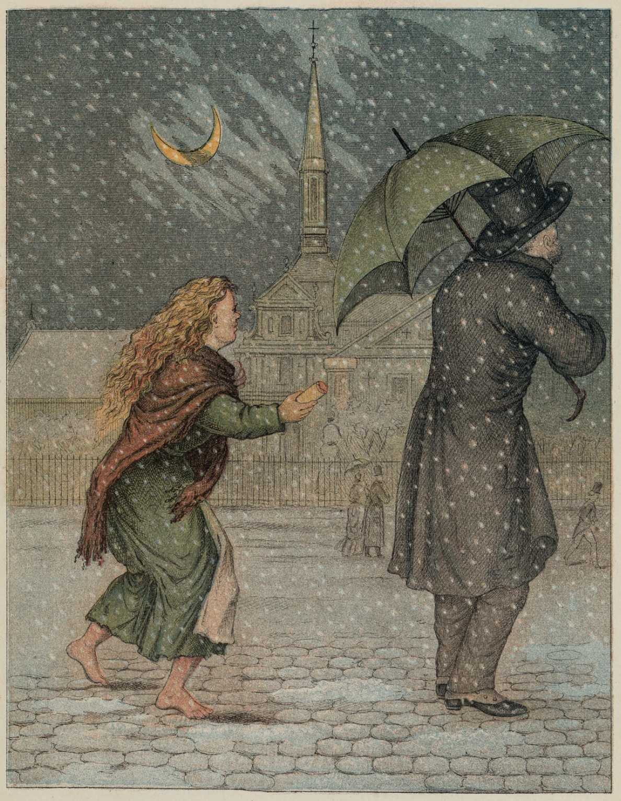
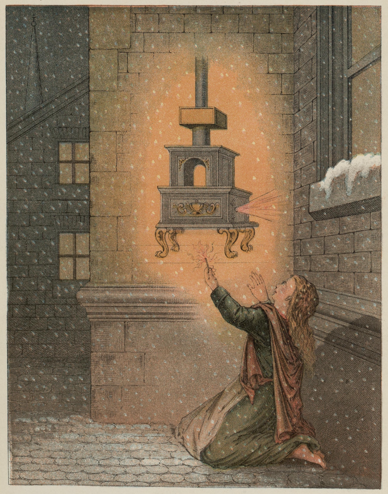
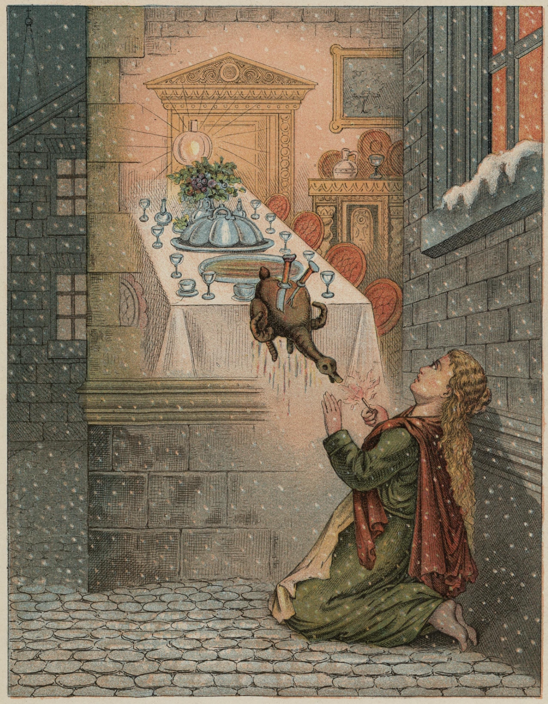
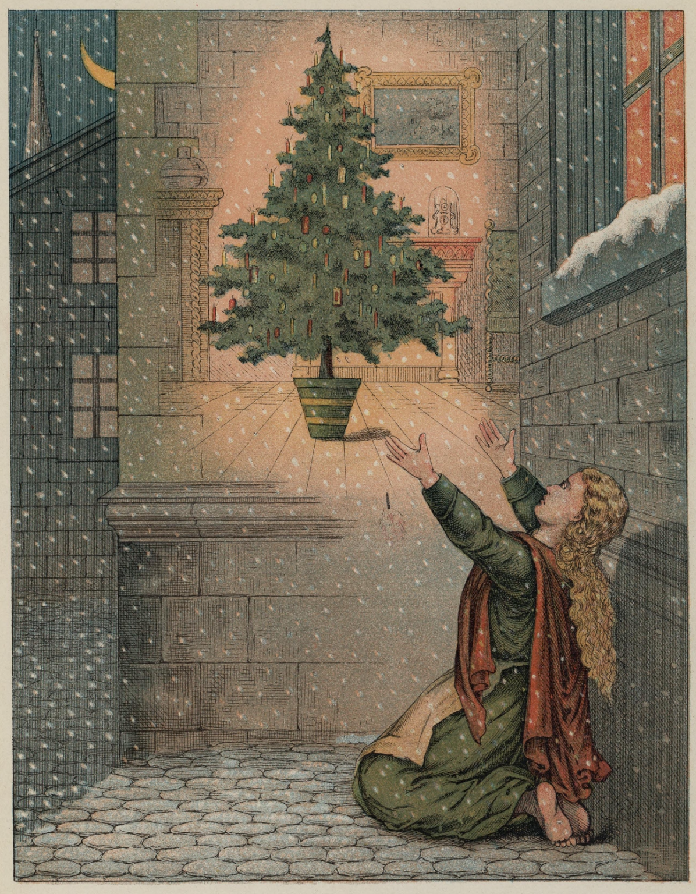
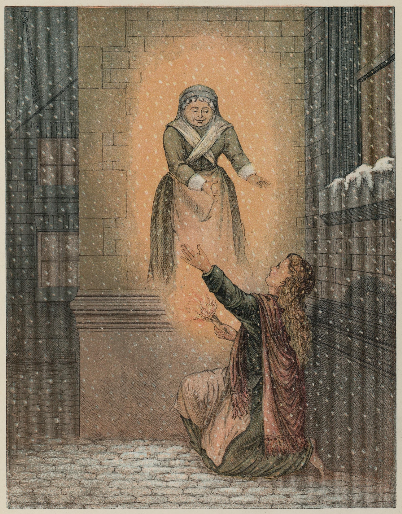
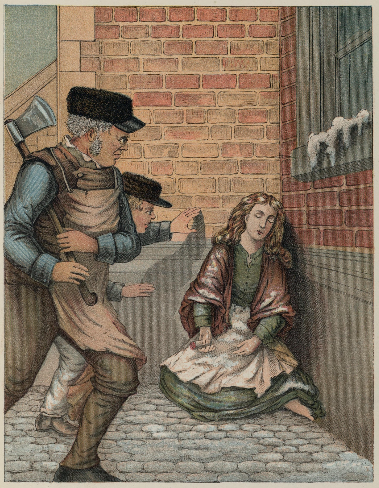

# Piken med fyrstikkene

Det var så gruelig kaldt. Det snødde og det begynte å bli mørk kveld. Det var også den siste kvelden i året, nyttårsaften.

I denne kulda og i dette mørket gikk en liten, fattig pike på gata med bart hode og nakne føtter. Ja, hun hadde jo riktignok hatt tøfler på da hun kom hjemmefra, men hva kunne det hjelpe! Det var veldig store tøfler, moren hennes hadde sist brukt dem, så store var de, og dem mistet den lille da hun skyndte seg over gata mens to vogner fór så forferdelig fort forbi. Den ene tøffelen var ikke å finne, og den andre løp en gutt med. Han sa at den kunne han bruke til vugge når han selv fikk barn.

Der gikk den lille pika på de nakne, små føttene som var røde og blå av kulde. I et gammelt forkle holdt hun en mengde fyrstikker, og ett knippe gikk hun med i hånda. Ingen hadde kjøpt noe av henne hele dagen, ingen hadde gitt henne en liten skilling. Sulten og gjennomfrossen gikk hun og så så forkuet ut, den lille stakkars! Snøfnuggene falt i det lange, gule håret hennes som krøllet så vakkert om nakken, men den stasen tenkte hun riktignok ikke på.

Ut fra alle vinduene skinte lysene, og så luktet det så deilig av gåsestek på gata. Det var jo nyttårsaften, ja, det tenkte hun på.

Borte i en krok mellom to hus – det ene stakk litt lenger fram i gata enn det andre – der satte hun seg og krøp sammen. De små beina hadde hun trukket opp under seg, men hun frøs enda mer, og hjem turte hun ikke gå. Hun hadde jo ingen fyrstikker solgt, ikke fått en eneste skilling. Faren hennes ville slå henne, og kaldt var det også hjemme. De hadde bare taket rett over seg, og der pep vinden inn, selv om det var stoppet strå og filler i de største sprekkene.

De små hendene hennes var nesten helt døde av kulde. Å! En liten fyrstikk kunne gjøre godt. Om hun bare turte trekke en ut av knippet, stryke den mot veggen og varme fingrene.

Hun trakk en ut. «Ritsch!» Hvor sprudlet den, hvor brant den! Det var en varm, klar flamme, akkurat som et lite lys da hun holdt hånda om den. Det var et underlig lys. Den lille pika syntes hun satt foran en stor jernkakkelovn med blanke messingkuler og messingtromle. Ilden brant så velsignet, varmet så godt. Nei, hva var det! Den lille strakte allerede føttene ut for å varme dem også – da sluknet flammen. Kakkelovnen forsvant. Hun satt med en liten stump av den utbrente fyrstikka i hånda.

En ny ble strøket, den brant, den lyste, og hvor skinnet falt på muren, ble denne gjennomsiktig som et flor. Hun så rett inn i stua hvor bordet sto dekket med en skinnende hvit duk, med fint porselen, og deilig dampet den stekte gåsa, fylt med svisker og epler. Og det som var enda prektigere: gåsa sprang fra fatet, vraltet bortover gulvet med gaffel og kniv i ryggen, helt bort til den fattige pika kom den – da sluknet fyrstikka, og det var bare den tykke, kalde muren å se.

Hun tente en ny. Da satt hun under det deiligste juletre. Det var enda større og mer pyntet enn det hun hadde sett gjennom glassdøra hos den rike kjøpmannen sist jul. Tusen lys brant på de grønne grenene, og fargerike bilder, som de som pynter butikkvinduene, så ned til henne. Den lille strakte begge hendene i været – da sluknet fyrstikka. De mange julelysa gikk høyere og høyere, hun så at de nå var de klare stjernene. En av dem falt og laget en lang ildstripe på himmelen.

«Nå dør det en!» sa den lille, for gamle mormor – som var den eneste som hadde vært snill mot henne, men nå var død – hadde sagt: når en stjerne faller, går det en sjel opp til Gud.

Hun strøk igjen en fyrstikk mot muren, den lyste rundt om, og i glansen sto den gamle mormor, så klar, så skinnende, så mild og velsignet.

«Mormor!» ropte den lille. «Å, ta meg med! Jeg vet du er borte når fyrstikka går ut, borte akkurat som den varme kakkelovnen, den deilige gåsesteken og det store, velsignede juletreet!»

Og hun strøk i hast hele resten av fyrstikkene som var i knippet. Hun ville så gjerne holde fast på mormor, og fyrstikkene lyste med slik glans at det var klarere enn midt på lyse dagen. Mormor hadde aldri før vært så vakker, så stor. Hun løftet den lille pika opp på armen sin, og de fløy i glans og glede, så høyt, så høyt, og der var det ingen kulde, ingen sult, ingen angst – de var hos Gud.

Men i kroken ved huset satt i den kalde morgenstunda den lille pika med de røde kinnene, med smil om munnen – død, frosset i hjel den siste kvelden i det gamle året.

Nyttårsmorgen gikk opp over det lille liket som satt med fyrstikkene, og et av knippene var nesten oppbrent. «Hun har villet varme seg,» sa folk. Ingen visste hvor vakre ting hun hadde sett, i hvilken glans hun med gamle mormor var gått inn til nyttårsglede.

