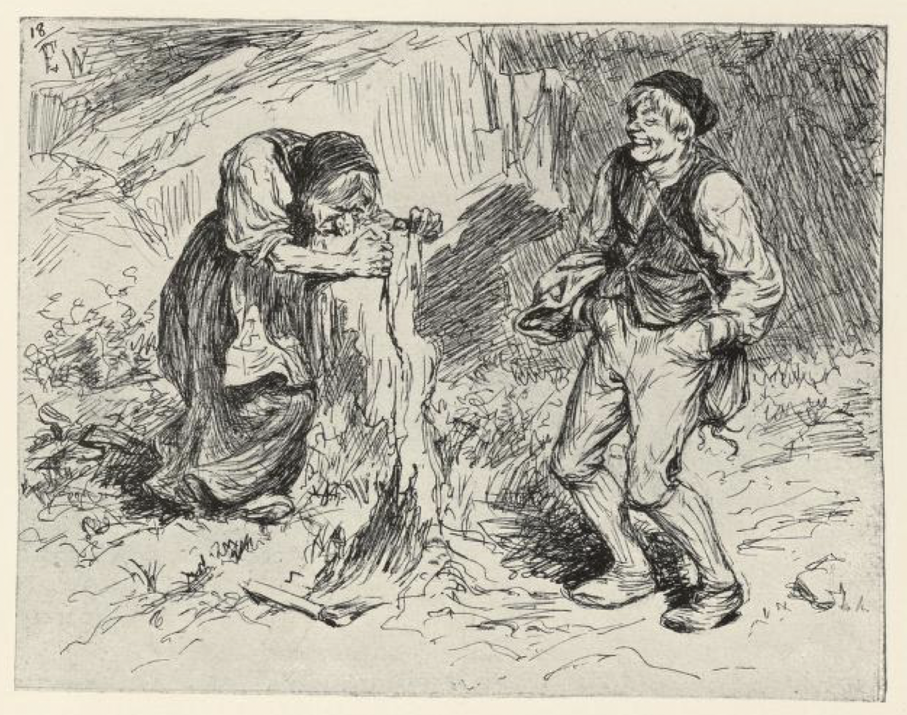
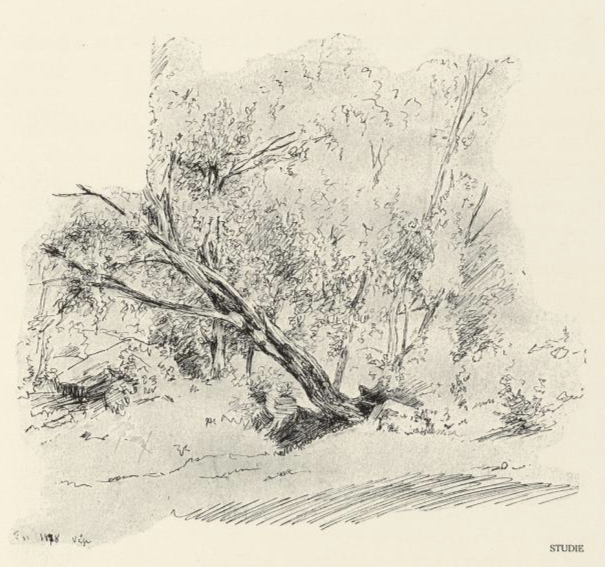
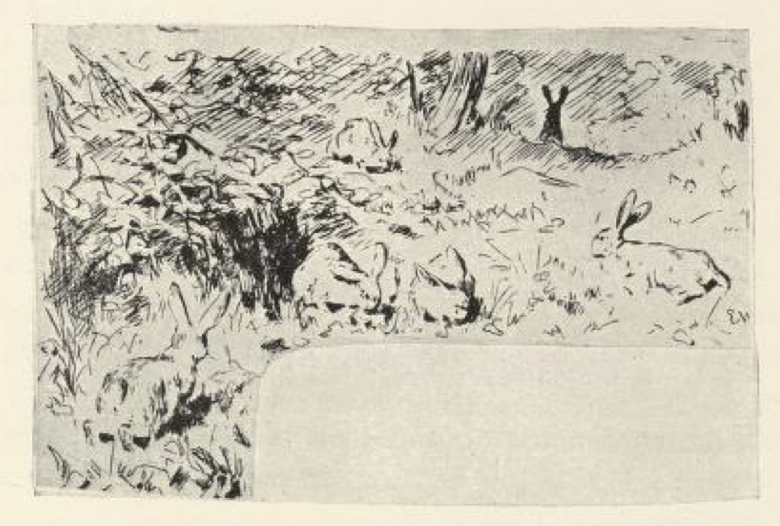
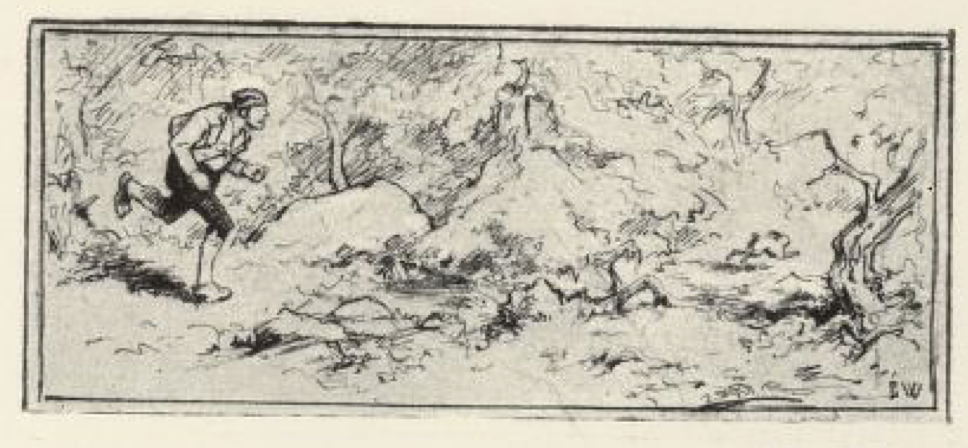
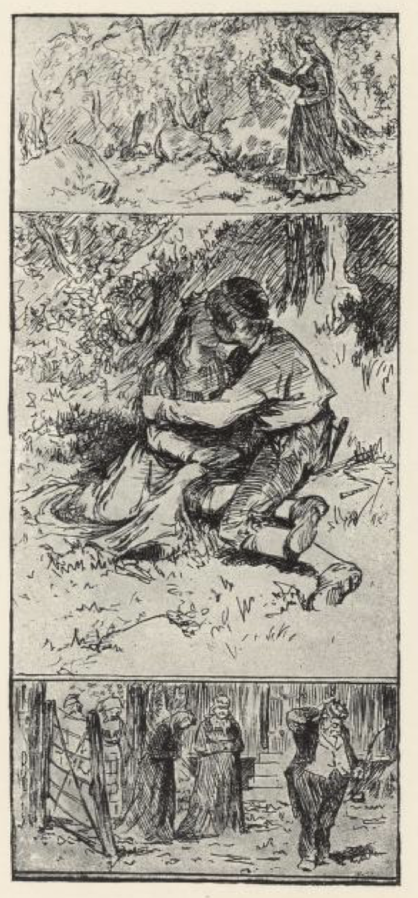
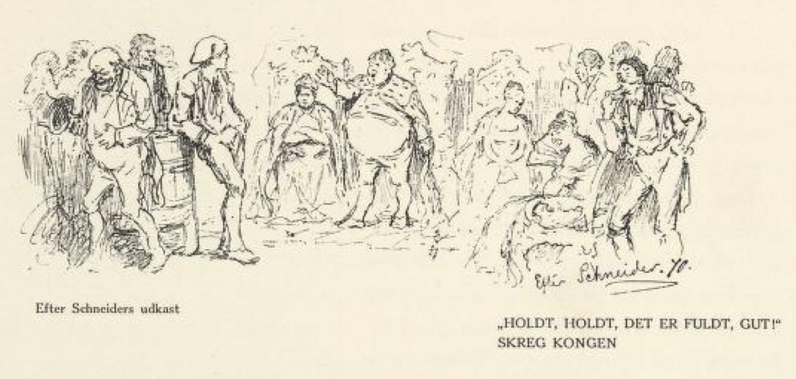

# Gjete kongens harer

Det var en gang en kårmann[^1] som hadde gitt fra seg gården sin til odelsmannen. Men han hadde tre sønner til, og de het Per og Pål og Espen Askeladd. De gikk hjemme og ville ingenting gjøre, for de hadde det for godt, og selv syntes de at de var for gode til alt, og at ingenting var godt nok for dem.

Langt om lenge hadde Per fått høre at kongen ville ha en gjeter til å gjete harene sine, og så sa han til faren at han ville dit, det kunne passe for ham, for han ville ikke tjene noen ringere mann enn kongen, sa han. Kallen mente at det nok kunne være arbeid som passet bedre for ham enn det; for den som skulle gjete harene, måtte være smidig og lett og ikke noen daustokk[^2], og når harene begynte å kaste seg rundt og fly, så ble det en annen dans enn å rangle stuemellom.

«Ja, det fikk ikke hjelpe, Per ville dit og han skulle dit,» så tok han skreppa på nakken og labbet ned over bakken, og da han hadde gått langt og lenger enn langt, kom han til en gammel kjerring som sto med nesen sin fast i en vedkubbe, og hakket, og da han fikk se hvordan hun rykket og slet for å komme løs, ga han seg til å storle.

«Stå ikke der og glis,» sa kjerringa, «men kom og hjelp en gammel krok; jeg skulle hogge i stykker litt ved, så fikk jeg nesen min ned i her, og så har jeg stått og rykket og slitt og ikke smakt en matsmule på hundre år,» sa hun.

Men enda mer lo han Per; han syntes det var bare moro, og sa at når hun hadde stått slik i hundre år, kunne hun godt holde ut hundre til.

Da han kom til kongsgården, tok de ham til gjeter med en gang; det var ikke vanskelig å få tjeneste der, og god niste og god lønn skulle han ha, og kanskje prinsessen på kjøpet; men om det kom bort en eneste av kongens harer, skulle de skjære tre røde remmer av ryggen hans og kaste ham i ormegården.

Så lenge Per var i fegaten[^3] og hjemmehagen, hadde han alle harene i én flokk; men da det led på dagen, og de kom opp i skogen, begynte de å skjene og fly over alle åsene. Per satte etter og løp på sprang så lenge han kunne skjønne at han hadde én igjen, og da den siste var borte, var han nesten sprengt, og siden så han ikke mer til dem.

Da det led på ettermiddagen, ruslet han hjemover, og sto og glodde og glodde etter dem ved grinda. Å nei, det kom ingen harer; men da han kom hjem til kongsgården om kvelden, sto kongen klar med kniven, og tok og skar tre røde remmer av ryggen på ham, strødde pepper og salt i og kastet ham i ormegården.

Om en stund ville Pål av sted til kongsgården og gjete harene til kongen. Kallen sa det samme til ham, og enda mer til; men han måtte av sted og han ville av sted, det var ingen råd for det, og det gikk verken verre eller bedre med ham enn det gikk med Per. Kjerringa sto der og rykket og slet med nesen i vedkubben, han lo og syntes det var bare moro, og lot henne stå der og hakke. Tjeneste fikk han med en gang, der var det ikke nei å få. Men harene skjente fra ham bort over alle haugene, enda han løp så han nesten fløy, så han peste og bar seg som en buhund i solsteiken. Og da han kom hareløs til kongsgården om kvelden, sto kongen klar med kniven på tunet, og tok og skar tre brede røde remmer av ryggen på ham og strødde pepper og salt i, og så i ormegården med ham.

Da det led en stund, ville Askeladden av sted og gjete kongens harer, og det sa han til kallen: han syntes det kunne være passende arbeid for ham, å fare i skog og mark og bort etter jordbærbråtene og springe etter en flokk harer og ligge og sove og late seg i solbakkene innimellom.

Kallen mente at det nok kunne være arbeid som passet bedre for ham; gikk det ikke verre, så gikk det i hvert fall ikke bedre med ham enn det hadde gått med brødrene hans; den som skulle gjete kongens harer, fikk ikke dra seg av sted som en daustokk med blysko på, eller som en flue på en tjærekost; og når de begynte å skjene i solbakkene, ble det en annen dans enn å fange lopper med votter på; den som skulle slippe fra det med hel rygg, måtte være mer enn smidig og lett, og kjappere måtte han være enn et tørt skinn og en fuglevinge.

«Ja, det fikk ikke hjelpe hvordan det var,» sa Espen Askeladd; han ville til kongsgården og tjene kongen, for noen ringere mann ville han ikke tjene, sa han, og harene skulle han nok gjete, de kunne vel ikke være stort verre enn geita og kalven. Så tok Askeladden skreppa på nakken og labbet ned over bakken.

Da han hadde gått langt og lenger enn langt, så han begynte å bli riktig sulten, kom han til den gamle kjerringa som sto med nesen i vedkubben og rykket og slet og ville løs.

«God dag, gamlemor,» sa Askeladden; «står du der og bryner nesen din, din stakkars krok?» sa han.

«Nå har ingen kalt meg mor på hundre år,» sa kjerringa; «men kom nå og hjelp meg løs, og gi meg litt å leve av, for jeg har ikke hatt mat i munnen i all den tid; så skal jeg gjøre deg et morsstykke[^4] igjen,» sa hun.

«Ja, han syntes nok hun kunne trenge både mat og drikke da,» sa Espen Askeladd.

Så kløyvde han kubben for henne, så hun fikk nesen ut av sprekken, og satte seg til å spise og delte med henne, og kjerringa hadde god matlyst, det kan en nok vite, så hun fikk brorparten av nisten.

Da de var ferdige med det, ga hun Askeladden en pipe som var slik at når han blåste i den ene enden, så spredte det seg til alle kanter, det som han ville ha bort, og når han blåste i den andre, så samlet det seg igjen; og om pipa ble borte eller kom fra ham, så fikk han den igjen, bare han ønsket den tilbake. «Det var mye til pipe,» tenkte Espen Askeladd.

Da han kom til kongsgården, tok de ham til gjeter med en gang, det var ikke vanskelig å få tjeneste der, og kost og lønn skulle han ha, og klarte han å gjete kongens harer så ingen kom bort, skulle han kanskje få prinsessen også; men kom det bort noen av dem, om det så ikke var mer enn en hareunge, skulle de skjære tre røde remmer av ryggen hans, og kongen var så sikker på det at han gikk bort og brynte kniven med det samme.

Det skulle være en smal sak å gjete disse harene, mente Espen Askeladd; for når de gikk ut, var de nesten så tamme som en saueflokk. Og så lenge han var i fegaten og i hjemmehagen, hadde han dem også samlet i flokk, men da de kom opp under skogåsen, og det led mot middag, så sola begynte å brenne og skinne i bråter og lier, begynte de å kaste seg rundt og skjene bort mellom alle haugene.

«Eia mei da! Hei, vil du gå!» skrek Espen Askeladd og blåste i den ene enden av pipa, så de fór til alle verdens kanter, og borte var de. Men da han kom fram til en gammel kullmile-bunn, så blåste han i den andre enden av pipa, og før han visste ordet av det, var harene der og sto i rad og rekke, så han kunne telle dem over, som en tropp soldater på en ekserserplass[^5].

«Det var mye til pipe,» tenkte Espen Askeladd. Så la han seg til å sove borte i en solbakke, og harene skjente og passet seg selv til kveldstid; da blåste han dem sammen igjen, og kom fram til kongsgården med dem som med en saueflokk.

Kongen og dronningen, og prinsessen med, de sto i svalgangen og undret seg på hva dette var for en kar som gjette harene så han kom hjem med dem igjen, og kongen telte og regnet dem, og pekte med fingeren og regnet dem igjen, men det var ikke borte så mye som en hareunge engang. «Det var en gutt, det!» sa prinsessen.

Neste dag fór han til skogs og skulle gjete igjen. Men som han lå og latet seg i en jordbærbråte, sendte de stuepiken i kongsgården bort til ham, for at hun skulle få greie på hvordan det gikk til at han var kar til å gjete kongens harer så godt.

Han tok fram og viste henne pipa, og så blåste han i den ene enden, så de fór som en vind bort over alle hauger og åser, og så blåste han i den andre, så de kom travende hjem på bråten og sto på rekke og rad igjen.

Det var en artig pipe, syntes stuepiken; hun skulle gjerne gi hundre daler for den, om han ville selge den, sa hun.

«Ja, det er mye til pipe,» sa Espen Askeladd, «og for penger var den ikke til salgs, men ville hun gi ham de hundre dalerne og et kyss for hver daler, så skulle hun få den,» sa han.

«Ja da, det skulle hun gjerne gjøre; hun skulle gjerne gi ham to for hver daler, og takk attpå.»

Så fikk hun pipa. Men da hun kom fram til kongsgården, var pipa borte, for Espen Askeladd hadde ønsket den tilbake til seg, og da det led mot kveld, kom han hjem med harene sine som med en annen saueflokk, og alt det kongen regnet og pekte og telte, så hjalp det ikke, det manglet ikke et hår.

Den tredje dagen han gjette, sendte de prinsessen av sted for at hun skulle få pipa fra ham. Hun gjorde seg blid som en lerke, og så bød hun ham to hundre daler om han ville selge henne pipa, og si henne hvordan hun skulle bære seg at for å få den trygt hjem med seg.

«Ja, det er mye til pipe,» sa Espen Askeladd; «og den var ikke til salgs,» sa han, «men det var det samme, han fikk gjøre det for hennes skyld; ville hun gi ham to hundre daler og et kyss på kjøpet for hver daler, så skulle hun få pipa, og ville hun beholde den, fikk hun passe godt på den, det var hennes sak, det.»

Det var en høy pris for den harepipa, syntes prinsessen, og hun gruet seg liksom for å gi ham kyssene; men siden det var i skogen, så ingen så det eller hørte det, så fikk det stå til, for pipa måtte hun ha, sa hun. Og da Espen Askeladd hadde fått det han skulle ha, så fikk hun pipa, og hun gikk og holdt og fingret på den hele veien; men da hun kom til kongsgården og skulle ta den fram, var den borte mellom fingrene på henne.

Neste dag ville dronningen selv av sted og få pipa fra ham, og hun mente nok hun skulle ha pipa med seg også.

Hun var mer gjerrig på skillingen og bød ikke mer enn femti daler, men hun måtte legge på, så det ble tre hundre. Askeladden sa det var mye til pipe, og at det var et rent skambud, men for hennes skyld fikk det være det samme; ville hun gi ham tre hundre daler og et smellkyss på kjøpet for hver daler, så fikk hun ha den. Det fikk han velmålt, for på det området var hun ikke så gjerrig.

Da hun hadde fått pipa, både bandt hun den fast og gjemte den godt attpå; men det gikk ikke henne et hår bedre enn de andre, for da hun skulle ta den fram, var pipa borte, og om kvelden kom Espen Askeladd hjem drivende med kongens harer som med en tam saueflokk.

«Det er noe skrap alt sammen,» sa kongen; «jeg får nok dra av sted selv, skal vi få fra ham denne skarvepipa; det blir ikke annen råd, kan jeg skjønne.»

Og da Espen Askeladd var kommet godt til skogs med harene neste dag, så strøk kongen etter, og fant ham i den samme solbakken som kvinnfolkene hadde vært i kastelag med ham i.

Ja, de var gode venner og godt forlikte, og Espen viste ham pipa og blåste både i den ene og i den andre enden av den, og kongen syntes det var en artig pipe, og ville for all del kjøpe den, om han så skulle gi tusen daler for pipa.

«Ja, det er mye til pipe, det,» sa Espen Askeladd, «og for penger er den ikke til salgs,» sa han; «men ser du den hvite merra der nede?» sa han og pekte bort i skogen.

«Ja, det er min egen hest, det er Hvita, det,» sa kongen; den kjente han godt igjen selv.

«Ja, vil du gi meg tusen daler og kysse den hvite hoppa som går nede i myra bak den store furua, så skal du få pipa mi.»

«Er den ikke til salgs for noen annen pris?» sa kongen.

«Nei, den er ikke det,» sa Espen.

«Ja, men jeg får vel lov å legge silkelommetørkleet mitt imellom?» sa kongen.

Det fikk han lov til, og så fikk han pipa og la den i pengepungen sin, og den stakk han i lomma og knappet godt igjen for den, og så strøk han av sted hjemover; men da han kom til kongsgården og ville ta fram pipa, gikk det ham ikke bedre enn kvinnfolkene, han hadde ikke pipa mer enn de hadde den; og Espen Askeladd kom hjem drivende med hareflokken, og det manglet ikke et hår.

Kongen var både sint og harm fordi han hadde narret dem alle sammen og snytt ham for pipa også, og nå skulle han miste livet, det var ikke noe å spørre om; og dronningen sa det samme, det var best å rette en slik bedrager på fersk gjerning.

Espen mente at det verken var rett eller rimelig, for han hadde ikke gjort annet enn det de hadde sagt han skulle gjøre, og så hadde han berget ryggen og livet sitt så godt han kunne.

Så sa kongen at det fikk være det samme: klarte han å lyve det store bryggekaret så fullt at det rant over, så skulle han få beholde livet.

«Det var verken noe langt eller vanskelig arbeid, det, det trodde han seg nok i stand til,» sa Espen Askeladd. Og så begynte han å fortelle hvordan det hadde gått med ham fra først av; han fortalte om kjerringa med nesen i stubben, og rett som det var, så sa han: «Jeg må lyve noe i hop, skal karet bli fullt»; så fortalte han om pipa han fikk, og om stuepiken som kom til ham og ville kjøpe den for hundre daler, og om alle kyssene hun måtte gi attpå borte i skogbakken; og så fortalte han om prinsessen, hvordan hun kom til ham og kysset ham så godt for pipa, så ingen så eller hørte det, borte i skogen — «jeg må lyve noe i hop, skal karet bli fullt,» sa Espen Askeladd; så fortalte han om dronningen, hvor nøye hun var med skillingen, og hvor raus hun var med smellkyss — «jeg må lyve noe i hop, skal karet bli fullt,» sa Espen Askeladd.

«Nå synes jeg det er temmelig fullt, jeg,» sa dronningen.

«Å nei da,» sa kongen.

Så begynte han å fortelle om at kongen kom til ham, og om den hvite hoppa som gikk nede i myra — og om han ville ha pipa, så fikk han — så fikk han — ja, med forlov, «jeg må lyve noe i hop, skal karet bli fullt,» sa Espen Askeladd.

«Stopp, det er fullt, gutt!» skrek kongen, «ser du ikke at det flommer over kanten på bryggekaret?»

Så syntes kongen og dronningen at det var best han fikk prinsessen og halve riket; det var ingen råd for det.

«Det var mye til pipe, det,» sa Espen Askeladd.

[^1]: kårmann = en gammel bonde som har overlatt gården til barna sine, og som får bo og ha kost og underhold (kår) på gården resten av livet

[^2]: daustokk = dvask, treig person

[^3]: fegaten = den inngjerdede veien buskapen ble drevet langs fra gården

[^4]: morsstykke = en god gjerning tilbake

[^5]: ekserserplass = øvingsplass for soldater
