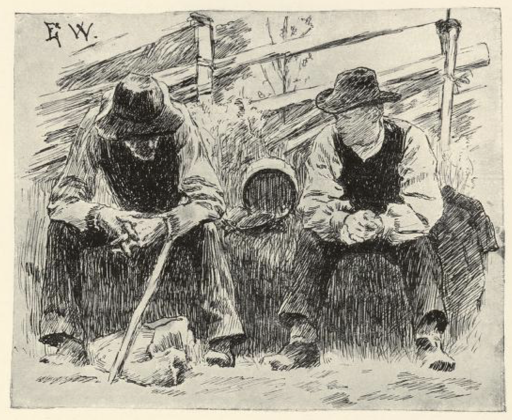
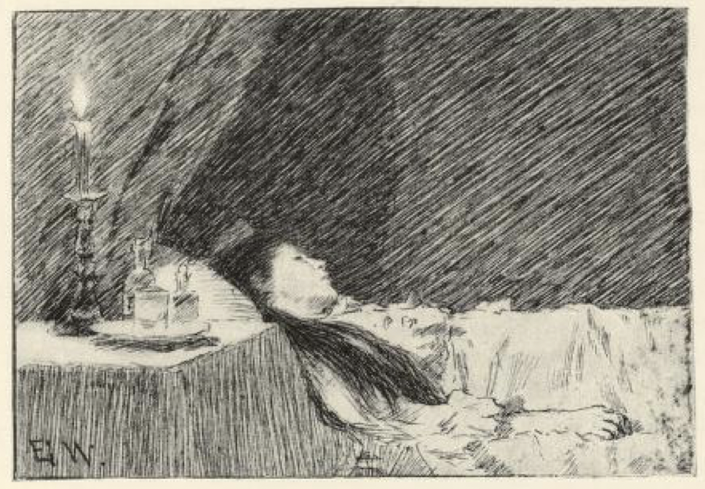
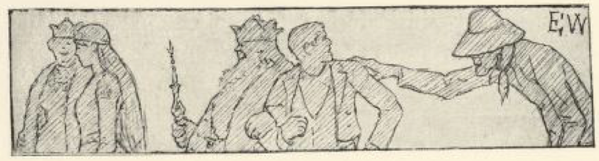

# Gutten med øldunken

Det var engang en gutt som hadde tjent lenge hos en mann nordenfjelds. Denne mannen var en mester til å brygge øl; det var så urimelig godt at det ikke fantes maken til det. Da gutten skulle reise derfra og mannen skulle betale ham lønnen han hadde tjent, ville han ikke ha annet enn en dunk av juleølet. Ja, den fikk han og gikk av sted med, og han bar den både langt og lenge, men jo lenger han bar på øldunken, desto tyngre ble den, og så begynte han å se seg omkring, om det kom noen som han kunne drikke med, så ølet kunne minke og dunken lettne.

Langt om lenge traff han en gammel mann med et stort skjegg.

«God dag,» sa mannen.

«God dag igjen,» sa gutten.

«Hvor skal du hen?» sa mannen.

«Jeg leter etter noen å drikke med, så jeg kan få lettet på dunken min,» sa gutten.

«Kan du ikke like godt drikke med meg som med en annen?» sa mannen; «jeg har faret både vidt og langt, så jeg både er trett og tørst.»

«Jo, kan jeg så,» sa gutten; «men hvor kommer du fra, og hva er du for en mann da?» sa han.

«Jeg er Vorherre, og jeg kommer fra himmerike jeg,» sa mannen.

«Deg vil jeg ikke drikke med,» sa gutten; «for du gjør så stor forskjell på folk her i verden og skifter retten så ulikt, så noen blir så rike og noen så ringe; nei, deg vil jeg ikke drikke med,» sa han, og labbet av sted igjen med dunken sin.

Da han hadde gått et stykke til, ble dunken så tung igjen, så han syntes ikke han orket å bære den lenger, med mindre det kom noen han kunne drikke med, så ølet kunne minke i dunken. Jo, så traff han en stygg, skranglet mann, som kom fykende så fort.

«God dag,» sa mannen.

«God dag igjen,» sa gutten.

«Hvor skal du hen?» sa mannen.

«Å, jeg leter etter noen å drikke med, så jeg kan få lettet på dunken min,» sa gutten.

«Kan du ikke like godt drikke med meg som med en annen?» sa mannen. «Jeg har faret både vidt og langt, og en øltår kunne gjøre godt i en gammel skrott,» sa han.

«Jo, kan jeg så,» sa gutten; «men hva er du for én, og hvor kommer du fra?» spurte han.

«Jeg? Jeg er kjent nok, jeg er Fanden og kommer fra helvete jeg,» sa mannen.

«Nei,» sa gutten; «du bare piner og plager folk, og der det er noen ulykke på ferde, der sier de alltid det er din skyld; deg vil jeg ikke drikke med,» sa gutten.

Så gikk han langt og lenger enn langt igjen med øldunken sin, til han syntes den ble så tung at han ikke orket å bære den lenger. Han begynte å se seg omkring igjen, om det ikke kom noen han kunne drikke med, så dunken kunne lettne. Jo, langt om lenge så kom det en mann igjen, og han var så tørr og skranglet, at det var et vidunder at han kunne henge sammen.

«God dag,» sa mannen.

«God dag igjen,» sa gutten.

«Hvor skal du hen?» sa han til gutten.

«Jeg skulle se om jeg kunne finne én å drikke med, så dunken min kunne lettne litt, den blir så tung å bære,» sa gutten.

«Kan du ikke drikke med meg like godt som med en annen?» sa mannen.

«Jo, kan jeg så,» sa gutten. «Hva er du for en, du da?» sa han.

«De kaller meg for Døden,» sa mannen.

«Deg vil jeg drikke med,» sa gutten, og la ned kaggen sin og ga seg til å tappe øl i skålen. «Du er en flink mann, for du gjør alle like, både fattige og rike.»

Så drakk han ham til, og Døden syntes det var en herlig drikk, og da gutten unte ham vel, drakk de til skiftes, så ølet minket og kaggen lettnet.

Til sist sa Døden: «Jeg har aldri kjent drikk som smakte bedre og gjorde meg så godt, som det ølet du har skjenket meg, jeg synes jeg ble som nyfødt innvendig, og jeg vet ikke hva jeg skal gjøre deg til gode for det.» Men da han hadde tenkt seg om en stund, så sa han at kaggen aldri skulle bli tom, hvor mye de drakk av den, og ølet som var i den, skulle bli til helsebot, så gutten kunne gjøre syke friske igjen, bedre enn noen doktor. Og så sa han at når han kom inn til en syk, da skulle Døden alltid være der og vise seg for ham, og det skulle han ha til et sikkert merke, at når Døden satt ved føttene, så kunne han redde den syke med en helsedrikk av kaggen, men satt han ved hovedgjerdet[^1], så fantes det verken hjelperåd eller helsebot for døden.

Gutten var snart navnspurt[^2], så han ble hentet vidt og bredt, og han hjalp mangfoldige til helsen igjen, som det ikke hadde vært hjelp for. Når han kom inn og så hvor Døden satt hos den syke, spådde han enten liv eller død, og alltid spådde han rett. Han ble både en rik mann og en mektig mann, og til sist ble han hentet til en kongsdatter langt borte i landene. Hun var så farlig syk at ingen doktor trodde han kunne hjelpe henne mer, og så lovet de ham alt han kunne ønske og forlange, om han kunne redde henne.

Da han kom inn til kongsdatteren, satt Døden ved hodegjerdet, men han satt og blunket og nikket, og mens han satt slik, kjente hun seg bedre.

«Her gjelder det liv eller død,» sa doktoren, «og det er vel ingen redning, om jeg ser rett,» sa han. Men de sa han måtte redde henne, om det så skulle koste land og rike. Så så han på Døden, og mens han satt der og blunket igjen, vinket han til tjenerne at de skulle vende sengen i en hast, så Døden ble sittende ved føttene, og i det samme det var gjort, ga han henne helsedrikken, så var hun reddet.

«Nå svek du meg,» sa Døden, «og nå er det kvitt mellom oss.»

«Jeg var nødt til det, om jeg skulle vinne land og rike,» sa gutten.

«Det skal ikke hjelpe deg stort,» sa Døden; «din tid er ute, for nå hører du meg til.»

«Ja, skal det så være, så la det så være,» sa gutten; «men du lar meg vel få lov til å lese ut Herrens bønn først,» sa han.

Ja, det skulle han få lov til; men han passet seg vel for å lese Herrens bønn; alt annet leste han, men Fadervor kom aldri på hans tunge, og til sist mente han at han hadde snydd Døden for alvor. Men da Døden syntes at det drygde for lenge, så gikk han dit en natt, og hengte opp en stor tavle med Fadervor på, over sengen til gutten. Da han våknet, begynte han å lese på den, og samlet seg ikke riktig før han kom til amen; men så var det for sent.

[^1]: Hovedgjerdet: gavlen av sengen der hodet ligger

[^2]: navnspurt = berømt, kjent vidt og bredt
