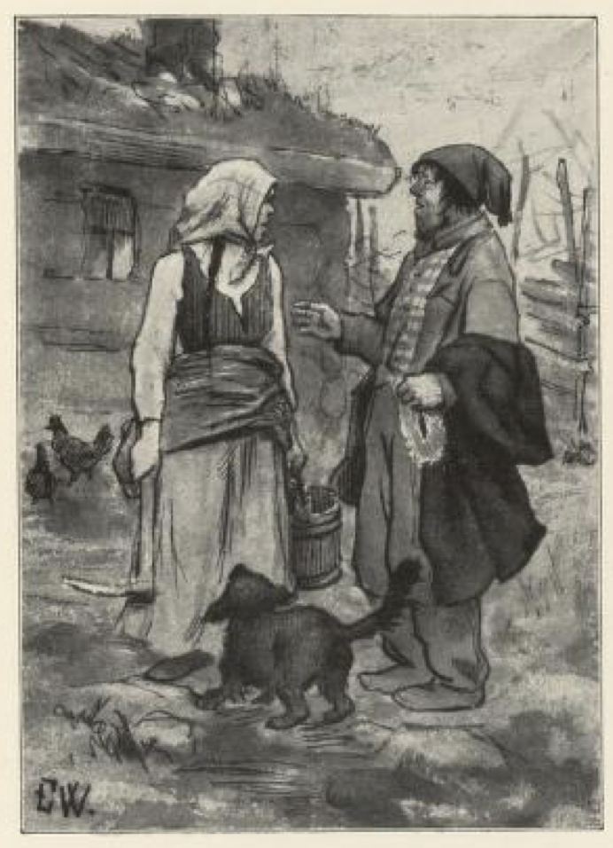
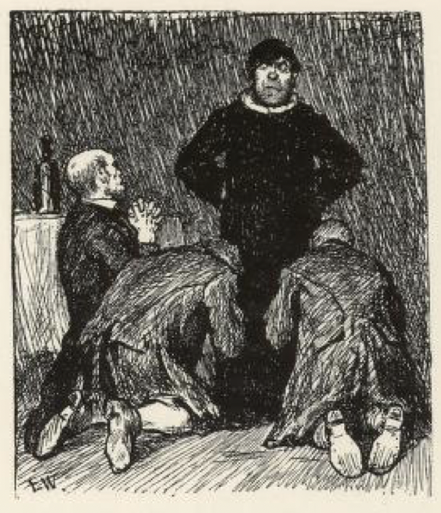
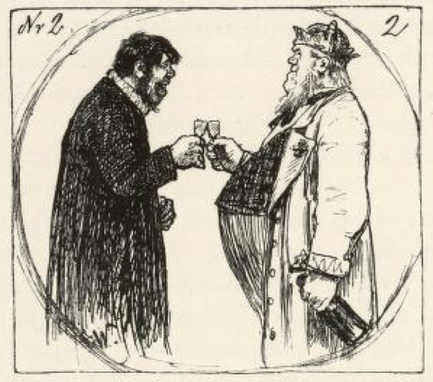

# Kullbrenneren

Det var en gang en kullbrenner som hadde en sønn, og han var også kullbrenner. Da faren var død, giftet sønnen seg, men han ville ikke ta seg noe til; skrøpelig var han til å passe mila også, og til slutt ville ingen ha ham til å brenne kull mer. Men så hadde han fått brent en mile en gang da, og reiste til byen med noen kullass og solgte, og da han hadde solgt dem, ranglet han ut på bygata og så seg om. På hjemveien kom han i lag med naboer og bygdefolk, og turte og drakk og pratet om alt det han hadde sett i byen. Det artigste han så, sa han, det var at det var så mange prester, og dem gikk alle folk og hilste på og tok av seg lua for; «jeg skulle ønske jeg var prest jeg også, så hilste de kanskje på meg og; nå later de mest som de ikke ser meg,» sa han.

«Ja, er du ikke annet, så er du da svart nok til prest, du og,» sa naboene til kullbrenneren; «men nå er vi på farten likevel, så kan vi reise på auksjon etter gammelpresten og få oss en tår, og i mellomtida kan du kjøpe kappe og krage,» sa de. Ja, de gjorde så, og da han kom hjem, hadde han ikke en skilling igjen.

«Nå har du vel både levevei og skillinger?» sa kjerringa.

«Ja, nå skal det bli levevei, mor,» sa kullbrenneren, «for nå er jeg blitt prest!» sa han; «her ser du både kappe og krage!» — «Det skal du få meg til å tro; sterkt øl gjør store ord,» sa kjerringa; «du er like sånn, hva for en ende som snur opp, du,» sa hun. «Du skal verken syte eller kyte av mila før kullene er kjølt,» sa kullbrenneren.

Så var det en dag det reiste så mange prestekledde folk forbi hos kullbrenneren på veien til kongsgården, så de kunne skjønne det var noe på ferde der. Ja, kullbrenneren ville være med han også og tok på seg presteklærne. Kjerringa mente det var vel så sikkert å være hjemme, for kom han til å få en hest å holde for en storkar, så gikk vel den tobakksskillingen han fikk for det, ned i strupen også. «Alle snakker om drikken, men ingen om tørsten, mor,» sa mannen, «jo mer en drikker, jo mer en tørster,» sa han, og så strøk han til kongsgården. Der ble alle de fremmede bedt inn til kongen, og kullbrenneren fulgte med, han også. Så sa kongen til dem at han hadde mistet den dyreste fingerringen sin, og han trodde sikkert at den var stjålet. Derfor hadde han bedt sammen alle de prestelærde i landet, om det var noen av dem som kunne si ham hvem tyven var. Og så lovte han at han skulle lønne den som kunne si det; var han i presteutdanning, skulle han få kall; var det en prest, skulle han bli prost; var det en prost, skulle han bli biskop, og var han biskop, skulle han bli den nærmeste etter kongen.

Så gikk kongen fra den ene til den andre og spurte dem alle sammen, og da han kom til kullbrenneren, sa han: «Hvem er du?» — «Jeg er den vise prest og den sanne profet,» sa kullbrenneren. — «Så kan vel du si meg hvem som har tatt ringen min da?» sa kongen.

«Ja, det er ikke rent ut av vett og forstand at det som er skjedd i mørket, kan vise seg i lyset,» sa kullbrenneren, «men det er ikke alle år at laksen leker i furutoppen,» sa han. «Nå har jeg lest i syv år for meg og mine og har ikke fått kall ennå; skal tyven fram, må jeg ha god tid og mye papir, for jeg må skrive og regne gjennom mange land.»

Ja, han skulle få god tid og så mye papir han ville, bare han kunne skaffe tyven fram.

Så fikk han et kammer for seg selv i kongsgården, og der var det ikke lenge før de skjønte at han måtte kunne mer enn Fadervår, for han skrev så mye papir at det lå der i store hoper og hauger, og det var ikke én som skjønte et ord av alt det han skrev, for det så bare ut som kroker og kragetær. Men tida gikk, og han fant ikke ut noe om noen tyv. Så ble kongen lei av det, og så sa han at kunne han ikke skaffe tyven fram om tre dager, så skulle han miste livet.

«Den som skal råde, får ikke være for brå; en kan da ikke rake ut kullene før mila er slukket,» sa kullbrenneren. Men kongen sto på sitt, han, og kullbrenneren skjønte at livet hans ikke var mye verdt. Nå var det tre av kongens tjenere som varta ham opp hver sin dag, og disse tre hadde vært sammen om å stjele ringen. Da den ene tjeneren kom inn og tok av bordet etter kveldsmaten og gikk ut igjen, dro kullbrenneren et dypt sukk og så etter ham: «Det var den første,» sa han; han mente den første av de tre dagene han hadde igjen av livet sitt. «Denne presten kan mer enn å mate seg selv,» sa tjeneren da han fikk kameratene for seg selv, og så fortalte han at «han hadde sagt at jeg var den første,» sa han. Den andre, som varta ham opp den neste dagen, skulle da legge godt merke til hva han sa, og riktig nok, da han bar ut etter kveldsmaten, glante kullbrenneren stort på ham og sukka sårt, og så sa han: «Det var den andre.» Så skulle den tredje legge merke til hvordan han bar seg den tredje dagen, og det gikk verre og ikke bedre; for da tjeneren tok i døra og skulle gå med kopper og kar, folda kullbrenneren hendene og sa: «Det var den tredje,» og så sukka han som om hjertet ville briste.

Han kom ut til kameratene med hjertet i halsen og sa det var klart at presten visste det, og så gikk de inn og falt på kne for kullbrenneren og ba og trygla om at han ikke måtte si det var dem som hadde tatt ringen; de skulle gjerne gi ham hundre daler hver, bare han ikke ville føre dem i ulykka. Det lovte han både sikkert og visst; det skulle ikke komme noen i ulykke, når han fikk pengene og ringen og en stor grøtklatt. I den balla han ringen godt inn, og lot så en av dem gi den til den største galten til kongen og passe på den, så den ikke ga den fra seg igjen.

Om morgenen kom kongen; da var han ikke blid, og ville ha greie på tyven.

«Ja, nå har jeg regnet og skrevet gjennom mange land,» sa kullbrenneren, «men det er ikke noe menneske som har stjålet ringen,» sa han. «Pøh! hvem er det da?» sa kongen. «Å, det er den store galten til kongen,» sa kullbrenneren. Ja, de tok og slakta galten, og ringen hadde den i seg; det var riktig nok det. Så fikk kullbrenneren prestekall, og kongen var så glad at han ga ham hest og gård og hundre daler på kjøpet. Kullbrenneren var ikke lenge om å flytte, og den første søndagen da han var kommet i kallet, skulle han til kirka og lese opp kallsbrevet, men før han reiste, skulle han ha dugurd[^1]; så la han fra seg kallsbrevet på flatbrødet, men tok feil og dyppa brevet ned i soddgryta, og da han kjente det var seigt å tygge, ga han hunden hele biten, og den slukte det med det samme.

Nå visste han ikke hvordan han skulle stelle seg. Men til kirka måtte han, for folket venta, og da han kom dit, gikk han opp på prekestolen med det samme. Der begynte han å heve seg slik at alle tenkte: «Det er visst svært til gild prest.» Men da det bar til, ble det ikke så gildt likevel.

«De ord, mine tilhørere, som dere skulle fått høre denne dag, for i hundene, men kom igjen en annen søndag, mine kjære sognefolk, så skal dere få annet å høre! Og dermed er denne prekenen ute.»

Folket syntes det var en underlig prest, for slik preken hadde de aldri hørt; men så mente de: «Han blir vel bedre, og blir han ikke det, så finner vi vel en råd med ham.» Den neste søndagen, da det var messe igjen, var det så fullt av folk som ville høre på den nye presten, at det nesten ikke var plass til dem i kirka. Ja, han kom da også, og gikk opp på prekestolen med det samme; der sto han en stund og sa ikke et ord, men så smalt han til med ett og ropte: «Hør du gamle Bukke-Berit, hvorfor sitter du så langt bak i kirka?» — «Å, jeg har slike utslitte sko, far,» sa hun. «Å, du kunne ta deg et gammelt purkeskinn og gjøre deg nye sko, så kunne du komme like langt fram i kirka du som de andre dannekvinnene[^2]. — Forresten må dere tenke over hva for vei dere går på; for jeg ser at når dere kommer til kirka, så kommer noen nordfra og noen sørfra; og det samme er det når dere reiser fra kirka igjen; men dere stanser vel, og da spørs det hvor det blir av dere. Ja, hvem vet hvor det blir av oss alle sammen? — Så skal jeg lyse etter en svart merr som er blitt borte for gamle prestemor. Hun har hovskjegg og hengeman og mer slikt som jeg ikke vil nevne på dette sted. — Og så har jeg et hull på den gamle bukselomma mi, det vet jeg, men ikke dere; men om noen har en lapp som kunne passe til hullet, det vet verken dere eller jeg.»

Denne prekenen var noen av folket nokså fornøyde med. De trodde ikke annet enn at det ble en bra prest av ham med tida, sa de, men de fleste syntes det var altfor galt, og da det ble prostemesse, klaga de på presten og sa at slike prekener hadde ingen hørt før, og så var det en som husket den siste og leste den opp for prosten.

«Det var en veldig god preken,» sa prosten; «for det var tydelig at han hadde snakket i lignelser om å søke lyset og sky mørket og dets gjerninger, om dem som gikk på den brede eller på den trange veien; og særlig,» sa han, «var det han lyste etter den svarte prestemerra, en herlig lignelse om hvordan det skulle gå med oss til slutt. Lomma med hull på, det skulle bety at han var i nød, og lappen var offer og milde gaver han venta av menigheten,» sa prosten.

«Ja, så mye skjønte vi og, det var prestesekken det!» ropte de.

Til slutt sa prosten at han syntes menigheten hadde fått en så bra og forstandig prestemann at de ikke burde klage på ham, og enden ble at de ikke fikk noen annen; men da de syntes det ble verre og ikke bedre, klaga de til biskopen.

Ja, langt om lenge kom han også, da det skulle være bispemesse. Men dagen før hadde kullbrenneren vært i kirka uten at noen visste om det, og saget løs prekestolen, så den så vidt hang der når en gikk varsomt opp på den. Da menigheten var samlet og han skulle til å preke for biskopen, lista han seg opp på stolen og begynte å legge ut, slik som han pleide; men da han hadde holdt på en stund, tok han hardere i, slo ut med armene og ropte høyt: «Er det noen her som har noe ondt eller noen ugjerning på seg, da er det best at han forlater dette sted; for på denne dag vil det skje et fall som ikke har sin make siden verdens skapelse,» og dermed slo han i stolen så det dundra, og prekestolen og presten og hele hurven[^3] ramla ned over kirkeveggen med et brak, så folket satte ut av kirka som om dommedag holdt på å komme.

Men da sa biskopen til folket at han undra seg over at menigheten kunne klage over en prestemann som hadde slike gaver på prekestolen og så mye visdom at han kunne forutsi det som skulle komme. Han syntes han minst burde være prost, sa han, og det varte ikke lenge heller før han ble det. Så var det ingen råd, de fikk dras med ham.

Nå var det så at kongen og dronninga der i landet ikke hadde noen barn, men da kongen fikk høre at det kanskje kunne komme et, var han nysgjerrig etter å vite om det skulle bli en arving til land og rike, eller om det bare skulle bli en prinsesse. Så ble alle de lærde i landet samlet på slottet, for at de skulle si hva det ble. Men da det ikke var noen av dem som kunne det, så huska både kongen og biskopen på kullbrenneren, og det var ikke lenge før de fikk ham mellom seg og spurte ham ut. Nei, han kunne ikke han heller, sa han, for det var ikke godt å gjette det som ingen kan vite.

«Ja, ja,» sa kongen, «jeg er like glad, enten du vet det eller du ikke vet det, jeg; men du er jo den vise prest og sanne profet, som kan forutsi det som skal komme; og vil du ikke si det, skal du miste både kappe og krage,» sa kongen. «Men det er det samme, jeg skal prøve deg først,» sa han, og så tok han det største sølvkruset han eide og gikk ned i fjæra. «Kan du si meg hva som er i det kruset,» sa kongen, «så kan du nok si det andre og?» sa han og holdt på kruslokket.

Kullbrenneren vred bare hendene og bar seg ille: «Å, du ulykkeligste kryp og krabbe på denne jord, hva har du nå for alt ditt slit og ditt slep!» sa han.

«Ja, der ser du om du ikke visste det!» sa kongen, for han hadde en stor krabbe i sølvkruset. Så måtte kullbrenneren inn i storstua til dronninga. Han tok en stol og satte seg midt på gulvet, og dronninga gikk fram og tilbake i stua.

«En skal ikke gjøre bås til ufødt kalv, og ikke krangle om navnet før barnet er født,» sa kullbrenneren; «men slikt har jeg verken hørt eller sett,» sa han; «når dronninga går mot meg, tror jeg mest det blir en prins, og når hun går fra meg, ser det ut som det blir en prinsesse»: det var tvillinger, så kullbrenneren traff det den gangen også. Og fordi han kunne si det som ingen kunne vite, fikk han penger i lassevis, og så ble han den nærmeste etter kongen. Tripp trapp trille, han ble mer enn han ville.

[^1]: Dugurd - formiddagsmat, måltid før kirkegang

[^2]: Dannekvinner - aktverdige, skikkelige koner

[^3]: Hurv - hele greia, alt sammen
