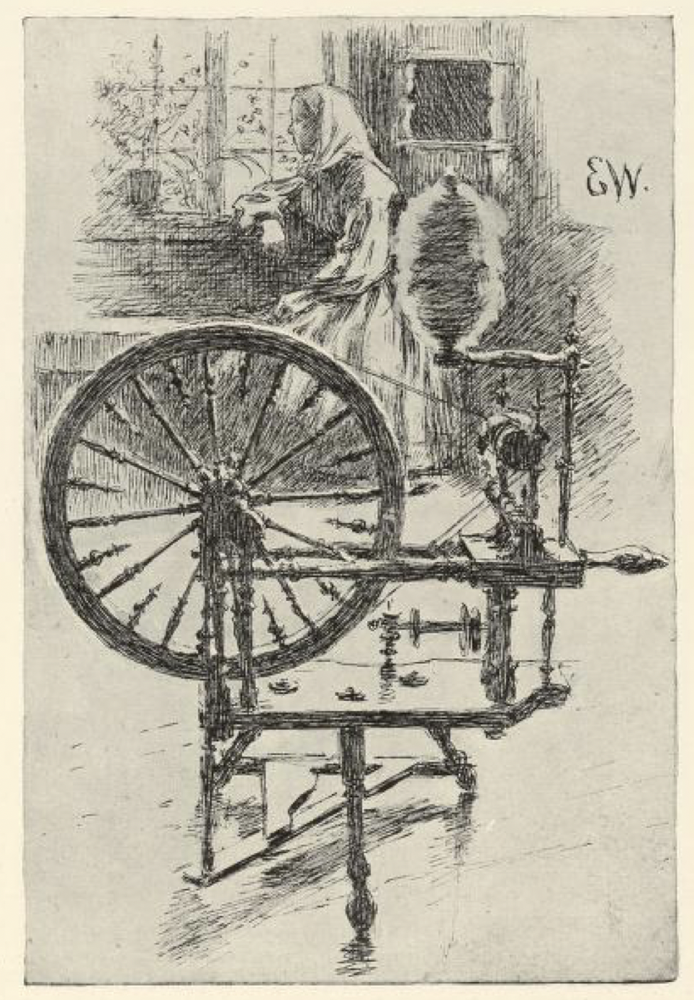
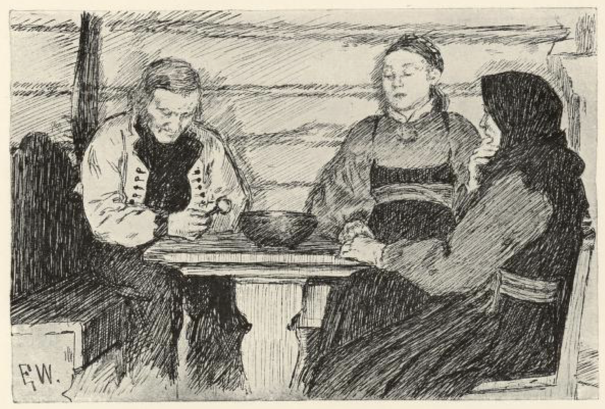
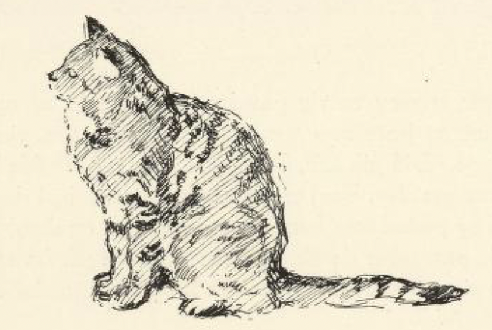

# Stabbursnøkkelen i rokkehodet

Det var engang en rik gårdgutt som skulle ut og fri. Han hadde fått spurt en jente som var både vakker og pen, gjev til å stelle og svær til å koke. Dit gikk han, for slik en var det han ville ha. De skjønte jo nok, folket på gården, hva ærend han kom i; så ba de ham sette seg inn på benken og pratet med ham, slik skikken er, og så bød de ham en skjenk til å bie[^1] på, mens de fikk laget mat til. De gikk fra og til, så frieren fikk tid til å se seg om i stua; borte i en krok så han at det sto en rokk, og rokkehodet var fullt av lin.

«Hvem er det som spinner på den rokka?» sa gutten.

«Å, det skulle nå være datter vår det,» sa kjerringa i stua.

«Det var overdådig til linlag,» sa gutten; «hun bruker vel mer enn ett døgn til å spinne av det?» sa han.

«Var det likt det,» sa kjerringa, «hun gjør det godt på ett, og kanskje på mindre enn det.»

Det var mer enn han hadde hørt og spurt, at noen kunne spinne i så kort tid, mente gutten.

Men som de skulle bære frem maten, gikk de ut alle sammen, og han ble igjen i stua alene; så fikk han se at det lå en stor gammel nøkkel i vinduskarmen, den tok han og stakk vel inn i rokkehodet og vippet den godt inn i linet. Så spiste de og drakk og var vel forlikte, og da han syntes han hadde vært der lenge nok, sa han takk for seg og gikk sin vei. De ba ham komme snart igjen, og det lovet han også; men målemet[^2] bar ham ikke frem, enda han syntes nokså godt om jenta.

Langt om lenge kom han igjen til gårds; da tok de enda bedre imot ham enn første gangen. Men som de var kommet i prat, så sier gårdkjerringa:

«Nei, sist du var her, du, så hendte det noe riktig forunderlig rart; stabbursnøkkelen vår den ble så rent borte, at vi aldri har kunnet finne den igjen siden.»

Gutten gikk bare bort til rokka, som sto der i kroken med linlaget like stort som sist, og tok opp under i rokkehodet.

«Der er nøkkelen,» sa han; «vindingen er nok ikke stor på spindingen, når spinnedagen varer fra mikkelsmess og til påske.»

Så sa han takk for seg, og bar ikke frem målemet sitt den gangen heller.

[^1]: Bie: vente

[^2]: Målemet: frieriet
