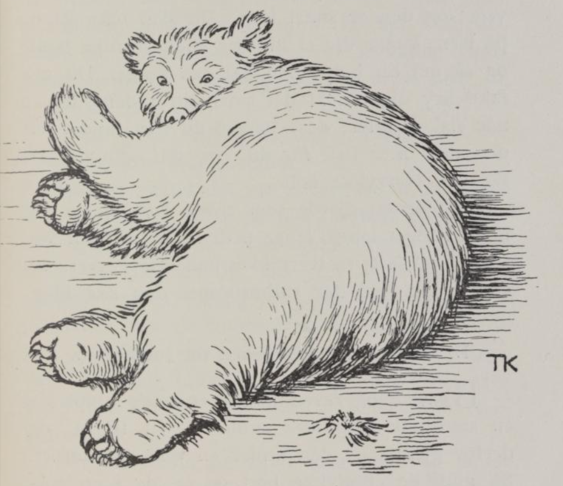
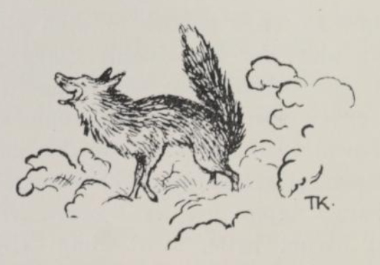

# Bjørnen og reven

## I. Hvorfor bjørnen er stubbrumpet

Bjørnen møtte en gang reven, som kom luskende med et knippe fisk han hadde stjålet.

«Hvor har du fått det fra?» spurte bjørnen.

«Jeg har vært ute og fisket, herr bjørn!» svarte reven.

Så fikk bjørnen også lyst til å lære å fiske, og ba reven si hvordan han skulle bære seg at.

«Det er en enkel kunst for deg,» svarte reven, «og den er snart lært. Du skal bare gå ut på isen, hugge deg et hull og stikke rumpa nedi; og så må du holde den der ganske lenge. Du må ikke bry deg om at det svir litt i den; det er når fisken biter; jo lenger du kan holde den der, jo mer fisk får du. Og rett som det er, skal du rykke den kjapt opp!»

Ja, bjørnen gjorde som reven hadde sagt, og holdt rumpa lenge, lenge nedi hullet, til den var frosset godt fast; så rykket han, og rumpa røk tvert av, og nå går han der stubbrumpet den dag i dag.

## II. Reven snyter bjørnen for julekosten.

Bjørnen og reven hadde en gang kjøpt seg en smørholk sammen: den skulle de ha til jul, og derfor gjemte de den under en tykk granbusk. Så gikk de et stykke bort og la seg i en solbakke for å sove. Da de hadde ligget en stund, reiste reven seg og ropte: «Ja!» … og satte av sted, like bort til smørholken, og åt en god tredjedel av den. Men da han kom igjen, og bjørnen spurte hvor han hadde vært, siden han var så feit om flabben, sa han: «Tror du ikke jeg ble bedt i barnedåp da?»

«Ja så. Hva het barnet?» spurte bjørnen.

«Tatt-på,» sa reven.

Dermed la de seg til å sove igjen. Om en liten stund sprang reven opp igjen og ropte: «Ja!» og strøk av sted bort til smørholken. Den gangen åt han også en god slump. Da han kom tilbake, og bjørnen spurte hvor han hadde vært, svarte han: «Å, ble jeg ikke nå igjen bedt i barnedåp da, tror du?»

«Hva het barnet nå da?» sa bjørnen.

«Halv-ett,» svarte reven.

Bjørnen syntes det var et rart navn, men han undret seg ikke lenge på det, for han gjespet og sov igjen; og før han hadde ligget en liten stund, gikk det likedan som begge de andre gangene: reven sprang opp igjen, ropte «Ja!» og la av sted bort til smørholken, og den gangen åt han resten. Da han kom tilbake, hadde han vært i barnedåp igjen; og da bjørnen ville vite hva det barnet het, svarte han: «Slikket-i-bunnen!»

Dermed la de seg til å sove igjen og lå en god stund. Så skulle de bort og se til smøret; men da var det spist opp. Og så skyldte bjørnen på reven, og reven på bjørnen; den ene sa at
den andre hadde vært borte i smørholken, mens han selv lå og sov.

«Ja, ja,» sa Mikkel, «vi skal snart få vite hvem av oss som har stjålet smøret. Nå skal vi legge oss der borte i solbakken: den som er fetest bak når vi våkner, han har stjålet det.»

Ja, den prøven ville bjørnen gjerne gå med på; han visste med seg selv at han ikke hadde smakt smøret engang, og la seg trygt til å sove i sola. Så lusket Mikkel bort til holken etter en smørklatt som satt igjen i en sprekk, og tilbake til bjørnen og smurte ham bak med den; så la han seg til å sove, som om ingenting hadde hendt. Da begge våknet, hadde sola smeltet smøret, og så ble bjørnen den som hadde spist smøret, likevel.

