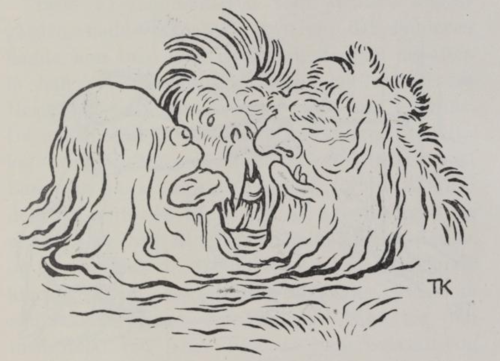
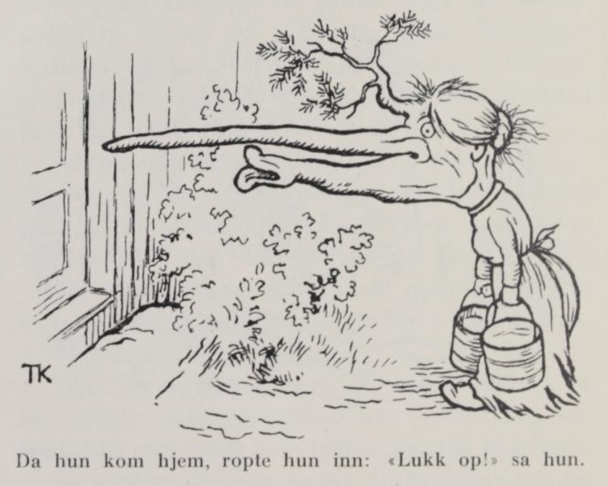
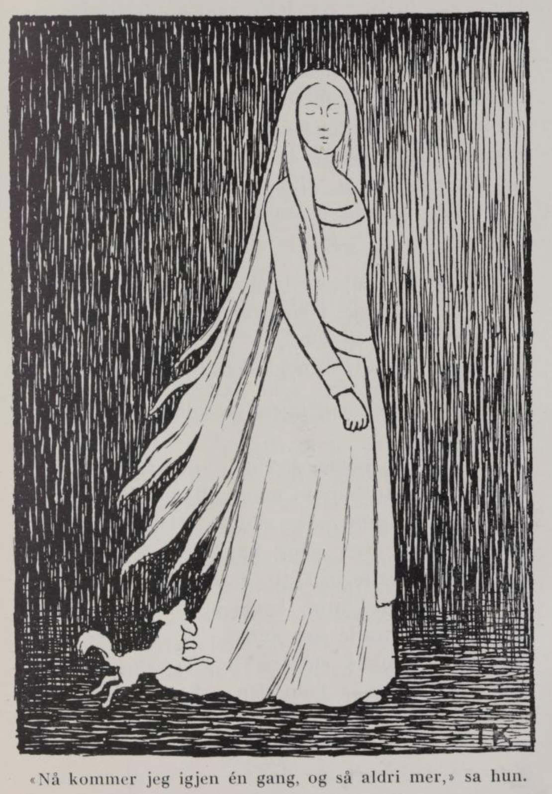

# Buskebrura

Det var en gang en enkemann som hadde en sønn og en datter etter den første kona si. Begge var de snille barn, og begge var de hjertelig glad i hverandre.

Om en tid giftet mannen seg igjen. Da fikk han en enke, som hadde en datter etter den første mannen sin; hun var både stygg og slem, og det var moren også. Fra den stund den nye kona kom i huset, var det ikke fred å få for mannsbarna i noen vrå eller krok, og så tenkte gutten det var best å dra ut i verden og prøve å tjene sitt brød selv. Da han hadde gått en tid, kom han til kongsgården; der fikk han tjeneste hos stallmesteren, og kjekk og hendig var han, så hestene han stelte, var så feite og blanke at det skinte av dem.

Men søsteren som var igjen hjemme, hadde det verre enn vondt. Både stemoren og kjerringdatteren var etter henne, hvor hun gikk og sto, og skjelte og smelte, og aldri hadde hun en times fred; alt det tyngste arbeidet måtte hun gjøre, vonde ord fikk hun seint og tidlig, og lite mat attpå.

En dag hadde de sendt henne til bekken etter vann. Så kom det et stygt, fælt hode opp av vannskorpa.

«Vask meg, du!» sa hodet.

«Ja, jeg skal gjerne vaske deg,» sa mannsdatteren, og begynte å gni og vaske det stygge ansiktet; men et fælt arbeid syntes hun det var.

Da hun hadde gjort det, kom det et annet hode opp i vannskorpa, det var enda fælere.

«Børst meg, du!» sa hodet.

«Ja, jeg skal gjerne børste deg,» sa jenta, og ga seg i kast med hårtustene, men noe morsomt arbeid kan du nok vite det ikke var.

Da hun var ferdig med det, kom det et enda fælere og styggere hode opp i vannskorpa.

«Kyss meg, du!» sa hodet.

«Ja, jeg skal kysse deg,» sa mannsdatteren, og det gjorde hun også; men hun syntes det var det verste arbeidet hun hadde gjort i sitt liv.

Så snakket det ene hodet til det andre, og de spurte hverandre hva de skulle gjøre med henne som var så snill.

«At hun blir den fineste jenta som finnes, og så hvit og lys som den lyse dag,» sa det første hodet.

«At det drysser gull av håret hver gang hun børster seg,» sa det andre.

«At det faller gull av munnen hver gang hun snakker,» sa det tredje hodet.

Da stedatteren kom hjem, og stemoren så at hun var så vakker og så hvit og lys som den lyse dagen, og at det falt gullpenger ut av munnen hennes når hun snakket, ble hun rent gal. Hun jaget mannsdatteren ut i grisehuset. Der skulle hun være med gullstasen sin, men inn i stua fikk hun ikke sette sin fot.

Det varte ikke lenge før moren ville sende rettedatteren til bekken etter vann. Da hun kom dit med bøttene sine, kom det første hodet opp. «Vask meg, du!» sa det.

«Rakkeren vaske deg!» sa rettedatteren.

Så kom det andre hodet opp. «Børst meg, du!» sa det.

«Rakkeren børste deg!» sa rettedatteren.

Så kom det tredje hodet opp. «Kyss meg, du!» sa det.

«Rakkeren kysse deg, din muletryne!» sa jenta.

Så snakket hodene igjen med hverandre, og spurte hva de skulle gjøre med henne som var så vrang; og så ble de enige om at hun skulle ha fire alens nese og tre alens trut og ei furubuske midt i skallen, og hver gang hun snakket, skulle det falle aske ut av munnen på henne.

Da hun kom hjem til stuedøra med vannbøttene, ropte hun inn til moren: «Lukk opp!» sa hun.

«Lukk opp selv, rettedatter mi!» sa moren.

«Jeg når ikke fram for nesa!» sa datteren.

Da moren kom ut og fikk se henne, kan en nok vite hvordan hun ble til mote, og hvordan hun skrek og bar seg; men nesa og truten ble ikke mindre for det.

Broren til mannsdatteren, han som tjente i kongsgården, hadde tegnet et bilde av søsteren; det bildet hadde han med seg, og hver morgen og kveld lå han på kne foran bildet og ba til Vårherre for søsteren, så glad var han i henne.

De andre stallguttene hadde hørt dette; så kikket de gjennom nøkkelhullet inn i kammerset hans, og så at han lå på kne foran et bilde der. Så spredte de ut at gutten hver morgen og kveld lå og ba til et avgudsbilde han hadde, og til sist gikk de til kongen og ba om at han skulle kikke gjennom nøkkelhullet inn til gutten, så skulle han få se. Kongen ville ikke tro det; men langt om lenge fikk de ham overtalt, og han listet seg på tærne bort til døra og kikket. Jo, han så gutten ligge på kne, og bildet hang på veggen, og hendene hadde han foldet.

«Lukk opp!» ropte kongen.

Men gutten hørte ikke.

Så ropte kongen en gang til; men gutten ba så inderlig at han ikke hørte det enda.

«Lukk opp, sier jeg!» ropte kongen igjen, «det er jeg som vil inn.»

Ja, så sprang gutten til døra og låste opp, og i skyndingen glemte han å gjemme bildet.

Da kongen kom inn og fikk se det, ble han stående som fjetret, og kunne ikke røre seg av flekken, så vakkert syntes han bildet var.

«Så vakkert et kvinnfolk finnes ikke i verden,» sa kongen.

Men gutten fortalte at det var søsteren hans, som han hadde tegnet av, og var hun ikke vakrere, så var hun slett ikke styggere, sa han.

«Ja, er hun så vakker, så vil jeg ha henne til dronning,» sa kongen, og befalte gutten at han skulle reise hjem etter henne på flyvende flekken, og for all del ikke være lenge borte. Gutten lovte at han skulle skynde seg alt han kunne, og reiste av sted fra kongsgården.

Da broren kom hjem og skulle hente søsteren sin, ville stemoren og datteren hennes også være med. De reiste da alle sammen, og mannsdatteren hadde med seg et skrin som hun hadde gullet sitt i, og en hund som het Lille Kaværn; de to tingene var hele morsarven hennes.

Da de hadde reist en stund, skulle de over sjøen, og broren satte seg bak ved roret, og moren og begge stesøstrene satt fremme i båten, og så seilte de både langt og lenge.

Om en tid kunne de se en strand. «Der dere ser den hvite stranden, skal vi i land,» sa broren og pekte utover sjøen.

«Hva er det bror min sier?» spurte mannsdatteren.

«Han sier du skal kaste skrinet ditt uti,» sa stemoren.

«Ja, når bror min sier det, så får jeg vel gjøre det,» sa mannsdatteren, og kastet skrinet.

Da de hadde seilt en stund igjen, pekte broren mot land igjen. «Der ser dere slottet vi skal til,» sa han.

«Hva er det bror min sier?» spurte mannsdatteren.

«Nå sier han du skal kaste Lille Kaværn uti,» svarte stemoren.

Mannsdatteren gråt, for Lille Kaværn var det kjæreste hun eide, men til slutt måtte hun, og kastet den i sjøen.

Da de hadde seilt et stykke igjen, pekte broren mot land. «Der ser du kongen som kommer mot oss,» sa han.

«Hva er det bror min sier?» spurte søsteren igjen.

«Nå sier han du skal kaste deg selv uti,» sa stemoren. Hun gråt og bar seg, men broren visste ikke om det, og hun måtte gjøre som stemoren sa, og kastet seg i sjøen.

Men da de kom til kongsgården, og kongen fikk se den fæle buskebrura med fire alens nese og tre alens trut og ei buske midt i skallen, ble han rent forskrekket; men bryllupet var klart, både med brygg og med bakst, og bryllupsfolkene satt og ventet, og så måtte kongen ta henne slik hun var. Men sint og rasende var han, det kan ingen klandre ham for, og derfor lot han gutten kaste i ormegården.

Første torsdagskvelden etter kom det en vakker jomfru inn på kjøkkenet i kongsgården, og ba kokkejenta som lå der, så pent om å få låne en børste. Det fikk hun, og så børstet hun håret sitt så gullet dryppet. En liten hund fulgte med henne, og til den sa hun: «Gå ut, Lille Kaværn, og se om det snart er dag!» Det sa hun tre ganger, og den tredje gangen hun sendte ut hunden, var det ved den tiden det begynte å gry. Da måtte hun gå, men med det samme hun gikk, sa hun:

> «Hutt! du stygge buskebrur,
> som skal ligge i kongens arm!
> Jeg i grus og sand,
> og min bror i ormegården, foruten gråt!»

«Nå kommer jeg igjen to ganger til og så aldri mer,» sa hun.

Om morgenen fortalte kokkejenta det hun hadde sett og hørt, og så sa kongen at neste torsdagskveld ville han selv våke i kjøkkenet for å se om det var sant, og da det hadde begynt å mørkne, kom han ut i kjøkkenet til jenta. Men alt han gned øynene og prøvde å holde seg våken, så hjalp det ikke; for buskebrura trallet og sang, så øynene hans gled igjen, og da den vakre jomfruen kom, sov han så han snorket. Akkurat som første gangen fikk hun låne en børste og børstet håret sitt med den så gullet dryppet, og så sendte hun ut hunden tre ganger, og da det lysnet, gikk hun. Med det samme hun gikk, sa hun de samme ordene som gangen før:

> «Hutt! du stygge buskebrur,
> som skal ligge i kongens arm!
> Jeg i grus og sand,
> og min bror i ormegården, foruten gråt!»

«Nå kommer jeg igjen én gang, og så aldri mer,» sa hun.

Den tredje torsdagskvelden ville kongen våke igjen. Da satte han to mann til å holde ham, en under hver arm, og de skulle riste ham og nappe i ham hver gang han holdt på å sovne, og to mann satte han til å holde vakt over buskebrura. Men da det led utpå kvelden, begynte buskebrura igjen å tralle og synge, så øynene hans holdt på å lukke seg, og hodet hang ned til den ene siden. Så kom den vakre jomfruen og fikk børsten og børstet håret sitt så gullet dryppet, og så sendte hun ut Lille Kaværn for å se om det snart var dag, og det gjorde hun tre ganger. Tredje gangen begynte det å lysne, og da sa hun:

> «Hutt! du stygge buskebrur,
> som skal ligge i kongens arm!
> Jeg i grus og sand,
> og min bror i ormegården, foruten gråt!»

«Nå kommer jeg aldri igjen mer,» sa hun, og så ville hun gå. Men de to mennene som holdt kongen under armene, grep om hendene hans og klemte en kniv inn i neven på ham, og så fikk han skåret henne i veslefingeren, så mye at hun begynte å blø.

Da var den rette bruden frelst, og kongen våknet; hun fortalte ham hvordan alt hadde gått til, og hvordan stemoren og kjerringdatteren hadde sveket henne. Straks ble broren hennes tatt ut av ormegården — ham hadde ormene ikke gjort den minste skade — og stemoren og datteren hennes ble kastet ned der i stedet. Men ingen kan si hvor glad kongen var da han ble kvitt den stygge buskebrura, og fikk en dronning som var så vakker og lys som selve dagen. Nå ble det rette bryllupet holdt, og det slik at det ble hørt og spurt over sju kongeriker; kongen og bruden hans kjørte til kirken, og Lille Kaværn satt også i vognen. Da vielsen var over, kjørte de hjem igjen, men siden var ikke jeg med dem lenger.
