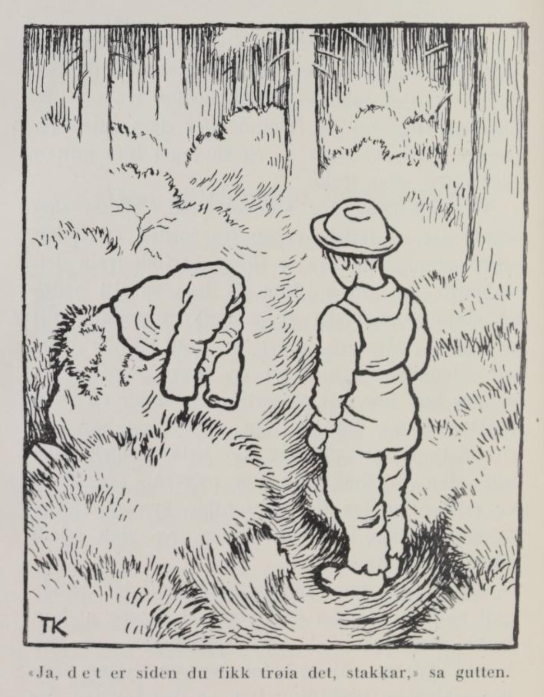
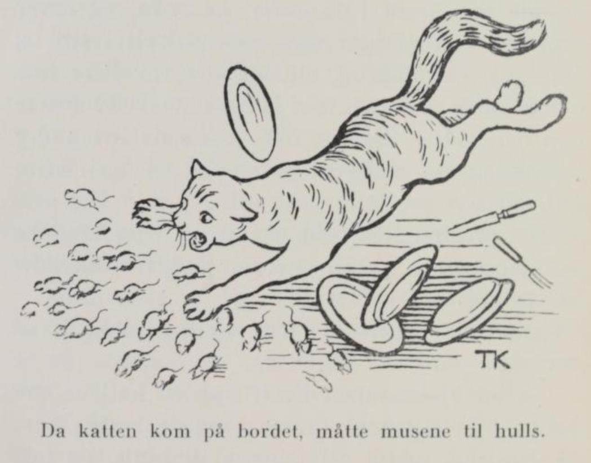
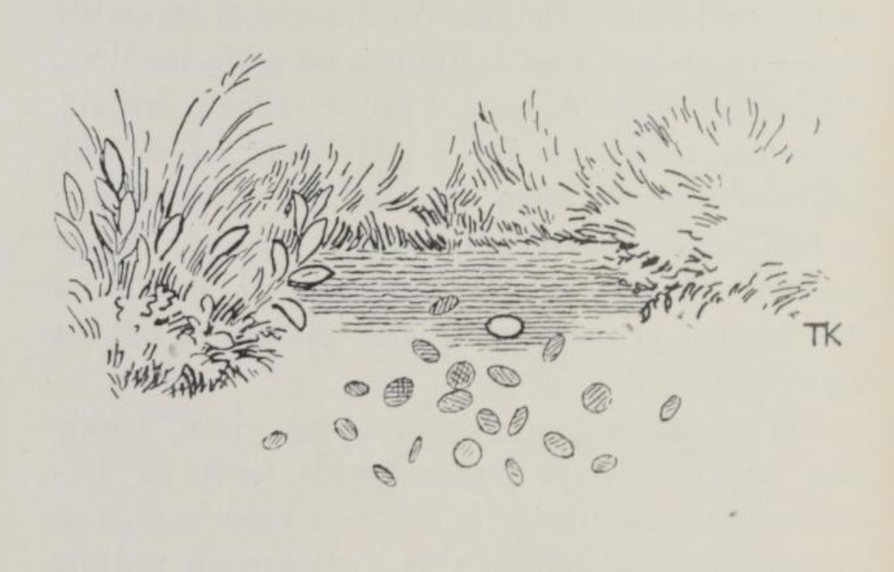

# Den rettferdige firskilling

Det var en gang en fattig kone som bodde i en ussel stue langt borte fra bygda. Lite hadde hun å bite og ingenting å brenne, og derfor sendte hun en liten gutt hun hadde, til skogs for å sanke ved. Han hoppet og sprang, og sprang og hoppet, for å holde seg varm, for det var en kald gråkostdag; og hver gang han hadde sanket en kvist eller en rot i vedbøra si, måtte han slå armene om hverandre mot herdebladene, for nevene var røde som tyttebærtuene han gikk over, av bare kulde.

Da han hadde fått vedbøra full og skulle hjem igjen, kom han over en stubbebråte. Der så han en hvit krokete stein. «Å, din stakkars gamle stein, så hvit og så bleik du er, du fryser nok fælt!» sa gutten. Han tok av seg trøia og la den på steinen.

Da han kom bærende med vedbøra, spurte moren hvorfor han gikk i skjorteermene i kostkulda. Han fortalte da at han hadde sett en gammal krokete stein som var rent hvit og bleik av frost, den hadde han gitt trøia si.

«Din tull!» sa kjerringa, «tenker du stein fryser? Men om den frøs så den skalv, så er enhver seg sjøl nærmest. Det koster nok å få klær på deg, om du ikke henger dem igjen på steiner borti bråtane,» -- og så jaget hun gutten bort igjen etter trøia. Da han kom der steinen sto, hadde den snudd seg og lettet seg opp fra jorden med den ene kanten. «Ja, det er siden du fikk trøia det, stakkar!» sa gutten.

Men da han så litt bedre på steinen, sto det et pengeskrin under, fullt av blank sølvmynt. «Det er visst stjålne penger,» tenkte gutten; «det er ingen som setter penger han har fått på ærlig vis, under en stein borti skogen.» Så tok han skrinet og bar ned til et tjern tett ved, og slo hele pengehaugen uti. Men en firskilling fløt ovenpå. «Ja, den er rettferdig; for det rettferdige synker aldri,» sa gutten, han tok firskillingen, og gikk hjem med den og trøia.

Så fortalte han moren hvordan det hadde gått ham, at steinen hadde snudd seg, og at han hadde funnet et skrin med sølvpenger, som han hadde slått ut i tjernet, for det var stjålne penger. «Men en firskilling fløt, og den tok jeg, for den var rettferdig,» sa gutten.

«Du er en tosk,» sa moren — hun var rent arg — «var ikke annet rettferdig enn det som flyter på vann, så var det ikke stor rettferdighet i verden. Men om så pengene var stjålne ti ganger, så hadde du funnet dem, og enhver er seg sjøl nærmest. Hadde du tatt pengene, kunne vi levd godt og vel i all vår tid. Men en tulling er du, og en tulling blir du, og nå vil jeg ikke lenger gå her og slite og dras med deg. Nå får du dra ut og tjene til brødet ditt.»

Gutten måtte da ut i den vide verden, og han gikk både langt og lenge og spurte etter tjeneste. Men hvor han kom, syntes folkene han var for liten og for veik, så de kunne ikke bruke ham til noe. Endelig kom han til en kjøpmann; der fikk han være i kjøkkenet, og skulle bære ved og vann til kokka.

Da han hadde vært der i lang tid, skulle kjøpmannen engang reise til fremmede land, og så spurte han alle tjenerne sine hva han skulle kjøpe med seg hjem til hver av dem. Da alle hadde sagt hva de ville ha, kom også turen til gutten som bar ved og vann til kokka. Han rakte frem firskillingen sin.

«Ja, hva skal jeg kjøpe for den da?» spurte kjøpmannen. «Det blir nok ikke store handelen.»

«Kjøp det jeg kan få for den, den er rettferdig, det vet jeg,» sa gutten.

Det lovte husbonden, og så seilte han.

Da kjøpmannen hadde losset og lastet i det fremmede landet, og kjøpt det han hadde lovt tjenerne sine, kom han ned til skipet igjen, og skulle til å legge fra bryggen. Først da kom han på at kokkedrengen hadde sendt med ham en firskilling som han skulle kjøpe noe for.

«Skal jeg nå opp i byen igjen for den firskillingens skyld? En har da heller ikke annet enn ugagn av å ta til seg slikt herk,» tenkte kjøpmannen.

I det samme kom det ei kjerring gåendes med en pose på ryggen.

«Hva er det du har i posen din, mor?» spurte kjøpmannen.

«Å, det er ikke annet enn en katt; jeg har ikke råd til å fø den lenger, så jeg har tenkt å kaste den på sjøen og gjøre det av med den,» svarte kjerringa.

«Gutten sa jo at jeg skulle kjøpe det jeg kunne få for firskillingen,» sa kjøpmannen ved seg sjøl, og så spurte han kjerringa om hun ville ha fire skilling for katten sin.

Ja, kjerringa var ikke sein om å slå til, og så var handelen gjort.

Da kjøpmannen hadde seilt et stykke, kom det et gruelig uvær på ham, med slik en himmels storm at det ikke var noen måte, og han drev og han drev, og visste ikke hvor det bar hen.

Til sist kom han til et land han aldri hadde vært i før, og der gikk han opp i byen. På vertshuset der han gikk inn var bordet dekket med et ris til hver som skulle sitte ved det. Dette syntes kjøpmannen var underlig, for han kunne ikke skjønne hva de skulle med alle risene; men han satte seg, og tenkte at han fikk se godt etter hva de andre gjorde med dem, så kunne han gjøre som dem. Jo, da maten kom på bordet, fikk han nok se hva risene var til: da krydde det frem i tusenvis av mus, og hver som satt ved bordet, måtte ta i med riset sitt og fektet og slo omkring seg, og det var ikke annet å høre enn det ene klasket av ris hardere enn det andre. Noen ganger råket de hverandre i ansiktet; da måtte de gi seg tid til å si: «Om forlatelse».

«Det er strengt arbeid å spise i dette landet,» sa kjøpmannen. «Men hvorfor holder folk ikke katter her?»

«Katter?» spurte de, de visste ikke hva det var. Så lot kjøpmannen hente opp den katten han hadde kjøpt til kokkedrengen, og da katten kom på bordene, måtte vel musene til huls, og folkene hadde ikke hatt så god matro i manns minne. De ba og velsignet kjøpmannen om han ville selge dem katten sin. Langt om lenge lovte han å overlate den, men hundre daler ville han ha for den; det ga de, og takk attpå.

Så seilte kjøpmannen igjen; men knapt var han kommet ut på åpent hav, før han så katten sitte oppi stormasten, og straks etter ble det en storm og et uvær igjen, enda verre enn siste gangen, og han drev og drev, til han kom inn til et sted han aldri hadde vært før.

Kjøpmannen gikk igjen opp i vertshuset, og her var også bordet dekket med ris, men de var mye større og lengre enn der han først var. Og de kunne vel trenges; for her var det enda flere mus. Og alle var de dobbelt så store som dem han før hadde sett.

Så solgte han katten igjen, og den gangen fikk han to hundre for den og det uten pruting.

Da han hadde seilt derfra, og var kommet et stykke utpå havet, satt katten oppi masten igjen; og straks tok uværet til på nytt, og langt om lenge ble han også den gangen drevet inn til et land han aldri hadde vært i.

Han gikk igjen opp i vertshuset; der var også bordet dekket med ris, men hvert ris var halvannen alen langt og så tykt som en liten lime, og folkene sa at det var den verste onna de hadde, å sitte og ete, for her var det i tusentall med store fæle rotter; det var med nød og neppe de kunne få en bete mat i munnen en gang imellom, slikt strev hadde de med å holde rottene fra seg.

Så måtte katten opp fra skipet igjen, og så fikk folkene matro. De ba og bønnfalt kjøpmannen om at han endelig måtte selge dem katten sin; lenge sa han nei, men til sist lovte han at de skulle få den for tre hundre daler. Det ga de, og takket og velsignet til.

Da kjøpmannen kom ut på sjøen, tenkte han over hvor mye gutten hadde tjent på firskillingen han hadde sendt med ham. «Ja, noe av pengene skal han få,» sa kjøpmannen ved seg sjøl, «men ikke alt. Det er meg han har å takke for katten jeg kjøpte, og enhver er seg sjøl nærmest.»

Men med det samme kjøpmannen tenkte det ved seg sjøl, ble det en storm og et uvær, så alle trodde skipet skulle gå under. Så merket kjøpmannen at det ikke var annen råd, og så måtte han love at gutten skulle få alt sammen. Knapt hadde han gitt det løftet, før været ble godt, og han fikk strykende bør like hjem.

Da han var kommet i land, ga han gutten de seks hundre dalerne, og datter si attpå; for nå var kokkedrengen like så rik som kjøpmannen, og siden levde gutten både i herlighet og glede.

Moren tok han til seg og var god mot henne; for «jeg tror ikke på det, at enhver er seg sjøl nærmest,» sa gutten.

