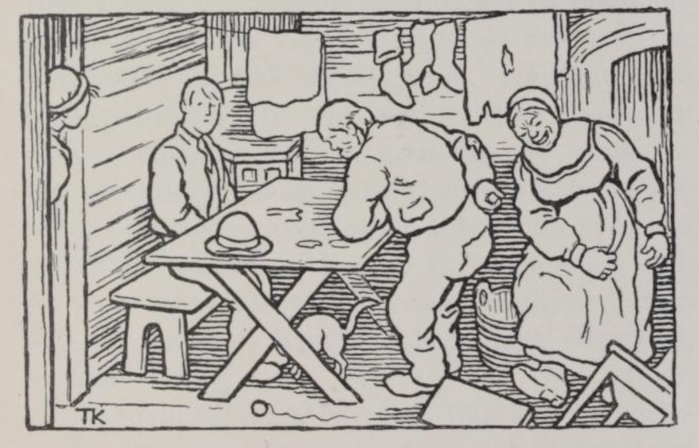

# En frierhistorie

Det var en gang en gutt som skulle ut og fri. Blant andre steder kom han også til en gård der folkene levde i stor fattigdom; men da frieren kom, ville de gjerne virke velstående, det kan en nok vite. Mannen hadde fått et nytt erme i trøia si. «Sitt ned!» sa han til frieren. «Men det er da så støvete overalt!» og så gikk han og gnidde og tørket på benker og bord med det nye ermet sitt; den andre armen holdt han på ryggen.

Konen hadde fått en ny sko. Med den gikk hun og spente og sparket på alt, krakker og stoler; «her ligger så mye i veien, det er så uryddig her!» sa hun.

Så ropte de på datteren, at hun skulle komme og rydde opp. Hun hadde fått ny lue; derfor satte hun hodet inn gjennom døra og nikket hit og dit. «Jeg kan da ikke være overalt, jeg heller!» sa hun. Å jo, så langt var det kommet.
