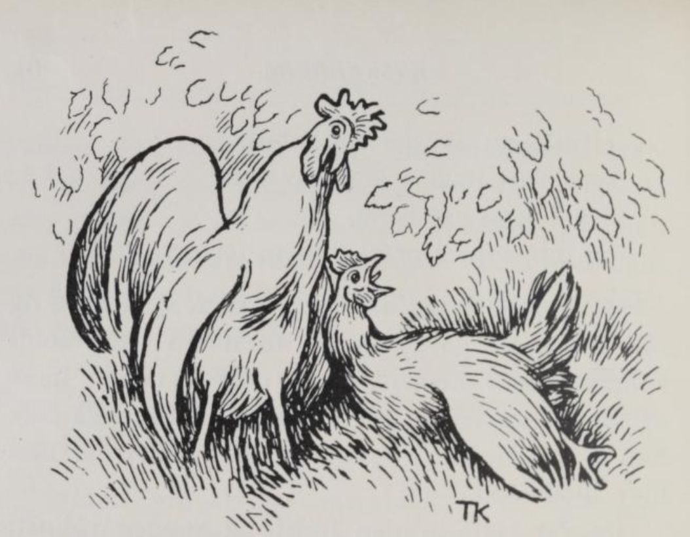

# Hanen og høna i nøtteskogen

Hanen og høna gikk engang i nøtteskogen og skulle plukke nøtter.

Så fikk høna et nøtteskall i halsen og lå og flakset i vingene. Hanen skulle etter vann til henne; så løp han til olla og sa:

«Kjære mi olle, gi meg vann; vann gir jeg tuppa, kona mi, som ligger og dras med døden i nøtteskogen.»

Olla svarte: «Du får ikke vann av meg, før jeg får lauv av deg.»

Så løp hanen til linden: «Kjære min lind, gi meg lauv; lauv gir jeg olla, olla gir meg vann, vann gir jeg tuppa, høna mi, som ligger og dras med døden i nøtteskogen.»

«Du får ikke lauv av meg, før jeg får røde gullbånd av deg,» svarte linden.

Så løp hanen til jomfru Maria: «Kjære mi jomfru Maria, gi meg røde gullbånd; røde gullbånd gir jeg linden, linden gir meg lauv, lauv gir jeg olla, olla gir meg vann, vann gir jeg tuppa, høna mi, som ligger og dras med døden i nøtteskogen.»

«Du får ikke røde gullbånd av meg, før jeg får skor av deg,» svarte jomfru Maria.

Så løp hanen til skomakeren: «Kjære min skomaker, gi meg skor; skor gir jeg jomfru Maria, jomfru Maria gir meg røde gullbånd, røde gullbånd gir jeg linden, linden gir meg lauv, lauv gir jeg olla, olla gir meg vann, vann gir jeg tuppa, høna mi, som ligger og dras med døden i nøtteskogen.»

«Du får ikke skor av meg, før jeg får bust av deg,» svarte skomakeren.

Så løp hanen til purka: «Kjære mi purke, gi meg bust; bust gir jeg skomakeren, skomakeren gir meg skor, skor gir jeg jomfru Maria, jomfru Maria gir meg røde gullbånd, røde gullbånd gir jeg linden, linden gir meg lauv, lauv gir jeg olla, olla gir meg vann, vann gir jeg tuppa, høna mi, som ligger og dras med døden i nøtteskogen.»

«Du får ikke bust av meg, før jeg får korn av deg,» svarte purka.

Så løp hanen til treskemannen: «Kjære min treskemann, gi meg korn; korn gir jeg purka, purka gir meg bust, bust gir jeg skomakeren, skomakeren gir meg skor, skor gir jeg jomfru Maria, jomfru Maria gir meg røde gullbånd, røde gullbånd gir jeg linden, linden gir meg lauv, lauv gir jeg olla, olla gir meg vann, vann gir jeg tuppa, høna mi, som ligger og dras med døden i nøtteskogen.»

«Du får ikke korn av meg, før jeg får lefse av deg,» svarte treskemannen.

Så løp hanen til bakstekjerringa: «Kjære mi bakstekjerring, gi meg lefse; lefse gir jeg treskemannen, treskemannen gir meg korn, korn gir jeg purka, purka gir meg bust, bust gir jeg skomakeren, skomakeren gir meg skor, skor gir jeg jomfru Maria, jomfru Maria gir meg røde gullbånd, røde gullbånd gir jeg linden, linden gir meg lauv, lauv gir jeg olla, olla gir meg vann, vann gir jeg tuppa, kona mi, som ligger og dras med døden i nøtteskogen.»

«Du får ikke lefse av meg, før jeg får ved av deg,» svarte bakstekjerringa.

Så løp hanen til vedhuggeren: «Kjære min vedhugger, gi meg ved; ved gir jeg bakstekjerringa, bakstekjerringa gir meg lefse, lefse gir jeg treskemannen, treskemannen gir meg korn, korn gir jeg purka, purka gir meg bust, bust gir jeg skomakeren, skomakeren gir meg skor, skor gir jeg jomfru Maria, jomfru Maria gir meg røde gullbånd, røde gullbånd gir jeg linden, linden gir meg lauv, lauv gir jeg olla, olla gir meg vann, vann gir jeg tuppa, kona mi, som ligger og dras med døden i nøtteskogen.»

«Du får ikke ved av meg, før jeg får øks av deg,» sa vedhuggeren.

Så løp hanen til smeden: «Kjære min smed, gi meg øks; øks gir jeg vedhuggeren, vedhuggeren gir meg ved, ved gir jeg bakstekjerringa, bakstekjerringa gir meg lefse, lefse gir jeg treskemannen, treskemannen gir meg korn, korn gir jeg purka, purka gir meg bust, bust gir jeg skomakeren, skomakeren gir meg skor, skor gir jeg jomfru Maria, jomfru Maria gir meg røde gullbånd, røde gullbånd gir jeg linden, linden gir meg lauv, lauv gir jeg olla, olla gir meg vann, vann gir jeg tuppa, kona mi, som ligger og dras med døden i nøtteskogen.»

«Du får ikke øks av meg, før jeg får kull av deg,» sa smeden.

Så løp hanen til kullbrenneren: «Kjære min kullbrenner, gi meg kull; kull gir jeg smeden, smeden gir meg øks, øks gir jeg vedhuggeren, vedhuggeren gir meg ved, ved gir jeg bakstekjerringa, bakstekjerringa gir meg lefse, lefse gir jeg treskemannen, treskemannen gir meg korn, korn gir jeg purka, purka gir meg bust, bust gir jeg skomakeren, skomakeren gir meg skor, skor gir jeg jomfru Maria, jomfru Maria gir meg røde gullbånd, røde gullbånd gir jeg linden, linden gir meg lauv, lauv gir jeg olla, olla gir meg vann, vann gir jeg tuppa, kona mi, som ligger og dras med døden i nøtteskogen.»

Så syntes kullbrenneren synd på hanen og ga ham kull. Så fikk smeden kull, og vedhuggeren øks, og bakstekjerringa ved, og treskemannen lefse, og purka korn, og skomakeren bust, og jomfru Maria skor, og linden røde gullbånd, og olla lauv, og hanen vann, og det ga han til høna si, som lå for døden i nøtteskogen; og så ble hun god igjen.
