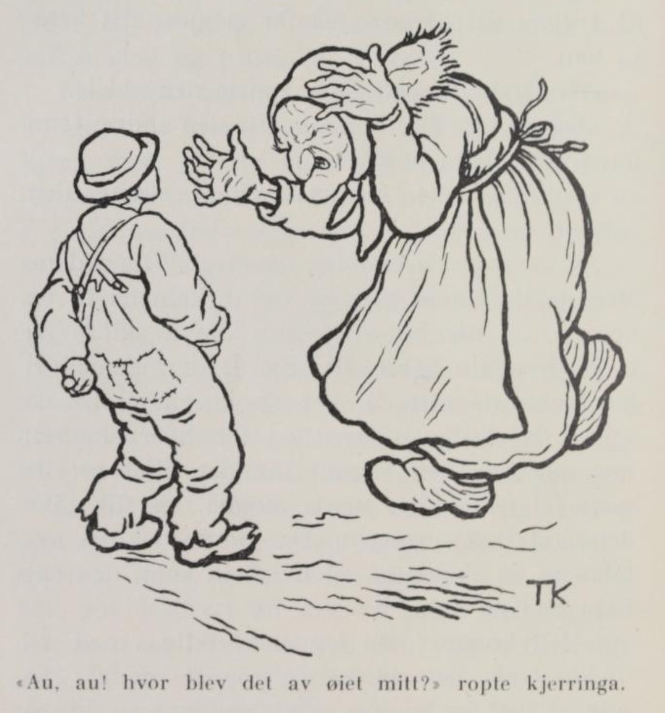
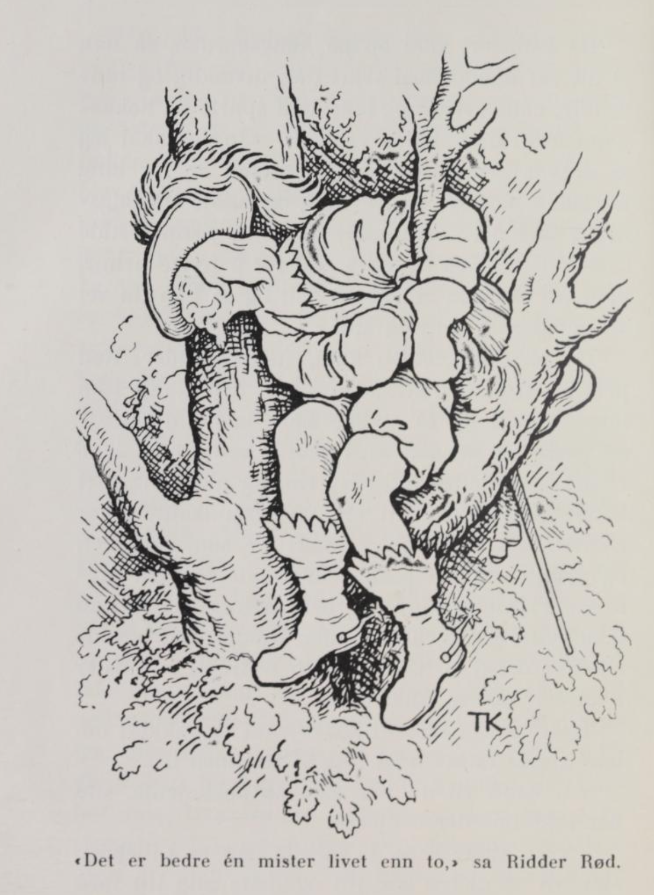
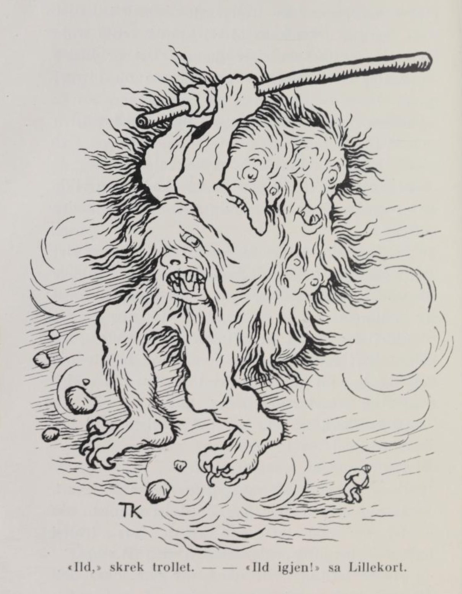
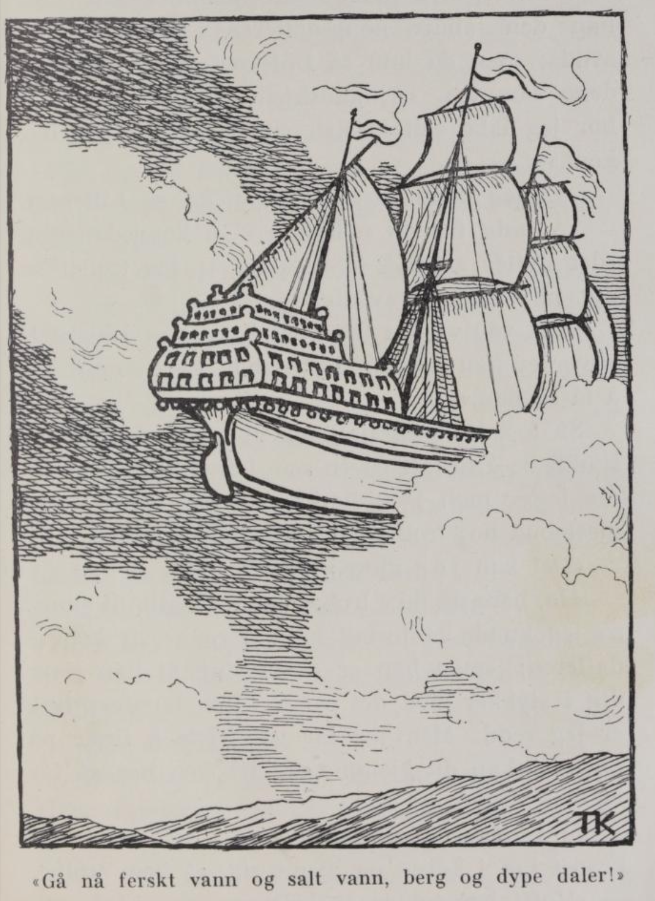

# Lillekort

Det var en gang et par fattige folk; de bodde i en ussel stue der det ikke var annet enn svarte fattigdommen, så de verken hadde noe å bite eller brenne. Men hadde de nesten ingenting annet, så hadde de en rik Guds velsignelse av barn, og for hvert år fikk de ett til. Nå kunne de igjen vente seg ett. Det var mannen ikke særlig glad for; han gikk stadig og gren og sutret, og sa at en gang syntes han det kunne være nok av de Guds gavene; og da tiden kom at konen skulle få barnet, gikk han til skogs etter ved, for han ville ikke se den nye skrikerungen; han fikk tidsnok høre ham når han skrek etter mat, sa han.

Da mannen vel hadde gått, fikk konen et vakkert guttebarn, og straks han var kommet til verden, så han seg om i stua.

«Å kjære mor,» sa han, «gi meg noen gamle klær etter brødrene mine og et par dagers niste, så vil jeg ut i verden og prøve lykken. Du har barn nok likevel, ser jeg.»

«Bevare meg vel, sønnen min,» sa moren, «du er altfor liten enda; det er ingen råd.»

Men guttungen sto på sitt, og tagg og ba, så lenge at moren måtte la ham få noen gamle filler og litt niste i et knyte, og så gikk han nokså glad og trøstig ut i verden.

Men han hadde knapt gått, før konen fikk en gutt til; han så seg også omkring og sa:

«Å kjære mor, gi meg noen gamle klær etter brødrene mine og et par dagers niste, så vil jeg ut i verden og finne igjen tvillingbroren min; du har barn nok likevel, du.»

«Bevare meg vel, du er altfor liten, stakkar,» sa konen; «det er ingen råd.»

Men det hjalp ikke, guttungen tagg og ba så lenge at han fikk noen gamle filler og et knyte med niste, og så ruslet han nokså modig ut i verden for å finne igjen tvillingbroren.

Da den yngste hadde gått en stund, fikk han se broren sin et stykke foran seg. Han ropte til ham og ba ham stanse: «Hei du,» sa han, «du legger i vei som om du fikk betalt for det; men du burde ha sett den yngste broren din også, før du dro ut i verden.» Den eldste stanset da og så seg tilbake, og da den yngste hadde tatt ham igjen og fortalt hvordan det hang sammen, at han var broren hans, sa han videre:

«Men la oss sette oss ned og se etter hva mor har gitt oss med til niste,» og det gjorde de.

Da de hadde gått et stykke, kom de til en bekk som rant gjennom en grønn eng, og der sa den yngste at de burde gi hverandre navn; «siden vi måtte skynde oss, så det ikke ble tid til å gjøre det hjemme, så får vi gjøre det her,» sa han.

«Hva vil du hete da?» spurte den eldste.

«Jeg vil hete Lillekort,» svarte den andre; «og du, hva vil du kalles?»

«Jeg, den eldste, vil hete kong Lavring,» svarte den andre.

Ja, de døpte hverandre, og så gikk de videre. Men da de hadde gått en stund, kom de til et veiskille, og der ble de enige om å skilles og gå hver sin vei. Det gjorde de; men de hadde ikke gått lenge før de møttes igjen; de skiltes på nytt og tok hver sin vei; men om en liten stund gikk det likedan: de møttes igjen før de visste ordet av det, og slik gikk det også tredje gangen. Da avtalte de at de skulle gå hver til sin kant, den ene mot øst og den andre mot vest.

«Men kommer du en gang skikkelig i nød og ulykke,» sa den eldste, «så rop tre ganger på meg, så skal jeg komme og hjelpe deg; men du må ikke rope på meg før du er i din ytterste nød!»

«Det blir vel ikke så snart vi ses da,» sa Lillekort.

Så sa de farvel til hverandre, og Lillekort gikk mot øst og kong Lavring mot vest.

Da Lillekort hadde gått en stund alene, møtte han ei gammal, gammal krokrygget kjerring som bare hadde ett øye. Det snappet Lillekort.

«Au, au!» ropte kjerringa, «hvor ble det av øyet mitt?»

«Hva gir du meg, hvis du skal få et øye?» sa Lillekort.

«Jeg gir deg et sverd som er slik at det kan vinne over en hel hær, om den var aldri så stor,» svarte kjerringa.

«Ja, kom med det,» sa Lillekort.

Kjerringa ga ham sverdet, og så fikk hun igjen øyet sitt.

Så gikk Lillekort videre, og da han hadde gått en stund, møtte han igjen ei gammal, gammal krokrygget kjerring, som bare hadde ett øye; det stjal Lillekort før hun visste ordet av det.

«Au, au! hvor ble det av øyet mitt?» ropte kjerringa.

«Hva gir du meg, hvis du skal få et øye?» sa Lillekort.

«Jeg gir deg et skip som kan gå på ferskt vann og salt vann, over berg og dype daler,» svarte kjerringa.

«Ja, kom med det,» sa Lillekort.

Kjerringa ga ham et bitte lite skip, som ikke var større enn at han stakk det i lomma; så fikk hun øyet sitt igjen, og de gikk hver sin vei.

Da han hadde vandret en lang stund, møtte han for tredje gang ei gammal, gammal krokrygget kjerring, som bare hadde ett øye; det stjal Lillekort igjen, og da kjerringa skrek og bar seg ille og spurte hvor det hadde blitt av øyet hennes, sa Lillekort: «Hva gir du meg, hvis du skal få et øye?»

«Jeg gir deg den kunsten å brygge hundre lester malt i ett brygg,» sa kjerringa.

Ja, for den kunsten fikk kjerringa øyet sitt igjen, og de gikk hver sin vei.

Men da Lillekort hadde gått et lite stykke, syntes han det kunne være verdt å prøve skipet. Så tok han det opp av lomma og satte først den ene foten i det og siden den andre, og straks han hadde steget opp i det med det ene beinet, ble skipet mye større, og da han så steg oppi med det andre, ble det like stort som skipene som går på havet. Så sa Lillekort: «Gå nå på ferskt vann og salt vann, over berg og dype daler, og stans ikke før du kommer til kongens gård!» Og straks fór skipet av sted, så fort som fuglen i lufta, til det kom like nedenfor kongsgården; der stanset det.

Fra vinduene på kongsgården hadde de stått og sett Lillekort komme seilende, og alle sammen ble de så forundret at de løp ned for å se hva det var for en som kom farende i lufta på et skip. Men mens de løp ned fra kongsgården, hadde Lillekort steget ut av skipet sitt og puttet det i lomma igjen; for straks han steg ut av det, ble det like lite som da han fikk det av den gamle kjerringa. De fra kongsgården så ikke annet enn en liten fillete gutt som sto nede ved stranden. Kongen spurte hvor han var fra, men gutten sa at det visste han ikke; heller ikke visste han hvordan han hadde kommet dit; men han ba så inderlig vakkert om å få arbeid på kongsgården; var det ikke annet å gjøre for ham, kunne han bære ved og vann for kokkejenta, sa han; og det skulle han da få lov til.

Da Lillekort kom opp på kongsgården, så han at alt var kledd i svart der, utvendig og innvendig, både vegger og tak; han spurte da kokkejenta hva det skulle bety. «Jo, det skal jeg si deg,» svarte hun; «kongsdatteren ble for lang tid siden lovet bort til tre troll, og neste torsdagskveld skal det første komme og hente henne. Ridder Rød har nok sagt seg god for å frelse henne, men hvem vet om han er kar til det; og så kan du vel skjønne at her er sorg og sut.»

Da torsdagskvelden kom, fulgte Ridder Rød prinsessen ned til stranden — for der skulle hun møte trollet; og så skulle han bli der nede og passe på henne; men han gjorde nok ikke trollet stor skade, skal jeg tro, for så snart prinsessen hadde satt seg på strandkanten, klatret Ridder Rød opp i et stort tre som sto der, og gjemte seg så godt han kunne mellom greinene. Prinsessen gråt og ba så inderlig om at han ikke måtte gå fra henne; men Ridder Rød brydde seg ikke om det, han: «Det er bedre at én mister livet enn to,» sa Ridder Rød.

I mellomtiden ba Lillekort kokkejenta så vakkert om han kunne få lov å gå ned til stranden litt.

«Å, hva vil du der da?» sa kokkejenta, «du har ikke noe der å gjøre.»

«Å jo, kjære deg, la meg få gå,» sa Lillekort; «jeg vil så gjerne ned dit og more meg litt med de andre guttene, jeg også.»

«Ja ja, gå da,» sa kokkejenta, «men pass på at du ikke blir der lenger enn til kveldsgryta skal henges på og steika skal settes på spidd; og ta så med deg et skikkelig fang ved inn på kjøkkenet igjen.»

Ja, det lovet Lillekort, og løp ned til stranden.

Med det samme han kom dit kongsdatteren satt, kom trollet farende så det suste og bruste om det; det var så stort og digert at det var fælt, og fem hoder hadde det.

«Ild!» skrek trollet.

«Ild igjen!» sa Lillekort.

«Kan du fekte?» ropte trollet.

«Kan jeg ikke, så kan jeg lære,» sa Lillekort.

Så slo trollet etter ham med en stor, tykk jernstang han hadde i neven, så jordspruten sto fem alen til værs.

«Tvi!» sa Lillekort, «det var noe, også det! Nå skal du se et hugg av meg!»

Så grep han sverdet han hadde fått av den gamle krokryggete kjerringa, og hogg til trollet, så alle fem hodene føk bort over sanden.

Da prinsessen så at hun var frelst, var hun så glad at hun ikke visste hvordan hun skulle bære seg at; hun både hoppet og danset. «Sov nå en liten stund på fanget mitt,» sa hun til Lillekort, og mens han lå der, trakk hun en gulldrakt på ham.

Men nå varte det ikke lenge før Ridder Rød krabbet ned av treet igjen, da han så at det ikke lenger var noen fare på ferde. Han truet kongsdatteren så lenge at hun måtte love å fortelle at han hadde frelst henne; for hvis hun ikke sa det, ville han ta livet av henne. Så tok han lungen og tungen ut av trollet og la dem i lommetørkleet sitt, og leide så prinsessen tilbake til kongsgården; og var han ikke blitt hedret før, så ble han det nå. Kongen visste ikke hva han skulle finne på for å hedre ham, og alltid satt han på høyre side av kongen ved bordet.

Lillekort, han gikk først ut på trollskipet og tok med seg en hel mengde gull- og sølvbånd og andre ting, og så pilte han tilbake til kongsgården. Da kokkejenta fikk se alt gullet og sølvet, ble hun rent forskrekket og spurte: «Men kjære deg, Lillekort, hvor har du fått alt dette fra?» for hun var nok redd for at han ikke hadde fått det på ærlig vis. «Å,» svarte Lillekort, «jeg var hjemme en tur, og der hadde disse båndene falt av noen spann, og så tok jeg dem med til deg, jeg.» Ja, da kokkejenta hørte at de var til henne, spurte hun ikke mer om den saken; hun takket Lillekort, og alt var godt og vel igjen.

Den andre torsdagskvelden gikk det likedan. Alle var i sorg og sut; men Ridder Rød sa at hadde han kunnet frelse kongsdatteren fra ett troll, så kunne han alltids frelse henne fra ett til, og leide henne ned til stranden. Men han gjorde nok ikke det trollet stor skade heller, han; for da tiden kom at de kunne vente trollet, sa han som forrige gang: «Det er bedre at én mister livet enn to,» og klatret så opp i treet igjen.

Lillekort ba denne gangen også om lov til å gå ned til stranden litt.

«Å, hva skal du der!» sa kokkejenta.

«Jo, kjære, la meg gå,» sa Lillekort, «jeg vil så gjerne ned og more meg litt med de andre guttene.»

Ja, han skulle da få lov til å gå; men først måtte han love at han skulle være tilbake til steika skulle snus, og da skulle han ha med seg et stort vedfang.

Lillekort var knapt kommet ned til stranden før trollet kom farende så det suste og bruste om det; det var dobbelt så stort som det andre trollet, og ti hoder hadde det.

«Ild!» skrek trollet.

«Ild igjen!» sa Lillekort.

«Kan du fekte?» ropte trollet.

«Kan jeg ikke, så kan jeg lære!» sa Lillekort.

Så slo trollet etter ham med jernstangen sin — den var enda større enn den det første trollet hadde —, så jordspruten sto ti alen til værs.

«Tvi!» sa Lillekort, «det var noe, også det! Nå skal du få se et hugg av meg!»

Så grep han sverdet og hogg til trollet, så alle ti hodene danset bort over sanden.

Så sa kongsdatteren til ham igjen: «Sov en liten stund på fanget mitt,» og mens Lillekort lå der, trakk hun en sølvdrakt på ham.

Så snart Ridder Rød merket at det ikke var noen fare på ferde lenger, krabbet han ned av treet og truet prinsessen så lenge at hun igjen måtte love å si at det var han som hadde frelst henne; så tok han tungen og lungen av trollet og la dem i lommetørkleet sitt, og leide kongsdatteren tilbake til slottet. Her ble det fryd og glede, det kan en nok vite, og kongen visste slett ikke hvordan han skulle bære seg at for å vise Ridder Rød ære og heder nok.

Men Lillekort tok med seg et fang med gull- og sølvbånd og slikt fra trollskipet, han. Da han kom tilbake til kongsgården, slo kokkejenta hendene sammen og undret seg over hvor han hadde fått alt det gullet og sølvet fra; men Lillekort svarte at han hadde vært hjemom en tur, og at det var bånd som hadde falt av noen spann; dem hadde han tatt med seg til kokkejenta, sa han.

Da den tredje torsdagskvelden kom, gikk det akkurat likedan som de to første gangene: hele kongsgården var kledd i svart, og alle var i sorg og sut, men Ridder Rød sa at han syntes ikke de hadde så mye å være redde for; hadde han frelst kongsdatteren fra to troll, så kunne han vel frelse henne fra det tredje også. Han leide henne da ned til stranden; men da det led mot den tiden trollet skulle komme, klatret han opp i treet og gjemte seg igjen. Prinsessen gråt og ba ham bli, men det hjalp ikke; han sa det samme som før: «Det er bedre at én mister livet enn to,» sa Ridder Rød.

Den kvelden ba også Lillekort om lov til å gå ned til stranden. «Å, hva skal du der!» svarte kokkejenta. Men han ba så lenge at han endelig fikk lov å gå; men han måtte love at han skulle være tilbake på kjøkkenet igjen når steika skulle snus.

Så snart han var kommet ned til stranden, kom trollet så det suste og bruste om det; det var mye, mye større enn noen av de andre, og femten hoder hadde det.

«Ild!» ropte trollet.

«Ild igjen!» sa Lillekort.

«Kan du fekte!» skrek trollet.

«Kan jeg ikke, så kan jeg lære,» sa Lillekort.

«Jeg skal lære deg!» skrek trollet, og slo etter ham med jernstangen sin, så jordspruten sto femten alen til værs.

«Tvi!» sa Lillekort, «det var noe, også det! Nå skal du se et hugg av meg!»

Med det samme grep han sverdet og hogg til trollet, så alle femten hodene danset bort over sanden.

Da var prinsessen frelst, og hun både takket og velsignet Lillekort fordi han hadde berget henne. «Sov nå en liten stund på fanget mitt,» sa hun, og mens han lå der, trakk hun en messingdrakt på ham.

«Men hvordan skal jeg nå bære meg at, så det blir deg som har frelst meg?» sa kongsdatteren. «Ridder Rød vil nok si at han har gjort det denne gangen også.»

«Det skal vi nok finne råd for,» sa Lillekort. «Når han kommer og vil ha deg, skal du si at du vil ha den som har frelst deg, og så skal du be om at alle på slottet skal prøve å vise fram de tre draktene, gulldrakten, sølvdrakten og messingdrakten, som du har gitt meg. Den som kan det, er den rette.»

Så sprang Lillekort tilbake til kongsgården, men først tok han med seg en hel haug med kostbare ting fra trollskipet. Han var knapt borte før Ridder Rød krabbet ned av treet og truet kongsdatteren til å si at han hadde frelst henne. Så leide han henne tilbake til slottet, og der ble det enda større glede enn de to første gangene. Men da Ridder Rød krevde å få kongsdatteren, sa hun det kongen hadde sagt, at den som kunne vise fram de tre draktene, han skulle få henne og halve riket. Ridder Rød prøvde, men han kunne ikke finne dem. Da sa kongen at alle på slottet skulle prøve, fra den største til den minste. Til sist kom turen til Lillekort. Da han hadde vist fram alle tre draktene, sa kongen: «Du er den rette, du skal ha datteren min og halve riket.» Så ble Ridder Rød kastet i ormegården, og Lillekort skulle få prinsessen.

En dag gikk kongen og Lillekort og spaserte; da spurte Lillekort kongen om han ikke hadde hatt flere barn.

«Jo,» sa kongen, «jeg har hatt en datter til; men henne har trollet tatt, for det var ingen som kunne frelse henne. Nå skal du få den ene datteren min; men kan du frelse den trollet har tatt også, skal du gjerne få henne og den andre halvdelen av riket også.»

«Jeg får vel prøve,» sa Lillekort; «men jeg må ha en jernkjetting som er fem hundre alen lang, og så vil jeg ha fem hundre mann, og niste til dem for femten uker; for jeg skal langt til sjøs,» sa han.

Ja, det skulle han nok få; men kongen var redd han ikke hadde et skip som var stort nok til å bære alt sammen.

«Jeg har skip selv,» sa Lillekort, og tok det han hadde fått av den gamle kjerringa, opp av lomma.

Kongen lo av ham og trodde det ikke var annet enn spøk; men Lillekort ba bare om det han hadde bedt om. De kom da med kjettingen og mannskapet og nisten, og da de skulle gå om bord, ble skipet større og større jo flere som steg i. Til sist var det så stort at alle fem hundre mann hadde god plass.

«Gå nå på ferskt vann og salt vann, over berg og dype daler, og stans ikke før du kommer dit kongsdatteren er,» sa Lillekort. Og skipet gikk av sted over land og strand så det suste, til det stanset midt ute på et stort, stort hav.

«Nå er vi her,» sa Lillekort; «men hvordan skal vi komme til bunns?»

«Ja, det er det ingen som vet,» sa de andre.

Lillekort bandt kjettingen om seg og sa: «Fir meg nå ned, og når jeg rykker i kjettingen, så heis meg opp igjen.»

Så sank han og sank, og til sist kom han til bunns. Der så han en stor berghule, og den gikk han inn i.

Da han hadde kommet inn, fant han den andre kongsdatteren; hun satt og sydde; men da hun så Lillekort, slo hun hendene sammen. «Å, gudskjelov!» ropte hun, «jeg har ikke sett et kristent menneske siden jeg kom hit.»

«Ja, jeg kommer for å hente deg, jeg,» sa Lillekort.

«Å, meg får du nok ikke,» sa kongsdatteren, «det nytter ikke å tenke på det; får trollet se deg, tar han livet av deg.»

«Det var godt du snakket om ham,» sa Lillekort; «hvor er han hen? Det kunne være morsomt å få se ham.»

Så fortalte kongsdatteren at trollet var ute for å prøve å få tak i en som kunne brygge hundre lester malt i ett brygg; for det skulle være gjestebud hos trollet, og da holdt det ikke med mindre.

«Det kan jeg gjøre,» sa Lillekort.

«Ja, bare trollet nå ikke var så hissig av seg, så jeg kunne få fortalt ham det,» svarte kongsdatteren; «men han er så bråsint at han river deg i stykker med det samme han kommer inn, er jeg redd. Men jeg får vel prøve å finne på noe. Nå kan du gjemme deg i kottet her, så får vi se hvordan det går.»

Ja, Lillekort gjorde det, og han hadde knapt krøpet inn i kottet og gjemt seg før trollet kom.

«Huff! her lukter det kristenmanns blod,» sa trollet.

«Ja, det fløy en fugl over taket med et kristenmanns bein i nebbet, og det slapp den ned gjennom pipa,» svarte kongsdatteren; «jeg skyndte meg nok å få det bort; men det er vel det det lukter av likevel.»

«Ja, det er vel det,» sa trollet.

Så spurte kongsdatteren om han hadde fått tak i noen som kunne brygge hundre lester malt i ett brygg.

«Nei, det er ingen som kan det,» sa trollet.

«For en liten stund siden var det en inne her som sa at han kunne det,» sa kongsdatteren.

«Du er da alltid så klok, du,» svarte trollet; «hvorfor lot du ham gå da? Du visste jo at jeg ville få tak i en sånn en.»

«Å, jeg lot ham nok ikke gå heller, jeg,» sa kongsdatteren, «men far er så hissig av seg, og så gjemte jeg ham i kottet; hvis far ikke har fått tak i noen, så er han nok her.»

«La ham komme inn,» sa trollet.

Da Lillekort kom, spurte trollet om det var sant at han kunne brygge hundre lester malt i ett brygg.

«Ja,» sa Lillekort.

«Det var godt jeg fikk tak i deg,» sa trollet. «Sett i gang straks; men stakkars deg hvis du ikke brygger ølet sterkt.»

«Å, det skal nok få smak,» sa Lillekort, og satte i gang med bryggingen. «Men jeg må ha flere troll til å bære brygget,» sa Lillekort; «de jeg har fått, orker ikke stort.»

Ja, han fikk flere, så mange at det krydde, og så gikk det unna med bryggingen.

Da vørteren var ferdig, skulle de smake alle sammen, forstår seg, først trollet selv og siden de andre; men Lillekort hadde brygget vørteren så sterk at de falt døde som fluer etter hvert som de drakk av den. Til sist var det ingen andre igjen enn ei gammal, ussel kjerring som lå bak ovnen.

«Å stakkar!» sa Lillekort, «du får da smake vørteren, du også!» og så gikk han bort og skrapte rundt bunnen av bryggekaret med øsen og ga henne; så var han kvitt dem alle sammen.

Som han sto der og så seg om, fikk han øye på en stor kiste; den tok Lillekort og fylte med gull og sølv, bandt så kjettingen om seg og kongsdatteren og kisten, og rykket til av alle krefter; så dro mannskapet dem opp i god behold.

Da Lillekort vel var kommet om bord igjen, sa han: «Gå nå på salt vann og ferskt vann, over berg og dype daler, og stans ikke før du kommer til kongens gård,» og straks fór skipet av sted så fossen sto om det. Da de på kongsgården så skipet, var de ikke sene med å komme dem i møte med sang og spill og ta imot dem, men gladest av alle var kongen, som nå hadde fått igjen den andre datteren sin også.

Men den som ikke var glad til sinns, det var Lillekort; for begge kongsdøtrene ville ha ham, og han ville ikke ha noen annen enn den han først hadde frelst — det var den yngste, det. Derfor gikk han titt og ofte og tenkte på hvordan han skulle bære seg at for å få henne, for den andre ville han også nødig gjøre imot. En dag han gikk og tenkte hit og dit på dette, kom han på at bare han hadde broren sin, kong Lavring, hos seg, han som var så lik ham at ingen kunne skjelne dem fra hverandre, så kunne han la ham få den andre kongsdatteren og det halve riket, for selv syntes han at han hadde nok med den ene halvdelen. Straks han hadde kommet på det, gikk han utenfor slottet og ropte på kong Lavring. Nei, det kom ingen. Så ropte han en gang til og litt høyere, men nei, det kom enda ingen. Så ropte Lillekort tredje gangen, og det av alle krefter, og da sto broren der.

«Jeg sa at du ikke skulle rope på meg uten at du var i din ytterste nød,» sa han til Lillekort, «og her er jo ikke en mygg som kan gjøre deg noe.»

Dermed klasket han til ham så Lillekort rullet bortover bakken.

«Å, skam deg, som slår!» sa Lillekort; «først har jeg vunnet den ene kongsdatteren og det halve riket, og så den andre kongsdatteren og det andre halve riket, og nå tenkte jeg å gi deg den ene kongsdatteren og halvdelen av kongeriket mitt — synes du det er rimelig å fare fram slik?»

Da kong Lavring hørte det, ba han broren sin om tilgivelse, og de ble straks gode venner og vel forlikt igjen.

«Nå vet du,» sa Lillekort, «at vi er så like at ingen kan kjenne den ene av oss fra den andre; bytt nå klær med meg og gå opp på slottet, så tror kongsdøtrene at det er jeg som kommer; den som først kysser deg, skal du få, så tar jeg den andre;» for han visste at den eldste kongsdatteren var den sterkeste, og så kunne han vel skjønne hvordan det ville gå.

Det var kong Lavring straks villig til; han byttet klær med broren og gikk opp på slottet. Da han kom inn på rommet til kongsdøtrene, trodde de at det var Lillekort, og begge sprang straks mot ham, men den eldste, som var størst og sterkest, skubbet søsteren til side og tok kong Lavring om halsen og kysset ham; og så fikk han henne, og Lillekort den yngste kongsdatteren. Da kan det vel hende det ble bryllup, og det så det hørtes og spurtes over sju kongeriker.
