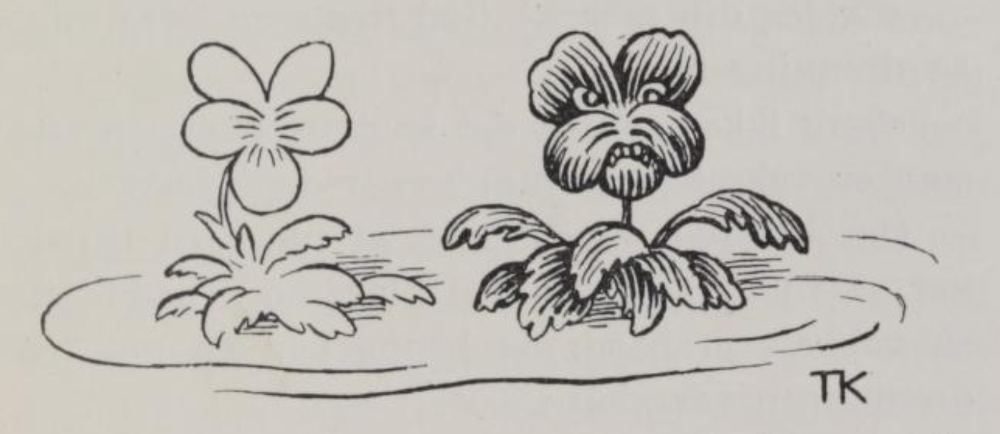
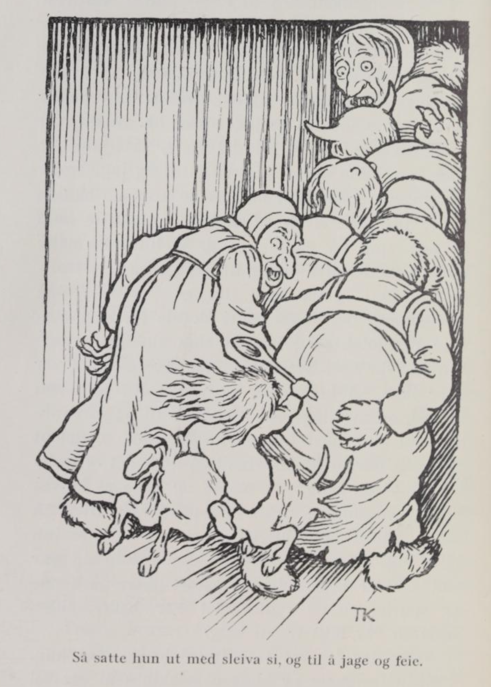
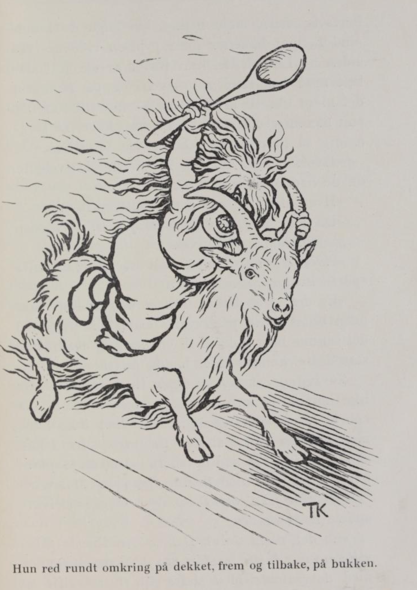

# Lurvehette

Det var en gang en konge og en dronning som ingen barn fikk, og det sørget dronningen så over at hun nesten ikke hadde en glad time. Støtt og stadig klaget hun, fordi det var så ødslig og stilt i kongsgården; «hadde vi bare barn, så ble det nok liv her,» sa hun. Hvor hun enn reiste i hele riket sitt, så fantes det Guds velsignelse av barn, selv i den fattigste stua; og hvor hun kom, så hørte hun kjerringa i huset skjenne på ungene, og sa at nå hadde de gjort det og det gale igjen; dette syntes dronningen var morsomt, og det hadde hun lyst til å gjøre også.

Til sist tok kongen og dronningen til seg et fremmed lite pikebarn; henne ville de ha hos seg i kongsgården og oppdra, og henne ville de skjenne på som sitt eget.

En dag sprang den lille jomfruen de hadde tatt til seg, nede i gården foran slottet og lekte med et gulleple. Så kom det ei fattig kjerring rekende; hun hadde også ei lita jente med seg, og det varte ikke lenge, så var jentungen og den lille jomfruen gode venner og ga seg til å leke sammen og trille gulleplet mellom seg. Dette så dronningen, som satt oppi vinduet på slottet; så pikket hun på ruten, at fosterdatteren skulle komme opp. Hun gjorde det, men fattigjenta ble med, og da de kom inn i salen til dronningen, holdt de hverandre i hånden. Dronningen skjente på den lille jomfruen; «det er ikke for deg å springe og leke med en fillete tiggerunge,» sa hun, og ville jage jentungen ned igjen.

«Visste dronningen hva mor mi kunne, så jaget hun ikke meg,» sa den vesle jenta, og da dronningen spurte henne nøyere ut, fortalte hun at mor hennes kunne skaffe dronningen barn. Det ville ikke dronningen tro, men jenta ble ved sitt, og sa at det var sant hvert ord, og at dronningen bare skulle la mor hennes få prøve.

Så lot dronningen den vesle jenta gå ned etter henne.

«Vet du hva datter di sier?» spurte hun kjerringa, da hun kom innenfor døren.

«Nei,» det visste tiggerkjerringa ikke.

«Hun sier du kan skaffe meg barn, om du vil,» sa dronningen.

«Det er ikke for dronningen å høre etter det en fattigunge finner på,» sa kjerringa og strøk ut igjen.

Dronningen ble vond og ville jage ned den vesle jenta igjen, men hun sto på sitt, at det var sant hvert ord hun hadde sagt.

«Dronningen skulle bare skjenke mor mi, så hun ble lystig, så visste hun nok råd,» sa jentungen.

Det ville dronningen prøve; fattigkjerringa ble hentet opp en gang til og ble traktert både med vin og mjød, så mye hun ville ha, og da varte det ikke lenge før hun fikk tungen på glid. Så kom dronningen igjen frem med spørsmålet sitt.

«Et råd vet jeg vel,» sa fattigkjerringa. «Dronningen skal la bære inn to kar med vann, en kveld hun vil legge seg. I dem skal hun vaske seg og siden slå dem inn under sengen. Når hun ser under den om morgenen, så er det vokset opp to blomster, en vakker og en stygg. Den vakre skal hun spise, den stygge skal hun la stå. Men glem ikke det siste!» sa fattigkjerringa.

Ja, dronningen gjorde som kjerringa hadde rådet henne; hun lot vannet bære opp i to kar, vasket seg i vannet og slo det under sengen, og da hun så etter om morgenen, sto det to blomster; den ene var stygg og fæl og hadde svarte blad, men den andre var så lys og vakker at hun aldri hadde sett maken til den, og den spiste hun straks. Men den vakre blomsten smakte så godt at hun ikke kunne la være; hun spiste den andre også. — «Det kan vel ikke gjøre noe fra eller til,» tenkte hun.

Om en tid kom dronningen i barselseng. Først fødte hun et pikebarn som hadde en sleiv i hånden og red på en bukk; stygg og fæl var hun, og med det samme hun kom til verden, ropte hun: «Mor!»

«Er jeg din mor, så Gud trøste og bære meg!» sa dronningen.

«Sørg ikke for det, det kommer snart en etter som er vakrere,» sa hun som red på bukken.

Om litt fikk dronningen et pikebarn til; det var så vakkert og vent, at aldri noen hadde sett så vakkert et barn; og henne kan en nok vite dronningen var glad i.

Den eldste kalte de Lurvehette, av det hun var så fæl og lurvete, og hadde en hette som hang i tafser rundt hodet; henne ville dronningen nødig se, og jentene prøvde å stenge henne inne i et annet rom; men det nyttet ikke, der den yngste var, der ville hun også være, og aldri kunne de få skilt dem fra hverandre.

Da de begge var halvvoksne, var det en julekveld det ble slikt forferdelig ståk og styr på svalen utenfor stuen til dronningen. Lurvehette spurte hva det var som knartet og ramlet så ute på svalgangen. «Å det er aldri verdt å spørre om det,» svarte dronningen; men Lurvehette ga seg ikke, hun ville endelig ha greie på det, og så fortalte da dronningen, at det var trollkjerringene som holdt juleleik der ute. Lurvehette sa at hun ville ut og jage dem, og enda så mye de ba henne om å la det være, så hjalp det ikke, hun ville ut og hun måtte ut og jage trollkjerringene; men hun ba om at dronningen skulle holde alle dørene stengt, så ikke en eneste kom så mye som på gløtt engang, sa hun. Så satte hun ut med sleiva si, og til å jage og feie trollkjerringene, og da ble det en rammel utpå svalgangen, slik at du aldri skulle ha hørt maken; det knaket og braket, som om tømmerstokkene skulle ryke av i hvert laft. Men hvordan det var eller ikke, så kom den ene døren litt på klem likevel, og så ville søsteren gløtte ut og se hvordan det gikk med Lurvehette, og stakk hodet ut gjennom dørsprekken. Husj! så kom det ei trollkjerring, tok hodet av henne og satte et kalvehode i stedet, og straks begynte prinsessen å gå innpå gulvet og raute. Da Lurvehette kom inn igjen og fikk se søsteren, skjente hun og var sint, fordi de ikke hadde passet bedre på henne og spurte om de syntes det var bedre, siden søsteren var blitt til en kalv.

«Men jeg får vel se å frelse henne,» sa hun.

Hun forlangte av kongen et skip som var godt rustet og helt klart; men styrmann og mannskap ville hun ikke ha, hun ville seile avsted med søsteren alene, og det måtte de til sist la henne få lov til.

Lurvehette seilte bort og styrte like under det landet trollkjerringene bodde i, og da hun hadde kommet til bryggen, sa hun til søsteren at hun skulle bli på skipet og holde seg ganske stille der; men selv red Lurvehette på bukken opp til trollkjerringslottet. Da hun kom der, var det ene salsvinduet åpent, og der så hun hodet til søsteren sto i vinduskarmen; så red hun i fullt sprang inn i svalgangen og nappet hodet og satte avsted med det. Trollkjerringene etter og ville ta igjen hodet, og de var om henne så tykt at de yrte og krydde; men bukken puffet og stanget med hornene, og selv slo og dasket hun med sleiva, og så måtte trollkjerringflokken gi seg. Og Lurvehette kom ned på skipet igjen, tok kalvehodet av søsteren og satte hennes eget hode på i stedet, så søsteren ble til menneske som før; og så seilte hun langt, langt bort til et fremmed kongerike.

Kongen i det riket var enkemann og hadde bare en eneste sønn.

Da han fikk se det fremmede skipet, sendte han bud ned til stranden for å få vite hvor det var fra, og hvem det var som eide det; men da kongens folk kom derned, så de ikke en levende sjel på skipet uten Lurvehette — hun red rundt omkring på dekket, frem og tilbake på bukken, så hårtafsene sto om hodet på henne. Folkene fra kongsgården var helt forundret over dette synet, og spurte om det ikke var flere om bord. «Å jo, hun hadde en søster med seg,» sa Lurvehette. Henne ville da folkene se, men Lurvehette sa nei; «henne får ingen se, uten at kongen kommer sjøl,» sa hun, og red omkring på bukken så det dundret i dekket.

Da tjenerne kom tilbake til kongsgården og fortalte om det de hadde sett og hørt nedpå skipet, ville kongen straks i veien og se henne som red på bukken. Da han kom, leide Lurvehette ut søsteren, og hun var så vakker og så ven, at kongen ble rent forgapt i henne, der han sto. Han tok dem begge med seg opp på slottet, og søsteren ville han ha til dronning, men Lurvehette svarte nei, henne kunne kongen ikke få på noen måte, uten at kongssønnen ville ha Lurvehette. Det kan du vite kongssønnen nødig ville, så stygt et troll som Lurvehette var; men så lenge snakket kongen og alle i kongsgården til ham, at han endelig ga seg, og lovet at han skulle ta henne til dronning, men nødig gjorde han det, og sturen var han.

Så ble det laget til bryllup både med brygg og med bakst, og da alt var ferdig, skulle de reise til kirke; men prinsen syntes det var den tyngste kirkevei han hadde reist i hele sitt liv. Først kjørte kongen med bruden sin; hun var så vakker og så gild, at alle folk stanset og så etter henne; men da kongssønnen kom ridende med Lurvehette, var han så sturen og sorgmodig at han ikke sa et ord.

Om litt spurte Lurvehette hvorfor han ikke snakket. «Hvorfor skal jeg snakke?» svarte prinsen. «Du er så stygg at jeg ikke kan snakke til deg.» «Du kan jo spørre hvorfor jeg rir på den stygge bukken,» sa Lurvehette. «Hvorfor rir du på den stygge bukken?» spurte kongssønnen. «Er det stygg bukk? Det er jo den gildeste hest en brud vil ride på,» sa Lurvehette, og med det samme ble bukken til en hest, den gildeste kongssønnen hadde sett i sine dager. Så red de et stykke igjen, men prinsen var like sturen og sa ikke et ord. Så spurte Lurvehette igjen hvorfor han ikke snakket, og ba ham spørre hvorfor hun hadde den stygge sleiva i neven. «Hvorfor har du den stygge sleiva?» spurte kongssønnen. «Er det stygg sleiv? Det er jo den blankeste sølvvifte en brud vil vifte med,» sa Lurvehette, og med det samme var det det.

Så red de enda et stykke, men kongssønnen var like sturen og sa ikke et ord. Om litt spurte Lurvehette igjen hvorfor han ikke snakket, og denne gangen sa hun at han skulle spørre, hvorfor hun hadde den stygge grå hetta på hodet. «Hvorfor har du den stygge grå hetta på hodet?» spurte kongssønnen. «Er det stygg hette? Det er jo den blankeste gullkrone noen brud vil bære,» svarte Lurvehette, og med det samme var den det.

Nå red de en lang stund igjen, og prinsen var sturen og satt der uten mål og mæle som før; så spurte bruden hans igjen hvorfor han ikke snakket, og ba ham spørre hvorfor hun var så grå og stygg i ansiktet. «Ja, hvorfor er du så grå og stygg i ansiktet?» spurte kongssønnen. «Er jeg stygg? Du synes søster mi er vakker, men jeg er ti ganger vakrere,» sa bruden, og da kongssønnen så på henne, var hun så vakker, at han syntes det ikke kunne være så vakker en jomfru til i verden.

Da kan det vel hende at prinsen fikk munnen på gli, og ikke lenger red og hang med hodet. Så drakk de bryllup både vel og lenge, og siden reiste både kongen og prinsen, hver med sin brud, til far til kongsdøtrene, og der drakk de bryllup på nytt lag, så det ingen ende ville ta. Skynder du deg til kongsgården, så er det kanskje igjen en dråpe av bryllupsølet enda.
