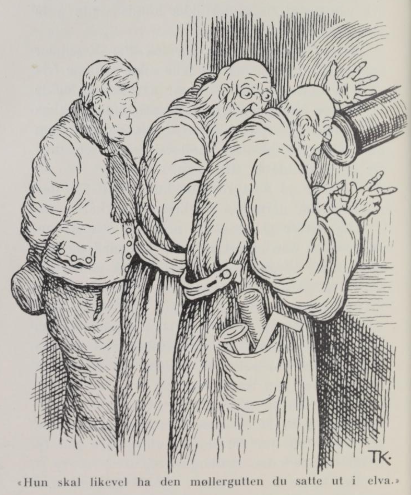
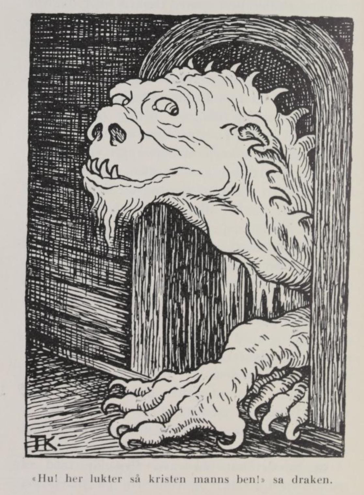
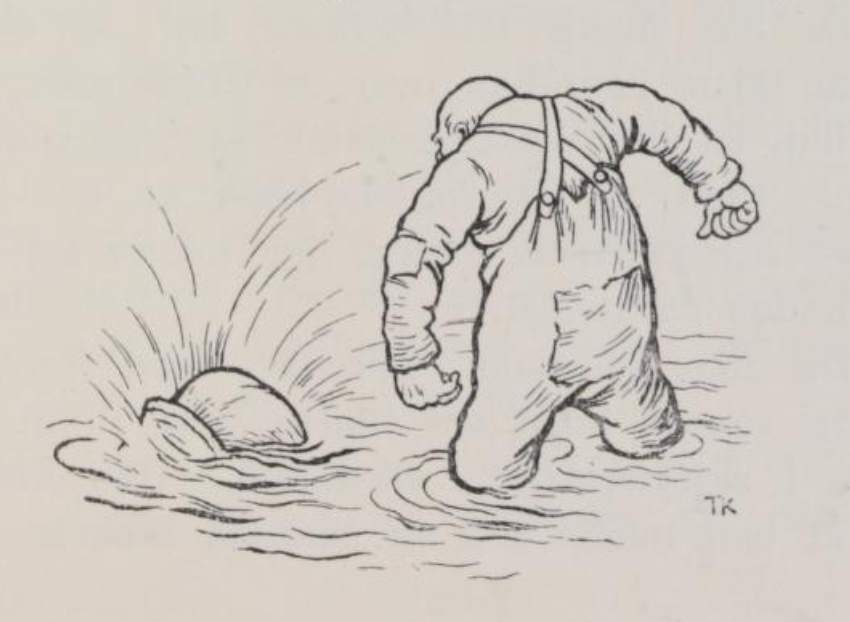

# Rike Per Kremmer

Det var en gang en mann som de kalte Rike Per Kremmer, av det han hadde faret om med kram og samlet mange penger, så han var blitt en rik mann. Denne Rike-Per hadde en datter, og henne holdt han så høyt at alle de frierne som kom til henne, fikk avslag, for han syntes at ingen var god nok. Da det gikk slik med alle, så kom det til sist ingen. Og da det tok til å dra ut i årene, så ble Per redd hun ikke skulle bli gift.

«Jeg lurer virkelig på,» sa han til konen, «hvorfor det ikke kommer noen og frir til datter vår, som er så rik? Det skulle da være veldig rart om det ikke skulle være noen som ville ha henne, for penger har hun, og eiendom får hun. Jeg mener jeg får reise til stjernekikerne, og spørre dem om hvem hun skal ha; for det kommer jo ikke et mors liv her lenger.»

«Hvordan kan stjernekikerne svare på det da?» spurte konen.

«Jo, de leser alt i stjernene, de,» sa Rike-Per.

Han tok med seg mange penger til stjernekikerne og ba dem om de ville se på stjernene og si ham hva mann datter hans skulle få. Stjernekikerne så på stjernene, men de sa at de kunne ikke se det. Men Per ba dem om at de måtte se bedre etter og endelig si ham det, han skulle betale dem godt for det. Stjernekikerne så da bedre etter, og sa at datter hans skulle få til mann det møllerbarnet, som nettopp hadde kommet til verden, i den kverna som lå straks nedenfor gården til Rike-Per. Per ga stjernekikerne hundre daler, og reiste hjem med den beskjeden han hadde fått. Han syntes det var altfor urimelig, at datter hans skulle få en til mann som nettopp var kommet til verden, og det en som var så fattig. Det sa han også til konen sin.

«Jeg undres om jeg ikke kunne få dem til å selge meg gutten,» sa han, «så skal vi nok bli av med ham.»

«Jo det tenker jeg nok,» sa konen, «det er fattigfolk.»

Per gikk da ned i kverna, og spurte konen om hun ikke ville selge ham gutten; hun skulle få mange penger for ham. Nei, det ville hun slett ikke. «Neimen om jeg skjønner hvorfor du ikke vil det,» sa Per Kremmer; «det er da bare armod med dere, og gutten skal ikke lette den, kan jeg tro.» Men hun var så glad i gutten, at hun ville ikke miste ham. Da mølleren kom inn, sa Per det samme til ham, og lovet at han skulle gi ham seks hundre daler for gutten, så de kunne kjøpe seg en gård, og slippe å male for folk, og sulte når det ikke var kvernvann. Det syntes mølleren godt om, og han snakket med konen, og så fikk Rike-Per gutten. Moren gråt og bar seg ille; men Per trøstet henne med at han skulle få det godt; men de måtte love at de ikke skulle spørre etter ham, for han ville sette ham langt bort i andre land, til å lære fremmede språk.

Da Per Kremmer var kommet hjem med gutten, lot han snekre en liten kiste, som var så fint tilstelt at det var en lyst å se. Den tettet han med bek, la møllergutten nedi, låste att låsen, og satte den ut i elven, så strømmen fór avsted med den. «Nå er jeg kvitt ham,» tenkte Per Kremmer. Men da kisten hadde seilt langt ned over elven, kom den inn i en vannrenne til et annet kvernbruk og fór gjennom den ned på kvernkallen, så kverna stanset. Mannen gikk da ned og skulle se etter hva det var som stanset kverna, og så fant han kisten, og tok den med seg opp.

Da han kom hjem til konen om middagen, sa han: «Jeg lurer virkelig på hva det kan være for noe i denne kisten; den kom farende ned på kvernkallen gjennom rennen og stanset kverna for meg i dag.»

«Det skal vi snart få vite,» sa konen, «nøkkelen står jo i; lukk bare opp.»

Da de lukket opp, lå det vakreste barn noen kunne se, og de ble glade og ville beholde gutten; for selv hadde de ingen barn, og så vidt til års var de at de heller ikke kunne vente å få noen mer.

Da det nå led noen tid, begynte Per Kremmer igjen å lure på om det ikke ville komme friere til datter hans, som var så rik og hadde så mange penger. Men det kom ingen, og så reiste han til stjernekikerne igjen, og tilbød dem mange penger, hvis de kunne si ham hvem datter hans skulle få til mann.

«Vi har jo sagt deg at hun skal få den møllergutten dernede,» sa stjernekikerne.

«Ja, det er godt og vel nok,» sa Per Kremmer; «men han er det nå gått galt med, så han er kommet av dage; og kunne jeg få vite hvem datter mi skal ha til mann, så ville jeg gjerne gi to hundre daler.»

Stjernekikerne så på stjernene igjen, men så ble de vonde og sa: «Hun skal likevel ha den møllergutten du satte ut i elva og ville gjøre ende på, for han lever enda, og er i den kverna som ligger så og så langt nedenfor.» Per Kremmer ga dem to hundre daler for spådommen, og tenkte på om det ikke skulle være råd til å bli av med den møllergutten.

Det første Per Kremmer gjorde da han kom hjem, var å reise ned til kverna. Da var gutten så stor at han hadde stått på kirkegulvet, og han gikk i kverna og hjalp til. En vakker gutt var det blitt av ham.

«Kunne du ikke la meg få den gutten du?» sa Per Kremmer til mølleren.

«Nei, det kan jeg ikke,» svarte han; «jeg har fostret ham opp som min egen, og han har skikket seg vel, så nå kan jeg ha hjelp og nytte av ham i kverna, for sjøl begynner jeg å bli gammel og skrøpelig.»

«Ja, så går det meg også,» sa Per Kremmer, «og derfor ville jeg gjerne ha en som jeg kunne lære opp til å handle. Vil du la meg få ham, skal jeg gi deg seks hundre daler; så kunne du kjøpe deg en gård, og leve i ro og fred på dine gamle dager.»

Ja, da mølleren hørte det, lot han Per Kremmer få gutten.

De to reiste nå vidt omkring med kram og handel, til de kom til et gjestgiversted som lå ved kanten av en stor skog. Derfra sendte Per gutten hjem med et brev til konen sin — for bent over skogen var det ikke langt — og ba ham si til henne at hun skulle gjøre det som sto i brevet, så snart som mulig. Men i brevet sto det, at hun straks på timen skulle gjøre opp et stort bål og kaste møllergutten på den, og hvis hun ikke gjorde det, skulle hun brennes levende selv. Gutten gikk avsted med brevet og da det led mot kvelden, kom han til en gård langt borti skogen, og der gikk han inn; folk fant han ikke; men på et rom der sto en oppredd seng, og den la han seg tvers over. Brevet hadde han satt under hattebåndet sitt, og hatten la han over ansiktet. Da røverne kom hjem — for på gården holdt det til tolv røvere — og de så gutten ligge på sengen, lurte de på hva slags kar han var, og en av dem tok brevet og brettet og leste det.

«Hm, hm,» sa han, «det er Per Kremmer som er ute; men nå skal vi gjøre ham et puss, for det ville være synd om den gamle skarven skulle få gjort ende på slik en ung vakker gutt.»

Så skrev røverne et annet brev til konen, og festet det under hattebåndet mens gutten sov, og i det brevet satte de, at hun på øyeblikket skulle holde bryllup for datteren og møllergutten, og gi dem kister og fe og redskap, og sette dem i full vei på den gården som han hadde oppunder åsen, og hvis det ikke var gjort til han kom hjem, så skulle hun komme til å unngjelde for det.

Neste dag lot røverne gutten gå, og da han kom hjem og ga henne brevet, sa han at han skulle hilse fra Per Kremmer, og si at hun skulle gjøre som det sto i brevet, og det på flyvende flekken. «Du må ha tjent ham som en bra gutt,» sa kremmerkjerringa til møllergutten, «siden han kan skrive slik nå; for den gangen dere reiste, var han så gal på deg, at han ikke visste hvordan han skulle få livet av deg.» Hun laget da til bryllup og satte dem i vei med laster og fe og all slags redskap på gården opp under åsen.

Ikke lenge etter kom Per Kremmer hjem igjen, og det første han spurte om, var om hun hadde gjort det han hadde skrevet i brevet.

«Ja, jeg syntes nok det var rart, men jeg turte ikke annet,» sa hun.

Så spurte Per hvor datteren var.

«Du kan vel vite hvor hun er,» sa konen; «hun er jo hos ham, på gården oppunder åsen, slik som det sto i brevet.»

Da Per Kremmer fikk høre hvordan det hang sammen, og fikk se brevet, ble han så sint at han var klar til å fly i filler, og han satte straks avsted opp på gården til ungfolkene.

«Det er vel nok, min gutt, at du har fått datter mi,» sa han til møllergutten; «men vil du tenke på å beholde henne, må du gå til draken av Dybenfart og skaffe meg tre fjær av stjerten på ham, for den som har dem, kan få hva han vil.»

«Hvor skal jeg finne ham da?» sa svigersønnen hans.

«Det får bli din sak; ikke vet jeg det,» sa Per Kremmer.

Gutten ga seg trøstig på veien, og da han hadde gått en tid, kom han til en kongsgård. «Her får jeg gå inn og spørre meg for,» tenkte han, «for slike folk er bedre kjent i verden enn andre, kanskje jeg her kunne få vite veien.»

Kongen spurte hvor han var fra, og hva ærend han reiste i.

«Jeg skal til draken av Dybenfart og ha tre fjær av stjerten på ham,» sa gutten.

«Det har ingen klart ennå,» sa kongen, «men siden du er slik en kar, så kan du vel gjøre det. Når du kommer til draken, kan du spørre ham fra meg hvorfor jeg ikke kan få rent vann i brønnen min.»

«Jeg skal så gjøre,» sa gutten.

Han reiste videre, og da han hadde gått en tid, kom han til en annen kongsgård. Der gikk han også inn. Kongen spurte hvor han reiste fra, og hva ærend han var ute i. «Jeg skal til draken av Dybenfart og ha tre fjær av stjerten på ham,» sa gutten. «Det har ingen klart ennå,» sa kongen; «men siden du er slik en kar, så kan du vel gjøre det. Når du kommer til draken, kan du spørre ham fra meg hvor det er blitt av datter mi, som er blitt borte for mange år siden.»

«Jeg skal så gjøre,» sa gutten.

Så reiste han videre, og kom til en tredje kongsgård. Her kom dronningen ut i kjøkkenet og spurte ham hvor han var fra, og hva ærend han reiste i.

«Jeg skal til draken av Dybenfart og ha tre fjær av stjerten på ham,» sa gutten.

«Det skal nok lykke til, det,» sa dronningen, «for jeg har aldri hørt at noen er kommet tilbake fra ham. Men skulle du finne ham, så kunne du gjerne spørre fra meg, hvor jeg skal finne gullnøklene mine, som jeg har mistet.»

«Jeg skal så gjøre,» sa gutten.

Da han hadde gått en stund, kom han til en stor bred elv. Mens han sto og lurte på hvordan han skulle komme over, eller om han skulle gå langs med, kom det en gammal krokrygget mann og spurte hvor han skulle.

«Jeg skal nok til draken av Dybenfart, jeg, om det var noen som kunne si meg hvor jeg skal finne ham,» svarte gutten.

«Det kan jeg nok si deg,» sa mannen, «for jeg går her og setter over dem som skal til ham. Han bor straks ovenfor her; bare du kommer opp bakken, ser du slottet hans, og får du snakke med ham, så kan du gjerne spørre ham fra meg, hvor lenge jeg skal gå her og sette over.»

«Jeg skal så,» sa gutten.

Mannen tok ham på ryggen og bar ham over elven, og da han var kommet opp på bakken, så han slottet og gikk inn. Der var kongsdatteren alene hjemme.

«Men kjære vene, tør det komme kristne folk hit?» sa hun. «Det har ikke vært noen her siden jeg kom, og det er nok best du ser å komme deg av sted igjen, så fort du kan, for når draken kommer hjem, så lukter han deg, og så sluker han deg med det samme, og meg gjør du også ulykkelig.»

«Nei,» sa gutten, «jeg kan ikke gå før jeg har fått tre fjær av stjerten på ham.»

«Det får du aldri,» sa kongsdatteren.

Men gutten ville ikke gå, han ville vente på draken og få fjærene av stjerten og svar på spørsmålene.

«Ja, siden du er så stri på det, så får jeg vel se om jeg kan hjelpe deg,» sa kongsdatteren. «Prøv om du kan løfte sverdet som henger på veggen der.»

Nei, gutten kunne ikke rugge det engang.

«Ja, så får du ta deg en slurk av denne flasken,» sa kongsdatteren.

Da gutten hadde sittet en stund, så skulle han til å prøve igjen; da kunne han så vidt rugge det.

«Du får nok ta deg en slurk til,» sa kongsdatteren, «og så får du si meg ærendet ditt.»

Han tok seg en slurk, og så fortalte han, at det var en konge som hadde bedt ham om å spørre draken, hvorfor han ikke kunne få rent vann i brønnen sin; fra en annen skulle han spørre hvor det var blitt av datter hans, som var blitt borte for mange år siden, og for en dronning skulle han spørre draken hvor det var blitt av gullnøklene hennes, og endelig så skulle han spørre draken fra ferjemannen, hvor lenge han skulle gå dernede og sette over.

Da han tok fatt i sverdet igjen, kunne han løfte det, og da han hadde fått seg en slurk til, kunne han svinge det.

«Skal ikke draken gjøre ende på deg med det samme, så får du krype under sengen,» sa kongsdatteren, da det led mot kvelden, «for nå kommer han snart hjem; og der må du ligge så stille at han ikke merker deg. Når vi så har lagt oss, så skal jeg spørre ham; men da må du høre godt etter og legge vel merke til hva han svarer; og under sengen må du bli liggende, til alt er stilt og draken sovner igjen. Kryp så sakte frem og ta sverdet med deg, og når han står opp, må du passe på å hugge hodet av ham med ett hugg, og med det samme nappe de tre fjærene; ellers river han dem av selv, for at ingen skal ha godt av dem.»

En stund etter at gutten hadde krøpet under sengen, kom draken hjem.

«Hv! Her lukter det kristen manns ben!» sa draken.

«Å ja, det kom en ravn flyvende med et manneben i nebbet og satte seg på taket,» sa kongsdatteren; «det må være lukten av det du kjenner.»

«Ja så,» sa draken.

Så satte kongsdatteren frem maten, og da de hadde spist, la de seg. Men da de hadde ligget en stund, sov hun så urolig, og med ett så kvakk hun.

«Au da!» sa hun.

«Hva feiler deg?» sa draken.

«Å, jeg sover så urolig,» sa kongsdatteren, «og så hadde jeg slik en underlig drøm.»

«Hva drømte du da?» sa draken.

«Jeg syntes det kom en konge her og spurte deg hvordan han skulle bære seg at for å få rent vann i brønnen sin,» sa kongsdatteren.

«Å, det kunne han nok vite sjøl,» sa draken; «når han graver om brønnen og tar opp den gamle råtne stokken som ligger på bunnen, så får han rent vann igjen; men ligg nå bare rolig.»

Da kongsdatteren hadde ligget litt, så ble hun så urolig og tok til å kaste seg i sengen, og så kvakk hun igjen: «Au da!»

«Hva er nå på ferde igjen?» sa draken.

«Å, jeg sover så urolig, og så hadde jeg slik en underlig drøm,» sa kongsdatteren.

«Det var da svare til drømming på deg,» sa draken; «hva drømte du nå da?»

«Jeg syntes det kom en konge her og spurte deg hvor det var blitt av datter hans, som var blitt borte for mange år siden,» sa kongsdatteren.

«Det er du det,» sa draken, «men deg får han aldri se mer. Men nå ber jeg deg at du lar meg ha nattero og ikke ligger og drømmer mer, ellers knekker jeg sidebenene på deg.»

Kongsdatteren hadde ikke ligget lenge, før hun tok til å bli urolig igjen; rett som det var så kvakk hun: «Au da!» sa hun.

«Nå, er det nå så igjen! Hva er det på ferde nå da?» sa draken; da var han så vill og søvngretten, at han var nær på å fly i flint.

«Å, du må ikke bli vond,» sa kongsdatteren; «men jeg hadde slik en underlig drøm.»

«Det var da endeløst til drømming også! Hva drømte du nå da?» sa draken.

«Jeg syntes det kom en dronning hit, som spurte deg om du kunne si henne, hvor hun skulle finne igjen de gullnøklene sine som hun har mistet.»

«Å, hun kan se etter mellom buskene, der hun pleier å ligge og dra seg etter middagen, så finner hun dem,» sa draken. «Men la meg nå være i fred for flere drømmer.»

Så sov de en stund, men da tok kongsdatteren til å bli så urolig igjen, og rett som det var, så kvakk hun: «Au da!»

«Du blir nok ikke bra, før jeg får knekket nakkebenet på deg,» sa draken; da var han så gal, at gnistene sprutet av ham. «Hva er det på ferde nå igjen da?»

«Å, du må slett ikke være vond på meg, jeg kan ikke gjøre for det,» sa hun; «men jeg hadde slik en underlig drøm.»

«Det er da måte på drømming også,» sa draken; «hva drømte du nå da?»

«Jeg syntes at ferjemannen ved sundstedet her nede kom og spurte hvor lenge han skal gå der og sette over,» sa kongsdatteren.

«Det dumme bestet, det kan han da snart slippe,» sa draken, «når det kommer én som vil over, og han kaster ham ut i elva og sier: «Sett nå du over, til du blir avløst!» Men la meg nå ha ro for drømmene dine, ellers blir det en annen dans.»

Ja, så lot kongsdatteren ham sove i fred. Men så snart det ble stilt, og møllergutten bare hørte draken snorke, krøp han frem. Før det var lyst, sto draken opp, men han var ikke kommet med begge benene på gulvet, før gutten hugg av hodet og nappet tre fjær av stjerten på ham.

Da ble det stor glede, og både gutten og kongsdatteren tok så mye gull og sølv og penger og andre gilde ting som de kunne få med, og da de kom til sundet, tullet de ferjemannen så rent bort med alt det han fikk å bære over, at han glemte å spørre om hva draken hadde sagt, til altihop og gutten og kongsdatteren var over.

«Det er sant, du,» sa han da de skulle avsted, «spurte du draken om det som jeg ba deg om?»

«Jaha,» sa gutten, «han sa, at når det kommer én som vil over, så skal du kaste ham midt uti elva og si: «sett nå du over til du blir avløst,» — så blir du fri.»

«Å tvi vore deg,» sa sundmannen; «hadde du sagt det før, skulle du fått løst meg av.»

Da de kom til den første kongsgården, spurte dronningen, om han hadde spurt draken om gullnøklene hennes.

«Ja,» svarte gutten og så hvisket han til dronningen: «han sa du skulle lete mellom buskene, der du pleier å ligge og dra deg etter middagen.»

«Hyss, si ingenting,» sa dronningen og ga gutten hundre daler.

Da han kom til den andre kongsgården, spurte kongen, om han hadde snakket med draken om det han ba om.

«Ja,» sa gutten, «det gjorde jeg, og her er datter di.»

Da ble kongen så glad, at han gjerne hadde gitt møllergutten kongsdatteren og halve riket. Men da han var gift før, så fikk han to hundre daler, og hester og vogn, og så mye gull og sølv som han kunne få med seg.

Da han nå kom til den tredje kongsgården, kom kongen ut og spurte, om han hadde spurt draken om det han ba om.

«Ja,» svarte gutten, «han sa du skulle kaste opp brønnen og ta opp den råtne, gamle stokken som ligger på bunnen, så får du nok rent vann.»

Så ga kongen ham tre hundre daler.

Derfra reiste han rett hjem, og han var så tilstaset med gull og sølv, og så gild at det lyste og lavde av ham; og nå var han mye rikere enn Per Kremmer. Da Per fikk fjærene, hadde han ikke noe å si mot giftermålet; men da han fikk se all rikdommen, ble han helt forundret og spurte, om det var slik velstand hos draken.

«Ja,» sa gutten, «det var mye mer enn jeg kunne få med, det er så mye at det blir mange hestelass, og hvis du vil reise dit, så er det visst nok til deg også.»

Ja, Per Kremmer ville mer enn gjerne reise. Så sa svigersønnen ham veien så vel at han slapp å spørre seg frem; «men hestene,» sa han, «er det best du setter igjen på denne siden av elva; den gamle sundmannen han hjelper deg nok over.»

Per dro av gårde, og stor niste tok han med seg og mange hester; men dem satte han etter seg ved elva, slik som gutten hadde sagt. Så tok sundmannen ham på ryggen, og da de kom et stykke uti, kastet han ham midt uti elva og sa: «Nå kan du gå her og sette over, til du blir avløst!» Og har ingen løst ham av, så går Rike Per Kremmer der og setter over den dag i dag.

