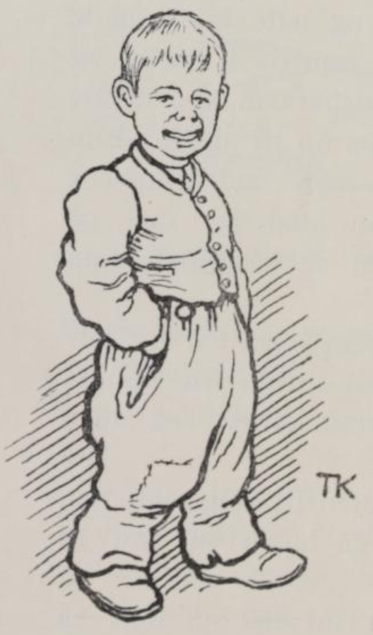
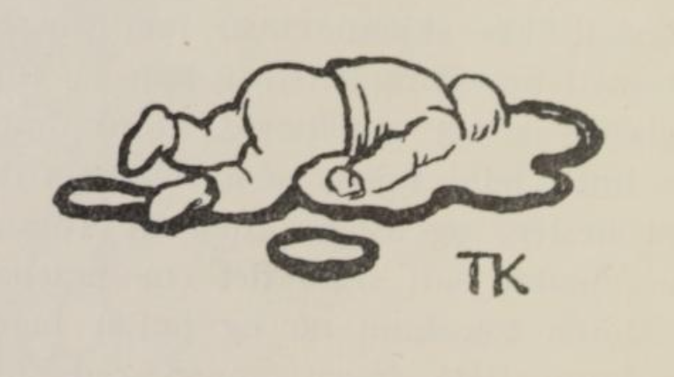

# Tommeliten

Det var en gang en kone som hadde en eneste sønn, og han var ikke lenger enn en tommelfinger; derfor kalte de ham også Tommeliten.

Da han var kommet til skjels år og alder, sa mor hans til ham at han skulle ut å fri: for nå syntes hun det var på tide, han tok til å tenke på å gifte seg. Da Tommeliten hørte det, ble han glad. De fikk i stand kjøregreiene og reiste av garde, og moren satte ham på fanget. Så skulle de reise til en kongsgård, der det var slik en stor prinsesse; men da de hadde kommet et stykke på veien, ble Tommeliten borte. Hun lette lenge etter ham og ropte på ham, og gråt for det han var borte og hun ikke kunne finne ham igjen. «Pip, pip!» sa Tommeliten, han hadde gjemt seg i manen på hesten. Så kom han frem, og så måtte han love at han ikke skulle gjøre det oftere. Da de hadde kjørt et stykke til, så var Tommeliten borte igjen. Moren lette etter ham og ropte og gråt, men borte var han. «Pip, pip!» sa Tommeliten, og hun hørte han lo og kniste, men hun kunne slett ikke finne ham igjen. «Pip, pip, her er jeg da!» sa Tommeliten og kom frem av øret på hesten. Så måtte han love, han ikke skulle gjemme seg oftere. Men da de hadde kjørt et stykke, så var han borte igjen; han kunne ikke dy seg.

Moren hun lette og gråt og ropte på ham; men borte var han og borte ble han, og alt hun lette, kunne hun ikke finne ham på noen vis. «Pip, pip, her er jeg da!» sa Tommeliten. Men hun kunne slett ikke skjønne hvor han var, for det låt så utydelig. Hun lette, og han sa «Pip, her er jeg!» og lo og gottet seg, fordi hun ikke kunne finne ham igjen; men rett som det var, så nøs hesten, og så nøs den ut Tommeliten, for han hadde satt seg i det ene neseboret på den. Moren tok ham og puttet ham i en pose; hun visste ingen annen råd, for hun kunne skjønne han ikke kunne bryte arten.

Da de kom til kongsgården, så ble det snart trolovelse, for prinsessen syntes han var en vakker liten gutt, og det varte ikke lenge før det ble bryllup heller.

Da de skulle til med middagen i bryllupsgården, så satt Tommeliten tilbords ved siden av prinsessen; men han var verre enn ille stelt, for da han skulle til å ete, kunne han ikke nå opp, og han hadde visst ikke fått matbete, hadde ikke prinsessen tatt og hjulpet ham opp på bordet.

Nå gikk det både godt og vel, så lenge han kunne ete av tallerken; men så kom det inn et stort grøtfat, det kunne han ikke nå opp i; men Tommeliten visste råd. Han satte seg på kanten. Men så var det et smørøye midt uti fatet; det kunne han ikke rekke, og så måtte han sette seg utpå kanten av smørøyet; men rett som det var kom prinsessen med en stor skje og skulle dyppe en dyktig grøtbete i smøret, og så kom hun nær Tommeliten, så han dumpet uti og druknet i smørøyet.

