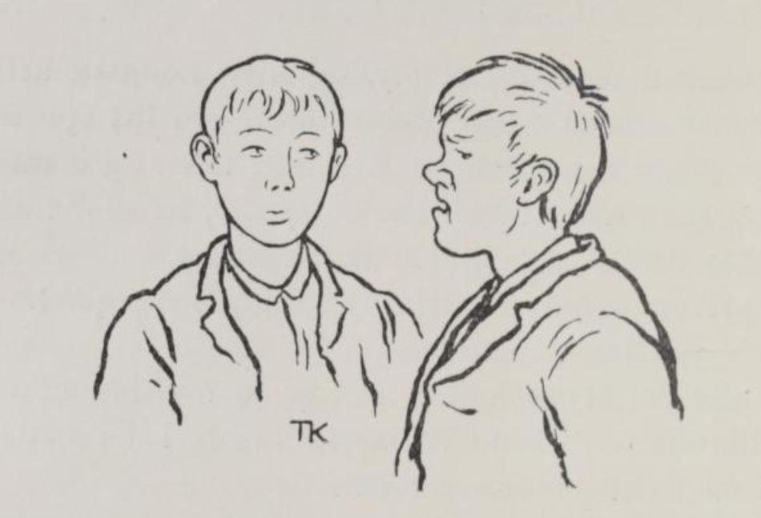
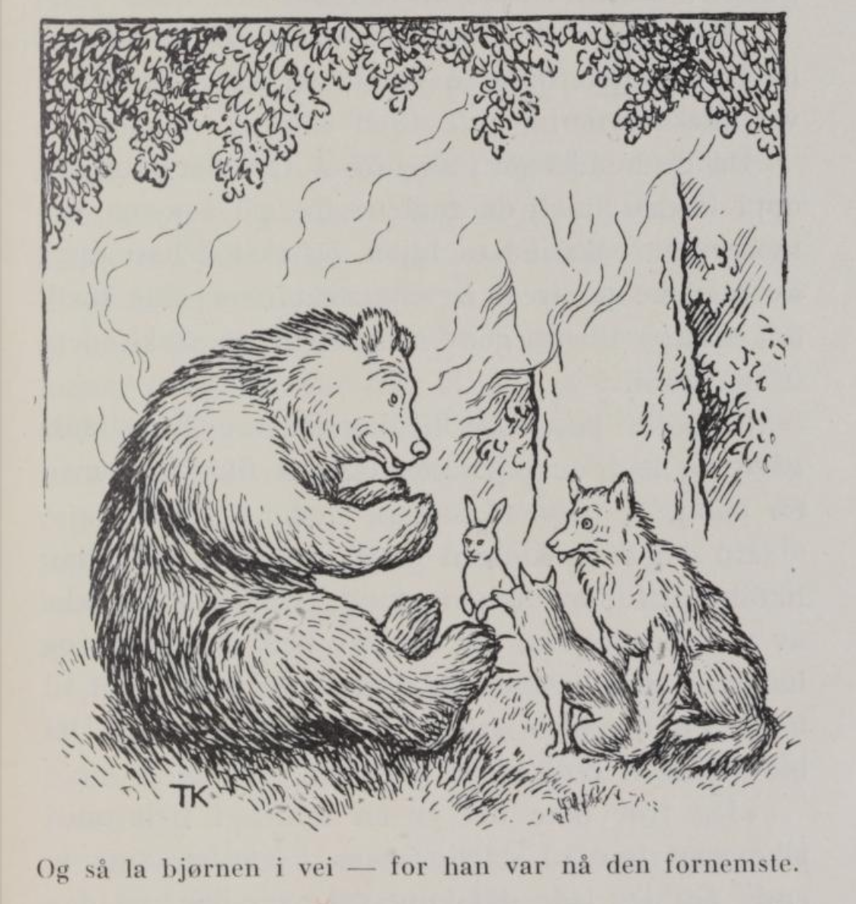
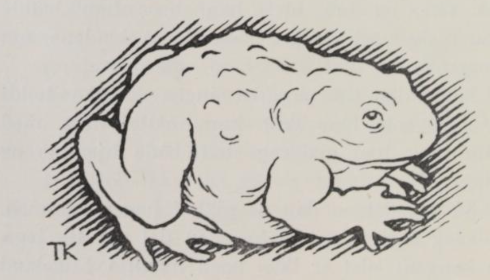

# Tro og Utro

Det var en gang to brødre, den ene het Tro og den andre Utro. Tro var ærlig og god, men Utro var slem og full av løgn, så ingen kunne stole på det han sa. Moren var enke og hadde ikke stort å leve av, og da sønnene var blitt voksne, måtte hun ha dem fra seg, så de selv kunne tjene sitt brød i verden. Hver av dem ga hun ei lita skreppe med mat, og så skulle de i veien.

Da de hadde gått til det ble kveld, satte de seg på et vindfall i skogen og tok frem skreppene sine, for sultne var de etter å ha gått hele dagen, og så syntes de at nå skulle en matbit smake godt.

«Vil du som jeg, eter vi først av skreppa di, så lenge det er noe i den, så kan vi siden ta av mi,» sa Utro. Ja, det var Tro fornøyd med, og så åt de; men alt det beste så Utro til å putte i seg, og Tro fikk bare skorpene, og de brente lefsestykkene og fleskesvorene, han. Om morgenen åt de igjen av maten hans Tro, og om middagen også; men så var det ikke mer i skreppa hans.

Da de så hadde gått til ut på kvelden og skulle til å få seg mat igjen, ville Tro ete av brorens skreppe; men Utro sa nei, og mente at den maten var hans, og at han ikke hadde mer enn han godt trengte til sjøl.

«Ja, men du fikk jo ete av skreppa mi, så lenge det var noe i den,» sa Tro.

«Ja, når du er slik en tosk og lar andre ete opp for deg, kan du ha det så godt,» mente Utro; «nå kan du sitte der og sikle nå,» sa han.

«Å ja, Utro heter du og utro er du, og det har du vært all din tid også,» sa Tro.

Da Utro hørte det, slo han seg sint, røk rett på broren og stakk ut begge øynene på ham.

«Nå kan du se om folk er tro eller utro nå, din blindebukk,» sa han, og dermed strøk han fra ham.

Tro, stakkar, han gikk nå der og trevlet seg fram midt i tykke skogen; blind og alene var han, og ikke visste han hva han skulle ta seg til. Men så fikk han tak i et stort tykt lindetre, og så tenkte han at det fikk han klyve opp i og sette seg der natten over, for villdyrene. «Når fuglene tar på å synge, så er det dag, og så får jeg vel prøve å trevle meg videre fram,» tenkte han, og så kløv han opp i linden.

Da han hadde sittet der en stund, hørte han det kom noen og tok til å koke og stelle nedunder treet, og straks etter kom det flere, og da de hilste på hverandre, hørte han det var bjørnen og gråbeinen, reven og haren, som kom og skulle holde jonsokleik der. De ga seg til å ete og leve godt, og da de var ferdige med det, satte de seg til å snakke sammen.

Så sa reven: «Skal vi ikke fortelle en liten stubb hver, mens vi sitter her?»

Jo, det syntes de andre godt om, det kunne være morosamt, sa de, og så la bjørnen i vei - for han var nå den fornemste -: «Kongen av Engeland har så dårlige øyne,» sa bamsen, «han kan nesten ikke se et kvart i været; men hvis han kom opp i denne linden om morgenen, mens det var dugg på bladene, og han fikk av duggen og smurte på øynene sine, så fikk han synet sitt igjen, så godt som han noen tid har hatt det.»

«Ja,» sa gråbeinen, «kongen av Engeland har en døvstum datter også; men visste han det jeg vet, så fant han snart råd for henne. I fjor da hun gikk til alters, så spyttet hun ut igjen brødet, og det kom ei stor padde og slukte; men hvis de bare grov under gulvet, så fant de padda, hun sitter rett under knefallet, og brødet sitter i halsen på henne enda. Hvis de skar opp padda og tok brødet og ga kongsdatteren, så ble hun som andre folk igjen både til å høre og snakke.»

«Ja, ja,» sa reven, «hvis kongen av Engeland visste det jeg vet, så hadde han ikke vondt for vann i kongsgården sin; under den store steinen midt i gården hans er det klareste kildevann noen kan ønske seg, bare han visste å grave der.»

«Ja,» sa haren, «kongen av Engeland har den vakreste frukthagen i hele landet, men den bærer ikke så mye som en eplekart engang; for det ligger en svær gullkjede tre ganger rundt om hagen. Fikk han gravd opp den, så ble det den gildeste hagen i hele hans rike.»

«Men nå er det langt på natta, og vi får nok gå hjem igjen nå,» sa reven, og så gikk de sin vei allesammen.

Da de hadde gått, så sovnet Tro, der han satt oppi linden; men da fuglene tok på å synge om morgenen, våknet han igjen, og så tok han dugg av bladene på treet og smurte øynene sine med; da så han like godt som før Utro stakk dem ut på ham.

Så gikk han rett til kongen av Engelands gård og ba om tjeneste, og det fikk han med en gang.

En dag kom kongen ut på gården, og da han hadde gått der ute en stund, ville han drikke av vannposten sin, for det var hett om dagen og han var blitt tørst; men da de øste opp vannet til ham, var det både grumset og seigt og stygt. Det ble kongen rent harm over.

«Jeg tror ikke det er en mann i hele mitt rike som har så dårlig vann i gården sin, og enda må jeg lede det lang vei over berg og daler!» sa kongen.

«Ja, men hvis du ville la meg få folk til å bryte opp den store steinen som ligger her midt på gården, skulle du nok få både mye og godt vann,» sa Tro.

Ja, det var kongen straks med på, og aldri før hadde de fått opp steinen og gravd en stund, så sto vannspruten rett til værs, så klar og kvikk som om den kom av en tønnetut; og klarere vann fantes ikke i hele Engeland.

En tid etter var kongen nedpå gården igjen; så kom det en stor hauk flyvende etter hønsene hans, og alle til å klappe i hendene og skrike: «Der flyger'n! Der flyger'n!» Kongen grep bøssa si og la til å sikte; men han kunne ikke se så langt. Så ble han rent ute av det. «Gud gi noen kunne si meg råd for øynene mine! Jeg mener snart jeg blir rent blind,» sa kongen. «Det skal nok jeg si deg,» sa Tro, og så fortalte han hvordan han hadde båret seg ad; og kongen reiste da til linden, samme kvelden, det kan du nok vite, og bra ble han så snart han hadde smurt seg med duggen som lå på bladene om morgenen.

Siden den tid var det ingen kongen holdt så gjæv som han Tro; han måtte være med ham hvor han gikk og sto, både hjemme og borte.

Så var det en dag de gikk i hagen sammen. «Jeg skjønner ikke hvordan det går til, jeg,» sa kongen; «det er ikke noen mann i Engeland som koster så mye på hagen sin som jeg, og enda kan jeg ikke få et eneste tre til å bære så mye som en kart.»

«Ja, ja,» sa Tro, «får jeg bare det som ligger tre ganger rundt om hagen din, og folk til å grave det opp, så skal nok hagen bære.»

Ja, det ville kongen gjerne; Tro fikk folkene, og til å grave, og så fikk han til sist opp hele gullkjeden. Nå var Tro en grunnrik mann, mye, mye rikere enn kongen sjøl, men kongen var likevel godt fornøyd, for nå bar hagen, så grenene hang like ned på bakken, og så søte epler og pærer hadde aldri noen smakt.

En dag igjen gikk Tro og kongen og snakket sammen; så kom kongsdatteren gående forbi dem, og kongen ble helt bedrøvet da han så henne.

«Er det ikke synd at så vakker en kongsdatter som min skal mangle mål og mæle?» sa han til Tro.

«Ja, men det er råd for det,» sa Tro.

Da kongen fikk høre det, ble han så glad at han lovet ham kongsdatteren og halve riket, hvis han kunne gjøre henne frisk igjen.

Tro fikk med seg et par mann bort til kirken og grov frem padda som satt under knefallet ved alteret, skar henne opp og tok ut brødet og ga kongsdatteren det, så ble hun som andre folk igjen til å snakke straks på timen.

Nå skulle da Tro ha kongsdatteren, og det ble laget til bryllup, for det skulle holdes så det både kunne høres og spørres over hele riket.

Mens de så holdt på å danse i bryllupet, kom det en fattiggutt og ba om en matbit, og han var så fillete og ynkelig å se på, at alle forkorset seg over ham; men Tro kjente ham igjen med en gang, og så at det var Utro, bror sin.

«Kjenner du igjen meg?» sa Tro.

«Å, hvor skulle jeg ha sett så stor en herre, jeg da?» sa Utro.

«Sett meg har du nok likevel,» sa Tro; «det var meg du stakk øynene ut på, et år i dag siden. Utro heter du og utro er du, det sa jeg og det sier jeg enda; men du er nå bror min likevel, og derfor skal du få litt mat, og så kan du gå til det lindetreet, der jeg satt i fjor. Får du så høre noe som kan gjøre lykken din, så er det deg vel unt.»

Ja, det slapp han si Utro to ganger. «Har han Tro hatt slik nytte av å sitte i lindetreet, at han er blitt konge over halve Engeland siden i fjor, så —,» tenkte han; han la i veien og kom til linden, og den kløv han opp i.

Han hadde ikke sittet der lenge, så kom alle dyrene og åt og drakk og holdt jonsokleik ned under treet igjen. Da de hadde spist seg mette, ville reven at de skulle til å fortelle historier, og da kan det vel hende han Utro la seg til å lytte, og det så ørene var ferdige til å dette av ham. Men bjørnen var sint han og brummet og sa: «Det har noen sladret om det vi fortalte i fjor, og derfor vil vi nå tie med det vi vet.» Og så sa dyrene god natt og gikk fra hverandre, og Utro var like klok.

Det var for det han het Utro og var utro, det.
