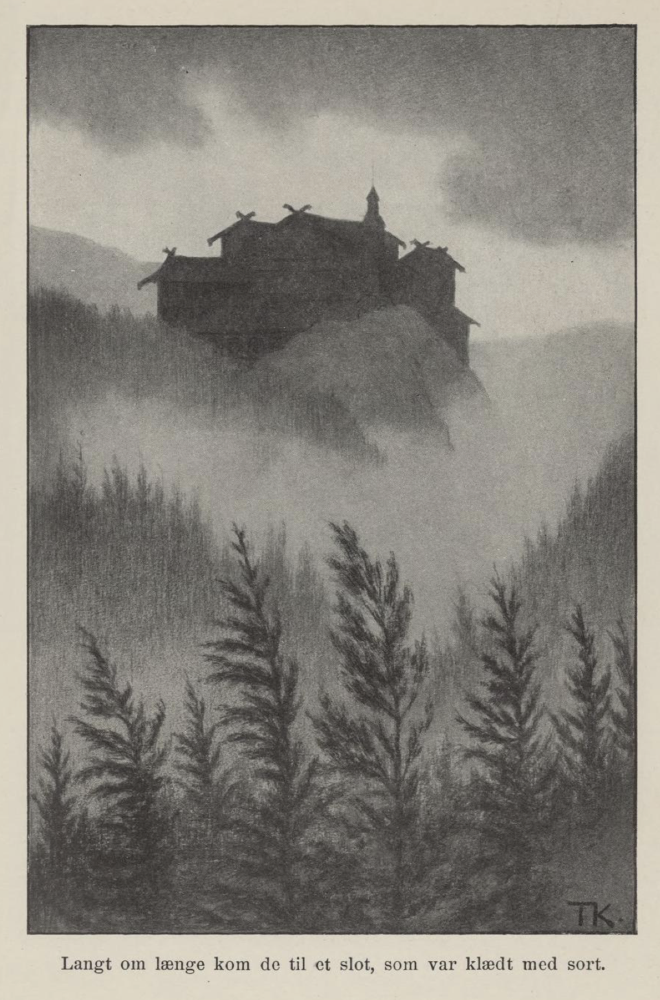
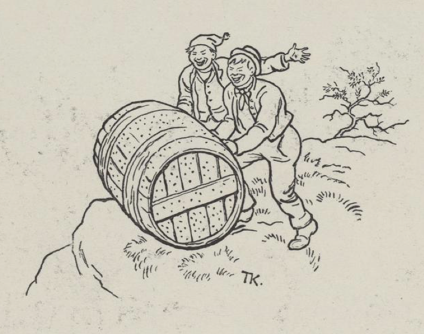

# Den grønne ridder

Det var en gang en konge som var enkemann, og han hadde en eneste datter. Men det er et gammelt ord at enkemanns sorg er som albuestøt: den gjør vondt, men den går snart over; og så giftet han seg med en dronning som hadde to døtre. Og denne dronninga, hun var ikke bedre enn stemødre pleier å være; slem og troll var hun alltid mot steddatteren.

Langt om lenge, da disse prinsessene var voksne, ble det krig, og kongen skulle ut og slåss for land og rike. De tre døtrene skulle få lov å si hva kongen skulle kjøpe og ta med hjem til dem, hvis han vant over fienden. Steddøtrene skulle nå si fra først hva de ønsket seg, må vite. Jo, den første ba om en gullrokk, så stor at den kunne stå på en sølvotteskilling, og den andre ba om et gullhespetre, så stort at det kunne stå på en sølvotteskilling. Det ville de ha; og det var nå verken for vindinga eller for spinninga til noen av dem. Men hans egen datter, hun ville ikke be om noen annen ting enn at han skulle hilse den grønne ridder. Kongen dro ut i krigen, og hvordan det nå gikk, så vant han, og hvordan det nå bar til, så kjøpte han det han hadde lovet steddøtrene; det hans egen datter hadde bedt ham om, hadde han glemt helt bort. Men så holdt han et gjestebud, fordi han hadde vunnet. Der fikk han se den grønne ridder; så kom han på det og hilste ham fra sin egen datter. Ridderen takket ham for hilsenen og ga ham en bok som så ut som en salmebok med spenner på permen. Den skulle kongen ta med og gi henne; men han måtte ikke åpne den, og ikke hun heller, før hun var alene. Da kongen var ferdig med krigen og gjestebudene, kom han hjem igjen, og han var nesten ikke kommet innenfor døra før steddøtrene flokket seg om ham og maste etter det han hadde lovet å kjøpe til dem. Ja, han hadde det. Men hans egen datter, hun holdt seg tilbake og spurte ikke etter noen ting, og kongen kom ikke på det han heller, før han en gang skulle gå ut; da tok han på seg den kjolen han hadde hatt i gjestebudet, og med det samme han stakk hånden ned i lomma etter lommetørkleet, kjente han boka. Så ga han henne den og sa at han skulle hilse, den var fra den grønne ridder, og hun måtte ikke åpne den før hun var alene.

Om kvelden, da hun var for seg selv på kammerset sitt, åpnet hun boka, og med det samme hørte hun først en slått, så deilig at hun aldri hadde hørt maken, og så kom den grønne ridder. Han sa at boka var slik at når hun åpnet den, kom han til henne, uansett hvor hun var, og når hun lukket den igjen, var han borte med det samme.

Ja, hun åpnet boka ofte om kvelden, når hun var alene og i ro, og ridderen kom alltid til henne og var der så ofte han kunne. Men stemora hadde nesen sin i alt; hun skjønte at det var noen inne hos henne, og hun var ikke sen om å si det til kongen. Han ville ikke tro det; de fikk da se etter først om det var slik, sa han, før de kom med slikt og anklaget henne for det. En kveld sto de utenfor døra og lyttet, og de syntes tydelig at noen snakket der inne. Da de kom inn, var det ingen der. «Hvem var det du snakket med?» spurte stemora både hardt og hvast. «Det var ingen, det,» sa kongsdatteren. «Jo, jeg hørte det jo tydelig,» sa hun. — «Jeg lå bare og leste i en bønnebok.» — «Vis meg den,» sa dronninga. — Ja, det var ikke annet enn en bønnebok, og den måtte hun vel ha lov å lese i, sa kongen. Men stemora trodde det samme som før, og så boret hun et hull i veggen og lurte der. En kveld hørte hun at ridderen var der, rev døra opp og fór som en vind inn til steddatteren; men hun var ikke sen om å lukke boka, hun heller, så han ble borte i en fart. Men så rask hun enn hadde vært, så fikk stemora et glimt av ham, så hun var sikker på at noen hadde vært der.

Så skulle kongen ut på en lang, lang reise; i mellomtida fikk dronninga gravd et dypt hull ned i jorda; der muret de opp et hus; men i muren lot hun dem legge rottegift og annen sterk gift, så det ikke skulle komme inn så mye som en mus engang. Murmesteren fikk god betaling og lovet at han skulle reise ut av landet; men det gjorde han ikke, han ble der han var, han. Der ble kongsdatteren satt ned sammen med tjenestejenta si, og så muret de igjen gangen, så det bare var et lite hull oppe, som de kunne sende mat ned til henne gjennom. Her satt hun og sørget, og tida falt lang og lenger enn lang. Så kom hun på at hun hadde boka med seg, tok den og åpnet den. Først hørte hun den samme deilige slåtten hun hadde hørt før, og siden en ynkelig jammer og klage, og rett som det var, kom den grønne ridder. «Jeg er nesten død nå,» sa han, og fortalte at stemora hadde lagt gift i muren, og han visste ikke om han kunne komme ut igjen med livet. Da hun så måtte lukke boka, hørte hun den samme jammeren og klagen.

Men terna som var hos henne, hadde en kjæreste, og ham fikk hun sendt bud til om at han skulle gå til murmesteren og be ham gjøre hullet så stort at de kunne krype opp gjennom det; kongsdatteren skulle betale ham så godt at han skulle ha nok for resten av livet. Ja, han gjorde det; de slapp ut og reiste langt, langt bort i fremmede land, både hun og terna, og hvor de kom, spurte de etter den grønne ridder. Langt om lenge kom de til et slott som var kledd i svart, og med det samme de skulle gå forbi der, kom det et voldsomt regnskyll over dem; så gikk kongsdatteren inn under kirkesvalen og ville stå der til regnbyga var over.

Som de sto der, kom en ung mann og en gammel mann, som også ville søke ly for regnet; men prinsessen trakk seg lenger inn i kroken, så de ikke fikk se henne.

«Hva kommer det av at denne kongsgården er kledd i svart?» sa den unge. «Vet du ikke det?» sa gamlingen, «prinsen her er dødssyk, han som de kalte den grønne ridder;» og så fortalte han hvordan det hadde gått til. Da den unge hadde hørt hvordan han hadde fått det, spurte han om det ikke var noen som kunne gjøre ham frisk igjen. «Nei, det er ikke mer enn ett råd,» sa han, «og det er hvis den jomfrua som satt i huset under jorda, kom hit og plukket legeurter på marka, kokte dem i søt melk og vasket ham med det tre ganger,» og så regnet han opp hva slags urter som skulle til for at han skulle bli frisk. Dette hørte hun, og hun hørte godt etter også. Da regnet var over, gikk de to, og hun ventet ikke lenge, hun heller. Da de kom hjem dit hvor de bodde, måtte de ut og hente alle slags urter på mark og i skog, både hun og terna, og de plukket og sanket sent og tidlig av alle dem hun skulle ha og koke. Så kjøpte hun seg en doktorhatt og en doktorkjole, gikk opp til kongen og tilbød seg å gjøre prinsen frisk igjen.

Nei, det kunne ikke nytte, sa kongen; det hadde vært så mange der og prøvd, men det var alltid blitt verre og ikke bedre. Hun ga seg ikke, men lovet sikkert at han skulle bli frisk, og det både fort og vel. Ja, så skulle hun få lov å prøve da, og hun kom inn til den grønne ridder og vasket ham første gang. Da hun kom igjen den andre dagen, var han så bra at han kunne sitte i senga; den neste dagen var han kar til å gå i rommet, og den tredje dagen var han så frisk som en fisk i vannet. Han skulle ut på jakt, sa doktoren. Nå ble kongen så glad i doktoren som fuglen i den lyse dagen. Men doktoren ville hjem. Da kastet hun kjolen og hatten, pyntet seg og laget i stand et måltid, og så åpnet hun boka. Det var den samme gledesslåtten som før, og med det samme kom den grønne ridder. Han undret seg over hvordan hun var kommet dit. Men så fortalte hun hvordan alt hadde gått til, og da de hadde spist og drukket, tok han henne med helt opp på slottet og fortalte kongen hvordan det hadde gått til fra først til sist.

Så ble det bryllup og bryllupsfest, og da de var ferdige med det, reiste de hjem. Da ble faren hennes svært glad. Men stemora tok de og trillet i en spikertønne.

