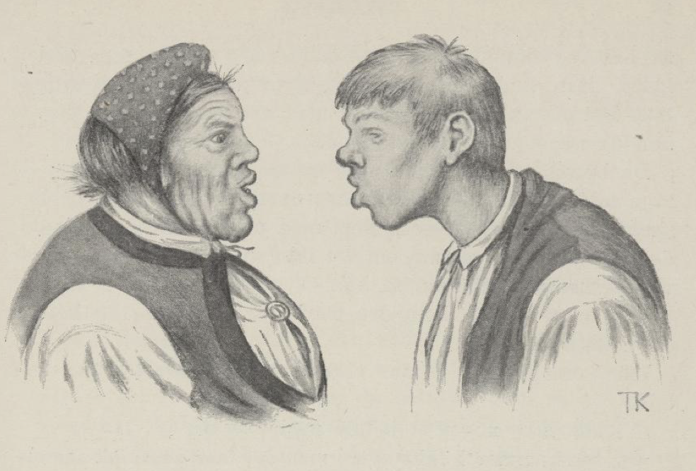
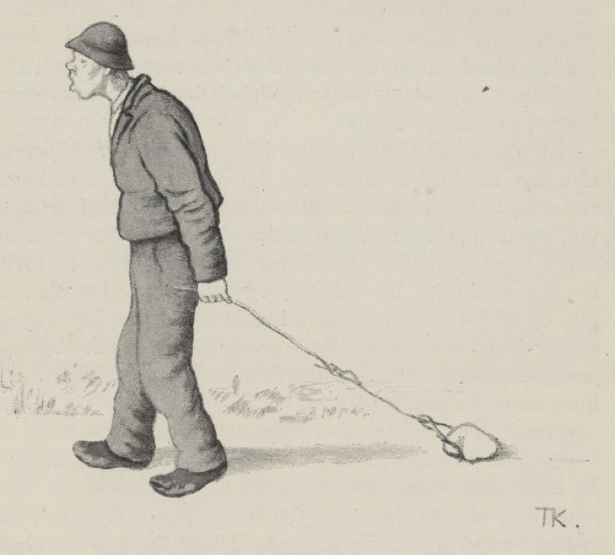
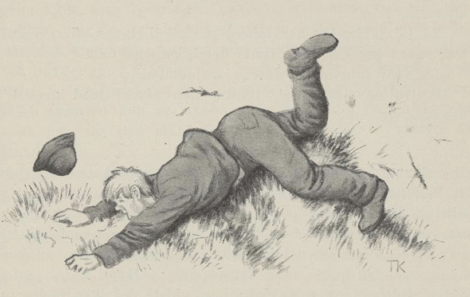
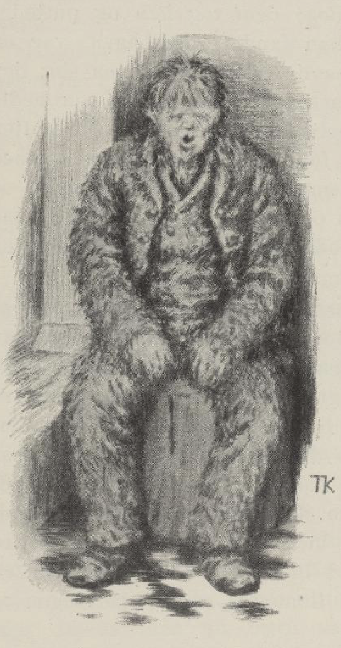
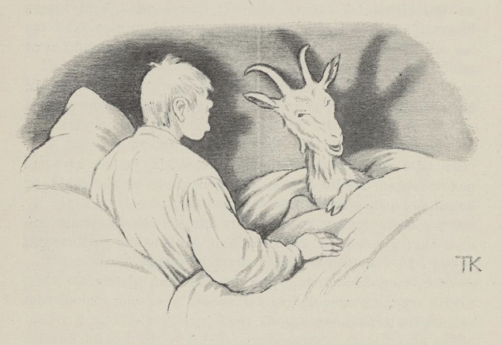

# Gale-Mattis

Det var en gang ei kjerring som hadde en sønn som het Mattis. Men han var så tullete at han ikke hadde forstand på noen ting; ikke tok han seg stort til heller, men det lille han gjorde, ble alltid bakvendt og aldri riktig; derfor kalte de ham aldri annet enn Gale-Mattis.

Dette syntes kjerringa var ille, og enda verre syntes hun det var at sønnen gikk der og aldri tok seg annet til enn å drive langs veggene.

Tett ved der de bodde, rant en stor elv, og den var stri og vanskelig å komme over. Så sa kjerringa en dag til gutten at det ikke var vondt om tømmerskog der, den vokste nesten helt inntil stueveggen; han fikk hugge, kjøre fram og prøve å bygge bro over elva og ta toll, så hadde han både noe å gjøre og noe å leve av også.

Ja, det syntes Mattis også; for mor hans hadde sagt det; det hun ba ham om, det skulle han gjøre, det var visst, sa han, og det hun sa, det skulle være slik og ikke annerledes. Han hogg tømmer og kjørte det fram og bygde bro. Det gikk ikke fælt fort med arbeidet, men så hadde han da noe å ta seg til mens det sto på.

Da broen var ferdig, skulle gutten stå nede ved den og ta toll av dem som ville over, og mor hans sa at han ikke skulle slippe noen over med mindre de betalte toll; det fikk være det samme om det ikke alltid var penger; varer var også god betaling, sa hun.

Den første dagen kom det tre karer med hvert sitt høylass og ville over broen.

«Nei,» sa gutten, «dere får ikke kjøre over før jeg har fått toll.»

«Vi har ikke noe å betale med,» sa de.

«Ja, så kommer dere ikke over; men det får være det samme om det ikke er penger; varer er også god betaling,» sa gutten.

Så ga de ham hver en dott høy, så han fikk et lite kjelkelass; så fikk de lov å kjøre over broen.

Så kom det en skreppekremmer, som hadde synåler og tråd og annet skreppegods, og ville over.

«Du får ikke gå over før du har betalt toll,» sa gutten.

«Jeg har ikke noe å betale med,» sa kremmeren.

«Du har vel varer?» sa gutten.

Så tok kremmeren fram et par synåler og ga ham; så fikk han gå over broen. Gutten stakk nålene inn i høyet, og så dro han hjem. Da han vel var kommet hjem, sa han: «Nå har jeg fått toll og noe å leve av!»

«Hva fikk du da?» sa kjerringa.

«Å, det kom kjørende tre karer med hvert sitt høylass; de ga meg en høydott hver, så jeg fikk et lite kjelkelass; og så fikk jeg et par synåler av en skreppekremmer,» sa gutten.

«Hvor gjorde du av høyet?» sa kjerringa.

«Jeg tygde på det, jeg; men det smakte bare gress, så kastet jeg det i elva,» sa gutten.

«Det skulle du ha bredt ut over låvegulvet,» sa kjerringa.

«Det skal jeg gjøre en annen gang, det, mor,» sa gutten.

«Hvor gjorde du av synålene da?» sa kjerringa.

«Jeg stakk dem i høyet,» sa gutten.

«Å, du er en tulling!» sa kjerringa; «du skulle ha stukket dem ut og inn i lua di.»

«Ja, ti stille, du mor, det skal jeg gjøre en annen gang,» sa gutten.

Neste dag, da gutten var nede ved broen igjen, kom det en mann fra kverna med en melkløv og ville over.

«Du kommer ikke over før du betaler toll,» sa gutten.

«Jeg har ikke skillinger å betale med,» sa mannen.

«Ja, så kommer du ikke over,» sa gutten; «men varer er god betaling,» sa han. Så fikk han et pund mel, og så slapp han mannen over.

Det var ikke lenge før det kom en smed med en kløv smedarbeid og ville over. Men det var det samme.

«Du får ikke komme over før du betaler toll,» sa gutten. Men han hadde heller ikke penger å betale med, så ga han gutten en navar, og så slapp han over.

Da gutten kom hjem til mor si, var tollen det første hun spurte om. «Hva fikk du i toll i dag?» sa hun.

«Å, det kom en mann fra kverna med en melkløv, han ga meg et pund mel, og så kom det en smed med en kløv smedarbeid, han ga meg en navar,» sa gutten.

«Hva gjorde du med navaren da?» sa kjerringa.

«Jeg gjorde som du ba meg, jeg, mor,» sa gutten; «jeg stakk den ut og inn i lua mi.»

«Ja, men det er galt, det,» sa kjerringa; «den skulle du ikke ha stukket ut og inn i lua di, men du skulle ha stukket den inn i trøyeermet ditt.»

«Ja, ja, ti stille, du mor, det skal jeg gjøre en annen gang,» sa gutten.

«Hva gjorde du med melet da?» sa kjerringa.

«Å, jeg gjorde som du ba meg, jeg, mor,» sa gutten; «jeg bredde det ut over låvegulvet.»

«Jeg har aldri hørt så galt!» sa kjerringa; «du skulle ha gått hjem etter et spann og hatt det i,» sa hun.

«Ja, ti stille, du mor, det skal jeg gjøre en annen gang,» sa gutten.

Dagen etter var gutten ved broen igjen og skulle ta toll. Så kom det en med en brennevinskløv og ville over.

«Du kommer ikke over før du betaler toll,» sa gutten.

«Jeg har ikke skillinger,» sa kløvkaren.

«Ja, så får du ikke komme over; men du har vel varer?» sa gutten. Ja, så fikk han en halv pott brennevin, og den helte han i trøyeermet sitt.

En stund etter kom det en med en geiteflokk og ville over broen.

«Du kommer ikke over før du betaler toll,» sa gutten.

Ja, han var ikke rikere enn de andre; han hadde ingen penger; men så ga han gutten en liten geitebukk, og så kom han over med flokken sin. Men gutten tok bukken og tråkket den ned i et spann han hadde tatt med. Da han kom hjem, spurte kjerringa igjen:

«Hva fikk du i dag?»

«Å, det kom en med en brennevinskløv; av ham fikk jeg en halv pott brennevin,» sa gutten.

«Hva gjorde du med det?» sa kjerringa.

«Å, jeg gjorde som du ba meg, jeg, mor,» sa gutten; «jeg helte det i trøyeermet mitt.»

«Ja, men det var galt, det, sønnen min; du skulle ha gått hjem etter en flaske og helt det i,» sa hun.

«Ja, ti stille, du mor, det skal jeg gjøre en annen gang, det,» sa gutten. «Så kom det en mann med en geiteflokk, han ga meg en liten geitebukk, og den tråkket jeg ned i spannet,» sa han.

«Det var galt, og galere enn galt, det, sønnen min,» sa kjerringa; «du skulle ha bundet en vidje på den og leid bukken hjem med,» sa mor hans.

«Ja, ti stille, du mor, det skal jeg gjøre en annen gang,» sa gutten.

Neste dag la han ned til broen igjen og skulle ta toll. Så kom det en mann med en smørkløv og ville over broen. Men gutten sa at han ikke fikk komme over før han betalte toll.

«Jeg har ikke noe å betale med,» sa mannen.

«Ja, så får du ikke komme over,» sa gutten; «men har du varer, kan jeg ta dem som god betaling,» sa han.

Så ga mannen ham et smørstykke, da fikk han lov til å kjøre over broen, og gutten strøk av sted til vidjeskogen, vred en vidje, satte den på smørstykket og dro det hjem etter veien; men hvor han gikk, ble det liggende igjen noe av smøret, og da han kom hjem, hadde han ikke noe igjen.

«Hva fikk du i dag?» sa mor hans.

«Det kom en mann med en smørkløv, han ga meg et stykke smør,» sa gutten.

«Hvor har du det da?» spurte kjerringa.

«Jeg gjorde som du ba meg, jeg, mor,» sa gutten, «jeg bandt en vidje på smøret og leide det hjem; men det ble borte på veien,» sa han.

«Å, du er en tulling, og du blir en tulling!» sa kjerringa. «Nå har du jo ikke noe for alt strevet; men hadde du vært som andre folk, kunne du ha hatt både mat og brennevin, både høy og redskap. Er du ikke god for å stelle deg bedre, vet jeg ikke hva jeg skal gjøre med deg. Kanskje du kunne bli bedre og få litt vett om du ble gift og fikk et menneske som kunne stelle for deg; jeg mener det er best du legger i vei og ser til å finne deg en bra jente. Men så må du oppføre deg pent på veien og hilse når du treffer folk.»

«Hva skal jeg si da?» spurte gutten.

«Skal du spørre om det?» sa moren. «Guds fred! skal du si, må vite.»

«Ja, jeg skal gjøre som du sier, jeg,» sa gutten, og så la han i vei og skulle gå på frieri. Da han var kommet et stykke på veien, møtte han en gråbein med syv unger, og da han kom så langt fram at han var ved siden av den, stanset han og hilste: «Guds fred!» Da han hadde sagt det, gikk han hjem igjen. «Jeg sa som du ba meg, jeg, mor,» sa gutten.

«Hva sa du da?» spurte moren.

«Guds fred! sa jeg,» sa gutten.

«Hvem møtte du da?» spurte moren.

«Jeg møtte en skrubb med syv unger, jeg,» sa gutten.

«Ja, du er lik deg selv, du!» sa moren. «Hvorfor skulle du si Guds fred til skrubben? Du skulle ha klappet hendene sammen og sagt: 'Husj! husj! di skrubbe!' skulle du ha sagt.»

«Ja, ti stille, du mor, det skal jeg si en annen gang, det,» sa gutten og strøk av gårde, og da han var kommet et stykke på veien, møtte han et brudefølge. Så stanset han, da han var kommet midt for bruden og brudgommen, slo hendene sammen og sa: «Husj! husj! di skrubbe!»

Så gikk han hjem til mor si. «Jeg gjorde som du ba meg, jeg, mor,» sa gutten; «men juling fikk jeg for det,» sa han.

«Hva gjorde du da?» spurte kjerringa.

«Jeg slo hendene sammen og sa: 'Husj! husj! di skrubbe!' jeg,» sa gutten.

«Hvem møtte du da?» sa kjerringa.

«Jeg møtte en brudeferd,» sa gutten.

«Å, du er en tulling; du blir lik deg selv!» sa moren. «Hvorfor skulle du si slik til brudeferden? 'Ri lystig, brud og brudgom!' skulle du ha sagt,» sa kjerringa.

«Ja, ti stille, du mor, det skal jeg si en annen gang,» sa gutten og la i vei igjen. Så møtte han en bjørn som red på en hest. Gutten ventet til han kom ved siden av dem. «Ri lystig, brud og brudgom!» sa han, og så gikk han hjem igjen og fortalte at han hadde sagt det som mor hans ba ham.

«Hva sa du da?» spurte mor hans.

«Ri lystig, brud og brudgom! sa jeg,» svarte gutten.

«Hvem møtte du da?» spurte mor hans.

«Jeg møtte en bjørn som red på en hest,» sa gutten.

«Kors, for en tulling du er!» sa moren. «Til helvete med deg! skulle du ha sagt,» sa hun.

«Ja, ti stille, du mor, det skal jeg gjøre en annen gang,» sa gutten.

Så la han av sted igjen og møtte et likfølge; da han kom midt for liket, hilste han og sa: «Til helvete med deg!» Så la han hjem til mor si og fortalte at han hadde sagt som hun ba ham.

«Hva sa du da?» spurte kjerringa.

«Til helvete med deg! sa jeg,» svarte gutten.

«Hvem møtte du da?» spurte mor hans.

«Jeg møtte et likfølge,» sa gutten; «men juling fikk jeg,» sa han.

«Ja, det skulle du ha fått mer av,» sa kjerringa; «Gud være din arme sjel nådig! skulle du ha sagt,» sa hun.

«Ja, ti stille, du mor, det skal jeg gjøre en annen gang, det,» sa gutten, og så strøk han av sted igjen. Da han kom et stykke på veien, fikk han se et par stygge landstrykere som flådde en bikkje. Da han kom fram til dem, hilste han og sa: «Gud være din arme sjel nådig!» og da han hadde sagt det, gikk han hjem igjen og fortalte at han hadde sagt det mor hans ba ham; men juling fikk han, så han nesten ikke orket å slepe seg hjem.

«Hva sa du da?» spurte kjerringa.

«Gud være din arme sjel nådig! sa jeg,» svarte gutten.

«Hvem møtte du?» spurte mor hans.

«Det var et par landstrykere som flådde en bikkje,» sa gutten.

«Ja, du blir lik deg selv, du!» sa kjerringa. «Det er både synd og skam slik du farer fram. En skulle aldri ha hørt slik styggedom,» sa hun. «Men nå får du dra i vei en gang til og ikke bry deg om hvem du møter, for du må bort og gifte deg og se om du kan få ei som skjønner seg bedre på verdens gang og er klokere til å styre enn du. Men nå får du oppføre deg som folk, og går det bra, får du ønske til lykke og rope hurra,» sa hun.

Ja, gutten gjorde alt det mor hans ba ham om. Han la i vei og fridde til en jente, og hun syntes at gutten ikke kunne være så ille likevel, og så sa hun ja, hun ville ha ham.

Da gutten kom hjem, ville kjerringa vite hva jenta hans het. Men det visste han ikke. Så ble kjerringa sint og sa at han fikk gå i vei igjen; for nå ville hun vite hva jenta hans het. Med det samme gutten skulle gå hjem igjen, kom han så mye til sans at han spurte hva hun het. Jo, hun het «Sølvi», sa hun. Gutten sprang og mumlet ved seg selv:

> «Sølvi, Sølvi,  
> tausa mi!  
> Sølvi, Sølvi,  
> tausa mi!»

Men rett som han sprang så fort for å komme hjem før han hadde glemt det, stupte han over en tue, og så glemte han navnet igjen. Da han kom på beina, begynte han å lete rundt omkring tua, men han fant ikke annet enn et grev. Det tok han og begynte å grave og lete alt han orket. Som han sto der og grov, kom det en gammel mann.

«Hva er det du graver etter?» sa mannen. «Har du mistet noe her?»

«Å ja, å ja, jeg har mistet navnet til tausa mi,» sa gutten; «men jeg kan ikke finne det igjen,» sa han.

«Jeg tror hun heter Sølvi,» sa mannen.

Da gutten hørte det, sprang han av sted med grevet i hånden og ropte:

> «Sølvi, Sølvi,  
> tausa mi!»

Men da han var kommet et stykke bort på jordet, kom han på at han hadde tatt grevet med seg, og så kastet han det tilbake, rett i foten på mannen. Mannen begynte å skrike og bære seg som om det satt en kniv i ham, og så glemte gutten navnet og løp hjem så fort han kunne, og da han kom hjem, var det første mor hans spurte: «Hva heter jenta di?» Gutten var like klok; han visste det ikke bedre nå enn den første gangen.

«Du er den samme storetullingen, du,» sa kjerringa. «Du kommer nok ingen vei med dette heller, du. Men nå får jeg selv dra i vei og hente jenta di hit hjem og få deg gift. Imens får du bære vann på femte veggen[^1], og så får du ta noe av bust og noe av bog[^2], og det grønneste i kålhagen får du ta, og koke alt, og når du har gjort det, får du fjære deg godt opp, så du er en søt gutt til jenta di kommer, og så kan du sette deg på stabben.»

Ja, det mente gutten at han nok skulle gjøre; han bar vann og helte inn i stua, så det hadde skikk; men han kunne ikke få det til å stå høyere enn til det fjerde bjelkelaget; når det kom høyere, rant det ut. Så måtte han holde opp med det. Men nå hadde de en hund som het Bust, og en katt som het Bog; dem tok han og puttet i suppegryta. Det grønneste han fant i kålhagen, var en grønn kjole som kjerringa hadde tiltenkt sønnekona si; den hakket han fin og hadde i suppa; men grisen, som het Alt, den kokte han for seg selv i bryggepanna. Da gutten vel var ferdig med det, fant han seg en krukke med sirup og en fjærdyne; først smurte han seg inn med sirupen, og siden sprettet han opp dyna og veltet seg i fjærene, og så satte han seg på stabben ute i kjøkkenet til moren og jenta kom.

Det første kjerringa savnet da hun kom til gårds, var hunden, for den pleide alltid å møte henne på jordet. Det neste hun savnet, var katten, for den møtte henne alltid i svalgangen, og når det var riktig godt vær og solskinn, kom den ut på tunet og møtte henne ved grinda. Den grønne kjolen hun hadde tiltenkt sønnekona si, så hun heller ikke, og grisen, som gryntet og fulgte henne hvor hun gikk, var ikke der, den heller. Så skulle hun til å spørre om det; men i det samme hun lettet på klinken, fosset vannet ut gjennom døra som en foss, så de nær hadde blitt borte i flommen, både kjerringa og jenta.

De måtte gå rundt til kjøkkendøra, og da de kom inn, satt denne oppfjærede skikkelsen der.

«Hva er det du har gjort?» sa kjerringa.

«Jeg gjorde som du ba meg, jeg, mor,» sa gutten; «jeg bar vann på femte veggen; men like fort som jeg bar inn, rant det ut, så jeg ikke fikk det høyere enn til den fjerde.»

«Ja, men Bust og Bog da?» sa kjerringa og ville slå det bort med noe annet, «hvor har du gjort av dem?» sa hun.

«Jeg gjorde som du ba meg, jeg, mor,» sa gutten, «jeg tok og la dem i suppegryta. De både skrek og de bar seg, og de bet og de klorte, og han Bust var sterk og sparket imot, men han måtte oppi til slutt likevel, og Alt, han koker i bryggepanna i storhuset, for til ham var det ikke plass i suppegryta!» sa han.

«Men hva har du gjort med den nye grønne kjolen jeg hadde tiltenkt sønnekona mi?» sa kjerringa og ville slå bort galskapen hans.

«Å, jeg gjorde som du ba meg, jeg, mor,» sa gutten. «Den hang i kålhagen, og den var det grønneste som var der, så tok jeg den og hakket den smått og hadde den i suppegryta.»

Kjerringa bort til peisen, rev gryta av, helte ut alt sammen og fikk på ei ny. Men da hun fikk se på gutten, ble hun helt skremt.

«Hvordan er det du ser ut da?» sa hun.

«Jeg gjorde som du ba meg, jeg, mor,» sa gutten; «først smurte jeg meg inn med sirup og gjorde meg søt, og siden sprettet jeg opp dyna og fjæret meg godt opp,» sa han.

Ja, kjerringa slo det bort så godt hun kunne, fikk plukket fjærene av gutten, vasket ham og fikk klær på ham igjen.

Så skulle de ha bryllup; men først skulle Mattis gå til byen og selge en ku og kjøpe inn til bryllupet for pengene. Kjerringa sa til ham hvordan han skulle bære seg at, og både det første og det siste var at han endelig måtte se til å få noe for kua. Ja, gutten mente nok at han skulle få noe for den. Da han kom på torget med kua, og de spurte hva han skulle ha for den, var det ikke annet svar å få av ham enn at han skulle ha «noe» for den.

Så kom det en slakter, og han ba ham ta kua og bli med hjem, så skulle han få «noe» for den. Ja, gutten tok med kua, og da han kom fram, spyttet slakteren i neven på gutten og sa: «Der har du noe for kua di, men pass godt på det!»

Gutten gikk så varsomt som om han gikk på egg, og holdt neven lukket; men da han var kommet så langt som til bygdeveien nedenfor jordet, møtte han presten, som kom kjørende.

«Lukk opp grinda for meg, gutten min!» sa presten.

Gutten skyndte seg å lukke opp, men glemte det han hadde i hånden, og tok tak med begge hendene, så det ble sittende igjen på grinda. Da han kjente at det var borte, ble han sint og sa at «han far» hadde tatt «noe» fra ham. Men da presten spurte om han ikke var riktig klok, og sa at han ikke hadde tatt noe fra ham, ble gutten så sint at han slo presten i hjel og grov ham ned i en myr ved veien. Da han var kommet hjem, fortalte han det til moren, og hun slaktet en geitebukk og la den ned der gutten hadde lagt presten, og presten grov hun ned et annet sted. Da hun hadde gjort det, hengte hun på ei gryte med grynvelling, og da den var kokt, fikk hun Mattis til å sette seg i peisen og spikke pinner. Imens gikk hun opp på taket med gryta og helte grynvellingen ned gjennom pipa, så den fløt over gutten.

Dagen etter kom lensmannen. Da han spurte, la ikke Mattis skjul på at han hadde slått presten i hjel, og han sa at han gjerne skulle vise lensmannen hvor han hadde lagt han far også. Lensmannen spurte hvilken dag det var.

«Det var den dagen da det regnet grynvelling over all verden,» sa gutten. Da han så kom dit med lensmannen, der han hadde gravd presten ned, trakk han fram geitebukken og spurte: «Hadde presten deres horn?» Men da øvrigheten hørte det, trodde den at gutten var helt fra vettet, og så slapp han.

Så skulle bryllupet stå, og kjerringa snakket både godt og lenge til gutten og sa at når de kom til bords, måtte han oppføre seg pent; han måtte ikke se for mye på bruden, men kaste et øye på henne nå og da; ertene kunne han spise selv, men eggene måtte han dele med henne, og beina skulle han ikke legge ved siden av seg på bordet, men han måtte legge dem pent sammen oppå tallerkenen.

Ja, Mattis skulle gjøre det, og gjøre det godt også; han gjorde alt det mor hans ba ham om, han, og ikke noe annet. Han strøk ut i sauefjøset og stakk ut øynene på alle de sauene og geitene som fantes der, og tok dem med seg. Da de kom til bords, satte han seg med ryggen til jenta; men rett som han satt, kastet han et saueøye, så det klistret seg fast i ansiktet hennes; om en liten stund kastet han ett til, og slik holdt han på. Eggene spiste gutten alle sammen, så jenta ikke fikk smake ett; men da ertene kom, delte han med henne. Da de så hadde spist en stund, la gutten føttene sine sammen, og opp på tallerkenen med dem.

Om kvelden, da de skulle legge seg, var jenta lei og trett, og hun syntes det ikke var noen hjelp i å ha en slik tulling til mann. Så sa hun at hun hadde glemt noe, hun ville gå ut litt. Men det måtte hun slett ikke få lov til; gutten ville gå med henne, for han var redd for at hun ikke skulle komme inn igjen.

«Nei, ligg stille, du!» sa bruden; «her er et langt bustetau; det skal jeg binde på meg, og så skal jeg la døra stå åpen. Synes du da at jeg blir for lenge, kan du bare trekke i tauet, så drar du meg inn igjen.»

Ja, det var Mattis fornøyd med; men da jenta kom ut på tunet, møtte hun en geitebukk, løste av seg tauet og bandt det på geitebukken.

Da gutten syntes at hun ble lenge ute, begynte han å trekke i tauet, og så dro han geitebukken opp i senga til seg. Da han hadde ligget en stund, ropte han:

«Mor, mor, bruden min har horn som en geitebukk!»

«Ei, den stygge gutten ligger og vrøvler!» sa mor hans; «det er hårflettene hennes, vesla, vet jeg.»

Rett som det var, skrek gutten igjen:

«Mor, mor, bruden min har ragg som ei geit!»

«Ei, du stygge gutten, ligger og galer!» sa kjerringa.

Men det var ingen ro å få, for rett som det var, skrek og gol gutten om at jenta hans var som en geitebukk, både i det ene og det andre. Da det led mot morgenen, sa kjerringa:

«Klyv opp, du, sønnen min, og fyr opp!»

Gutten klatret opp på en hjell under taket og tente på litt halm og flis og annet rask som lå der; men så ble det slik røyk at han ikke kunne holde ut inne; han måtte ut, og det var i det samme dagen grydde. Kjerringa måtte også komme seg ut, og da de kom ut, brant stua, så luen sto høyt opp gjennom taket.

«Til lykke, til lykke! Hurra!» skrek gutten. Det syntes han var bryllupsmoro.

[^1]: Vaske de fem nederste omhvarv, omfar, eller bjelkelag i stuen.

[^2]: «Bust og bog»: Flesk og fårekjøtt, fårebog, spekebog.
