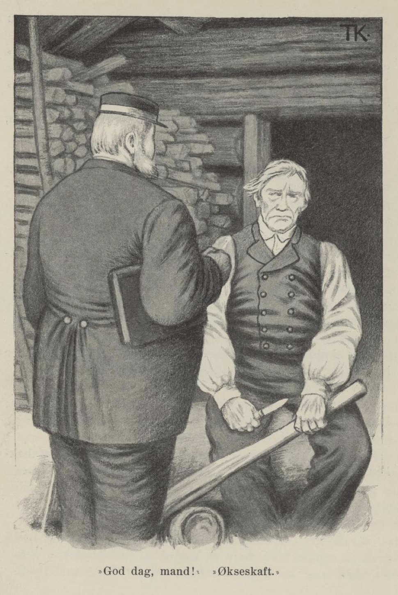

# «God dag, mann!» «Økseskaft!»

Det var en gang en fergemann som var så tunghørt at han hverken kunne høre eller samle det noen sa til ham. Han hadde ei kjerring og to sønner og en datter, og de brydde seg ikke om mannen, men levde lystig og vel så lenge det var noe å leve av, og siden tok de på borg hos gjestgiveren og holdt bedt lag og kastud hver dag.

Da ingen ville borge dem lenger, skulle lensmannen komme og pante for det de hadde borget og ødt bort; så reiste kjerringa og barna til slektningene hennes og lot den tunghørte mannen bli igjen alene og ta imot lensmannen og lensmannsdrengen.

Mannen gikk der og stullet og stelte, og undret seg på hva lensmannen ville spørre etter, og hva han skulle si når han kom.

«Jeg kan ta meg til å emne til noe,» sa han ved seg selv, «så spør han meg om det. Jeg får gi meg til å telje på et økseskaft. Så spør han meg hva det skal bli; så sier jeg: «Økseskaft.» Så spør han meg hvor langt det skal være; så sier jeg: «Opp under denne kvisten.» Så spør han hvor ferja er henne; så sier jeg: «Jeg skulle tjærebre henne; nå ligger hun på stranden og er sprukket i begge ender.» Så spør han: «Hvor er den grå merra di henne?» Så sier jeg: «Hun står i stallen med føll.» Så spør han: «Hvor er buskapen og sommerfjøset ditt henne?» Så sier jeg: «Det er ikke langt unda; når du kommer opp av bakken, så er du der straks.»»

Dette syntes han var godt og vel overlagt.

Da det led om en stund, kom lensmannen; han var sikker nok, men drengen hans hadde gått en annen vei om gjestgiveren, og der satt han nok og drakk enda. «God dag, mann!» sa han.

«Økseskaft,» sa fergemannen.

«Jasså,» sa lensmannen. «Hvor langt er det til gjestgiveren?» spurte han.

«Opp under denne kvisten,» sa mannen og pekte et stykke opp på økseskaft-emnet.

Lensmannen ristet på hodet og glante stort på ham.

«Hvor er kjerringa di, mann?» sa han.

«Jeg skulle til å tjærebre henne,» sa fergemannen, «for hun ligger på stranden og er sprukket i begge ender.»

«Hvor er dattera di?»

«Å, hun står i stallen og er med føll,» sa mannen; han syntes han svarte både godt og vel for seg.

«Å reis du til helvete, din tull du er!» sa lensmannen.

«Ja, det er ikke langt unda; når du kommer opp av bakken, så er du der straks,» sa mannen.
