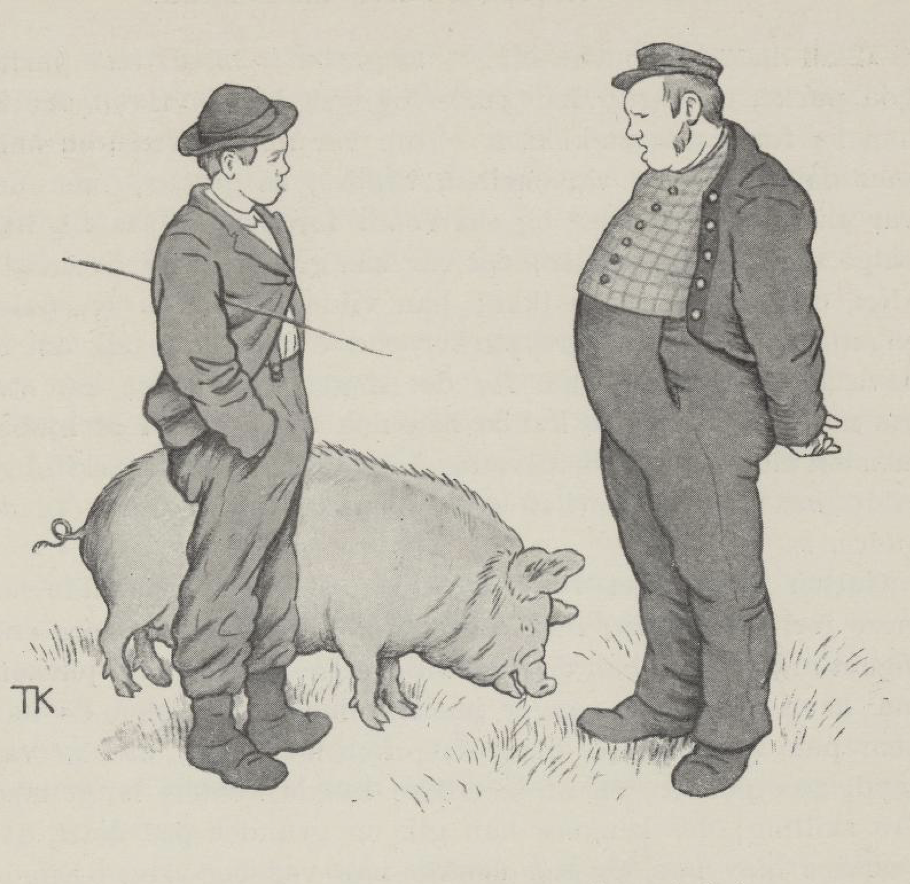
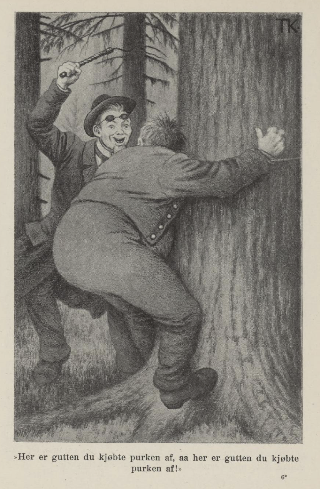
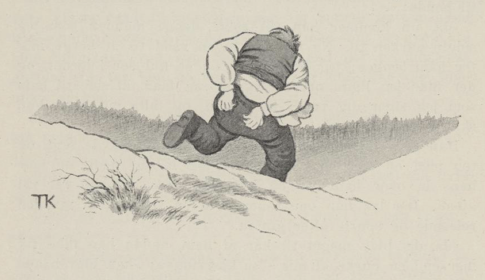

# Gutten som ville bli handelskar

Det var en gang en enke som hadde en sønn, og han hadde ikke lyst til annet enn å bli handelskar. Men de var så fattige at de ikke hadde noe som han kunne ta på å handle med. Det eneste mora eide, det var en purke, og den ba og tigget han så lenge og så vel om, at hun til slutt måtte la ham få den. Da han hadde fått den, skulle han av sted og selge den, så han kunne få noe å begynne å handle med. Han bød den fram både til lik og ulik, men det var ingen som ville kjøpe purke den tida. Til slutt kom han til en rik kakse; men mye vil ha mer, og denne her var av det slaget som aldri kunne få nok.

«Skal du kjøpe purke i dag?» sa gutten; «både stor purke, god purke, og riktig feit purke og,» sa han. «Hva skulle han ha for den?» sa kaksen. «Hun var minst verdt en halv snes daler, om det var mellom brødre,» sa gutten; men det var slike knappe tider og så vondt for penger, så fikk han selge den for fire daler; det var så godt som til givendes.»

«Nei, det ville kaksen ikke; han ville ikke gi en daler engang; han hadde flere purker enn han brydde seg om å ha, det var ikke vondt for det slaget; men siden han var så ivrig etter å selge, kunne han nok gjøre ham den tjenesten å kjøpe; men det meste han ville gi for hele purka, var fire skilling; ville han det, kunne han sette den inn i grisehuset til de andre,» sa han.

Gutten syntes det var ergerlig at han ikke skulle få mer for purka si; men han tenkte at noe var bedre enn ingenting; så tok han de fire skillingene og satte inn purka, så hadde han da penger mellom hendene. Men da han kom ut på veien igjen, begynte det å gnage ham at han var snytt for purka, og at han ikke kunne komme langt med fire skilling; jo lenger han gikk og grunnet på dette, desto sintere ble han, og så tenkte han ved seg selv: «Kunne jeg spille ham et ordentlig puss igjen, fikk det være det samme både med purka og med skillingene.»

Så gikk han bort og fikk seg et par sterke tau og en tjorpeis, og tok på seg en stor kjole og satte på seg et bukkeskjegg, og gikk så tilbake til gauen, og sa at han kom fra utlandet; der hadde han lært å være tømmermester — han visste at mannen skulle bygge, må vite.

Ja, gauen ville gjerne ta ham til mester for bygginga si, sa han, for der på bygda hadde de ikke annet enn enkle, hjemmelærte tømmermenn. Da de var borte og så på tømmeret, var det den gjeveste malmfura noen kunne ønske i en husvegg, og gutten sa også det var gildt tømmer, det kunne ingen si annet; men utenlands hadde de nå fått en ny skikk, som var mye bedre enn den gamle; de hogg ikke lange tømmerstokker og la inn i veggen, men de skar dem opp i småstubber, som de solbakte og festet sammen igjen, og det ble både sterkere og vakrere enn en gammeldags laftebygning. «Det er nå i bruk på alle steder i utlandet,» sa gutten.

«Det fikk så være da,» mente gauen, og så fikk han sammen alle de tømmermenn og tømmerhuggere som fantes i bygda, til å hugge opp tømmeret i småstubber.

«Men så trengs det noen store trær, riktig av de største mastefuruene, til svillstokker; kanskje det ikke finnes så store trær i skogen din,» sa gutten.

«Ja, finnes de ikke i min skog, er det vel vondt om slike trær,» sa mannen, og så strøk de til skogs begge to.

Litt oppi marka kom de til et stort tre. «Tro om det er stort nok?» sa mannen.

«Nei, det er ikke stort nok; har du ikke større trær, kommer vi ingen vei med bygginga, etter den nye måten da,» sa gutten.

«Ja, jeg har dem nok større, skal du se,» sa mannen; «men så må vi lenger bort.» Så gikk de langt innover åsen, og så kom de til et digert tre, et av de største mastetrær i skogen.

«Mener du denne er stor nok?» sa mannen.

«Jeg tror det mest,» sa gutten; «vi skal favne den, så får vi se. Gå du på den andre sida av furua, så står jeg her; er vi da ikke god for å nå sammen med hendene, så er den stor nok; men tøy deg vel, tøy deg vel, sier jeg,» sa gutten og fikk fram tauet sitt. Mannen gjorde som gutten sa.

«Ja, vi rekker nok sammen,» sa gutten; «vent litt, så skal jeg tøye deg bedre,» sa han, og satte rennesnarer om håndleddene på ham og dro til og bandt ham godt fast til furulæggen, og så fram med tjorpeisen og tok til å denge mannen, så lenge han orket. «Her er gutten du kjøpte purka av, og her er gutten du kjøpte purka av!» skrek han, og holdt ikke opp, før han syntes han hadde nok, og han selv hadde fått rett for purka si; så løste han ham og lot ham ligge.

Da gauen ikke kom hjem, gjorde de manngard etter ham fra bygda og lette over hele marka, og endelig fant de ham under mastefurua, men da var han mer død enn levende. Da de hadde fått ham vel til gårds, kom gutten og hadde kledd seg ut som doktor og sa at han kom fra utlandet, og han visste råd for all slags uråd. Da mannen hørte det, ville han ha ham til å doktere seg, og gutten mente det skulle ikke stå lenge på, men han måtte ha ham ut i en stue for seg selv, og der måtte han være alene med ham. «Hører dere at han skriker,» sa gutten, «så skal dere ikke bry dere om det; for jo mer han skriker, desto før blir han frisk.»

«Først skal jeg årelade deg,» sa han; og så la han mannen på magen på langbenken og bandt ham godt fast med tauene; så kom tjorpeisen fram, og tok til å denge ham igjen alt det han orket. Mannen huiet og skrek, for ryggen var sår, og det sved i bare kjøttet, og gutten dengte så det ikke var noen måte på det. «Her er gutten som du kjøpte purka av, og her er gutten som du kjøpte purka av,» sa han. Mannen bar seg som om det satt en kniv i ham; men det var ingen som brydde seg om det, for jo mer han skrek, desto før ble han frisk, mente de. Da gutten hadde gjort fra seg doktereringa, reiste han av gårde det forteste han kunne. Men de reiste etter, og fikk fatt på ham igjen og satte ham fast, og så ble han dømt til å henges. Og gauen var så harm på ham ennå, at han ikke ville at han skulle henges, før han ble så frisk at han kunne gjøre det selv.

Mens gutten satt der og ventet på at han skulle bli hengt, var en av husmennene til mannen ute en natt og stjal fra ham, og det så gutten. Du er en god tyverådd, tenkte han, og det skulle vel være artig, om jeg ikke skulle få spilt deg et puss, før de henger meg, sa han ved seg selv.

Da det led på, og mannen var så bra at han trodde han kunne orke å henge ham, lot han dem sette opp en galge nede ved kvernveien, så han kunne se kroppen henge der hver gang han gikk til kverna. Da de var kommet et stykke på veien, sa gutten:

«Du nekter meg vel ikke å snakke i enerom med den husmannen din som er på kverna og maler? Jeg har en gang gjort ham en skalkestreg, og den vil jeg skrifte og be ham tilgi meg, før jeg dør.»

Ja, det skulle han da få lov til.

«Gud bære deg,» sa han til husmannen, «nå kommer husbonden og vil henge deg opp, fordi du stjal i kålhagen hans.»

Da husmannen hørte det, ble han så ille ved at han ikke visste råd for å berge seg, og spurte gutten hva han skulle gjøre. «Kom og bytt klær med meg og gjem deg bak døra, så vet han ikke annet enn det er meg,» sa gutten, «og tar han noen da, så blir det ikke deg, men meg,» sa han.

Det tok tid, før de fikk byttet og fått tatt på seg igjen, så mannen begynte å bli redd for at gutten kanskje kunne være rømt. Han satte av sted til kvernhusdøra.

«Hvor er han?» sa han til gutten, som sto der så hvit som en møller.

«Han var her akkurat nå, jeg syntes han gjemte seg bak døra,» sa gutten.

«Ja jeg skal lære deg å gjemme deg bort, din skjelm,» sa han, og tok husmannen i fullt sinne og strøk av sted til galga med ham og hengte ham opp med det samme, og han visste ikke annet enn det var gutten han hengte.

Da det vel var gjort, ville han inn i kvernhuset og snakke med husmannen sin, som var der med maling.

Gutten hadde løftet opp overkvernen og holdt på å trevle under med hendene.

«Kom hit, skal du kjenne hvor underlig denne kvernsteinen er,» sa gutten.

Mannen gikk bort og kjente etter med den ene hånda.

«Nei, du kjener det ikke, med mindre du tar under og trevler med begge hendene,» sa gutten.

Ja, han gjorde så, men med det samme nappet gutten vågen unna og slapp overkvernen på ham, så han satt fastklemt mellom steinene; og så fram med tjorpeisen og tok til å denge ham, det meste han orket igjen.

«Å, her er gutten du kjøpte purka av,» skrek han.

Da han hadde dengt ham så mye han ville og kunne, reiste han hjem til mor si, og da det led om en stund, så han kunne tenke mannen var kommet seg igjen, så sa han til henne:

«Ja, nå kommer han vel snart, denne mannen som jeg solgte purka til. Nå vet jeg ingen råd til å berge meg for ham lenger; jeg får grave opp et hull sør i jordet, og der får jeg ligge om dagen, og så får du si til ham som jeg sier deg før,» sa gutten, og fortalte hva hun skulle si og gjøre.

Han grov opp et sånt hull da, som han hadde sagt, og tok med en stor lang slaktekniv, og la seg nedi, og mor hans la over ham bar og kvister og mose, så han var vel gjemt. Der lå han om dagen. Om en stund kom mannen reisende og spurte etter gutten.

«Ja, det ble mye til kar av ham, selv om han ikke fikk mer enn en purke av meg,» sa kjerringa; «han ble både doktor og tømmermester, og så ble han hengt og sto opp igjen fra de døde, og ennå får jeg aldri høre annet enn ulik om ham. Her om dagen kom han hjemflyvende, og da gjorde han meg den største glede jeg har hatt av ham, han la seg til å dø,» sa kjerringa. «Jeg brydde meg ikke så mye om ham, at jeg ville koste prest og kristen jord på ham; men jeg grov ham ned her sør i jordet og raket over ham noe kvister og bar,» sa hun.

«Ser du, om han ikke snøt meg og slapp likevel!» sa mannen. «Men siden jeg ikke fikk hevnet meg på ham i levende live, så skal jeg gjøre ham en vanære på hans grav.»

Han strøk sør i jordet til graven og ville sette seg; men i det samme stakk gutten kniva i ham like til skaftet og skrek:

«Her er gutten du kjøpte purka av! Å her er gutten du kjøpte purka av!»

Mannen av sted med kniva i kroppen, og ble så redd og forskrekket, at han verken har vært hørt eller spurt siden.

