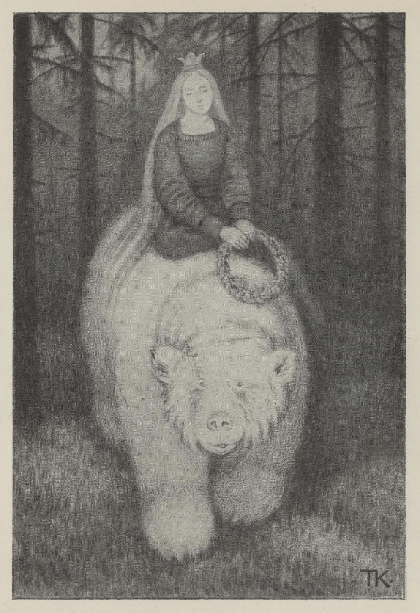
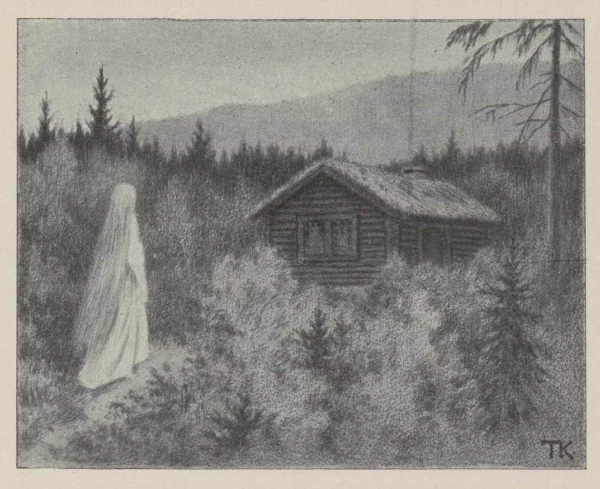
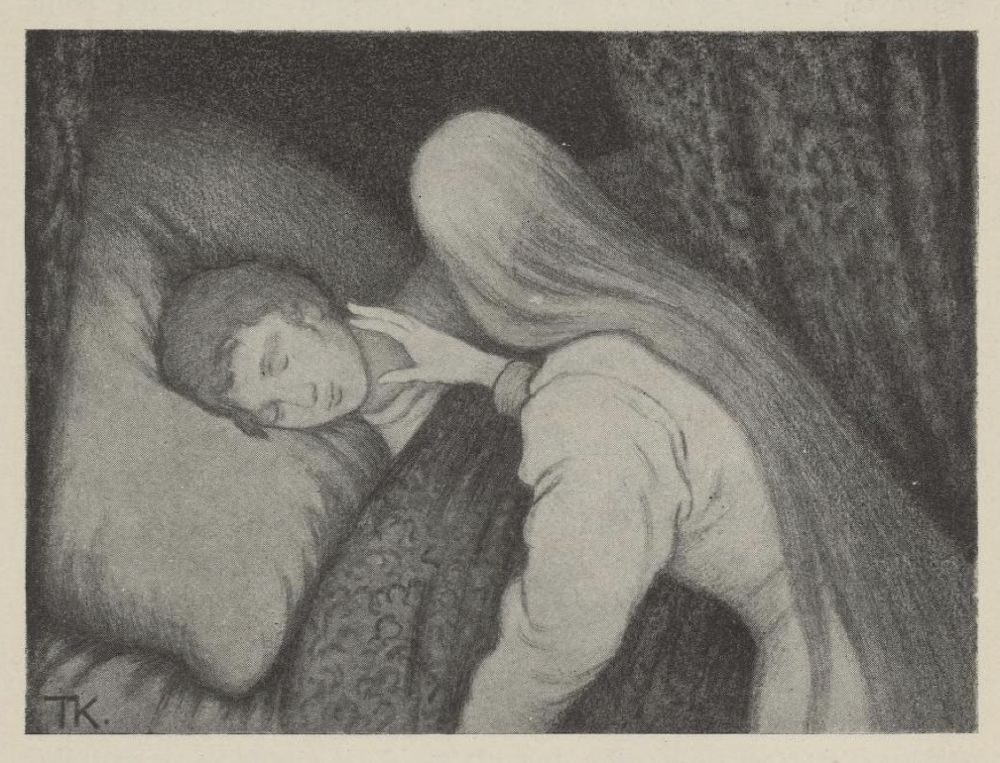
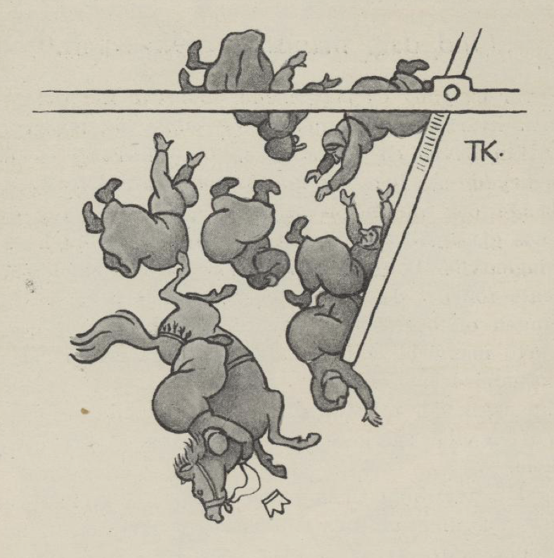

# Hvitebjørn kong Valemon

Det var en gang, som vel kunne være, en konge. Han hadde to døtre som var stygge og slemme, men den tredje var så ven og blid som klare dagen, og kongen og alle var glad i henne. Hun drømte en gang om en gullkrans, som var så deilig, at hun aldri kunne leve om hun ikke fikk den. Men da hun ikke kunne få den, ble hun sturen og kunne ikke snakke for sorg, og da kongen fikk vite at det var kransen hun sørget over, så sendte han ut en som var klippet ut slik som den kongsdatteren hadde drømt om, og sendte bud til gullsmedene i alle land, om de kunne skaffe maken til den. De arbeidet både dag og natt; men noen av kransene slengte hun, og andre ville hun ikke så mye som se på.

En gang som hun var i skogen, fikk hun se en hvitbjørn, som hadde den kransen hun hadde drømt om, mellom labbene og lekte med. Så ville hun kjøpe den.

Nei, den var ikke til fals for penger, men bare når han fikk henne selv. Ja, det var aldri verdt å leve uten den, sa hun; det var det samme hvor hun kom og hvem hun fikk, når hun bare måtte ha kransen, og så ble de forlikt om at han skulle hente henne om tre dager, og det var torsdagen.

Da hun kom hjem med kransen, ble alle glade, fordi hun var glad igjen, og kongen mente, det kunne sagtens ikke være så farlig å stagge en hvitbjørn. Den tredje dagen måtte hele krigsmakten ut rundt slottet, til å ta mot ham. Men da hvitbjørnen kom, var det ingen som kunne stå seg mot ham, for det bet ingenting på ham; han slo dem ned på alle kanter, så de lå i haugevis. Dette syntes kongen gikk rent på skade; så sendte han ut den eldste datteren, og henne tok hvitbjørnen på ryggen og fór av sted med.

Da de hadde reist langt og lenger enn langt, så spurte hvitbjørnen:

«Har du sittet mygere, har du sett klarere?» sa han.

«Ja, på min mors fang satt jeg mygere, i min fars gård så jeg klarere,» sa hun.

«Ja, så er du ikke den rette,» sa hvitbjørnen, og jaget henne hjem igjen.

Neste torsdagen kom han igjen, og da gikk det like ens. Krigsmagen var ute og skulle ta imot hvitbjørnen; men det bet verken jern eller stål på ham, og så slo han dem ned som gress, så kongen måtte be ham holde opp, og så sendte han ut den nesteldste datteren, og henne tok hvitbjørnen på ryggen og fór av sted med. Da de hadde reist langt og lenger enn langt, spurte hvitbjørnen:

«Har du sett klarere, har du sittet mygere?» sa han.

«Ja,» sa hun, «i min fars gård så jeg klarere, på min mors fang satt jeg mygere.»

«Ja, så er du ikke den rette,» sa hvitbjørnen, og jaget henne hjem igjen.

Den tredje torsdagen kom han igjen. Da sloss han enda hårdere enn de forrige gangene; så syntes kongen han ikke kunne la ham slå ned hele krigsmakten, og så ga han ham den tredje datteren i Guds navn. Så tok han henne på ryggen og reiste av sted langt og lenger enn langt, og da de var kommet bort i skogen, så spurte han henne som han hadde spurt de andre, om hun hadde sittet mygere og sett klarere.

«Nei aldri!» sa hun.

«Ja, du er den rette,» sa han.

Så kom de til et slott som var så gildt, at det slottet hennes far hadde, var som den usleste husmannsplass i sammenligning med det. Der skulle hun være og leve godt, og hun skulle ikke ha annet å gjøre enn passe at varmen aldri gikk ut. Bjørnen var borte om dagen, men om natten var han hos henne, og da var han et menneske. Det gikk alt både godt og vel i tre år. Men hvert år fikk hun et barn, og det tok han og fór bort med, straks det var kommet til verden.

Så ble hun mer og mer sturen, og ba om å få lov å komme hjem og se til foreldrene sine. Ja, det var ikke noe i veien for det; men først måtte hun love ham, at hun nok skulle lyde på hva faren sa, men ikke på hva moren ville hun skulle gjøre. Så kom hun hjem, og da de var alene med henne, og hun hadde fortalt hvordan hun hadde det, ville moren gi henne lys med, for at hun kunne få se hvordan han var. Men faren sa: «Nei, det skulle hun ikke gjøre; det er til skade, og ikke til gagn.»

Men hvordan det var eller ikke, så fikk hun lysestubben med seg, da hun reiste. Det første hun gjorde, da han var sovnet, det var at hun tente den og lyste på ham; han var så deilig, at hun syntes hun aldri kunne se nok på ham; men som hun lyste, så dryppet det en het talgdråpe på pannen hans, og så våknet han.

«Hva er det du har gjort?» sa han. «Nå har du gjort oss ulykkelige begge to; det var ikke mer enn en måned igjen, hadde du bare holdt ut den, så hadde jeg vært frelst; for det er en trollkjerring som har forgjort meg, så jeg er hvitbjørn om dagen. Men nå er det forbi med oss, nå må jeg fare dit og ta henne.»

Hun gråt og bar seg ille; men han måtte reise, og han skulle reise. Så spurte hun om hun ikke kunne få være med. Det var ingen råd for det, sa han; men da han fór av sted i bjørnehammen, tok hun tak i ragget likevel, kastet seg opp på ryggen av ham og holdt seg vel fast. Så gikk det av sted over ur og berg, gjennom holt og runner[^1], til klærne ble revet av henne, og hun var så dødelig trett at hun slapp taket og ikke visste mer av seg.

Da hun våknet, var hun i en stor skog, og så la hun av sted igjen; men hun visste ikke hvor det bar hen. Langt om lenge kom hun til en hytte; der var det to kvinnfolk, en gammel kone og en vakker liten jentunge. Kongsdatteren spurte, om de hadde sett noe til Hvitebjørn kong Valemon.

«Ja, han fór her i dag tidlig; men han fór så fort at du visst aldri tar ham igjen,» sa de.

Jentungen fór omkring og klippet og lekte seg med en gullsaks, som var slik at silke- og fløyelsremsene fløy om henne bare hun klippet i luften. Der den var, manglet det aldri klær.

«Men denne konen som skal fare så vidt og så vonde veier, hun må slite hardt,» sa jentungen; «hun kunne trenge mer til denne saksen, hun enn jeg, til å klippe klær til seg,» sa hun, og så ba hun om hun ikke fikk lov til å gi henne saksen. Jo, det skulle hun ha lov til.

Så reiste kongsdatteren av sted igjennom skogen, som det aldri ville bli noen ende på, både dagen og natten, og neste morgen kom hun til en hytte igjen. Der var det også to kvinnfolk, en gammel kone og en jentunge.

«God dag,» sa kongsdatteren. «Har dere sett noe til Hvitebjørn kong Valemon?» spurte hun dem.

«Var det du som skulle hatt ham kanskje?» sa kjerringa. Det var da det. «Jo, han fór her forbi i går; men han fór så fort at du nok aldri tar ham igjen.»

Jentungen gikk på gulvet og lekte seg med en flaske, som var slik at den skjenket alt de ville ha, og der den var, manglet det aldri drikke.

«Men denne stakkars kjerringa som skal fare så vidt og så vonde veier, tenker jeg kan tørste og lide mye annet vondt,» sa jentungen; «hun kan trenge mer til denne flasken, hun enn jeg,» sa hun, og så spurte hun om hun ikke fikk lov til å gi henne flasken. Ja, det skulle hun få.

Så fikk kongsdatteren flasken, takket for seg og reiste av sted igjen bort igjennom den samme skogen, både den dagen og natten med. Den tredje morgenen kom hun til en hytte, hvor det også var en gammel kone og en jentunge.

«God dag,» sa kongsdatteren.

«God dag igjen,» sa kjerringa.

«Har dere sett noe til Hvitebjørn kong Valemon?» sa hun.

«Kanskje det var du som skulle hatt ham?» sa kjerringa. Ja, det var da det. «Jo, han fór forbi her i går kveld; men han fór så fort at du aldri tar ham igjen,» sa hun.

Jentungen gikk på gulvet og lekte seg med en duk, som var slik, at når de sa til den: «Duk, bred deg og red deg med alle gode retter!» så gjorde den det, og der den var, manglet det aldri god mat.

«Men denne stakkars kjerringa som skal fare så vidt og så vonde veier,» sa jentungen, «hun kan både sulte og lide mye annet vondt, så hun kan trenge mer til denne duken, hun enn jeg,» sa hun, og så spurte hun om hun ikke fikk lov til å gi henne duken. Det skulle hun ha lov til.

Så tok kongsdatteren duken og takket for seg, og reiste av sted langt og lenger enn langt, bort igjennom den samme mørkeskogen, hele den dagen og natten, og om morgenen kom hun til et tverberg, som var så bratt som en vegg, og så høyt og så bredt at hun ingen ende kunne se. Det var en hytte der også, og da hun kom inn, var det første hun sa:

«God dag, har dere sett om Hvitebjørn kong Valemon har faret denne veien?»

«God dag igjen,» sa kjerringa; «det var kanskje du som skulle hatt ham?» sa hun. Det var da det. «Ja, han fór forbi oppetter berget for tre dager siden; men det kan ikke noe uflyvende slippe opp,» sa hun.

I denne hytten var det så fullt av småbarn, og alle sammen hang de i stakken på mor sin og skrek etter mat. Kjerringa satte en gryte full av runde småsteiner på varmen. Kongsdatteren spurte hva det skulle bety. De var så fattige, sa kjerringa, at de verken hadde til mat eller klær, og det var så vondt å høre barna skrike etter matbiten; men når hun satte gryta på varmen og sa: «Nå er eplene[^2] snart kokt,» så var det som om det døyvet sulten, og de ga tål en stund, sa hun.

Det varte ikke lenge før kongsdatteren fikk frem duken og flasken, det kan en nok vite, og da barna var mette og glade, klippet hun klærne til dem med gullsaksen.

«Ja,» sa kjerringa i hytten, «siden du har vært så hjertelig snill mot meg og barna mine, så var det skam, om ikke jeg gjorde hva vi kan, for å prøve å hjelpe deg oppover berget. Mannen min er en av de beste smedene. Nå får du slå deg til ro, til han kommer hjem, så skal jeg ha ham til å smide klør til deg til hender og føtter; så får du prøve å krabbe deg opp.»

Da smeden kom, begynte han på klørne straks, og den andre morgenen var de ferdige. Hun hadde ikke tid til å vente, men takket for seg, hugget seg fast og krøp og krabbet med stålklørne hele dagen og natten, og da hun var så trett, så trett, at hun syntes hun ikke kunne løfte en hånd mer, men ville sige ned igjen, da var hun oppe.

Der oppe var det en slette med åkrer og enger så store og vide at hun aldri hadde tenkt seg noe så vidt og så jevnt, og like ved var det et slott fullt av arbeidsfolk av alle slag, som strevet som maur i en tue.

«Hva er det som er på ferde her?» spurte kongsdatteren.

Jo, her bodde hun, den trollkjerringa som hadde forgjort Hvitebjørn kong Valemon, og om tre dager skulle hun ha bryllup med ham. Hun spurte, om hun ikke kunne få snakket med henne. Nei, var det likt seg, det var da rent umulig.

Så satte hun seg utenfor vinduet, og til å klippe med gullsaksen, så fløyels- og silkeklærne føk som i en snøkave. Da trollkjerringa fikk se det, ville hun kjøpe saksen; «for alt det skredderne strever, så monner det ikke,» sa hun; «det er for mange som skal kles opp.»

For penger var den ikke til salgs, sa kongsdatteren; men hun skulle få den, om hun fikk lov å sove med kjæresten hennes i natt. Ja, det kunne hun godt få, sa trollkjerringa; men hun ville selv svæve[^3] ham og selv vekke ham. Da han hadde lagt seg, ga hun ham en sovedrikk, så han ikke var i stand til å våkne, alt det kongsdatteren ropte og gråt.

Den neste dagen gikk kongsdatteren utenfor vinduene igjen, og satte seg til å skjenke av flasken; det fosset som en bekk både med øl og med vin, og den ble aldri tom. Da trollkjerringa fikk se det, ville hun kjøpe den; for «alt det de strever med å brygge og brenne, så monner det ikke; det er for mange som skal ha drikke,» sa hun. For penger var den ikke til fals, sa kongsdatteren; men fikk hun lov å sove med kjæresten hennes i natt, skulle hun få den. Ja, det kunne hun godt få, sa trollkjerringa; men hun ville selv svæve ham og selv vekke ham. Da han hadde lagt seg, ga hun ham en sovedrikk igjen, så det ble ikke bedre den natten enn den forrige; han klarte ikke å våkne, alt det kongsdatteren ropte og gråt.

Men den natten var det en av håndverkerne som arbeidet i rommet ved siden av. Han hørte gråden der inne, og skjønte hvordan det hang sammen, og neste dagen sa han til prinsen at hun måtte være kommet, kongsdatteren som skulle frelst ham.

Den dagen gikk det like ens med duken, som med saksen og flasken; da det var ved middagstid, gikk kongsdatteren utenfor slottet, tok frem duken og sa: «Duk, bred deg og red deg med alle gode retter,» så var det mat, så det var nok til hundre mann; men kongsdatteren satte seg til bords alene. Da trollkjerringa fikk se duken, så ville hun kjøpe den; «for alt det de koker og steker, så monner det ikke; det er for mange munner som skal ha mat,» sa hun. For penger var den ikke til fals, sa kongsdatteren; men fikk hun lov å sove med kjæresten hennes i natt, skulle hun få den. Det kunne hun godt få, sa trollkjerringa; men selv ville hun svæve ham, og selv ville hun vekke ham og.

Da han hadde lagt seg, kom hun med sovedrikken; men den gangen passet han seg og lurte henne. Trollkjerringa trodde ham ikke mer enn som så, hun heller; for hun tok en stoppenål og stakk tvers igjennom armen på ham og ville prøve om han sov tungt nok; men enda så vondt det gjorde, rørte han seg ikke, og så fikk kongsdatteren lov å komme inn til ham.

Da var alt godt og vel, og når de bare ble kvitt trollkjerringa, så var han frelst. Så fikk han tømmermennene til å gjøre en svivelem i den broen brudefølget skulle fare over; for de hadde den skikken der at bruden red fremst i følget. Da hun kom utpå, svingte lemmen rundt med bruden og alle de trollkjerringene som var brudekonene hennes. Men kong Valemon og kongsdatteren og alle bryllupsfolkene fór tilbake til slottet og tok med av gullet og pengene til trollkjerringa alt det de kunne føre, og fór så av sted til hans land, og skulle holde det rette brylluppet. Men på veien var kong Valemon innom og tok med de tre småjentene, og nå fikk hun se hvorfor han hadde tatt fra henne barna og satt dem bort; det var for at de skulle hjelpe henne frem til ham. Så drakk de bryllup både stivt og sterkt.

[^1]: Det som «renner opp»; tett småskog av rot- og stubbeskudd.

[^2]: Potetene

[^3]: Få ham til å sove.
