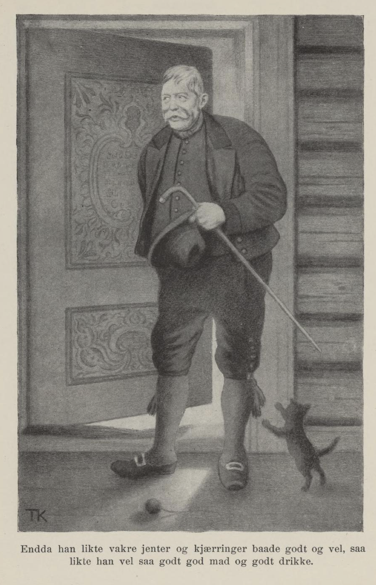
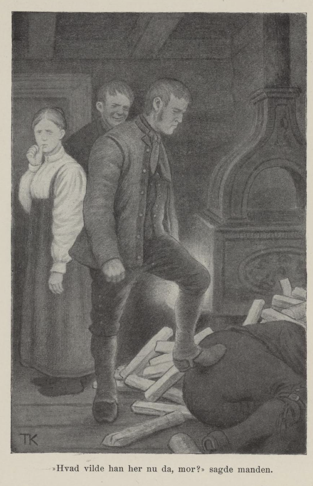
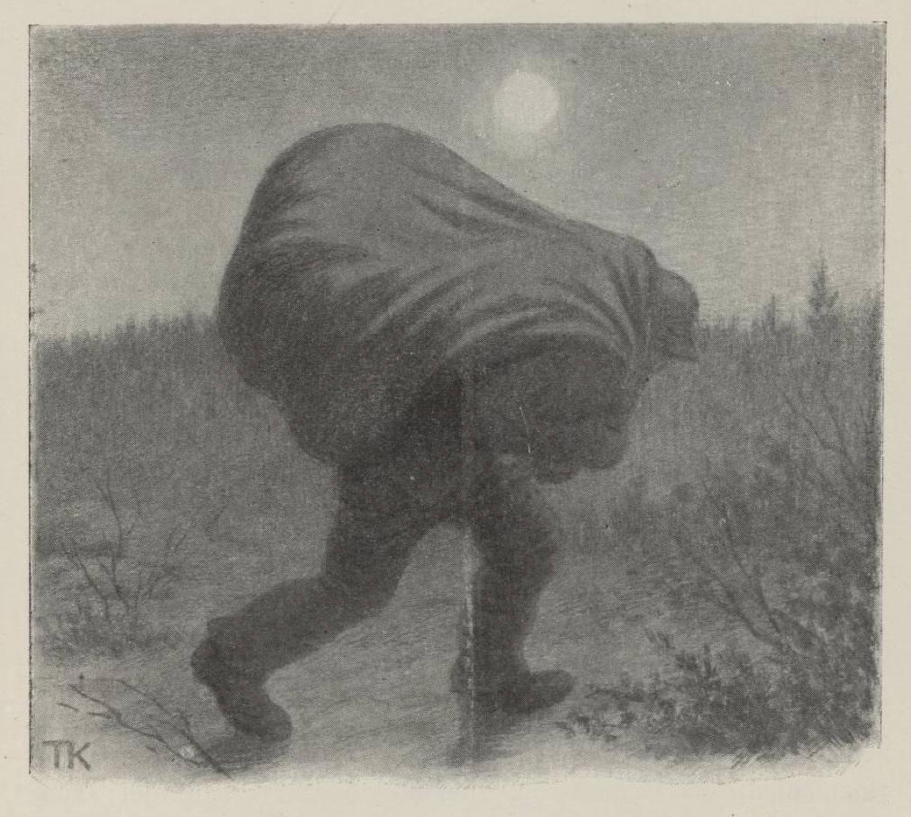
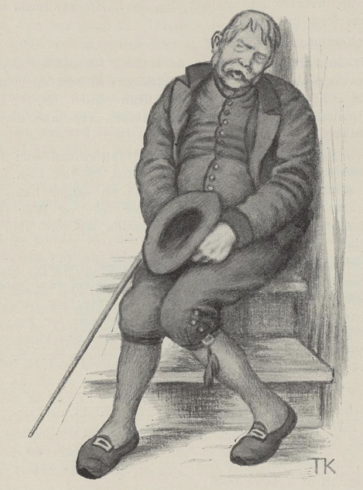

# Klokkeren i bygden vår

Det var en gang en klokker i bygden vår; han var glad i alt som var vakkert og godt. Bygdefolket sa han hadde det meste vettet i vomma; for enda han likte vakre jenter og kjerringer både godt og vel, så likte han vel så godt god mat og god drikke. «Ja, en lever ikke lenge av elsk og søndavind,» sa klokkeren; det var ordtaket hans. Derfor holdt han seg også helst til velstandskjerringene, til dem som nylig var gift, eller til vakre jenter som skulle gifte seg til rikdom og gode gårdmenn; der var det best både for vakkert og lekkert, mente klokkeren. Det var ikke alle som syntes det var gjævt å ha en slik matfrier; men det var de som syntes det var nokså gjævt; for en klokker skulle da liksom være litt mer enn en bonde.

Så var det en ung, rik jente som ble gift med naboen til klokkeren. Der smisket han seg inn, gjorde seg gode venner med mannen, og enda bedre venner ble han med kjerringa. Når mannen var hjemme, så var han blid og grei med ham; men når han var ved kverna eller i skogen, på fløting og på tinget, så sendte kjerringa bud på klokkeren, og så holdt de gjestebud og gilde, de to. Det var ingen som skjønte dette, før tjenestegutten fikk nyss om det. Han syntes han skulle snakke med husbonden om det også; men det ville aldri passe riktig, før en gang de var sammen på utengen etter lauvkjerv. Der pratet de både likt og ulikt om jenter og kjerringer. Mannen syntes han hadde gjort en god fangst da han fikk den rike, vakre kjerringa, og det sa han:

«Gud skje lov og takk, fordi hun var både bra og snill.»

«Å ja, ja, hver mann er hjulpet med sin tro,» sa gutten; «men kjente dere henne godt, så snakket dere ikke slik ut i været. Vene kvinnfolk er som vind i varmt sommervær,» sa gutten, «og elsk er ingen vilje, den faller snart på en klokker og snart på en lilje,» sa han.

«Hva er det du sier?» sa mannen.

«Jeg har lenge tenkt jeg skulle si fra om at det går en svart okse klov om klov og horn om horn med den lyse kvigen i hagen deres, jeg, husbond,» sa gutten.

«En kan si mye på en sommerlang dag,» sa mannen; «men ikke vet jeg hvor dette bærer hen,» sa han.

«Ja, det var da det,» sa gutten, «jeg hadde tenkt å si fra om at klokkeren er støtt og stadig hjemme hos mor, og de lever som om det var bryllup hver dag, og vi, vi får ikke smulene av godmaten engang,» sa han.

«Den som vil smake på alt, han får både surt og salt,» sa mannen. «Jeg tror ikke et ord av det du mener,» sa han.

«Det er et underlig øre som ikke vil høre,» sa gutten; «men det som en selv får se, det slipper en å tvile på, og vil du høre på meg, så skal jeg gjerne vedde ti daler på at du skal få troen i hendene.»

Det ville han, ti daler ville han vedde, og om det så var hest og gård og hundre daler til.

Ja, det veddemålet skulle stå; «men gammel rev er vond å fange,» sa gutten; derfor skulle husbonden gjøre og si som tjenestegutten ville. Når de kom hjem, skulle han si at de skulle reise til elva og lense tømmer, og hun skulle lage i stand niste til dem i en fart; det var best å benytte seg mens det var godt vær; det kunne snart slå om til uvær. Ja, mannen sa det, og nisten var klar på timen. Gutten spente hesten for tømmerdraget og reiste av sted, men ikke lenger enn en halv fjerdingsvei; der tok de inn på en gård og satte hestene på stall; utpå kvelden gikk de tilbake igjen. Da de kom hjem, var døra stengt.

«Nå har vi ham; det er vondt å vende fra åkeren som en er vant til,» sa gutten.

Så gikk de kjellerveien fra hagen opp gjennom lemmen i kjøkkenet, tente lys og gikk inn og lyste på ham. Jo, klokkeren hadde spist så godt at han lå med nesen i været og snorket, og kjerringa var ikke våken, hun heller.

«Ser dere nå, her går syn for segn, husbond?» sa gutten.

«Gud trøste meg så sant; ikke hadde jeg trodd det, om ti hadde sagt det,» sa mannen.

«Tsju, ti stille!» sa gutten, og tok ham med ut.

«Manns lov er ikke landslov; men med tukt kan en temme selve bjørnen. Har dere noe bly, husbond?» sa gutten.

Ja, han hadde visst over sytti blykuler i skatollet sitt. «Det var vel det.» De tok en glopanne, bråsmeltet blyet og helte det i gapet på klokkeren.

«Hver liker sitt, derfor blir all mat spist,» sa gutten, da det freste i halsen på klokkeren av den glødende blytappen.

Så gikk de ut samme veien som de var kommet inn, og ga seg til å banke og dundre på husdøra. Kona våknet, og spurte hvem det var.

«Det er meg; lukk opp, sier jeg!» sa mannen.

Hun dyttet på klokkeren. «Det er far, det er han far!» sa hun. Nei, han brydde seg ikke om det, og rørte ikke på seg heller; så satte hun knærne i siden på ham, spente ham ut på gulvet, hoppet så over, tok klokkeren i hommelsbøtene[^1] og dro ham opp i vedkroken bak ovnen; der gjemte hun ham. Før fikk hun ikke tid til å lukke opp for mannen heller.

«Skulle du etter dåpsvann først?» sa mannen.

«Å, jeg snakket i søvne, og ikke trodde jeg det var du heller,» sa kjerringa.

«Nå får du sette fram litt mat til meg og gutten,» sa mannen; «sultne er vi,» sa han.

«Jeg har ikke noe mat ferdig,» sa kjerringa, «kan du tenke deg slikt; jeg ventet deg verken i dag eller i morgen. Du skulle jo til elva og lense tømmer,» sa hun.

«En kan ikke henge kjeften på veggen; men selvhjulpen er velhjulpen; skal jeg ta inn nisten, husbond?» sa gutten.

Ja, det fikk han. Så satte de seg til å spise av nistetina, og la et par vedskier i ovnen; der lå klokkeren i vedkroken.

«Hva er dette for en?» sa mannen.

«Å, å, det var en fattigmann som kom hit sent på kvelden og ba om husly; han var like fornøyd bare han kunne få ligge i vedkroken,» sa kjerringa.

«Det var en rar fattigmann, det, han har sko med sølvspenner og sølvspenner ved knærne,» sa mannen.

«Det er ikke alle fanter som har fillete klær,» sa gutten.

«Men det er jo klokkeren i bygden vår,» sa han.

«Hva ville han her nå da, mor?» sa mannen, og rugget på ham og sparket til ham. Klokkeren verken rørte seg eller reiste seg. Kjerringa sto og fomlet og stammet, og visste ikke hva hun skulle si; hun bet seg bare i tommelfingeren, hun.

«Jeg ser det på ansiktet ditt hva du har gjort, mor,» sa mannen; «men livet er sårt å miste, og han var da klokkeren i bygden vår. Gjorde jeg det som rett var, skulle jeg sende bud etter lensmannen.»

«Gud velsigne deg, skaff bare klokkeren av veien,» sa kjerringa.

«Det er din sak og ikke min, det,» sa mannen; «jeg har verken bedt ham eller sendt bud på ham,» sa han; «men kan du få noen til å hjelpe deg å bli kvitt ham, skal det ikke være meg imot.»

Så tok hun gutten til side og sa: «Jeg har laget i stand vadmel til mannen min; det skal du få til klær, om du kan få gravd ned klokkeren, så det verken blir hørt eller spurt,» sa hun.

«Ingenting duger uprøvd; den som er ute på glatta, han får la det skure og kjøre,» sa gutten. «Har dere liner og tau, husbond, så skal jeg prøve om det er noe håp om bot,» sa han.

Ja, han vipper klokkeren inn i rennesnarer, kaster ham på ryggen, napper med seg hatten hans, og stikker av sted. Han hadde ikke gått langt utenfor grinda i enga, før han traff noen hester. Så tok han en av dem, snørte og bandt klokkeren godt fast, satte hatten på ham og hånden ned på låret, så han satt og huska og red, som en rytter skal.

«I utide skal troll drepes,» sa gutten, da han kom hjem; «ingen vet hvor den feige flakker; men den som er gravd i jorden, kommer ikke igjen,» sa han; «og den fuglen som er falt, han synger ikke mer.»

Hvordan det nå var eller ikke var, så gikk det en vei fra enga bortover til en utløe, og der hadde de kjørt høy og spilt høy også. Etter den veien gikk hesten og plukket opp høyspillet. Men i utløa lå det to som skulle passe høyet for tyver; det var knapt med fôr det året.

«Der kommer tyven,» sa de, da de hørte hesten kom; «nå skal vi knipe ham.»

«Hvem der?» skrek de, så det ljomet i åsen. Nei, det var ingen som svarte. Hesten brydde seg ikke om det, og klokkeren enda mindre.

«Svarer du ikke, så skyter jeg en kule i fjeset på deg, din hestetyv,» skrek de, og med det samme smalt det. Hesten satte på sprang, så brått at klokkeren gjorde et kast og dumpet ned på marka.

«Jeg tror du skjøt ham stendød,» sa den ene, og sprang bort og skulle se om han kjente ham. «Å, jøye meg, det er klokkeren i bygden vår! Du skulle ha siktet på låret og ikke drept ham.»

«Gjort gjerning står ikke til å endre,» sa den andre. «Den første skaden er best å bøte, — vi får holde ørene stive og grave ham ned i høygulvet så lenge.»

Ja, de gjorde det, og da de hadde gjort det, la de seg til å hvile. Om en stund kommer det en pesende og stampende, så det sang i marka. De dyttet på hverandre, de to som lå i høyet, de trodde det var tyver igjen. Tett ved løeveggen var det en saltstein; der satte han seg med børen sin og snakket med seg selv. Han hadde slaktet svin på en gård for noen dager siden, men syntes han hadde fått for lite for det, for skrinn traktering og for lite slaktemat; så hadde han vært av sted nå og stjålet den største grisen. «Den som skal bytte med bjørnen, får ikke like lodder; derfor er det best å hjelpe seg til retten selv,» sa han; «bedre er en liten lodd enn en lang trette. Men bitre død, glemte jeg ikke igjen vottene mine! Finner de dem, så vet de hvem det er som har arvet grisen,» sa han, og la av sted etter vottene.

De to som var i høyløa, lå og lyttet på dette.

«Den som setter feller for andre, går i fella selv,» sa den ene.

«Det er ikke greit å stjele fra en tyv; men det blir ikke andre hengt enn de som ikke stjeler riktig,» sa den andre; «det skulle være artig å bli kvitt klokkeren på en lettvint måte og få en gjøgris i tillegg; jeg synes vi bytter, jeg, gutt,» sa han. Den andre storlo. Så vrengte de sekken av grisen, satte klokkeren med hatten hodestups nedi, og knyttet sekkebåndet godt til.

Rett som det var, kom tyven flyende med vottene, nappet sekken og strøk hjem. Der kaster han den inn på gulvet til kjerringa.

«Her har jeg en gris, mor!» skrek han.

«Det var gildt,» sa kjerringa. «Ingenting er godt i øynene, men ikke i munnen; maten kan ingen savne, for den er mannens makt. Gud skje lov vi får mat i huset,» sa hun; «nå skal vi leve godt en stund.»

«Jeg tok den største, jeg,» sa mannen, satte seg opp i høysetet og pustet og tørket svetten av skolten; «han hadde både bukser og bleier,» sa han; han mente at grisen var godt gjødd og fet. «Har du noe mat, kjerring?» sa han.

«Nei, jeg har ingen mat,» sa hun; «hvor skulle jeg ha fått den fra?»

«Så gjør opp varme, skjær flesk, salt, og stek en fleskepanne.»

Hun gjorde som han sa, rev opp sekkebåndet og skulle til å skjære flesk.

«Hvordan har dette seg da? Han har jo klovene på,» sa hun, da hun fikk se skoene. «Svart er han også.»

«Vet du ikke det, i mørket er alle katter grå og alle griser svarte,» sa mannen.

«Jo da, men hvitt i svart er alltid bjart, og det er forskjell på skodde og myrbær,» sa kjerringa. «Men denne grisen har bukser,» sa hun.

«Ja, pine jord, har han fleskebukser på låret, det har jeg fått kjenne; jeg har båret på ham, så jeg er både het og svett,» sa mannen.

«Nei, nei,» sa kjerringa; «han har sko med sølvspenner og sølvspenner ved knærne; det er jo klokkeren i bygden vår!» skrek hun.

«Det var gjøgrisen jeg tok,» sa mannen. Så kom han bort og skulle se. Jo, her gikk syn for segn; det var klokkeren, det, både med sko og med spenner. Men det var det største svinet han hadde puttet i sekken, det holdt han fast ved. Det var gjort som gjort var. «Selv er beste dreng, men hjelp er også god, unntatt i grautfatet; vekk henne Mari, kjerring,» sa mannen.

Ja da, de hadde en datter som var både flink og handfast; hun hadde karskrefter og visste råd for all uråd. Hun skulle ta og grave ned klokkeren i en avkrok, så det aldri kom for dagens lys, og for det skulle hun få en ny kjole til hverdags, som mor selv skulle ha hatt. Jenta tok klokkeren om livet, slengte ham på nakken og strøk av gårde, og hatten tok hun med.

Men da hun kom et stykke på veien, hørte hun felespill; det var dansegilde på en gård; der listet hun seg inn og satte klokkeren oppe i den andre trappen. Han satt med hatten mellom hendene, som om han skulle be om noe for sjelebots skyld, og støttet seg til staven og opp mot veggen. Så kom det en jente vimsende.

«Jeg lurer på hva dette er for en,» sa hun; «bonden er grå som en gås, men denne her er svart som en ravn. Hør du, hvorfor har du satt deg der? En kan nesten ikke komme fram for deg.»

Klokkeren sa ikke et ord.

«Er du fattig? Ber du om en skilling for sjelebots skyld? Å, stakkars deg, der har du to skilling,» sa hun, og la dem i hatten. Klokkeren sa ingen ting. Hun ventet litt, for hun tenkte han skulle takke; men klokkeren var ikke den som nikket med hodet engang.

«Nei, jeg har aldri sett maken til fattigmann som han som sitter i trappen her ute,» sa jenta, da hun kom inn; «han sitter ikke som en skjære på en skigard, han,» sa hun; «for han svarer ikke og takker ikke og rører ikke så mye som en finger engang, enda jeg ga ham to skilling.»

«Det minste en kan be om, er at tiggeren takker,» sa en futedreng som var med i laget; «det skulle vel være en snodig kar om jeg ikke skulle få ham til å svare; jeg har fått munnen opp både på tyver og tverrbleier før, jeg,» sa han; gikk ut på trappen og skrek inn i øret på klokkeren, for han trodde han var tunghørt: «Hvorfor sitter du der, du?» Nei da. «Er du fattig, ber du?»

Nei, klokkeren sa ingenting. Så tar han opp en halv daler og kaster i hatten: «Der har du den!» Klokkeren tiet og rørte ikke på seg. Da han ikke fikk noen takk, slo futedrengen til ham under øret, så hardt han orket, så klokkeren gikk kant i kant ned over trappen. Da var jenta ikke sen til å komme fram:

«Har dere besvimt, eller er dere død, far?» skrek hun, og begynte å skråle og bære seg ille. «Fattigmanns fred finnes ikke noe sted,» sa hun; «men jeg har verken hørt eller spurt at de har lagt seg etter å slå i hjel fattigfolk.»

«Tsju, ikke lag noe styr,» sa futedrengen; «der har du ti daler, hold så kjeft, og få ham vekk; jeg kom bare til å gi ham et svimeslag.»

Ja, hun var glad til: «Penger drar penger,» tenkte hun; «for gode ord og penger får en alt hva en trenger, og det er ingen nød om niste når en har penger i kiste.» Så tok hun klokkeren på nakken og strøk til nærmeste nabogård; der la hun ham tvers over brønnkanten. Da jenta kom hjem, sa hun at hun hadde båret ham til skogs og gravd ham godt ned langt borte i en avkrok.

«Gud skje lov vi ble kvitt ham, du skal få det jeg har lovt, og mer til; det er sikkert,» sa kjerringa.

Der lå klokkeren og kikket ned i brønnen, til i grålysningen, da tjenestegutten kom kjørende.

«Hva ligger du der og glor etter? Unna med deg; jeg skal ha vann!» sa gutten.

Nei, han rørte seg ikke. Gutten kjørte til, så det sa plump — og der lå klokkeren i brønnen. Så måtte han ha hjelp; han visste ingen råd, før husmannen kom med en båtshake og dro ham opp.

«Det er klokkeren i bygden vår!» ropte de, og trodde at han hadde levd så godt i gjestebudsgården at han hadde sovnet på brønnkanten. Men da mannen på gården kom og fikk se klokkeren, og hørte hvordan det hadde gått til, så sa han:

«Skaden våker mens mannen sover; men mannskade er den største skaden. Når den ene krukken støter mot den andre, så brister begge. Legg salen på blakken og reis etter lensmannen, gutt,» sa han, «så vi ikke blander oss inn i ulykken for klokkerens skyld; en ulykke kommer sjelden alene; men leit er det å drukne på tørre land,» sa han.

Ja, gutten fór av sted til lensmannen, og da tiden kom, kom lensmannen også. Men for mye hast er heller til last, og brågjort verk vil ikke vare. Det tok tid før de fikk doktor og synsmenn til. Vi er alle Vårherre en død skyldig; men da ble det greid ut at klokkeren var drept tre ganger før han falt i brønnen. Først hadde blytappen tatt pusten fra ham, så hadde han fått en kule i panna, og til syvende og sist var nakken knekt. Han var ikke ufeig, der han fór. Det er ikke godt å vite hvordan det er spurt og kommet ut; men en er ofte på ord der en ikke er på bord, og ordet står oppe når mannen ligger i molda.

[^1]: Hasene
