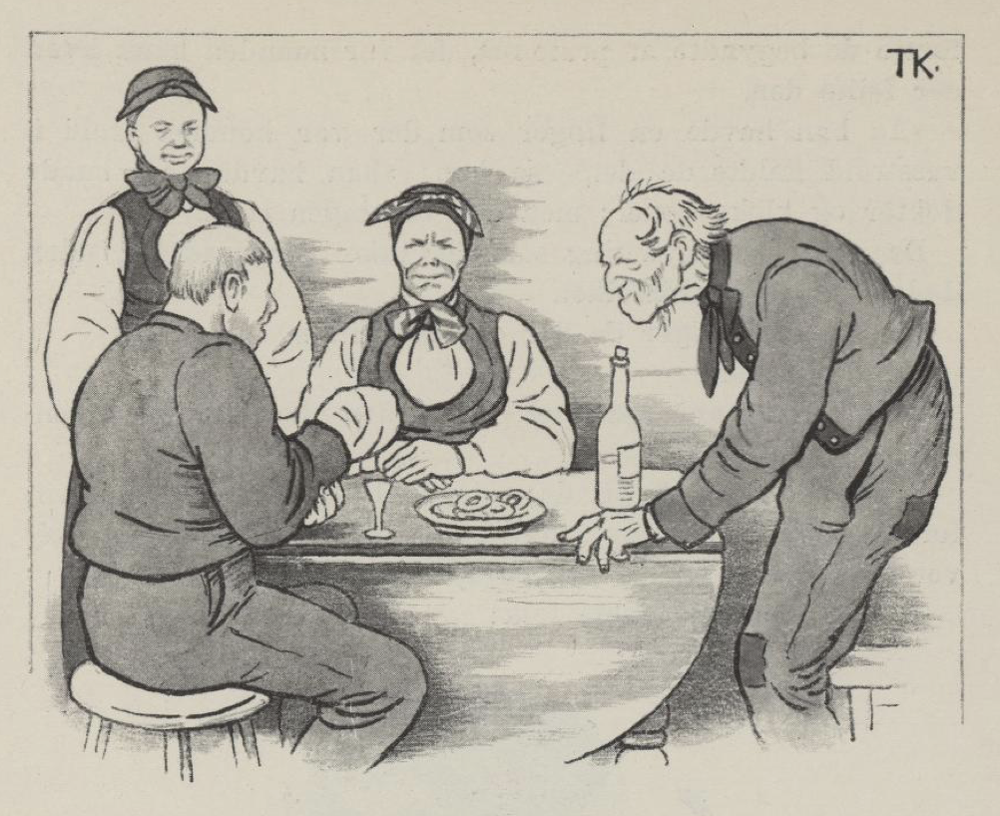
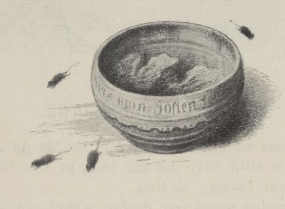

# Syv års gammel grøt

Det var også en gutt en gang som skulle ut å fri. Mor hans ville alltid ha det så rent, at «det skulle være som om det var blåst,» sa hun.

Det ville gutten også, og derfor ville han ha en kjerring som var like så renslig som mor hans. Men hvordan han skulle finne ut om de var renslige eller sluskete, det gikk han lenge og grundet på. Jo, til sist fant han på det. Han surret den ene hånden sin inn i kluter og plagg, som om han hadde veldig vondt i den, og så dro han av sted. Der han kom, tok de imot ham som det er skikk å ta imot en frier til gårds, både med øl og med drikk, både med mat og med prat, og noe av det første de begynte å prate om, det var hånden hans, hva det feilte den.

«Å han hadde en finger som det var kommet troll i, vasstroll kalte de det,» sa han; «han hadde søkt både doktor og kloke koner; men det var ingen råd.»

Det var da ingenting som det ikke var råd for, uten døden, mente gårdsfolket.

«Ja, én råd sier de det er,» sa gutten.

Hva det var?

Det var syv års gammel grøt; men den var vel ingensteds å få, sa han.

«Pøh, ikke annet?» sa de; «det skal det nok bli råd for; for i grytene våre og i de gamle grøttrugene er det skorper som visst er både syv og fjorten år gamle,» sa de.

Jo, det var renslige folk!

