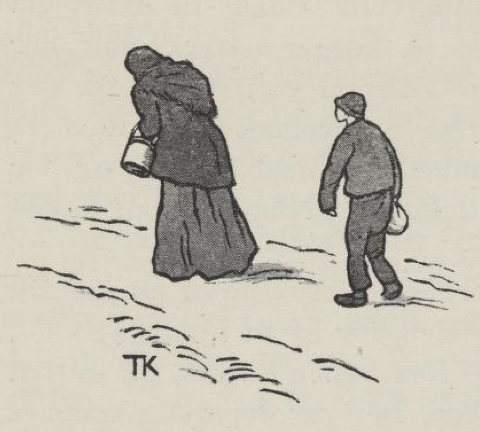
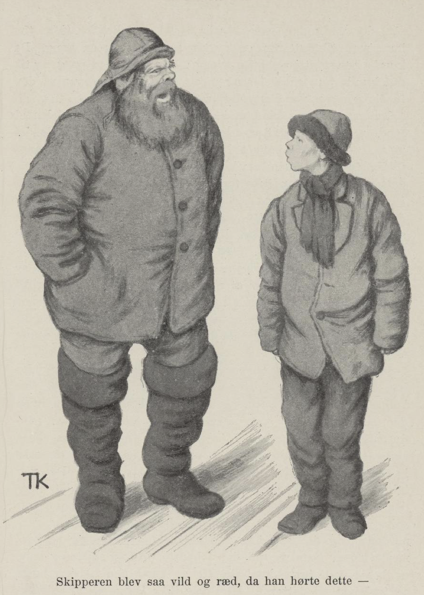
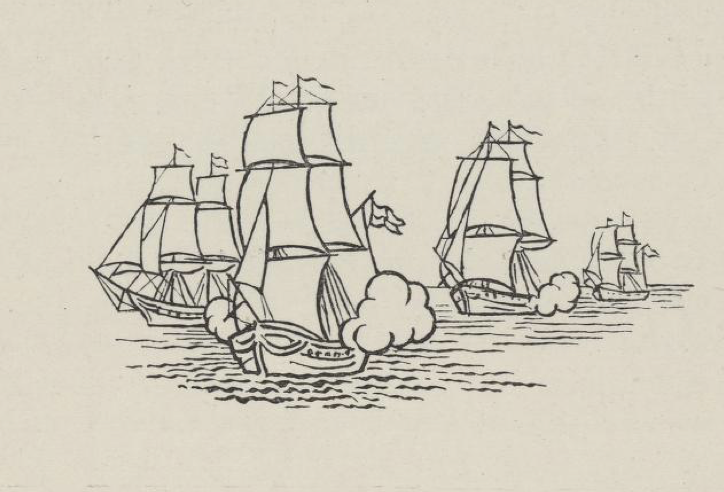

# Tobaksgutten

Det var en gang en fattig kjerring, som gikk omkring med sønnen sin og ba; hjemme hadde hun hverken å bite eller brenne. Først gikk hun bygdimellom, og så kom hun til byen. Da hun hadde gått husimellom der en stund, kom hun til borgermesteren. Det var både en snill mann og en gjæv mann, en av de beste i byen; for han var gift med datteren til den rikeste kjøpmannen der, og med henne hadde han en liten datter; de hadde ikke flere barn, så hun var både søtungen og sukkerungen, og det var ingenting som var for godt til henne. Hun ble straks velkjent med denne fattiggutten også, da han kom der med mor sin, og da borgermesteren så at de var godvenner så snart, tok han gutten til seg, for at hun skulle ha ham til lekebror. Ja de lekte sammen og stelte sammen, leste sammen og gikk på skolen sammen, og var alltid gode venner.

En dag sto borgermesterkona ved vinduet og så etter barna, da de skulle på skolen. Da fikk hun se det var en regndam i gata; først bar gutten tina med skolematen over dammen; så kom han igjen og løftet veslejenta over, og da han satte henne ned, tok han seg et kyss.

Da hun så det, ble hun sint: «Skal en slik skarveunge kysse datteren vår, vi som er de beste folk i byen?» sa hun. Mannen prøvde å stagge henne det beste han kunne, og sa at det visste ingen hvor barna skulle bo, og ingen hva som kan hende med ens egne; det var en snill og en skikkelig gutt, og det kom ofte et stort tre av en liten teining, sa han. Men nei, det var det samme både hva han var og hva han ble; «når armod kommer til ære, vet den ikke hvordan den vil være,» og «den som er slått til skilling, blir aldri til daler, om han skinner som en gullpenge,» sa borgermesterkona; der fikk han ikke lov å være; hun ville av med ham. Da det ikke var annen råd, så sendte borgermesteren ham bort med en kjøpmann som var kommet dit med et skip, og der skulle han være kahyttgutt. Til kona sa han at han hadde solgt gutten for tobakk.

Men før han reiste, brøt borgermesterdatteren ringen sin i to stykker og ga ham halvdelen, for at de kunne kjenne hverandre igjen, om de skulle møtes igjen. — Så reiste skipet, og gutten kom til en by langt borti landene. Der var det nylig kommet en prest, som var så svær til å preke at alle måtte i kirka og høre ham, og om søndagen måtte skipsfolka også dit og høre på preken. Gutten ble alene igjen på skipet. Mens han holdt på å lage maten, hørte han at det ropte over et sund tett ved. Gutten tok båten og satte over. Det var en gammel kjerring som ropte så. «Ja nå har jeg stått her i hundre år og ropt og kalt, og tenkt jeg skulle komme over sundet,» sa kjerringa; «men ingen har hørt det og rørt det før du, og du skal få lønn for det du har satt meg over,» sa hun. Gutten måtte følge med til søster hennes, som bodde i et berg tett ved, og der skulle han be om den gamle duka som lå på skaphylla. Ja, da han kom dit, og trollkjerringa fikk vite at han hadde hjulpet søster hennes over sundet, så måtte han få hva han ville, sa hun.

«Å, jeg vil ikke ha annet enn den gamle duka som ligger på skaphylla, jeg,» sa gutten. «Det har du ikke av deg selv,» sa trollkjerringa.

«Nå må jeg ombord og koke helgemat til kirkefolka,» sa gutten. «Rør det ikke,» sa kjerringa; «den skal koke seg selv den, mens du er borte,» sa hun. «Bli med meg, skal du få mer lønn du; jeg har stått ved sundet og ropt og kalt i hundre år; men ingen har hørt det eller rørt det før du.» Så skulle han følge med til den andre søsteren. Der skulle han be om å få det gamle sverdet, som var slik at han kunne putte det i lomma, så ble det til en kniv, og dro han det ut, så ble det til et langt sverd; hugget han med den svarte eggen, så falt alt dødt, og med den hvite, så ble alt levende igjen. Ja da de kom dit, og trollkjerringa fikk vite at han hadde hjulpet søster hennes over sundet, så skulle han ha fergelønn, han måtte få hva han ville. «Å, jeg vil ikke ha annet enn det gamle sverdet som ligger oppå skapet, jeg,» sa gutten. «Det har du ikke av deg selv,» sa trollkjerringa.

«Kom med meg,» sa den andre; «jeg har stått ved det sundet og ropt og kalt i hundre år, og ingen har hørt det eller rørt det før du; du skal ha mer lønn du; bli med til den tredje søstera mi!» Der skulle han be om den gamle salmeboka, og den var slik, at når noen var syk og han sang en salme som passet til sykdommen, så ble den syke frisk igjen. Ja, da de kom fram, og den tredje trollkjerringa hørte han hadde hjulpet søster hennes over sundet, skulle han ha fergelønn der også; han måtte få hva han ville ha. «Å, jeg vil ikke ha annet enn den gamle salmeboka til bestemor, jeg,» sa gutten. «Det har du ikke av deg selv,» sa trollkjerringa.

Da han kom ned på skipet igjen, var folka i kirka ennå. Så prøvde han duka og bredte ut bare en liten snipp av den, for han ville se hva den dugde til først, før han la den på bordet og brukte den. Jo det ble både gild mat og mye mat, og drikke til, det var sikkert nok. Han tok bare en smakebit, han, og så ga han hunden så mye den orket å ete.

Da kirkefolka kom ombord, sa skipperen: «Hvor har du fått all den maten til hunden? Den er jo stinn som en rullepølse og lat som en purke.» «Å, jeg ga den bena jeg,» sa gutten. «Det var bra gutt, som kom i hug hunden også,» sa skipperen. Så bredte han duka ut, og med det samme var det så fullt med mat og drikkevarer at de aldri hadde levd så vel før.

Da gutten var alene med hunden igjen, ville han prøve sverdet også. Han hugget til den med den svarte eggen, så falt den død i dekket; men da han vendte det og hugget med den hvite, livnet den opp og viftet med rova mot lekekameraten sin. Men boka, den kunne han ikke få prøvd.

Så seilte de både vel og lenge, til det kom en storm på dem, som varte mange dager; de lå og drev, så de ikke visste hvor de var. Til slutt så stilnet det, og da kom de til et land langt borte, hvor ingen var kjent; men de kunne skjønne det var stor sorg der, og det var det også, for kongsdatteren var spedalsk. Kongen kom ned til skipet og spurte om ingen kunne frelse henne og gjøre henne god igjen. Nei, det var ingen, sa de som var oppå dekket. «Er det ingen flere om bord i dette skipet?» sa kongen. «Jo, en liten fillegut,» sa de. «La ham komme, han og,» sa kongen. Gutten mente at han nok skulle gjøre henne god. Skipperen ble så vill og redd, da han hørte dette, at han rendte i ring som en tordivel i en tjærekopp; han tenkte gutten kunne legge seg borti noe som han ikke kom vel fra, og mente det ikke var verdt å røre slikt barnesnak. Men kongen sa at vettet kom med veksten, og barn var mannsemne; hadde han sagt seg god for det, fikk han prøve seg; det var mange som hadde frista og feila før. Han tok ham med til datteren, og gutten sang salmen én gang. Da kunne kongsdatteren løfte armen; han sang den en gang til, så kunne hun sitte i senga, og da han hadde sunget den tredje gangen, var kongsdatteren frisk.

Kongen var så glad at han ville gi ham halvdelen av land og rike, og datteren med. Ja land og rike kunne det være godt nok å ha halvdelen av, det takket han mangfoldig for; men han hadde lovet en annen, sa han, kongsdatteren kunne han ikke ta. Så ble han der i landet og fikk halvdelen av riket. Men da det led om en stund, ble det krig; gutten måtte være med, og han sparte ikke den svarte eggen, kan du vite. Krigsfolka til fienden falt som fluer, og kongen vant. Men så brukte han den hvite eggen; da livnet de opp igjen alle sammen, og ga seg under kongen, fordi de fikk lov å nyte livet. Men da det var blitt så mange, var det vondt for mat, og kongen ville gjerne gi dem fullt opp både av mat og drikke. Så måtte gutten fram med duka si; da ble det ikke mangel på noe slag.

Da han hadde vært en tid hos kongen igjen, begynte han å stunde etter borgermesterdatteren. Han rustet fire krigsskip og reiste med, og da han kom utenfor den byen der borgermesteren var, skjøt han og dundret, så vindusrutene sprakk i halve byen. Ombord på disse skipa var det så staselig som hos en konge, og selv hadde han gull etter hver søm, så gild var han. Det var ikke lenge før borgermesteren kom ned, og ba om ikke den fremmede storkaren ville være så snill å komme og spise hos ham. Jo, det ville han; han kom opp til borgermesteren, og der satt han ved siden av datteren og borgermesterfrua. Som de satt der i beste prat og spiste og drakk og levde vel, lurte han seg til å kaste den halve ringen opp i glasset til datteren. Hun var ikke lenge om å skjønne meningen, gjorde seg et ærend ut fra bordet og satte den sammen med den andre halva. Mora merket det var noe på ferde, og strøk etter så snart hun kunne.

«Vet du hvem som er inne, mor?» sa datteren. «Nei,» sa borgermesterfrua. «Det er han som far solgte for tobakk,» sa hun. Med det samme dånet frua og falt overende på gulvet. Så kom borgermesteren etter, og da han hørte hvordan det hang sammen, ble det ikke stort likere med ham. «Det er ikke noe å få støkk av,» sa tobaksgutten; «jeg er bare kommet for å få den veslejenta jeg kyste på skoleveien,» sa han. Og til borgermesterkona sa han det: «Du skal aldri forakte fattigmanns barn; det er ingen som vet hva det kan bli av det; for barn er mannsemne, og vettet kommer med veksten.»

